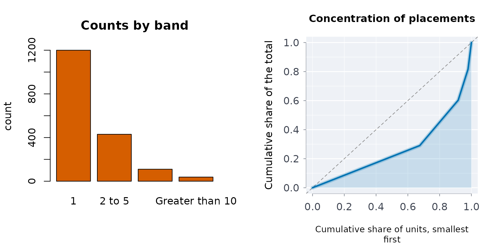

# Banded tables and concentration: from '6 to 10' to a Gini

Published frequency tables band their values: “1”, “2 to 5”, “6 to 10”,
“Greater than 10”. To compute anything about the underlying
distribution, the bands have to be parsed, given representative values,
and expanded into per-unit values, and the result has to be checked
against the one assumption that cannot be verified: what the open top
band contains.

## Parsing band labels

``` r

prsbands(c("1", "2 to 5", "6 to 10", "Greater than 10"))
#>             label lower upper openlo openup
#> 1               1     1     1  FALSE  FALSE
#> 2          2 to 5     2     5  FALSE  FALSE
#> 3         6 to 10     6    10  FALSE  FALSE
#> 4 Greater than 10    11    NA  FALSE   TRUE
prsbands(c("18 to 24", "25 to 49", "50+"))
#>      label lower upper openlo openup
#> 1 18 to 24    18    24  FALSE  FALSE
#> 2 25 to 49    25    49  FALSE  FALSE
#> 3      50+    50    NA  FALSE   TRUE
```

An unrecognised label is reported as unparsed, never guessed at:

``` r

prsbands(c("3", "unknown", "not stated"))
#>        label lower upper openlo openup
#> 1          3     3     3  FALSE  FALSE
#> 2    unknown    NA    NA  FALSE  FALSE
#> 3 not stated    NA    NA  FALSE  FALSE
```

## Representative values

Each band needs one value to stand for its members: the midpoint by
default, or the lower or upper edge, or the geometric mean for skewed
quantities. The open top band has no upper edge, so a cap or a factor on
its lower edge is supplied explicitly:

``` r

b <- prsbands(c("1", "2 to 5", "6 to 10", "Greater than 10"))
bandvals(b, rule = "midpoint", openupcap = 20)
#>             label lower upper openlo openup value assumed
#> 1               1     1     1  FALSE  FALSE   1.0   FALSE
#> 2          2 to 5     2     5  FALSE  FALSE   3.5   FALSE
#> 3         6 to 10     6    10  FALSE  FALSE   8.0   FALSE
#> 4 Greater than 10    11    NA  FALSE   TRUE  15.5    TRUE
bandvals(b, rule = "geometric", openupcap = 20)
#>             label lower upper openlo openup     value assumed
#> 1               1     1     1  FALSE  FALSE  1.000000   FALSE
#> 2          2 to 5     2     5  FALSE  FALSE  3.162278   FALSE
#> 3         6 to 10     6    10  FALSE  FALSE  7.745967   FALSE
#> 4 Greater than 10    11    NA  FALSE   TRUE 14.832397    TRUE
```

## Expanding to per-unit values

With counts per band,
[`expbands()`](https://rootcoder007.github.io/rmorie-bricklayer/reference/expbands.md)
returns one value per unit, ready for any statistic:

``` r

x <- expbands(c("1", "2 to 5", "Greater than 5"), cnts = c(10, 4, 2),
                  openupcap = 12)
table(x)
#> x
#>   1 3.5   9 
#>  10   4   2
ginicoef(x)
#> ╭── Gini coefficient ─────────────────────────────────────────────────────────╮
#> │   Gini coefficient  0.4524                                                  │
#> │   Units             16                                                      │
#> │   Total             42                                                      │
#> │   Largest unit      9 (21.4% of the total)                                  │
#> │   Most for n units  0.9375                                                  │
#> │                                                                             │
#> │   A Gini of 0.4524: the total is highly concentrated.                       │
#> │   That is 48% of the way from equal shares (0) to one unit holding all of   │
#> │   it (0.9375 for 16 units).                                                 │
#> │                                                                             │
#> │   0 when every unit holds the same, 1 - 1/n when one unit holds it all;     │
#> │   doubling every value leaves it unchanged. It says how unequal, not        │
#> │   which units: topshr() and lorenzc() show where the total sits.            │
#> ╰─────────────────────────────────────────────────────────────────────────────╯
```

## Concentration

The **Gini coefficient** measures how unequally a total is spread across
units: 0 when every unit holds the same, approaching 1 when one unit
holds everything.
[`topshr()`](https://rootcoder007.github.io/rmorie-bricklayer/reference/concentration.md)
reports what the most frequent few account for, and
[`lorenzc()`](https://rootcoder007.github.io/rmorie-bricklayer/reference/concentration.md)
gives the curve behind the Gini.

``` r

ginicoef(rep(1, 10))             # no concentration
#> ╭── Gini coefficient ─────────────────────────────────────────────────────────╮
#> │   Gini coefficient  0                                                       │
#> │   Units             10                                                      │
#> │   Total             10                                                      │
#> │   Largest unit      1 (10.0% of the total)                                  │
#> │   Most for n units  0.9                                                     │
#> │                                                                             │
#> │   A Gini of 0: the total is close to equal shares.                          │
#> │   That is 0% of the way from equal shares (0) to one unit holding all of    │
#> │   it (0.9 for 10 units).                                                    │
#> │                                                                             │
#> │   0 when every unit holds the same, 1 - 1/n when one unit holds it all;     │
#> │   doubling every value leaves it unchanged. It says how unequal, not        │
#> │   which units: topshr() and lorenzc() show where the total sits.            │
#> ╰─────────────────────────────────────────────────────────────────────────────╯
ginicoef(c(rep(0, 9), 1))        # one unit holds everything
#> ╭── Gini coefficient ─────────────────────────────────────────────────────────╮
#> │   Gini coefficient  0.9                                                     │
#> │   Units             10                                                      │
#> │   Total             1                                                       │
#> │   Largest unit      1 (100.0% of the total)                                 │
#> │   Most for n units  0.9                                                     │
#> │                                                                             │
#> │   A Gini of 0.9: the total is very highly concentrated.                     │
#> │   That is 100% of the way from equal shares (0) to one unit holding all of  │
#> │   it (0.9 for 10 units).                                                    │
#> │                                                                             │
#> │   0 when every unit holds the same, 1 - 1/n when one unit holds it all;     │
#> │   doubling every value leaves it unchanged. It says how unequal, not        │
#> │   which units: topshr() and lorenzc() show where the total sits.            │
#> ╰─────────────────────────────────────────────────────────────────────────────╯
1 - 1 / 10                   # the maximum for ten units
#> [1] 0.9

placements <- c(rep(1, 1200), rep(3, 430), rep(8, 110), rep(20, 38))
ginicoef(placements)
#> ╭── Gini coefficient ─────────────────────────────────────────────────────────╮
#> │   Gini coefficient  0.4612                                                  │
#> │   Units             1,778                                                   │
#> │   Total             4,130                                                   │
#> │   Largest unit      20 (0.5% of the total)                                  │
#> │   Most for n units  0.9994                                                  │
#> │                                                                             │
#> │   A Gini of 0.4612: the total is highly concentrated.                       │
#> │   That is 46% of the way from equal shares (0) to one unit holding all of   │
#> │   it (0.9994 for 1,778 units).                                              │
#> │                                                                             │
#> │   0 when every unit holds the same, 1 - 1/n when one unit holds it all;     │
#> │   doubling every value leaves it unchanged. It says how unequal, not        │
#> │   which units: topshr() and lorenzc() show where the total sits.            │
#> ╰─────────────────────────────────────────────────────────────────────────────╯
topshr(placements, c(0.01, 0.05, 0.1))
#> ╭── Top shares of a total ────────────────────────────────────────────────╮
#> │   Fractions  3                                                          │
#> │                                                                         │
#> │   top  units  share                                                     │
#> │   ---  -----  ------                                                    │
#> │   1%      18  8.717%                                                    │
#> │   5%      89  28.28%                                                    │
#> │   10%    178  41.89%                                                    │
#> │                                                                         │
#> │   The top 1% of units (18 of them) hold 8.717% of the total; with equal │
#> │   shares they would hold 1%.                                            │
#> ╰─────────────────────────────────────────────────────────────────────────╯
head(lorenzc(placements))
#>     population        value
#> 1 0.0000000000 0.0000000000
#> 2 0.0005624297 0.0002421308
#> 3 0.0011248594 0.0004842615
#> 4 0.0016872891 0.0007263923
#> 5 0.0022497188 0.0009685230
#> 6 0.0028121485 0.0012106538
```

Here the top 1% of people account for a disproportionate share of
placements: the substantive finding a banded table hides.

## The assumption you cannot check: sensitivity to the open band

Everything above depends on what the “Greater than 10” band is taken to
contain. If the statistic barely moves as that assumption varies, it has
been measured; if it swings, it has not, and the honest report says so.
[`bandsens()`](https://rootcoder007.github.io/rmorie-bricklayer/reference/bandsens.md)
recomputes a statistic over a range of caps:

``` r

counts <- c(1200, 430, 110, 38)
bandsens(b, counts)
#> ╭── Sensitivity to the open top band's assumed cap ───────────────────────╮
#> │   Open band starts at         11                                        │
#> │   Caps tried                  12                                        │
#> │   Span over the caps          0.2747                                    │
#> │   Share of the typical value  53.7%                                     │
#> │                                                                         │
#> │      cap   value                                                        │
#> │   ------  ------                                                        │
#> │    11.55  0.4255                                                        │
#> │    15.10  0.4346                                                        │
#> │    19.74  0.4461                                                        │
#> │    25.80  0.4604                                                        │
#> │    33.73  0.4780                                                        │
#> │    44.09  0.4993                                                        │
#> │    57.63  0.5245                                                        │
#> │    75.34  0.5538                                                        │
#> │    98.49  0.5868                                                        │
#> │   128.74  0.6229                                                        │
#> │   168.30  0.6611                                                        │
#> │   220.00  0.7002                                                        │
#> │                                                                         │
#> │   span over the caps tried: 0.2747 (53.7% of the typical value). The    │
#> │   statistic moves by more than a tenth of itself across the caps tried, │
#> │   so it is a property of the assumption as much as of the data. Report  │
#> │   the range, not a single figure.                                       │
#> ╰─────────────────────────────────────────────────────────────────────────╯
bandsens(b, counts, stat = mean)
#> ╭── Sensitivity to the open top band's assumed cap ───────────────────────╮
#> │   Open band starts at         11                                        │
#> │   Caps tried                  12                                        │
#> │   Span over the caps          2.228                                     │
#> │   Share of the typical value  83.2%                                     │
#> │                                                                         │
#> │      cap  value                                                         │
#> │   ------  -----                                                         │
#> │    11.55  2.257                                                         │
#> │    15.10  2.295                                                         │
#> │    19.74  2.345                                                         │
#> │    25.80  2.410                                                         │
#> │    33.73  2.494                                                         │
#> │    44.09  2.605                                                         │
#> │    57.63  2.750                                                         │
#> │    75.34  2.939                                                         │
#> │    98.49  3.186                                                         │
#> │   128.74  3.510                                                         │
#> │   168.30  3.932                                                         │
#> │   220.00  4.485                                                         │
#> │                                                                         │
#> │   span over the caps tried: 2.228 (83.2% of the typical value). The     │
#> │   statistic moves by more than a tenth of itself across the caps tried, │
#> │   so it is a property of the assumption as much as of the data. Report  │
#> │   the range, not a single figure.                                       │
#> ╰─────────────────────────────────────────────────────────────────────────╯
```

## Heavy tails

When the open band holds a long tail, the question is how heavy. The
Hill estimator gives the tail index of a power law; for counts, the
exact discrete likelihood matters, because the continuous closed form is
badly biased at a threshold of one:

``` r

k <- 1:10000
p <- k^(-2.5) / sum(k^(-2.5))
set.seed(2)
z <- sample(k, 5000, replace = TRUE, prob = p)
c(exact = round(hilltlidx(z, xmin = 1)$alpha, 2),
  approx = round(hilltlidx(z, xmin = 1, approx = TRUE)$alpha, 2))
#>  exact approx 
#>   2.46   2.00
```

A short tail still returns an estimate, marked as not to be leaned on:

``` r

short <- hilltlidx(c(3, 4, 5, 9), xmin = 3)
c(alpha = round(short$alpha, 2), n = short$ntl, reliable = short$reliable)
#>    alpha        n reliable 
#>     2.59     4.00     0.00
```

## Workflow

1.  [`prsbands()`](https://rootcoder007.github.io/rmorie-bricklayer/reference/prsbands.md);
    stop if anything is unparsed.
2.  [`bandvals()`](https://rootcoder007.github.io/rmorie-bricklayer/reference/bandvals.md)
    or
    [`expbands()`](https://rootcoder007.github.io/rmorie-bricklayer/reference/expbands.md)
    with an explicit cap for the open band.
3.  The statistic:
    [`ginicoef()`](https://rootcoder007.github.io/rmorie-bricklayer/reference/concentration.md),
    [`topshr()`](https://rootcoder007.github.io/rmorie-bricklayer/reference/concentration.md),
    [`lorenzc()`](https://rootcoder007.github.io/rmorie-bricklayer/reference/concentration.md),
    [`hilltlidx()`](https://rootcoder007.github.io/rmorie-bricklayer/reference/hilltlidx.md).
4.  [`bandsens()`](https://rootcoder007.github.io/rmorie-bricklayer/reference/bandsens.md)
    over the cap, and report the range, not the point.

## How unevenly a population is spread

Concentration measures apply to any non-negative counts. With the 2021
Census counts of First Nations people by province and territory (bundled
with the package), the Gini coefficient and top shares say how
concentrated the population is in a few jurisdictions:

``` r

cp <- indiex("censuspop")
tot <- cp[cp$GEO_LEVEL != "Country" & cp$AGE_GROUP == "Total - Age groups" &
            cp$RESIDENCE == "Total - Residence on or off reserve" &
            grepl("^Total - Average age", cp$CHARACTERISTIC_NAME), ]
ginicoef(tot$FIRST_NATIONS)
#> ╭── Gini coefficient ─────────────────────────────────────────────────────────╮
#> │   Gini coefficient  0.5292                                                  │
#> │   Units             13                                                      │
#> │   Total             1,048,410                                               │
#> │   Largest unit      251,030 (23.9% of the total)                            │
#> │   Most for n units  0.9231                                                  │
#> │                                                                             │
#> │   A Gini of 0.5292: the total is highly concentrated.                       │
#> │   That is 57% of the way from equal shares (0) to one unit holding all of   │
#> │   it (0.9231 for 13 units).                                                 │
#> │                                                                             │
#> │   0 when every unit holds the same, 1 - 1/n when one unit holds it all;     │
#> │   doubling every value leaves it unchanged. It says how unequal, not        │
#> │   which units: topshr() and lorenzc() show where the total sits.            │
#> ╰─────────────────────────────────────────────────────────────────────────────╯
topshr(tot$FIRST_NATIONS, fracs = c(0.25, 0.5))
#> ╭── Top shares of a total ────────────────────────────────────────────────╮
#> │   Fractions  2                                                          │
#> │                                                                         │
#> │   top  units  share                                                     │
#> │   ---  -----  ------                                                    │
#> │   25%      4  67.88%                                                    │
#> │   50%      7  93.27%                                                    │
#> │                                                                         │
#> │   The top 25% of units (4 of them) hold 67.88% of the total; with equal │
#> │   shares they would hold 25%.                                           │
#> ╰─────────────────────────────────────────────────────────────────────────╯
```

## The bands and the curve in a picture

The left panel shows the banded counts as published. The right panel
draws the Lorenz curve of the placements with
[`plotlrnz()`](https://rootcoder007.github.io/rmorie-bricklayer/reference/plotlrnz.md):
the further it bows below the diagonal, the more unevenly the population
is spread.

``` r

op <- par(mfrow = c(1, 2))
barplot(
  counts,
  names.arg = b$label,
  col = blpal()[2],
  main = "Counts by band",
  ylab = "count"
)
plotlrnz(placements, main = "Concentration of placements")
```



``` r

par(op)
```
