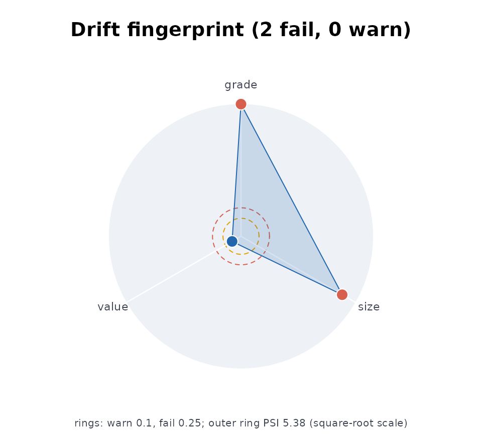
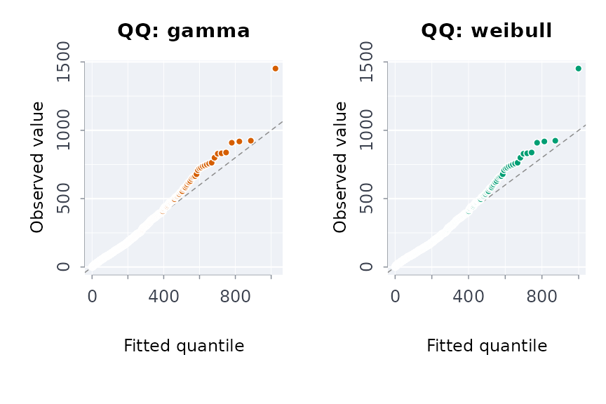
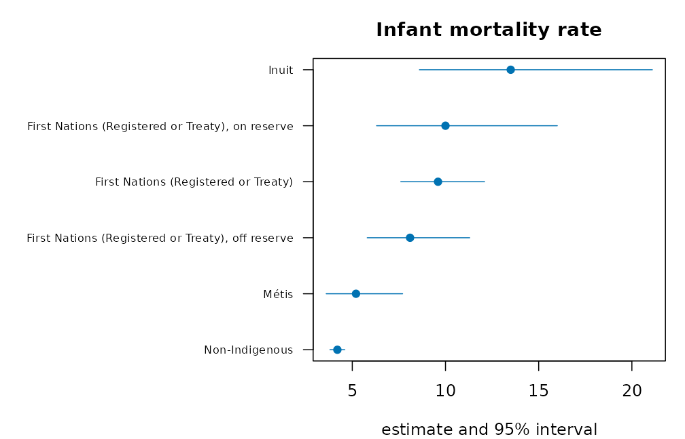

# Capsules and provenance

## Your first capsule: a published table, analysed and recorded

Most published administrative data arrives as a table of counts by
period and group. The questions are always the same: what changed, how
sure can we be, is there a trend, and is this release the one we had
before. This vignette answers them for one real table in twenty lines,
then records the run so someone else can repeat it.

### The table

Ontario publishes the number of distinct individuals held in restrictive
confinement each fiscal year, by age category and gender. A tidy copy of
the published figures ships with the package.

``` r

library(rmoriebricklayer)
otis <- read.csv(system.file("extdata", "otis_a01_individuals.csv",
                             package = "rmoriebricklayer"))
otis
#>           table    group year individuals
#> 1  age_category 18 to 24 2023        3507
#> 2  age_category 18 to 24 2024        2944
#> 3  age_category 18 to 24 2025        3688
#> 4  age_category 25 to 49 2023       14930
#> 5  age_category 25 to 49 2024       14445
#> 6  age_category 25 to 49 2025       18482
#> 7  age_category      50+ 2023        2344
#> 8  age_category      50+ 2024        2252
#> 9  age_category      50+ 2025        2875
#> 10       gender   Female 2023        1511
#> 11       gender   Female 2024        1924
#> 12       gender   Female 2025        2821
#> 13       gender     Male 2023       19270
#> 14       gender     Male 2024       17717
#> 15       gender     Male 2025       22224
```

### One call

``` r

a <- anltab(otis, value = "individuals", prd = "year",
                   by = c("table", "group"))
a
#> Analysis of `individuals` by year over 3 period(s) (2023 to 2025), grouped by table x group
#>   rows 15, columns 4; no missing values
#>   change: 10 comparison(s), 9 significant after BH at 0.05
#>   trend: 0 of 5 series with Mann-Kendall p < 0.05
```

The change table carries an exact interval for every percent change and
a p-value that is exact too. Five groups are compared twice each, so the
p-values are adjusted over the scan (Benjamini-Hochberg) before any row
is called significant. A row that looks striking on its own is judged in
the company of the other nine.

``` r

a$change[, c("table", "group", "year", "value", "previous",
             "pctchg", "pctlo", "pctup", "padj",
             "significant")]
#>           table    group year value previous     pctchg      pctlo      pctup
#> 1  age_category 18 to 24 2023  3507       NA         NA         NA         NA
#> 2  age_category 18 to 24 2024  2944     3507 -16.053607 -20.094317 -11.813237
#> 3  age_category 18 to 24 2025  3688     2944  25.271739  19.315638  31.533918
#> 4  age_category 25 to 49 2023 14930       NA         NA         NA         NA
#> 5  age_category 25 to 49 2024 14445    14930  -3.248493  -5.443046  -1.003220
#> 6  age_category 25 to 49 2025 18482    14445  27.947387  25.185677  30.771917
#> 7  age_category      50+ 2023  2344       NA         NA         NA         NA
#> 8  age_category      50+ 2024  2252     2344  -3.924915  -9.363927   1.838757
#> 9  age_category      50+ 2025  2875     2252  27.664298  20.771500  34.963148
#> 10       gender   Female 2023  1511       NA         NA         NA         NA
#> 11       gender   Female 2024  1924     1511  27.332892  18.974672  36.297285
#> 12       gender   Female 2025  2821     1924  46.621622  38.316800  55.450157
#> 13       gender     Male 2023 19270       NA         NA         NA         NA
#> 14       gender     Male 2024 17717    19270  -8.059159  -9.920858  -6.159393
#> 15       gender     Male 2025 22224    17717  25.438844  22.981369  27.946827
#>             padj significant
#> 1             NA       FALSE
#> 2   3.164937e-12        TRUE
#> 3   1.664477e-19        TRUE
#> 4             NA       FALSE
#> 5   5.269786e-03        TRUE
#> 6  3.609584e-109        TRUE
#> 7             NA       FALSE
#> 8   1.794906e-01       FALSE
#> 9   6.794641e-18        TRUE
#> 10            NA       FALSE
#> 11  2.786935e-12        TRUE
#> 12  2.223495e-38        TRUE
#> 13            NA       FALSE
#> 14  1.161620e-15        TRUE
#> 15 8.427443e-112        TRUE
```

### What the release withheld

Published counts are often rounded. If this table had been rounded to
the nearest five, each cell could have come from any count within two
and a half of it, and the percent change inherits that. `rounding = 5`
adds the envelope and a combined interval that is the union of the
sampling interval and the envelope: the honest range for a number read
off a rounded table. Suppressed cells (`"x"`, `"<5"`) are handled the
same way through `suplim`.

``` r

b <- anltab(otis, value = "individuals", prd = "year",
                   by = c("table", "group"), rnd = 5)
b$change[!is.na(b$change$previous),
         c("group", "year", "pctchg", "pctlo", "pctup",
           "compctlo", "compctup")]
#>       group year     pctchg      pctlo      pctup   compctlo   compctup
#> 1  18 to 24 2024 -16.053607 -20.094317 -11.813237 -20.094317 -11.813237
#> 2  18 to 24 2025  25.271739  19.315638  31.533918  19.315638  31.533918
#> 3  25 to 49 2024  -3.248493  -5.443046  -1.003220  -5.443046  -1.003220
#> 4  25 to 49 2025  27.947387  25.185677  30.771917  25.185677  30.771917
#> 5       50+ 2024  -3.924915  -9.363927   1.838757  -9.363927   1.838757
#> 6       50+ 2025  27.664298  20.771500  34.963148  20.771500  34.963148
#> 7    Female 2024  27.332892  18.974672  36.297285  18.974672  36.297285
#> 8    Female 2025  46.621622  38.316800  55.450157  38.316800  55.450157
#> 9      Male 2024  -8.059159  -9.920858  -6.159393  -9.920858  -6.159393
#> 10     Male 2025  25.438844  22.981369  27.946827  22.981369  27.946827
```

### Trend

Three fiscal years is a short series. The Mann-Kendall test is exact for
it, and its smallest possible p-value with three points is one third, so
no trend can be declared from three years; the table says so instead of
hiding it. The Poisson rate ratio per year is still informative as a
description.

``` r

a$trend
#>          table    group periods first  last       tau     trndp  slope
#> 1 age_category 18 to 24       3  3507  3688 0.3333333 1.0000000   90.5
#> 2 age_category 25 to 49       3 14930 18482 0.3333333 1.0000000 1776.0
#> 3 age_category      50+       3  2344  2875 0.3333333 1.0000000  265.5
#> 4       gender   Female       3  1511  2821 1.0000000 0.3333333  655.0
#> 5       gender     Male       3 19270 22224 0.3333333 1.0000000 1477.0
#>   rateratio rateratiolo rateratioup
#> 1  1.027143   0.2491778    4.234015
#> 2  1.118024   0.4111145    3.040459
#> 3  1.112728   0.4023851    3.077062
#> 4  1.376319   0.8250989    2.295790
#> 5  1.077781   0.3556341    3.266310
```

### Has the data changed since last time?

Keep the previous release and pass it as `prior`; every column is
screened. Before trusting a drift verdict, ask how often the screens
fire on data that has not changed:
[`drftcal()`](https://rootcoder007.github.io/rmorie-bricklayer/reference/drftcal.md)
splits one release into random halves and reports the false-alarm rate
per column.

``` r

drftcal(otis, n = 10)
#> Drift screens on 10 identical re-fetches (alpha = 0.01)
#>   at least one column flagged: 0% of re-fetches
#>   no column fired on identical data
#>   per-screen alpha for a family-wise 0.01: 0.0025
```

### Stock and flow

A count of people in confinement on a day is a stock; the people who
pass through in a year are a flow. Lakner’s decomposition ties them
exactly: average daily population is person-days over the days in the
period, average length of stay is person-days over the people served,
and the identity `adp = admissions * alos / t` means a change in days
must multiply out of a change in people and a change in stay.
[`stkflow()`](https://rootcoder007.github.io/rmorie-bricklayer/reference/stkflow.md)
reports both sides and checks the identity.

``` r

sf <- stkflow(days = c(21900, 23725, 20440), people = c(300, 325, 280),
                 prd = c(2022, 2023, 2024), t = 365)
sf
#> ── Stock and flow over 3 periods ───────────────────────────────── 
#>  period people  days alos adp
#>    2022    300 21900   73  60
#>    2023    325 23725   73  65
#>    2024    280 20440   73  56
#> 
#>   2022 to 2024: people -6.7%, stay +0.0%, days -6.7%
#> ──────────────────────────────────────────────────────────────────
```

A population that rose while stays shortened, or fell while stays
lengthened, reads differently from one where both moved together;
[`adp()`](https://rootcoder007.github.io/rmorie-bricklayer/reference/adp.md),
[`alos()`](https://rootcoder007.github.io/rmorie-bricklayer/reference/alos.md)
and
[`admits()`](https://rootcoder007.github.io/rmorie-bricklayer/reference/admits.md)
give the single measures.

### Stock and flow

A count of people in confinement on a day is a stock; the people who
pass through in a year are a flow. Lakner’s decomposition ties them
exactly: average daily population is person-days over the days in the
period, average length of stay is person-days over the people served,
and the identity `adp = admissions * alos / t` means a change in days
must multiply out of a change in people and a change in stay.
[`stkflow()`](https://rootcoder007.github.io/rmorie-bricklayer/reference/stkflow.md)
reports both sides and checks the identity.

``` r

sf <- stkflow(days = c(21900, 23725, 20440), people = c(300, 325, 280),
                 prd = c(2022, 2023, 2024), t = 365)
sf
#> ── Stock and flow over 3 periods ───────────────────────────────── 
#>  period people  days alos adp
#>    2022    300 21900   73  60
#>    2023    325 23725   73  65
#>    2024    280 20440   73  56
#> 
#>   2022 to 2024: people -6.7%, stay +0.0%, days -6.7%
#> ──────────────────────────────────────────────────────────────────
```

A population that rose while stays shortened, or fell while stays
lengthened, reads differently from one where both moved together;
[`adp()`](https://rootcoder007.github.io/rmorie-bricklayer/reference/adp.md),
[`alos()`](https://rootcoder007.github.io/rmorie-bricklayer/reference/alos.md)
and
[`admits()`](https://rootcoder007.github.io/rmorie-bricklayer/reference/admits.md)
give the single measures.

### Other published tables

The same approach works on any table with an estimate and its interval.
The package also bundles Statistics Canada estimates of First Nations,
Metis and Inuit health and mental health
([`?indiex`](https://rootcoder007.github.io/rmorie-bricklayer/reference/indiex.md)).
[`vignette("applied-analyses")`](https://rootcoder007.github.io/rmorie-bricklayer/articles/applied-analyses.md)
analyses them: by distinction, with suppressed cells never imputed, and
with wellness reported beside distress.

### Record it

[`rptanl()`](https://rootcoder007.github.io/rmorie-bricklayer/reference/rptanl.md)
writes the whole analysis as Markdown or a single HTML file, and
[`usecpstmpl()`](https://rootcoder007.github.io/rmorie-bricklayer/reference/usecpstmpl.md)
writes a folder with the provenance file, an `analysis.R` that pins the
source bytes and runs the steps above, and a README. The template runs
as written against this table.

``` r

d <- usecpstmpl(tempfile("capsule-"), ex = TRUE)
list.files(d)
#> [1] "analysis.R"           "data_provenance.json" "README.md"
cat(readLines(file.path(d, "analysis.R"))[1:12], sep = "\n")
#> # Reproducible capsule: fetch, verify, analyse, record.
#> # Run with: Rscript analysis.R
#> library(rmoriebricklayer)
#> arg <- grep("^--file=", commandArgs(), value = TRUE)
#> here <- if (length(arg)) dirname(normalizePath(sub("^--file=", "", arg[1]))) else getwd()
#> prov <- loadprov(file.path(here, "data_provenance.json"))
#> 
#> # 1. Fetch (a local path is read directly; a URL is downloaded with a
#> #    Wayback Machine fallback) and pin the bytes.
#> src <- prov$source$url
#> local <- if (file.exists(src)) src else
#>   fdl(src, file.path(here, basename(src)))
```

From here, replace the source URL and the column names in
`data_provenance.json`, run `Rscript analysis.R`, and copy the SHA-256
it prints back into the provenance file. Later runs refuse to proceed if
the bytes change, and
[`mnfrcmp()`](https://rootcoder007.github.io/rmorie-bricklayer/reference/mnfrcmp.md)
compares two runs number by number.

### The analysis in a picture

[`plot()`](https://rdrr.io/r/graphics/plot.default.html) draws the
analysis of the published table and the stock-and-flow result.

``` r

plot(a)
```


``` r

plot(sf)
```


## Building reproducible data capsules

`rmoriebricklayer` turns “the data was downloaded from the portal at
some point” into a verifiable, self-contained record: a **capsule**. A
capsule pins where the data came from, what its bytes hashed to, what
shape it must have, and — when the portal is unreachable — how to
synthesize a stand-in so the pipeline still runs end-to-end.

This vignette walks the essential flow with a small, fully offline
example:

1.  pin a source in a provenance record,
2.  validate data against the pinned schema,
3.  verify file integrity with SHA256,
4.  fall back to schema-driven synthetic data,
5.  account for every step in a manifest and plain-language summary.

``` r

library(rmoriebricklayer)
```

### 1. The provenance record

Everything starts from a `data_provenance.json` file: the
machine-readable pin of a project’s data source. It records the portal
endpoint, a pattern identifying the right resource, the expected SHA256,
the schema the data must satisfy, and a recipe for synthesizing a
stand-in.

``` r

provjson <- '{
  "dataset": {
    "title": "Demo library statistics",
    "ckan_api_endpoint": "https://data.ontario.ca/api/3/action/package_show?id=ontario-public-library-statistics"
  },
  "resource": { "name_match_pattern": "2014" },
  "schema": {
    "expected_columns": ["year", "visits", "alert"],
    "structural_invariants": { "min_data_rows": 5 },
    "expected_value_sets": { "year": [2024, 2025] },
    "synthetic_recipe": {
      "n_rows": 25,
      "seed": 42,
      "columns": {
        "year":   { "type": "sample",    "values": [2024, 2025] },
        "visits": { "type": "poisson",   "lambda": 3, "min": 1 },
        "alert":  { "type": "bernoulli", "p": 0.2 },
        "id":     { "type": "id_pattern", "pattern": "p-{seq:05d}" }
      }
    }
  }
}'

provpath <- file.path(tempdir(), "data_provenance.json")
writeLines(provjson, provpath)

prov <- loadprov(provpath)
prov$dataset$title
#> [1] "Demo library statistics"
```

### 2. Resolving the live source (network)

On a machine with network access, the resolvers turn the pinned endpoint
into a current download URL — surviving portal-side resource-UUID churn.
CKAN powers data.ontario.ca, data.gov.uk, and data.gov; Socrata and
ArcGIS resolvers cover the Chicago/NYC/Calgary and Toronto Police
portals.

``` r

url <- rslvckan(prov)            # package_show + name match
if (is.null(url))                        # slug-change fallback
  url <- rslvckns(prov)

path <- file.path(tempdir(), "data.csv")
fdl(url, path)             # plain-language failure diagnosis
                                         # + automatic Wayback fallback
```

This vignette stays offline, so we go straight to the fallback path.

### 3. Synthetic fallback: the pipeline always runs

When the real source is down,
[`mksyncsv()`](https://rootcoder007.github.io/rmorie-bricklayer/reference/mksyncsv.md)
generates a reproducible stand-in from the recipe pinned in the
provenance itself. Results from synthetic data are marked as such all
the way through (see the manifest below) — the point is to keep the
*pipeline* testable, never to pass synthetic output off as real.

``` r

datapath <- file.path(tempdir(), "data.csv")
gen <- mksyncsv(prov$schema$synthetic_recipe, datapath)
gen$rows
#> [1] 25

df <- read.csv(datapath)
head(df, 3)
#>   year visits alert      id
#> 1 2025      2    No p-00001
#> 2 2024      2   Yes p-00002
#> 3 2024      2    No p-00003
```

### 4. Integrity and schema validation

Every file gets a SHA256; every data frame is checked against the pinned
schema.
[`valsch()`](https://rootcoder007.github.io/rmorie-bricklayer/reference/valsch.md)
reports issues without raising, so callers choose the severity response;
[`schval()`](https://rootcoder007.github.io/rmorie-bricklayer/reference/schval.md)
is the strict wrapper (fatal issues stop, drift warns).

``` r

digest <- sha256file(datapath)
substr(digest, 1, 16)
#> [1] "e2f4b6752a2e3b56"

chk <- vrfsha256(datapath, digest)
chk$match
#> [1] TRUE

issues <- valsch(df, prov)
length(issues)   # 0 = clean against the pinned schema
#> [1] 0
```

### 5. The manifest: account for everything

[`mkmnf()`](https://rootcoder007.github.io/rmorie-bricklayer/reference/mkmnf.md) +
[`recrd()`](https://rootcoder007.github.io/rmorie-bricklayer/reference/recrd.md)
accumulate named cross-checks (each PASS / DIFFER / INFO), and the
writers produce the two capsule artifacts: a machine-readable
`manifest.json` and a human-readable `SUMMARY.txt`.

``` r

man <- mkmnf(
  list(project = "demo-study", author = "A. Author", synthetic = TRUE),
  env = FALSE  # TRUE also snapshots R/OS/package versions
)

man <- recrd(man, "rowsgenerated", obs = gen$rows, expd = 25)
#>   rowsgenerated                                observed = 25.0000      expected = 25.0000      [INFO]
man <- recrd(man, "meanvisits",
              obs = mean(df$visits), expd = 3,
              tol = 1, syn = TRUE)
#>   meanvisits                                   observed = 2.8000       expected = 3.0000       [INFO]

outdir <- file.path(tempdir(), "capsule-demo")
dir.create(outdir, showWarnings = FALSE)

wrmnfjs(man, file.path(outdir, "manifest.json"))
summarypath <- wrsmrytxt(
  man, outdir,
  paths = list(input = datapath, results = outdir),
  whatwasdone = c("* generated synthetic stand-in (real source offline)",
                    "* validated schema and recorded cross-checks")
)

cat(readLines(summarypath)[7:12], sep = "\n")
#> Project:   demo-study
#> Author:    A. Author
#> When:      2026-10-21 16:31:53 UTC
#> OS:        Linux
#> R:         R version 4.6.1 (2026-06-24)
#> Mode:      SYNTHETIC (not real data -- pipeline check only)
```

The capsule directory now contains everything a reviewer needs to trace
the run: the exact inputs, their digests, every cross-check with its
status, and a plain-language account — reproducible years later even if
the portal has moved on.

### Where this sits in the MORIE family

`rmoriebricklayer` is the provenance/reproducibility layer under rmorie
(github.com/rootcoder007/rmorie) and rmoriedata
(github.com/rootcoder007/rmoriedata); both link against its compiled
core (`LinkingTo: rmoriebricklayer`) for shared SHA-256 and
summary-statistic kernels
([`csha256()`](https://rootcoder007.github.io/rmorie-bricklayer/reference/csha256.md),
[`cmn()`](https://rootcoder007.github.io/rmorie-bricklayer/reference/cstat.md),
[`cvari()`](https://rootcoder007.github.io/rmorie-bricklayer/reference/cstat.md),
[`ccorr()`](https://rootcoder007.github.io/rmorie-bricklayer/reference/cstat.md)).

### A capsule for an Indigenous health table

The same steps pin a Statistics Canada table: write it, record its
digest, and describe it in a manifest that names its source and licence.

``` r

d <- indiex("wellbeing")
f <- file.path(tempdir(), "indigenous_wellbeing.csv")
utils::write.csv(d, f, row.names = FALSE)
h <- sha256file(f)
m <- mkmnf(list(dataset = "indigenouswellbeing", rows = nrow(d), sha256 = h,
                        source = "Statistics Canada, Indigenous Peoples Survey 2022",
                        licence = "Statistics Canada Open Licence"),
                   env = FALSE)
vrfsha256(f, h)
#> $actual
#> [1] "c4b3e61f660856d89b302f1050393f99d84363ad7540b838ebecfbac5e4e5c2a"
#> 
#> $expected
#> [1] "c4b3e61f660856d89b302f1050393f99d84363ad7540b838ebecfbac5e4e5c2a"
#> 
#> $match
#> [1] TRUE
```

### The capsule’s tables in a picture

The capsule records these two tables. The first shows the published
estimates and their intervals; the second shows the visits counted in
each year.

``` r

ci_plot <- function(t, lab, main) {
  o <- order(t$estimate)
  t <- t[o, ]
  y <- seq_len(nrow(t))
  op <- par(mar = c(4, 10, 3, 1))
  on.exit(par(op))
  plot(t$estimate, y, xlim = range(t$lower, t$upper, na.rm = TRUE), yaxt = "n", pch = 19,
       col = blpal()[1], xlab = "estimate and 95% interval", ylab = "", main = main)
  segments(t$lower, y, t$upper, y, col = blpal()[1])
  axis(2, y, lab[o], las = 1, cex.axis = 0.7)
}
t1 <- d[d$indicator == d$indicator[1], ]
ci_plot(t1, t1$group, t1$indicator[1])
```


``` r

v <- tapply(df$visits, df$year, sum)
barplot(v, col = blpal()[2], main = "Visits by year", xlab = "year", ylab = "visits")
```


## Provenance you can verify

A manifest with a SHA-256 in it proves the data was not corrupted. It
proves nothing about who produced it, because anyone who can edit the
data can recompute the digest and write it back.

This vignette covers the three things that close that gap: signing a
manifest, pinning a capsule chunk by chunk, and making the *history* of
runs tamper-evident rather than only each run.

### Signing: a shared secret

The simplest case is one team, one secret.
[`cpssign()`](https://rootcoder007.github.io/rmorie-bricklayer/reference/cpssign.md)
with `scheme = "hmac"` produces an HMAC-SHA-256 tag: only a key holder
can compute it, so only a key holder can produce a manifest that
verifies.

``` r

manifest <- paste0(
  "source=https://example.org/extract.csv\n",
  "sha256=", csha256("id,value\n1,2\n"), "\n",
  "fetched=2026-09-12"
)

sig <- cpssign(csha256(manifest), key = "team-secret",
                    scheme = "hmac")
cpsvrf(csha256(manifest), sig, "team-secret")
#> [1] TRUE
```

An edited manifest has a different digest, which the signature does not
cover:

``` r

edited <- sub("fetched=2026-09-12", "fetched=2026-01-01", manifest)
cpsvrf(csha256(edited), sig, "team-secret")
#> [1] FALSE
```

Do not carry raw key bytes around by hand.
[`drvkey()`](https://rootcoder007.github.io/rmorie-bricklayer/reference/drvkey.md)
stretches a passphrase into a full-width key with PBKDF2:

``` r

# Fixed here so the vignette is reproducible. For a real key the salt
# comes from rndbytes(16), which reads the operating system's
# CSPRNG rather than R's generator.
salt <- "9f2c41a7d8e05b36"
key <- drvkey("correct horse battery staple", salt)
nchar(key)
#> [1] 64
```

The salt is not secret and must be stored beside the capsule – without
the same salt and iteration count, the key cannot be re-derived.

HMAC is symmetric, so anyone who can *verify* can also *sign*. That is
fine within one team and useless for publishing.

### Signing: a public verifier, after quantum

For a verifier who should be able to check but not forge, the signature
has to be asymmetric. The classical options (RSA, Ed25519) fall to
Shor’s algorithm.

Worth being precise about what that threatens. Hashing is fine: Grover’s
algorithm only halves the security exponent, so SHA-256 retains roughly
2^128 preimage resistance, and HMAC with a 256-bit key is likewise fine.
**Signatures** are the part that breaks.

[`pqckg()`](https://rootcoder007.github.io/rmorie-bricklayer/reference/pqckg.md)
builds a hash-based signing key – a Merkle tree over Winternitz one-time
keys, the RFC 8391 construction, over the SHA-256 this package already
ships. Its security rests on the hash function alone: no lattice
assumption, no elliptic curve, and no new system dependency.

``` r

# Small for the vignette; the default height 10 gives 1024 signatures.
signingkey <- pqckg(height = 3)
signingkey
#> ── Signing key (post-quantum) ────────────────────────────────────
#>   scheme     xmss-sha256
#>   root       426da6d24d3ce3c0d3c0c8ae1eee6274643ee0cbedec1029a91b6a503693eff9
#>   height     3
#>   used       0 of 8 signatures
#>   remaining  8
#>   secret     <withheld>
#>   ! one signature per index; never sign twice at one index
#> ──────────────────────────────────────────────────────────────────
```

Publish the public half. It carries no secret:

``` r

pub <- signpubkey(signingkey)
pub
#> ── Public verification key ───────────────────────────────────────
#>   scheme  xmss-sha256
#>   root    426da6d24d3ce3c0d3c0c8ae1eee6274643ee0cbedec1029a91b6a503693eff9
#>   height  3
#> ──────────────────────────────────────────────────────────────────
```

``` r

s1 <- cpssign(csha256(manifest), signingkey)
cpsvrf(csha256(manifest), s1, pub)
#> [1] TRUE

# A verifier holding only `pub` cannot forge one.
cpsvrf(csha256(edited), s1, pub)
#> [1] FALSE
```

#### One signature per index, and no more

A Winternitz key signs **once**. Signing two different messages at one
leaf index leaks enough chain material to forge a third. So the key is
stateful, and `xmssadv(key, signature)` returns the advanced state for
you to carry forward:

``` r

signingkey <- xmssadv(signingkey, s1)
signingkey$next_index
#> [1] 1

s2 <- cpssign(csha256("a second manifest"), signingkey)
cpsvrf(csha256("a second manifest"), s2, pub)
#> [1] TRUE

# and forward again, for the next signature
signingkey <- xmssadv(signingkey, s2)
```

An exhausted key is an error rather than a silent wrap-around:

``` r

k <- pqckg(height = 1)          # signs exactly 2 messages
k <- xmssadv(k, cpssign("one", k))
k <- xmssadv(k, cpssign("two", k))
#> Warning: this key has used all 2 of its one-time indices: generate a new one
#> with pqckg()
cpssign("three", k)
#> Error:
#> ! this key is exhausted: a height-1 key signs 2 messages and all of them are used. Generate a new key -- reusing an index would break the signature scheme.
```

On the standardised schemes: ML-DSA (FIPS 204) and SLH-DSA (FIPS 205)
are implemented here too, at every parameter set both standards define –
three for ML-DSA, twelve for SLH-DSA – with no system dependency, so the
list
[`pqcbknd()`](https://rootcoder007.github.io/rmorie-bricklayer/reference/pqcbknd.md)
reports is the same on every machine.
[`fipskg()`](https://rootcoder007.github.io/rmorie-bricklayer/reference/fipskg.md)
takes any of them,
[`fipskey()`](https://rootcoder007.github.io/rmorie-bricklayer/reference/fipskey.md)
wraps key material that came from elsewhere, and both are stateless: one
key signs any number of messages.

What makes that defensible is the cross-check rather than care. In
deterministic mode this package and OpenSSL 3.5 produce the same bytes
for every parameter set, which is a test a subtly wrong implementation
cannot pass: it would have to be wrong in exactly the same way, in a
construction where a single misplaced field changes every output.

``` r

pqcbknd()
#>  [1] "xmss-sha256"        "ML-DSA-44"          "ML-DSA-65"         
#>  [4] "ML-DSA-87"          "SLH-DSA-SHA2-128s"  "SLH-DSA-SHA2-128f" 
#>  [7] "SLH-DSA-SHA2-192s"  "SLH-DSA-SHA2-192f"  "SLH-DSA-SHA2-256s" 
#> [10] "SLH-DSA-SHA2-256f"  "SLH-DSA-SHAKE-128s" "SLH-DSA-SHAKE-128f"
#> [13] "SLH-DSA-SHAKE-192s" "SLH-DSA-SHAKE-192f" "SLH-DSA-SHAKE-256s"
#> [16] "SLH-DSA-SHAKE-256f"
```

### Signing something a verifier can check

[`cpssign()`](https://rootcoder007.github.io/rmorie-bricklayer/reference/cpssign.md)
signs a string, which proves the string was signed and leaves three
things implicit: which key, which scheme, which bytes. A verifier handed
a directory still has to be told all three, and a check that depends on
being told what to check is a formality.

[`cpsatst()`](https://rootcoder007.github.io/rmorie-bricklayer/reference/cpsatst.md)
records them inside the signed payload.

``` r

m <- mkmnf(list(dataset = "otis", rows = 1200L),
                   env = FALSE)
key <- fipskg("ML-DSA-65")
att <- cpsatst(m, key, note = "counts as published")
cpschkatst(att, m)
#> ── Attestation check: OK ─────────────────────────────────────────
#>   attestation_complete   ok    
#>   manifest_digest        ok    d61525e7f8b685bb5eb2cb3d1c7747b4161508c3a255
#>   signature              ok    
#> ──────────────────────────────────────────────────────────────────
```

The check needs the attestation and the manifest, nothing else. Change
either – or edit the note, which is covered by the signature because it
is part of the digest – and it fails:

``` r

m2 <- m
m2$meta$rows <- 1201L
cpschkatst(att, m2)$ok
#> [1] FALSE
```

What it does not establish is that the key belongs to whoever you think:
an attestation is only as good as the channel the public key arrived on.
Pass `keyexp` when you know which key should have signed.

### The number in the manifest is the number

A manifest is meant to be checked against later. That only works if it
records what actually happened, at the precision it happened:

``` r

onethird <- mkmnf(list(x = 1 / 3), env = FALSE)
back <- fromjs(mnfcanon(onethird))
identical(back$meta$x, 1 / 3)
#> [1] TRUE
```

Sign
[`mnfdgst()`](https://rootcoder007.github.io/rmorie-bricklayer/reference/mnfcanon.md)
rather than the pretty JSON. R lists keep insertion order, so building
`meta` before `results` or the other way round gives different bytes for
the same content; the canonical form sorts the keys, so the digest
depends on what the manifest says and not on how a script assembled it.

``` r

identical(
  mnfdgst(mkmnf(list(a = 1, b = 2), env = FALSE)),
  mnfdgst(mkmnf(list(b = 2, a = 1), env = FALSE)))
#> [1] TRUE
```

### Whether the finding survives

Everything above is about the record being intact. None of it says the
number means anything: a capsule can be signed, hashed, chained and
reproduced byte for byte while reporting an artefact. That is a separate
question and it needs controls that can fail.

``` r

set.seed(1)
d <- data.frame(x = rnorm(200))
d$y <- 0.8 * d$x + rnorm(200)
cpsfals(d, function(z) cor(z$x, z$y), trt = "x",
                n = 199, seed = 42)
#> ── Falsification controls ────────────────────────────────────────
#>   observed statistic  0.5812737
#>   permutations        199 (seed 42)
#> ──────────────────────────────────────────────────────────────────
#>   permutation            ok    p = 0.005 with 199 usable permutations; 
#>   placebo                ok    a permuted exposure gives 0.0702711, aga
#>   random_common_cause    ok    adding a column of noise moved the stati
#>   subset_stability       ok    the middle 95% of 199 subsets spans [0.5
#> ──────────────────────────────────────────────────────────────────
```

Four controls, each for a different way of being wrong: permuting the
exposure destroys the association, so the statistic should fall to its
null; a column of noise cannot matter, so the statistic should not move;
a placebo exposure should show nothing; and random subsets should agree.

They can fail, which is the point. A constant fails the permutation test
and nothing else, because everything else about a constant is perfectly
stable:

``` r

cpsfals(d, function(z) 0.5, trt = "x", n = 199,
                seed = 42)$controls[, c("control", "passed")]
#>               control passed
#> 1         permutation  FALSE
#> 2             placebo   TRUE
#> 3 random_common_cause   TRUE
#> 4    subset_stability   TRUE
```

Note what the permutation control reports alongside its p-value: the
smallest p-value the design could have produced. With 199 permutations
that floor is 0.005, and with 19 it is 0.05 – so a p of 0.05 from 19
permutations is not weak evidence, it is no evidence at all.

### Re-deriving the numbers, not just checking them

[`vrfcps()`](https://rootcoder007.github.io/rmorie-bricklayer/reference/vrfcps.md)
reads a manifest and confirms it is consistent with itself. That catches
an edited manifest and cannot catch one that was wrong when it was
written, because a manifest written from the wrong data is perfectly
consistent too.

``` r

d <- data.frame(x = 1:10)
man <- mkmnf(list(dataset = "demo"), env = FALSE)
man <- recrd(man, "mean_x", obs = mean(d$x), expd = 5.5)
#>   mean_x                                       observed = 5.5000       expected = 5.5000       [INFO]
man <- recrd(man, "n", obs = nrow(d), expd = 10)
#>   n                                            observed = 10.0000      expected = 10.0000      [INFO]

mnfrcmp(man, d, list(mean_x = function(z) mean(z$x),
                                n = function(z) nrow(z)))
#> ── Recomputation: everything checked and matched ─────────────────
#>   mean_x                   MATCH      |recorded - recomputed| = 0
#>   n                        MATCH      |recorded - recomputed| = 0
#> ──────────────────────────────────────────────────────────────────
```

Recompute only some of them and the rest are reported as unchecked
rather than passed over, which is the difference between a clean bill of
health and a partial one:

``` r

mnfrcmp(man, d, list(n = function(z) nrow(z)))
#> ── Recomputation: see below ──────────────────────────────────────
#>   n                        MATCH      |recorded - recomputed| = 0
#> ──────────────────────────────────────────────────────────────────
#>   1 recorded result(s) NOT recomputed: mean_x
#> ──────────────────────────────────────────────────────────────────
```

For anything stochastic, record the generator state rather than the
seed. `set.seed(1)` reproduces a run only if everything before it does
too – one extra draw anywhere upstream shifts every later value:

``` r

set.seed(1)
m2 <- mnfrecseed(mkmnf(list(a = 1),
                                         env = FALSE))
first <- runif(3)
invisible(runif(1000))          # any amount of other work
mnfrstseed(m2)
identical(runif(3), first)
#> [1] TRUE
```

### Saying in advance what you will report

The falsification controls above are worth much more when the statistics
were named before the data was looked at. A declaration makes the two
ways of departing from a plan visible, and they are different failures:

``` r

plan <- prrgdecl(c(
  ate = "use of force is higher in the exposed division",
  n_rows = "the extract has the row count the source publishes"))

# a declared outcome that was not reported
prrgchk(plan, "n_rows")
#> ── Against the declaration of 2026-10-21T16:31:54Z: departures below 
#>   declared but not reported (outcome switching): ate
#> ──────────────────────────────────────────────────────────────────

# statistics reported that were never declared
prrgchk(plan, c("ate", "n_rows", "byyear", "byprecinct"))
#> ── Against the declaration of 2026-10-21T16:31:54Z: departures below 
#>   reported but not declared (2 addition(s)): byyear, byprecinct
#> ──────────────────────────────────────────────────────────────────
```

That second case is why a nominal p-value needs correcting. Run the
permutation control over several statistics and the smallest is not the
finding:

``` r

falsfam(c(ate = 0.02, byyear = 0.3, byprecinct = 0.4,
                 byshift = 0.6, bymonth = 0.7), meth = "holm")
#> ── Family of 5, corrected by holm at alpha 0.05 ──────────────────
#>   ate                    p 0.02       adjusted 0.1        
#>   byyear                 p 0.3        adjusted 1          
#>   byprecinct             p 0.4        adjusted 1          
#>   byshift                p 0.6        adjusted 1          
#>   bymonth                p 0.7        adjusted 1          
#> ──────────────────────────────────────────────────────────────────
```

And for the confounder nobody measured, the E-value says how strong it
would have to be to explain the result away – with both the exposure and
the outcome:

``` r

evlrr(2, lo = 1.4, hi = 2.9)
#> evlpoint evllimit 
#> 3.414214 2.148331
```

### One file to hand someone

A bundle carries a digest of every file, the manifest digest, and an
attestation over both. The file digests are inside the signature, which
is the point: a list of hashes that is not itself signed can be
rewritten to match whatever the files now say.

``` r

dir <- tempfile()
dir.create(dir)
write.csv(data.frame(x = 1:3), file.path(dir, "data.csv"),
          row.names = FALSE)
b <- cpsbndl(dir, man, key, note = "as published")
cpsbndlvrf(attr(b, "path"), dir, man = man)
#> ── Bundle check: OK ──────────────────────────────────────────────
#>   file:data.csv                  ok    95aecaa7399a39092c9e716ce1e18bb1c606
#>   no_unlisted_files              ok    
#>   attestation:attestation_comple ok    
#>   attestation:manifest_digest    ok    89b6714740388966d24bf7c3ef5a808fd939
#>   attestation:signature          ok    
#>   manifest_digest                ok    8082eb02d48b11e6e07667e3c024d9596aa7
#> ──────────────────────────────────────────────────────────────────
```

Files sitting in the directory that the bundle does not mention are
reported as well: a signed list of what should be there says nothing
about what else was put beside it.

``` r

unlink(dir, recursive = TRUE)
```

### When, not just in what order

The chain proves the order of a sequence of manifests. It does not prove
that any of them existed at a particular time – the whole chain can be
built in an afternoon and dated however one likes. An RFC 3161 timestamp
token from a third party supplies the date, and
[`tsvrf()`](https://rootcoder007.github.io/rmorie-bricklayer/reference/tsvrf.md)
checks three separate things: that the token is about these bytes, what
time it asserts, and that the authority’s signature holds.

``` r

res <- tsvrf("response.tsr", data = "manifest.json")
res$time
res$checks
```

What it does not check, and this is the difference between it and a
browser’s padlock: whether the certificate should be trusted. There is
no chain building, no validity dates, no revocation and no check of the
timeStamping key usage. Pass the certificate you have independently
decided to trust, and read a pass as “this key said so” rather than
“this is true”.

### Pinning chunk by chunk

A single digest over a file tells you it changed. A Merkle tree over its
chunks tells you *which* chunk changed, and lets you prove one chunk
belongs without re-reading the rest.

``` r

chunks <- c("id,value", "1,2", "3,4", "5,6")
root <- mrkroot(chunks)
root
#> [1] "80332968a476e13898f2d88c2632603b3fa6bcc746bf05be7ed178aced51ab16"
```

``` r

# Editing one chunk moves exactly one leaf.
editedchunks <- chunks
editedchunks[3] <- "3,5"
which(mrklvs(chunks) != mrklvs(editedchunks))
#> [1] 3
```

``` r

# Prove chunk 3 belongs, holding only it and log2(n) sibling digests.
proof <- mrkprf(chunks, 3)
proof
#> $sibling
#> [1] "2191ddd39af84a2334704f1bc99d7c53fc4735a5f1f44cdebdf0c3c52f5d5681"
#> [2] "8f71896ada80f49aab101ab39dff71d81b3470c5abc14cb58f1806b16c8fe6af"
#> 
#> $side
#> [1] "right" "left" 
#> 
#> $scheme
#> [1] 2
mrkvrf(chunks[3], proof, root)
#> [1] TRUE
mrkvrf("3,5", proof, root)
#> [1] FALSE
```

[`chnkfile()`](https://rootcoder007.github.io/rmorie-bricklayer/reference/chnkfile.md)
produces the chunks from a file.

An unpaired node at an odd level is *promoted* rather than hashed
against a duplicate of itself. That is a correctness requirement, not a
preference: duplicating the last leaf lets two different chunk lists
produce the same root, which is the CVE-2012-2459 weakness.

``` r

mrkroot(c("a", "b", "c")) == mrkroot(c("a", "b", "c", "c"))
#> [1] FALSE
```

### The history, not just the run

Every manifest above verifies on its own. That says nothing about
whether any were *removed* – delete an inconvenient run and the
remaining manifests are all still perfectly valid.

A chain fixes that by linking each entry to the digest of the one
before:

``` r

chain <- chnnew()
chain <- chnapp(chain, "manifest for run 1", label = "run-1")
chain <- chnapp(chain, "manifest for run 2", label = "run-2")
chain <- chnapp(chain, "manifest for run 3", label = "run-3")
chain
#> ── Manifest chain ────────────────────────────────────────────────
#>   ✓ chain intact
#> 
#>   entries  3
#>   head     b9ccb96106a68f3d4d2a0cfb8e2ae160f7996393e28e93d7f4650c2bbd81ff49
#>   seal     940721e3704268b570bcbf1c9ae841bde02927f584ec44dc3cf053ef7404d8a0
#> 
#>     1  run-1            cb25fa776c693a106b2d08a1
#>     2  run-2            03a645a531c93fbb12bb2c07
#>     3  run-3            b9ccb96106a68f3d4d2a0cfb
#> ──────────────────────────────────────────────────────────────────
```

``` r

# Deleting an entry from the middle breaks the links, and names where.
tampered <- chain
tampered$entries[[2]] <- NULL
chnvrf(tampered)
#> ✗ chain broken at entry 2 of 2
```

#### Sign the seal, not the head

Two failure modes, and neither single value catches both:

- Deleting from the **middle** leaves the last entry’s stored digest
  untouched, so the head is unchanged – but
  [`chnvrf()`](https://rootcoder007.github.io/rmorie-bricklayer/reference/chn.md)
  fails.
- Truncating from the **end** leaves a valid prefix that
  [`chnvrf()`](https://rootcoder007.github.io/rmorie-bricklayer/reference/chn.md)
  accepts – but the head changes.

``` r

truncated <- chain
truncated$entries[[3]] <- NULL

c(headuncbymiddel =
    chnhead(tampered) == chnhead(chain),
  linksacctru = chnvrf(truncated)$valid)
#> headuncbymiddel     linksacctru 
#>            TRUE            TRUE
```

[`chnseal()`](https://rootcoder007.github.io/rmorie-bricklayer/reference/chn.md)
folds the entry count and every link digest into one value, which covers
both. It is the thing to sign:

``` r

sealsig <- cpssign(chnseal(chain), signingkey)
cpsvrf(chnseal(chain), sealsig, pub)
#> [1] TRUE

# The truncated chain seals to a different value.
cpsvrf(chnseal(truncated), sealsig, pub)
#> [1] FALSE

# A chain whose links disagree has no seal to offer at all.
chnseal(tampered)
#> [1] NA
```

### What is verified, and what is not

Every primitive with a published test vector is checked against it:
SHA-512 against FIPS 180-4, HMAC-SHA-256 against RFC 4231, PBKDF2
against the published vectors, BLAKE2b against RFC 7693, CRC-32 against
the ITU V.42 check value.

The XMSS signature scheme is the exception. No official RFC 8391
known-answer vectors ship with the RFC itself, which carries only XDR
formats. The check is instead made against the **reference
implementation**: the whole 2500-byte signature for XMSS-SHA2_10_256 –
index, randomiser, WOTS+ signature and authentication path – is
byte-identical to what `github.com/XMSS/xmss-reference` produces from
the same key material, and those vectors are embedded in the test suite
so the check needs no network. A signature written here can therefore be
handed to another XMSS implementation as bytes.

It is verified against its security properties as well: a genuine
signature verifies, and every tampering of the message, the signature,
the authentication path, the leaf index or the key fails. The scheme is
not *certified*, which is a statement about process rather than about
the bytes.

### Provenance for Indigenous data

The bundled Indigenous tables name their sources (Statistics Canada
table numbers, retrieval dates and licence) in the package’s COPYRIGHTS
file:

``` r

cr <- readLines(system.file("COPYRIGHTS", package = "rmoriebricklayer"))
cat(cr[grep("indigenouslifeexpectancy", cr) + 0:4], sep = "\n")
```

With a data key
([`dlogin()`](https://rootcoder007.github.io/rmorie-bricklayer/reference/dlogin.md)),
[`indtabs()`](https://rootcoder007.github.io/rmorie-bricklayer/reference/indtabs.md)
lists the mirrored tables themselves:

``` r

head(indtabs()[, c("key", "rows")])
```

[`indtabs()`](https://rootcoder007.github.io/rmorie-bricklayer/reference/indtabs.md)
lists the Statistics Canada tables on data.rmorie.com with their source,
licence and table number, so a result can name the exact table it used.

### The pinned data in a picture

The manifest above pins these ten values. A verifier that recomputes the
digest is checking exactly what this chart shows.

``` r

barplot(d$x, names.arg = seq_len(nrow(d)), col = blpal()[1], xlab = "row", ylab = "x",
        main = "The values the manifest pins")
```


## Validation rules, inferred schemas and synthetic stand-ins

A capsule says what shape its data must have. This vignette covers the
three tools for stating and checking that shape: explicit **rules**, a
**schema** inferred from a known-good table, and a **synthetic
stand-in** generated from the schema when the portal is unreachable.

### Rules

A rule is a name, a predicate and optionally a column. Row-wise rules
report how many rows fail and which; table-wise rules take the whole
data frame. A `fatal` severity stops the pipeline; a `warning` is
recorded.

``` r

df <- data.frame(id = c(1, 2, 2), age = c(30, -5, 40),
                 start = c(1, 5, 3), end = c(2, 4, 9))

rules <- list(
  rul("agenonnegative", function(v) v >= 0, col = "age"),
  rul("idunique", function(v) !anyDuplicated(v), col = "id", sev = "fatal"),
  rul("datesordered", function(d) all(d$start <= d$end))
)

issues <- valrules(df, rules)
names(issues)
#> [1] "agenonnegative" "idunique"       "datesordered"
issues$agenonnegative$n_failed
#> [1] 1
issues$agenonnegative$rows
#> [1] 2
```

Clean data produces nothing:

``` r

clean <- data.frame(id = 1:3, age = c(30, 31, 40), start = 1:3, end = 4:6)
length(valrules(clean, rules))
#> [1] 0
```

Two behaviours matter for trust. A rule for an absent column is
**skipped**, not failed: a missing column is the schema’s finding to
report. And a rule that *errors* is a **failure**, never a silent pass:

``` r

length(valrules(data.frame(id = 1:3), rules[1:2]))
#> [1] 0
broken <- list(rul("bad", function(v) stop("boom"), col = "age"))
valrules(clean, broken)$bad$message
#> [1] "Rule 'bad' failed (rule could not be evaluated: boom)"
```

#### Ready-made rules

Common checks have constructors so the intent is in the name:

``` r

rules2 <- list(
  rulenull("id"),
  ruleuniq("id", sev = "fatal"),
  rulebtw("age", 0, 120),
  ruleinset("grade", c("a", "b", "c")),
  rulerx("code", "^[A-Z]{2}-[0-9]{4}$"),
  rulemad("score", n = 3),
  rulecolcnt(6, sev = "fatal")
)
length(rules2)
#> [1] 7
```

[`ruleincr()`](https://rootcoder007.github.io/rmorie-bricklayer/reference/rulelib.md),
[`ruledstn()`](https://rootcoder007.github.io/rmorie-bricklayer/reference/rulelib.md)
and
[`rulecmpl()`](https://rootcoder007.github.io/rmorie-bricklayer/reference/rulelib.md)
complete the set. `schval(df, rules2)` runs a rule list the same way and
stops on any fatal issue, which is the call a pipeline makes (it takes a
provenance list or a rule list; until 0.5.12 a rule list was silently
ignored and reported a pass).

### Inferring a schema

Given a table known to be right,
[`infsch()`](https://rootcoder007.github.io/rmorie-bricklayer/reference/infsch.md)
pins what can be pinned: column names and types, numeric ranges with a
little slack, and the level set of categorical columns (up to `maxlvl`,
so free text is not mistaken for a code list):

``` r

set.seed(1)
df <- data.frame(
  id = 1:100,
  score = stats::runif(100, 0, 10),
  grade = sample(c("a", "b", "c"), 100, TRUE),
  note = paste0("free text ", 1:100),
  stringsAsFactors = FALSE
)
sch <- infsch(df)
sch$expected_value_sets
#> $grade
#> [1] "a" "b" "c"
```

It validates the table it was learned from, and catches a vanished
column or a new category:

``` r

length(valsch(df, list(schema = sch)))
#> [1] 0
length(valsch(df[, -3], list(schema = sch))) > 0
#> [1] TRUE
bad <- df
bad$grade[1] <- "z"
length(valsch(bad, list(schema = sch))) > 0
#> [1] TRUE
```

A schema goes into the capsule’s provenance record;
[`valsch()`](https://rootcoder007.github.io/rmorie-bricklayer/reference/valsch.md)
is what
[`vrfcps()`](https://rootcoder007.github.io/rmorie-bricklayer/reference/vrfcps.md)
runs on a fresh download.

### Synthetic stand-ins

When the portal is down, the pipeline should still run end to end on
data of the right shape, clearly marked as synthetic. A recipe names
each column’s generator:

``` r

recipe <- list(
  n_rows = 20, seed = 42,
  columns = list(
    year   = list(type = "sample", values = list(2024, 2025)),
    alert  = list(type = "bernoulli", p = 0.2),
    visits = list(type = "poisson", lambda = 3, min = 1),
    id     = list(type = "id_pattern", pattern = "p-{seq:05d}")
  )
)
out <- tempfile(fileext = ".csv")
res <- mksyncsv(recipe, out)
res$rows
#> [1] 20
res$seed
#> [1] 42

df <- utils::read.csv(out)
dim(df)
#> [1] 20  4
names(df)
#> [1] "year"   "alert"  "visits" "id"
head(df, 3)
#>   year alert visits      id
#> 1 2024    No      4 p-00001
#> 2 2024    No      7 p-00002
#> 3 2024   Yes      4 p-00003
```

The seed makes the stand-in reproducible; `nrows` overrides the recipe’s
own count. A `<path>.synthetic` sidecar file is written beside the CSV
(the file itself stays a plain table), and the capsule checks read that
marker, so a synthetic run can never be mistaken for a result:

``` r

mksyncsv(recipe, tempfile(fileext = ".csv"), nrows = 5)$rows
#> [1] 5
```

[`mksyncol()`](https://rootcoder007.github.io/rmorie-bricklayer/reference/mksyncol.md)
generates one column from a spec, for building a table piece by piece or
for testing a generator.

### Putting them together

1.  On the first, trusted download:
    [`infsch()`](https://rootcoder007.github.io/rmorie-bricklayer/reference/infsch.md),
    then add the rules the schema cannot express (ordering between
    columns, cross-table consistency) and pin both.
2.  On every later run:
    [`valsch()`](https://rootcoder007.github.io/rmorie-bricklayer/reference/valsch.md)
    and
    [`valrules()`](https://rootcoder007.github.io/rmorie-bricklayer/reference/valrules.md);
    stop on `fatal`.
3.  When the source is unreachable:
    [`mksyncsv()`](https://rootcoder007.github.io/rmorie-bricklayer/reference/mksyncsv.md)
    from the pinned schema, run the pipeline, and let the synthetic
    marker say what the output is.

### Rules for a published table

Rules catch problems in a table before it is used. For an Indigenous
health table: the estimate inside its interval, a known quality flag,
and a known group:

``` r

d <- indiex("health")
rules <- list(
  ruleinset("quality", c("ok", "E", "F", "x", "..")),
  ruleinset("group", c("First Nations", "M\u00e9tis", "Inuit", "Non-Indigenous")),
  rul("estimate inside its interval",
       function(x) is.na(x$estimate) | (x$lower <= x$estimate & x$estimate <= x$upper))
)
valrules(d, rules)
#> list()
```

An empty list means every rule held on every row.

### The synthetic stand-in in a picture

The stand-in written above, column by column as the recipe generated it:
visits drawn from a Poisson distribution with mean 3 and never below 1,
and the share of rows with an alert in each year (the recipe asks for
20%).

``` r

op <- par(mfrow = c(1, 2))
barplot(table(df$visits), col = blpal()[1], xlab = "visits", ylab = "rows",
        main = "Synthetic visits")
al <- tapply(df$alert == "Yes", df$year, mean)
barplot(100 * al, col = blpal()[2], ylim = c(0, 100), xlab = "year", ylab = "rows with an alert (%)",
        main = "Synthetic alert flag")
abline(h = 20, lty = 2)
```


``` r

par(op)
```

## Has the data changed?

A capsule pins a dataset so a result can be reproduced. The pin is a
SHA-256, and it answers exactly one question: are these the same bytes?

That is not the question that usually matters. Two different questions
hide behind it:

- The bytes changed, but the data did not. An open-data portal
  re-exports its extract with a new timestamp in the header, or reorders
  rows, or switches line endings. The digest changes; nothing you
  compute from it does.
- The bytes are plausible and the data changed anyway. A column that was
  reported in dollars is now reported in thousands. The name, the type
  and the row count are identical. The digest changes, so you know
  *something* happened – but a digest cannot tell you *what*, and if you
  re-pin without looking, the change is now baked in.

[`cpsdrft()`](https://rootcoder007.github.io/rmorie-bricklayer/reference/cpsdrft.md)
answers the second question.

### A re-release that is statistically the same

Suppose the capsule was built from one sample and a fresh fetch gives
another draw from the same process.

``` r

reference <- data.frame(
  value = rnorm(500),
  size  = runif(500, 1, 10),
  grade = sample(c("a", "b", "c"), 500, TRUE),
  stringsAsFactors = FALSE
)

current <- data.frame(
  value = rnorm(500),
  size  = runif(500, 1, 10),
  grade = sample(c("a", "b", "c"), 500, TRUE),
  stringsAsFactors = FALSE
)
```

The two have different bytes, so their digests differ:

``` r

dgstobj(reference) == dgstobj(current)
#> [1] FALSE
```

But nothing moved distributionally, and the report says so:

``` r

cpsdrft(reference, current)
#> ── Capsule drift report ──────────────────────────────────────────
#>   ✓ no drift detected
#> 
#>   reference rows  500
#>   current rows    500
#>   columns tested  3
#>   alpha           0.01
#> 
#> ── Per-column tests ──────────────────────────────────────────────
#>      column        type  stat      p   psi
#>    ✓   size     numeric 0.078 0.0955 0.059
#>    ✓  grade categorical  3.08  0.215 0.012
#>    ✓  value     numeric 0.034  0.935 0.033
#> 
#>   plot(x, what = "columns") draws the columns; drfthtml(x, file) writes an interactive report
#> ──────────────────────────────────────────────────────────────────
```

### A silently rescaled column

Now the same fetch, except `size` arrives on a different scale and a
category appears that the capsule never saw.

``` r

moved <- current
moved$size <- moved$size * 3
moved$grade[1:200] <- "z"

cpsdrft(reference, moved)
#> ── Capsule drift report ──────────────────────────────────────────
#>   ✗ DRIFT DETECTED
#> 
#>   reference rows  500
#>   current rows    500
#>   columns tested  3
#>   alpha           0.01
#> 
#> ── Per-column tests ──────────────────────────────────────────────
#>      column        type  stat      p   psi
#>    ✗   size     numeric 0.738 <2e-16 4.205
#>    ✗  grade categorical   253 <2e-16 5.376
#>    ✓  value     numeric 0.034  0.935 0.033
#> 
#>   plot(x, what = "columns") draws the columns; drfthtml(x, file) writes an interactive report
#> ──────────────────────────────────────────────────────────────────
```

`value` is untouched and is not flagged. `size` and `grade` are.

### Looking at the drift

[`plot()`](https://rdrr.io/r/graphics/plot.default.html) draws the
population stability index of each column, worst first, coloured by its
verdict, with the warn and fail bands as dashed lines. A column is
`fail` when its test rejects at `alpha` or its PSI is above the fail
band on large samples, `warn` when its PSI is above the warn band, and
`ok` otherwise.

``` r

d <- cpsdrft(reference, moved)
plot(d)
```


`what = "columns"` shows where each column moved: the two distributions,
with each PSI bin’s share of the index written on it.

``` r

plot(d, what = "columns", cols = c("size", "grade"))
```


`what = "ecdf"` and `what = "quantiles"` show the same moves as
cumulative shares and as quantiles against the identity line, and
`what = "fingerprint"` puts every column on one chart: a spoke per
column at its PSI, the bands as rings.

``` r

plot(d, what = "fingerprint")
```



For someone who will not run R,
[`drfthtml()`](https://rootcoder007.github.io/rmorie-bricklayer/reference/drfthtml.md)
writes the same report as one HTML file. It fetches nothing, so it opens
from disk and stays as it was written, and it holds only the binned
summaries, never the rows. It opens on the chosen column’s two
distributions drawn in on a canvas, with the verdict and the capsule’s
provenance beside them. The Columns tab has the table, which can be
searched, filtered and sorted (the up and down keys move through it),
and the column detail: both samples’ statistics, a sentence on the
verdict, and charts that each carry a line on how to read them, namely
the density overlay (a category flow for a categorical column), the ECDF
overlay, the quantile shift, the PSI by bin and the first digits against
Benford’s law. The Overview tab has the fingerprint and a tile per
column. Further tabs show the manifest diff as a tree, the PSI over
earlier runs as a heatmap, and the capsule chain from provenance to
attestation. Sliders move the bands and alpha and score every chart
again. Buttons export Markdown, JSON, SVG or a GitHub comment.

``` r

f <- file.path(tempdir(), "drift.html")
drfthtml(d, f, title = "Pinned against fetched")
file.exists(f)
#> [1] TRUE
```

On the command line `rmbl drift PATH --html FILE` writes it for each
capsule whose source moved. `drftapp(d)` opens the report as a Shiny app
that also reruns the comparison and shows what would clear a column.

### Which test, and why

For a numeric column,
[`cpsdrft()`](https://rootcoder007.github.io/rmorie-bricklayer/reference/cpsdrft.md)
runs a two-sample Kolmogorov-Smirnov test and computes the population
stability index. The KS p-value drives the flag because it is
*calibrated* – under no drift it is uniform, so a threshold means what
it says.

The population stability index is reported alongside it as an effect
size, but by default it is not allowed to raise the flag on its own
until both samples reach `psiminn`. The reason is worth stating, because
the index is widely used without it: PSI’s conventional bands (0.1
“investigate”, 0.25 “material shift”) are large-sample heuristics with
no calibrated null distribution. On a few hundred rows, binning noise
alone clears 0.25 routinely:

``` r

a <- data.frame(v = rnorm(80))
b <- data.frame(v = rnorm(80))

# Two draws from the SAME distribution.
cpsdrft(a, b)$columns[, c("p_value", "psi")]
#>     p_value       psi
#> 1 0.5595597 0.1376677
```

The PSI is above the conventional threshold; the p-value correctly is
not. Flagging on PSI here would manufacture drift.

For a categorical column the test is
[`drfthomog()`](https://rootcoder007.github.io/rmorie-bricklayer/reference/drfthomog.md),
a two-sample chi-square on the 2-by-k table – *not* a goodness-of-fit
test against the reference proportions. The distinction matters: the
reference is itself a finite sample, and treating its proportions as
known ignores their sampling error, which inflates the false-positive
rate.

``` r

x <- sample(c("p", "q", "r"), 300, TRUE)
y <- sample(c("p", "q", "r"), 300, TRUE)

# The homogeneity test is the more conservative, and the correct one here.
c(homogeneity = drfthomog(x, y)[["p_value"]],
  goooffit = drftchisq(y, x)[["p_value"]])
#>  homogeneity     goooffit 
#> 5.992249e-03 9.970333e-06
```

### Screening for figures that were not measured

Benford’s law describes the leading digits of quantities that span
several orders of magnitude. Figures that were rounded, capped,
re-scaled or invented typically do not follow it.

``` r

# A quantity spanning several orders of magnitude.
benfordtst(10^runif(2000, 0, 6))
#> ── Benford first-digit screen ────────────────────────────────────
#>   ✓ consistent with Benford's law
#> 
#>   values used  2,000
#>   chi-square   2.067
#>   df           8
#>   p-value      0.979
#> 
#>   digit  observed  expected        shape
#>       1     0.305     0.301  ####################
#>       2     0.174     0.176  ###########         
#>       3     0.127     0.125  ########            
#>       4     0.088     0.097  ######              
#>       5     0.082     0.079  #####               
#>       6     0.068     0.067  ####                
#>       7     0.059     0.058  ####                
#>       8     0.052     0.051  ###                 
#>       9     0.044     0.046  ###                 
#> ──────────────────────────────────────────────────────────────────
```

``` r

# Leading digits drawn uniformly -- not what measurement looks like.
benfordtst(as.numeric(paste0(sample(1:9, 2000, TRUE), "000")))
#> ── Benford first-digit screen ────────────────────────────────────
#>   ! departs from Benford's law (screen only, not a verdict)
#> 
#>   values used  2,000
#>   chi-square   846.893
#>   df           8
#>   p-value      <2e-16
#> 
#>   digit  observed  expected        shape
#>       1     0.121     0.301  ####################
#>       2     0.102     0.176  #################   
#>       3     0.099     0.125  ################    
#>       4     0.117     0.097  ################### 
#>       5     0.113     0.079  ################### 
#>       6     0.100     0.067  ################    
#>       7     0.121     0.058  ####################
#>       8     0.112     0.051  ##################  
#>       9     0.115     0.046  ################### 
#> ──────────────────────────────────────────────────────────────────
```

This is a screen and not a verdict. Columns with a narrow range, a unit
floor, or an assigned-identifier structure (postcodes, year fields,
prices ending in 99) violate Benford’s law perfectly legitimately. A
small p-value is a reason to look.

### Structure, separately

Drift is about distributions. Structure – names, types, bounds, allowed
values – is
[`valsch()`](https://rootcoder007.github.io/rmorie-bricklayer/reference/valsch.md)’s
job, and the two complement each other.
[`infsch()`](https://rootcoder007.github.io/rmorie-bricklayer/reference/infsch.md)
writes the schema for you from data you trust:

``` r

schema <- infsch(reference)
schema
#> ── Inferred schema ───────────────────────────────────────────────
#>   columns         3
#>   rows            450 to 550
#>   value sets      1
#>   numeric ranges  2
#> 
#>   value                numeric    max NA  10.0%  [-3.69, 4.492]
#>   size                 numeric    max NA  10.0%  [0.1196, 10.86]
#>   grade                character  max NA  10.0%  a, b, c
#> ──────────────────────────────────────────────────────────────────
```

``` r

# It accepts the data it learned from.
length(valsch(reference, list(schema = schema)))
#> [1] 0

# And catches the rescaled column, which is now outside its pinned range.
issues <- valsch(moved, list(schema = schema))
issues[["rangesize"]]$message
#> NULL
```

Read what
[`infsch()`](https://rootcoder007.github.io/rmorie-bricklayer/reference/infsch.md)
produces before committing it. It describes one extract, and cannot know
that a category which happens not to occur is nonetheless legal, or that
a range is a physical bound rather than an accident of this sample.

### Two cycles of the same survey

Drift checks fit a question a re-release raises: did the distribution of
a published table change between cycles? On the bundled indicators, the
2015/2018 and 2019/2022 estimates:

``` r

hi <- indiex("health")
a <- hi$estimate[hi$period == "2015/2018"]
b <- hi$estimate[hi$period == "2019/2022"]
drftks(a[is.finite(a)], b[is.finite(b)])
#>   statistic     p_value        neff 
#>   0.0526087   0.4894839 251.4910537
```

## The analysis dashboard

[`rmblapp()`](https://rootcoder007.github.io/rmorie-bricklayer/reference/rmblapp.md)
opens a dashboard over the package’s analyses in your browser. It runs
on your machine, in your R session. It needs the shiny package.

``` r

rmblapp()                          # every tab opens on its own demo dataset
rmblapp(indiex("health"))          # start with a data frame
rmblapp(capsule = "path/to/capsule")
```

From a terminal, `rmbl app [PATH] [--port N] [--no-browser]` does the
same. PATH is a CSV file or a capsule directory.

### The page

The navbar groups the tabs in menus: **Data** (Describe, Distributions),
**Over time** (Year over year, Rates, Trends), **Causal and survey**
(Survey, Policy), **Capsules** (Drift, Capsule, Proof ledger) and
**Domains** (First Nations, Métis and Inuit; Courts and corrections; Air
pollution; Hawkes), then Report and Settings. At the right, **Share this
view** gives a link that reopens the page with the same tab, data and
form, and the switch sets light or dark mode.

Each analysis tab has its form in a sidebar (the data, the analysis and
its arguments) and opens with its first analysis already run on a demo
dataset. Its results are in cards:

- **Value boxes**: the headline estimate, its interval, n (with the
  p-value) and a verdict.
- **Plot**: the package’s plot for the result, or the estimates with
  their intervals when the function has no plot. It opens full screen,
  and downloads as PNG, SVG or the table as CSV.
- **Method**: the method in its help page’s words, its assumptions, what
  the numbers mean, and how to read the effect sizes and fit statistics
  the result carries (standardised differences, Cramér’s V, I-squared,
  correlations, ratios, the branching ratio, the time-rescaling test,
  overdispersion, the PSI).
- **Diagnostics**: the diagnostic plots the method has (QQ, PP and tail
  plots of a fit, the time-rescaling QQ plot of a Hawkes fit, observed
  and fitted values with residuals of a count trend, the clearance
  interval of a case flow, the fingerprint of a drift), the checks and
  secondary tables the function returns, and the rows by flag.
- **Table**, with the printed result below it, and the **Reproducible R
  call**.

Some views are linked. Choose a column name in the profile on the
Describe tab to see its distribution. Point at the year-over-year plot
to see the rows of that period. On the Drift tab, drag across the two
densities of a column to see the share of each snapshot’s rows in that
range.

The resampling analyses (bootstraps, permutations, simulations, the
Hawkes fits) run in a forked background process on Linux and macOS, so
the page stays live while they work; the Run button shows that it is
busy. A refusal appears in the page in the package’s words, with
[`explerr()`](https://rootcoder007.github.io/rmorie-bricklayer/reference/explerr.md)’s
note on where it comes from, and as a notice in the corner.

Every analysis shows the R call it ran, and it runs exactly that call.
Copy the call into a script and you get the same result.

### Data

Every tab opens on a dataset from
[`rmbldemo()`](https://rootcoder007.github.io/rmorie-bricklayer/reference/rmbldemo.md):
made-up, seeded data shaped like what the tab reads. They are the same
on every call.

``` r

rmbldemo()
#>               name rows
#> 1            court  576
#> 2         offences 1440
#> 3  offences_annual  120
#> 4           survey 1200
#> 5             fnmi  128
#> 6             otis  144
#> 7              air 2016
#> 8           hawkes   NA
#> 9            drift 3000
#> 10           waits 1000
#> 11          ledger  120
#>                                                                  description
#> 1           Court caseload panel, 16 courts by 36 months, a staggered reform
#> 2   Monthly offence counts by area, seasonal, with a step down in April 2020
#> 3                       The offence counts by area and year, with population
#> 4    Stratified two-stage survey with design and bootstrap replicate weights
#> 5  Published health table by distinction, suppressed cells and quality flags
#> 6       Custody admissions and days by institution and year (stock and flow)
#> 7                   Hourly NO2 at six monitors around a stack, with the wind
#> 8                                   Self-exciting event stream over one year
#> 9              Two snapshots of one table, reference and current, with drift
#> 10                  Days to disposition and appearances of 1,000 court cases
#> 11                 Proof ledger of 120 theorems and the functions they cover
```

The court panel, for example, has a reform adopted by eight of sixteen
courts at four different months. It lowers the median delay by 12 days,
and the courts share a trend, so the parallel-trends assumption holds:

``` r

court <- rmbldemo("court")
plndid(court, unit = "court", time = "month", y = "delay", trtd = "reformed")
#> Difference in differences: 576 observations, 16 clusters
#>     term estimate     se  lower  upper     t   p_value
#>  treated   -12.61 0.4724 -13.62 -11.61 -26.7 4.643e-14
#> Effect relative to the comparison units' pre-period mean (100): -12.6%
```

The **Data** sidebar (the arrow at the left) takes a demo dataset, a CSV
file (plain or gzip), a capsule directory, or a table from
data.rmorie.com, and **Load all demos** loads every demo dataset so you
can switch between them. Data chosen there is used by every tab (“The
dataset chosen at the left” in a tab’s Data menu). For a capsule it
loads the pinned data file. For data.rmorie.com, sign in first with
`rmbl login`. The app never holds your data key:
[`dload()`](https://rootcoder007.github.io/rmorie-bricklayer/reference/dmnf.md)
reads it from where `rmbl login` stored it.

### The tabs

- **Describe**:
  [`profcols()`](https://rootcoder007.github.io/rmorie-bricklayer/reference/profcols.md),
  [`freqtbl()`](https://rootcoder007.github.io/rmorie-bricklayer/reference/freqtbl.md),
  [`cortbl()`](https://rootcoder007.github.io/rmorie-bricklayer/reference/cortbl.md),
  [`mahaoutl()`](https://rootcoder007.github.io/rmorie-bricklayer/reference/mahaoutl.md)
  and
  [`missgrid()`](https://rootcoder007.github.io/rmorie-bricklayer/reference/missgrid.md),
  plus ridgelines, distribution functions, violins, hexagonal bins and
  concentration curves.
- **Distributions**:
  [`dstfit()`](https://rootcoder007.github.io/rmorie-bricklayer/reference/dstfit.md)
  fits candidate distributions and ranks them, with density, QQ, PP and
  tail plots. You can draw a synthetic sample from the best fit with
  [`mksyncol()`](https://rootcoder007.github.io/rmorie-bricklayer/reference/mksyncol.md).
- **Year over year**:
  [`yoy()`](https://rootcoder007.github.io/rmorie-bricklayer/reference/yoy.md)
  with the period, value, groups, the smallest base for a percentage and
  which direction is better. Download the result as the
  [`yoyhtml()`](https://rootcoder007.github.io/rmorie-bricklayer/reference/yoyren.md)
  page.
- **Rates**:
  [`rtcalc()`](https://rootcoder007.github.io/rmorie-bricklayer/reference/rtcalc.md),
  [`ratechg()`](https://rootcoder007.github.io/rmorie-bricklayer/reference/ratechg.md)
  and
  [`shrs()`](https://rootcoder007.github.io/rmorie-bricklayer/reference/shrs.md).
  A rate per population and a share of a total stay apart.
- **Trends**:
  [`trndtst()`](https://rootcoder007.github.io/rmorie-bricklayer/reference/trndtst.md)
  (Mann-Kendall with the Theil-Sen slope),
  [`stepchg()`](https://rootcoder007.github.io/rmorie-bricklayer/reference/stepchg.md),
  [`cnttrnd()`](https://rootcoder007.github.io/rmorie-bricklayer/reference/cnttrnd.md),
  a calendar heatmap, a horizon chart, small multiples and a bump chart.
- **Survey**:
  [`svydes()`](https://rootcoder007.github.io/rmorie-bricklayer/reference/svydes.md)
  with weights, strata, clusters or replicate weights, then
  [`svyest()`](https://rootcoder007.github.io/rmorie-bricklayer/reference/svyest.md)
  or
  [`svycmp()`](https://rootcoder007.github.io/rmorie-bricklayer/reference/svycmp.md).
- **Policy**: the panel designs on unit-by-period data, from
  [`plndid()`](https://rootcoder007.github.io/rmorie-bricklayer/reference/plndid.md)
  and
  [`evstudy()`](https://rootcoder007.github.io/rmorie-bricklayer/reference/evstudy.md)
  to
  [`syndid()`](https://rootcoder007.github.io/rmorie-bricklayer/reference/syndid.md),
  [`wcb()`](https://rootcoder007.github.io/rmorie-bricklayer/reference/wcb.md),
  [`plnpwr()`](https://rootcoder007.github.io/rmorie-bricklayer/reference/plnpwr.md)
  and
  [`tse()`](https://rootcoder007.github.io/rmorie-bricklayer/reference/tse.md).
  The tab names the assumption they share: without the policy, the
  outcomes would have moved in parallel. Read the pre-period
  coefficients and the cohort trends before the estimate.
- **Drift**:
  [`cpsdrft()`](https://rootcoder007.github.io/rmorie-bricklayer/reference/cpsdrft.md)
  on two snapshots, and the app of
  [`drftapp()`](https://rootcoder007.github.io/rmorie-bricklayer/reference/drftapp.md)
  for two CSV files.
- **Capsule**: a capsule’s provenance, manifest, attestation and bundle
  files (a demo capsule is built in a temporary directory). Its buttons
  run
  [`vrfcps()`](https://rootcoder007.github.io/rmorie-bricklayer/reference/vrfcps.md)
  and
  [`cpschk()`](https://rootcoder007.github.io/rmorie-bricklayer/reference/cpschk.md),
  or
  [`cpsrfrsh()`](https://rootcoder007.github.io/rmorie-bricklayer/reference/cpsrfrsh.md).
- **Proof ledger**: a ledger from the demo, a file, a capsule or an
  installed package, its theorems and
  [`ldgrchk()`](https://rootcoder007.github.io/rmorie-bricklayer/reference/ldgrread.md)’s
  rows.
- **First Nations, Métis and Inuit**: Statistics Canada’s tables as
  [`indiex()`](https://rootcoder007.github.io/rmorie-bricklayer/reference/indiex.md)
  ships them, a demo table in the same layout, or your own. Each
  distinction is reported on its own. Suppressed cells stay suppressed,
  and the quality flags are shown. The tab states the OCAP® and CARE
  principles and links the source tables.
- **Courts and corrections**:
  [`caseflow()`](https://rootcoder007.github.io/rmorie-bricklayer/reference/caseflow.md),
  [`stkflow()`](https://rootcoder007.github.io/rmorie-bricklayer/reference/stkflow.md),
  [`clrdcmp()`](https://rootcoder007.github.io/rmorie-bricklayer/reference/clrdcmp.md),
  [`dispmix()`](https://rootcoder007.github.io/rmorie-bricklayer/reference/dispmix.md),
  [`lifetbl()`](https://rootcoder007.github.io/rmorie-bricklayer/reference/lifetbl.md),
  [`crmdens()`](https://rootcoder007.github.io/rmorie-bricklayer/reference/crmdens.md),
  [`knoxtst()`](https://rootcoder007.github.io/rmorie-bricklayer/reference/knoxtst.md),
  [`rgnmapintg()`](https://rootcoder007.github.io/rmorie-bricklayer/reference/rgnmapintg.md),
  and the SIU readers
  [`siuprs()`](https://rootcoder007.github.io/rmorie-bricklayer/reference/siuprs.md)
  and
  [`siuso()`](https://rootcoder007.github.io/rmorie-bricklayer/reference/siuso.md)
  on pasted text.
- **Air pollution**: a plume map
  ([`plmfld()`](https://rootcoder007.github.io/rmorie-bricklayer/reference/plmfld.md)),
  the demo monitors’ readings, a downwind profile and receptor
  concentrations
  ([`gplume()`](https://rootcoder007.github.io/rmorie-bricklayer/reference/pgsig.md)),
  the concentration-response functions,
  [`polbrdn()`](https://rootcoder007.github.io/rmorie-bricklayer/reference/polbrdn.md)
  and
  [`vrfpol()`](https://rootcoder007.github.io/rmorie-bricklayer/reference/vrfpol.md).
- **Hawkes**:
  [`chwkfit()`](https://rootcoder007.github.io/rmorie-bricklayer/reference/chwkfit.md)
  with
  [`plothwk()`](https://rootcoder007.github.io/rmorie-bricklayer/reference/plothwk.md)
  (intensity, time-rescaling check, branching tree),
  [`chwksim()`](https://rootcoder007.github.io/rmorie-bricklayer/reference/chwksim.md)
  and
  [`chwkjit()`](https://rootcoder007.github.io/rmorie-bricklayer/reference/chwkjit.md).
- **Report**: what you added from the tabs. Save it as one HTML page
  with the plots as inline SVG, as Markdown, or copy it as a GitHub
  comment.
- **Settings**: the theme (light, dark or as the system is set), printed
  digits, and the seed the seeded analyses use.

### The same work in a script

What the Distributions tab runs on its demo data:

``` r

wait <- rmbldemo("waits")$days
fit <- dstfit(wait, nboot = 50)
fit$table[, c("rank", "family", "aic", "ks")]
#>   rank      family      aic         ks
#> 1    1       gamma 12144.46 0.04754282
#> 2    2     weibull 12163.66 0.05231905
#> 3    3   lognormal 12166.91 0.04705977
#> 4    4 exponential 12196.68 0.07886116
#> 5    5           t 12571.14 0.13837486
#> 6    6      normal 12934.52 0.16103623
#> 7    7      pareto 14258.49 0.41016644
plot(fit, which = "qq", fams = c("gamma", "weibull"))
```



And what the Proof ledger tab runs on the sample ledger:

``` r

led <- ldgrread(system.file("extdata", "ledger_sample.json", package = "rmoriebricklayer"))
led
#> Proof ledger rmoriebricklayer sample ledger: 3 theorems (1 proved, 1 sorry, 1 axiom)
#>   https://github.com/rootcoder007/rmorie-proofs @ 0123456789ab, Lean v4.12.0
ldgrchk(led)[, c("check", "ok", "severity")]
#>                                                check    ok severity
#> 1                                 proved: gini-equal  TRUE    error
#> 2     covered: gini-equal rmoriebricklayer::ginicoef  TRUE    error
#> 3                                  check: gini-equal  TRUE    error
#> 4                            proved: lorenz-monotone FALSE    error
#> 5 covered: lorenz-monotone rmoriebricklayer::lorenzc  TRUE    error
#> 6                                proved: float-round FALSE     warn
```

A ledger records the theorems of a formal-proof build and the functions
each one covers. Any package can ship one in `inst/ledger/`, and the tab
finds it there. A theorem counts as proved only when no `sorry` remains.
An axiom is assumed, not proved, so it shows as a warning. A ledger
pinned in a capsule (provenance `kind: "ledger"`) is checked by
`rmbl verify` too.

## Language models (your own key) and the signed services document

[`llmask()`](https://rootcoder007.github.io/rmorie-bricklayer/reference/llmask.md)
sends a question to a language model and returns the answer. You bring
the model: a key for a provider you already use, a model on your own
machine, or a server of your own. Nothing is sent anywhere you did not
set up, and the package runs no model service of its own. This vignette
explains the routes, how the model is given the packages’ help, and what
the package will and will not do on the network.

### The route order

1.  **An endpoint of your own**: `MORIE_LLM_BASE_URL` (with
    `MORIE_LLM_API_KEY` and `MORIE_LLM_MODEL`), any OpenAI-compatible
    server (LM Studio, vLLM, llama.cpp’s `llama-server`, a company
    gateway). Taken when configured, not probed.
2.  **A provider whose key is set**, in the order
    [`llmprvd()`](https://rootcoder007.github.io/rmorie-bricklayer/reference/llmprvd.md)
    lists them: OpenAI, Anthropic, Google Gemini, OpenRouter, Groq,
    Together AI, Fireworks AI, DeepSeek, Mistral, xAI, Cerebras,
    Perplexity, Hugging Face, OpenCode Zen, Cohere and NVIDIA. Each
    reads its usual variable (`OPENAI_API_KEY`, `ANTHROPIC_API_KEY`,
    `GEMINI_API_KEY`, …) or a key saved with
    `llmcfg(anthropic.key = ...)`; the model is `MORIE_<PROVIDER>_MODEL`
    or `<provider>.model`. Anthropic’s Messages API and Gemini’s
    `generateContent` are spoken natively; the others are
    OpenAI-compatible.
3.  **Ollama** at `OLLAMA_HOST` (default `localhost:11434`), on this
    machine or another, once its server is running (`ollama serve`, the
    Ollama app, or the system service its Linux installer sets up) and
    has a model (`ollama pull NAME`), or Ollama’s own cloud API
    (`ollama.url = https://ollama.com` with your `ollama.key`);
    `OLLAMA_HOST=off` disables the probe. Its first listed model is the
    default.

`route = "anthropic"` (or `rmbl config set route anthropic`) takes one
route only.

``` r

llmprvd()[, c("id", "label", "key_env")]
#>             id         label            key_env
#> 1       openai        OpenAI     OPENAI_API_KEY
#> 2    anthropic     Anthropic  ANTHROPIC_API_KEY
#> 3       gemini Google Gemini     GEMINI_API_KEY
#> 4   openrouter    OpenRouter OPENROUTER_API_KEY
#> 5         groq          Groq       GROQ_API_KEY
#> 6     together   Together AI   TOGETHER_API_KEY
#> 7    fireworks  Fireworks AI  FIREWORKS_API_KEY
#> 8     deepseek      DeepSeek   DEEPSEEK_API_KEY
#> 9      mistral       Mistral    MISTRAL_API_KEY
#> 10         xai           xAI        XAI_API_KEY
#> 11    cerebras      Cerebras   CEREBRAS_API_KEY
#> 12  perplexity    Perplexity PERPLEXITY_API_KEY
#> 13 huggingface  Hugging Face           HF_TOKEN
#> 14    opencode  OpenCode Zen   OPENCODE_API_KEY
#> 15      cohere        Cohere     COHERE_API_KEY
#> 16      nvidia    NVIDIA NIM     NVIDIA_API_KEY
```

[`llmstat()`](https://rootcoder007.github.io/rmorie-bricklayer/reference/llmstat.md)
reports what is available from this machine. With the local route off
the call reaches no network:

``` r

old <- Sys.getenv("OLLAMA_HOST", unset = NA)
Sys.setenv(OLLAMA_HOST = "off")
llmstat()
#>             route   status
#> 1    own endpoint  not set
#> 2 other providers   no key
#> 3    local Ollama disabled
#>                                                                                                                                                                                                                                                                                                                                                                                                                                              detail
#> 1                                                                                                                                                                                                                                                                                                                                                           MORIE_LLM_BASE_URL (+ MORIE_LLM_API_KEY, MORIE_LLM_MODEL): any OpenAI-compatible server
#> 2 openai (OPENAI_API_KEY), anthropic (ANTHROPIC_API_KEY), gemini (GEMINI_API_KEY), openrouter (OPENROUTER_API_KEY), groq (GROQ_API_KEY), together (TOGETHER_API_KEY), fireworks (FIREWORKS_API_KEY), deepseek (DEEPSEEK_API_KEY), mistral (MISTRAL_API_KEY), xai (XAI_API_KEY), cerebras (CEREBRAS_API_KEY), perplexity (PERPLEXITY_API_KEY), huggingface (HF_TOKEN), opencode (OPENCODE_API_KEY), cohere (COHERE_API_KEY), nvidia (NVIDIA_API_KEY)
#> 3                                                                                                                                                                                                                                                                                                                                                                                                                                   OLLAMA_HOST=off
if (is.na(old)) Sys.unsetenv("OLLAMA_HOST") else Sys.setenv(OLLAMA_HOST = old)
```

### Asking, with the packages’ help at hand

``` r

llmask("How do I estimate a weighted proportion with bootstrap replicate weights?")
llmask(paste(c("Summarise this table:", capture.output(print(head(mtcars)))),
                         collapse = "\n"),
                   syspro = "Answer in two sentences.", docs = FALSE)
```

With `docs = TRUE` (the default) the model is told every function of the
MORIE packages installed here (rmoriebricklayer, and rmoriedata and
rmorie when present), read from their installed help, and gets five
tools it can call: `search_docs` (a search over every help page),
`get_help`, `get_examples`, `list_datasets` and `get_vignette`. It reads
the pages it needs before it writes code. A model that does not take
tools gets the pages nearest the question in its prompt instead. The
tools only read help; nothing the model says is run.

How much of the help goes into the prompt follows what the model can
take in:

- a provider’s model, a model Ollama serves from its cloud
  (`minimax-m3:cloud` reports a 512,000-token context) and a remote
  server of your own get the whole index of functions, full help pages
  and up to six rounds of lookups;
- a model Ollama runs on this machine works in Ollama’s context window
  (4,096 tokens unless the server was started with
  `OLLAMA_CONTEXT_LENGTH`), so it gets the functions nearest the
  question, shorter pages and fewer rounds; a server of your own on this
  machine gets a middle size;
- `MORIE_LLM_CONTEXT` (tokens) says what your model takes, whatever the
  route.

Every size can still reach every function: `search_docs` and `get_help`
look up any page.

[`agentbndl()`](https://rootcoder007.github.io/rmorie-bricklayer/reference/agentbndl.md)
asks over the same routes, with the bundle task added, and with no route
it returns the setup hint (`rmbl bundle` exits 1).

### The signed services document

The data service’s addresses and its sign-in service are **not**
hard-coded in the package. They come from a document at
`https://rmorie.com/.well-known/morie-services.json`, signed with
ML-DSA-44 under a key pinned in the package, so the endpoints can change
without a release while no one but the project can change them. A copy
ships with the package as the fallback and the floor:

``` r

s <- svcs(offline = TRUE)
s$data$mode
#> [1] "key"
attr(s, "source")
#> [1] "bundled"
```

What the verifier enforces, each with a test:

- the signature must verify under the pinned key, or the document is
  ignored;
- a validly signed but **older** document than the bundled copy is
  refused: a retired document in a cache (or served live) can never pin
  the endpoint a key would be sent to;
- the cache serves only when it is newer than the bundled document, and
  an older cache is deleted;
- a mirror without a `.json` suffix finds its `.sig`;
  `MORIE_SERVICES_URL` names a mirror.

### What the package will not do on the network

The 0.5.8 to 0.5.10 reviews closed every bypass of the transport and
these rules now hold for every byte the package sends or receives:

- An endpoint of your own is either the loopback host, a literal private
  LAN address (`10/8`, `172.16/12`, `192.168/16`, `fc00::/7`, for an LM
  Studio or vLLM box on your own network) over plain http, or a public
  https address. Link-local addresses and host names over plain http are
  refused, and a redirect from a remote origin into the loopback
  interface is refused.
- Request headers do not follow a redirect to another origin (scheme,
  host or effective port) unless they are content negotiation;
  `Authorization`, `X-Api-Key` and the rest stay with the first origin.
- **Keys are redacted by value**: a gateway’s error text has the key
  that was sent, any `Bearer` token and any `sk-` key removed before it
  becomes an R condition.
- Bytes a server sent are parsed as text, never as a second address.
- A download under 64 bytes/s for 30 s is ended. A model call is not: a
  model may think for a minute before its first byte, so a call has one
  deadline, the `timeout` (120 s), a conversation with help-page lookups
  three times that, and Ctrl-C ends the wait at once without sending the
  prompt again. An in-memory reply past 16 MiB is dropped; the services
  document and JSON fetches cap at 1 MiB and 16 MiB.
- The sign-in service’s `verification_uri` is opened in a browser only
  when it is a public https address.

### The data key

Signing in is for the curated tables at `data.rmorie.com` only; it is
never a language model.

``` r

dlogin(token = "<key issued at https://www.rmorie.com/access/>")
dlogin()          # or: GitHub device flow / emailed code
dlogout()         # forget the key
```

The key is stored with mode 0600 in the user’s configuration directory
and never written anywhere else. `rmbl doctor` says whether one is
stored.

### From the command line

The same routes serve the CLI installed by
[`instcli()`](https://rootcoder007.github.io/rmorie-bricklayer/reference/instcli.md):

``` sh
rmoriebricklayer config setup       # pick a provider, paste its key (saved privately), pick a model
rmoriebricklayer doctor             # the routes, and the one ask takes
rmoriebricklayer models --route anthropic
rmoriebricklayer ask "what does cpsbndl() cover?"
rmoriebricklayer ask --route ollama --model gemma3:4b "how do I verify a capsule?"
rmoriebricklayer login --token      # the data key: paste it when asked; it never sits in the shell history
```

### Asking about the Indigenous tables

With a route set up, a question can name the package’s Indigenous data;
the model answers with the functions to call (this needs a model, so it
is not run here):

``` r

llmask(paste("How do I compare perceived mental health of First Nations,",
                         "Metis and Inuit adults with non-Indigenous adults, using",
                         "indiex('health_indicators')?"))
```

### The providers in a picture

The routes above are drawn from the provider table
[`llmprvd()`](https://rootcoder007.github.io/rmorie-bricklayer/reference/llmprvd.md).
The bars count the providers by the shape of request each one takes;
every OpenAI-compatible provider shares one request builder.

``` r

pv <- llmprvd()
barplot(table(pv$api), col = blpal()[1], ylab = "providers", main = "Providers by request shape")
```


## JSON without jsonlite: parsing, encoding and exact serialisation

Manifests, provenance records and signed documents are JSON. The package
parses and writes JSON natively, in R with no parser dependency, with
jsonlite’s conventions, so a capsule has no dependency on another
package’s parser and the parser can be held to the same standard as the
cryptography.

### Encoding R objects

[`tojs()`](https://rootcoder007.github.io/rmorie-bricklayer/reference/tojs.md)
follows jsonlite’s `toJSON()` conventions (data frames as rows,
`auto_unbox`, `pretty`, `na` handling):

``` r

tojs(list(a = 1:3, b = "x"), auto_unbox = TRUE)
#> {"a":[1,2,3],"b":"x"}
tojs(data.frame(id = 1:2, v = c(1.5, NA)), pretty = TRUE)
#> [
#>   {
#>     "id": 1,
#>     "v": 1.5
#>   },
#>   {
#>     "id": 2
#>   }
#> ]
```

### Parsing JSON

[`fromjs()`](https://rootcoder007.github.io/rmorie-bricklayer/reference/fromjs.md)
follows `fromJSON()`, with the simplification options:

``` r

txt <- '{"id":[1,2,3],"name":["a","b","c"],"ok":true}'
str(fromjs(txt))
#> List of 3
#>  $ id  : int [1:3] 1 2 3
#>  $ name: chr [1:3] "a" "b" "c"
#>  $ ok  : logi TRUE
str(fromjs(txt, simplifyVector = FALSE))
#> List of 3
#>  $ id  :List of 3
#>   ..$ : int 1
#>   ..$ : int 2
#>   ..$ : int 3
#>  $ name:List of 3
#>   ..$ : chr "a"
#>   ..$ : chr "b"
#>   ..$ : chr "c"
#>  $ ok  : logi TRUE
```

#### A repeated key is an error

JSON permits duplicate keys and most parsers silently keep the last one,
which has been the root of several real vulnerabilities (two parsers
disagreeing about which value wins). Here a duplicate key is an error
unless you ask to keep it:

``` r

try(fromjs('{"a":1,"a":2}'))
#> Error : duplicate key "a" at character 14
fromjs('{"a":1,"a":2}', duplicate_keys = "keep")
#> $a
#> [1] 1
#> 
#> $a
#> [1] 2
```

#### Big integers

Numbers beyond the exact range of a double are flagged, and can be
returned as text so no digit is lost:

``` r

fromjs('{"id": 9007199254740993}', bigint_as_char = TRUE)
#> $id
#> [1] "9007199254740993"
```

### Exact serialisation: types and attributes included

Data JSON loses R’s structure: a factor becomes strings, a matrix
becomes nested arrays, a `Date` becomes text.
[`jsser()`](https://rootcoder007.github.io/rmorie-bricklayer/reference/jsserdoc.md)
writes an object *with* its type and attributes, so the round trip is
[`identical()`](https://rdrr.io/r/base/identical.html):

``` r

f <- factor(c("b", "a", "b"), levels = c("a", "b", "c"))
back <- jsunser(jsser(f))
identical(back, f)
#> [1] TRUE

m <- matrix(1:6, nrow = 2)
identical(jsunser(jsser(m)), m)
#> [1] TRUE

x <- list(a = 1:3, b = list(c = "x", d = NULL), e = TRUE)
identical(jsunser(jsser(x)), x)
#> [1] TRUE
```

Plain data JSON does not keep either, which is the trade-off:

``` r

tojs(f)
#> ["b","a","b"]
```

Doubles are rounded to `digits` by default; `I(17)` keeps them exact to
the last bit:

``` r

jsser(1 / 3)
#> {"type":"double","attributes":{},"value":[0.33333333]}
exact <- jsser(1 / 3, digits = I(17))
identical(jsunser(exact), 1 / 3)
#> [1] TRUE
```

The serialised form is text, so it can be pinned like any other:

``` r

csha256(jsser(m))
#> [1] "8ad8c97422a65fd2c22eb76f9ef58957b1456bdb941dac86dbe0cee57be7ac46"
```

### Compressed, base64 JSON

For embedding a table inside another document (a manifest field, a URL,
a signed record),
[`jsgzenc()`](https://rootcoder007.github.io/rmorie-bricklayer/reference/jsgz.md)
gzips the JSON and base64-encodes the bytes:

``` r

x <- list(rows = data.frame(id = 1:50, value = round(stats::runif(50), 3)))
enc <- jsgzenc(x)
substring(enc, 1, 40)
#> [1] "H4sIAAAAAAAA/23UwUpEMQyF4XfpepCmSZPmvoq4"
c(json = nchar(tojs(x)), gzipb64 = nchar(enc))
#>    json gzipb64 
#>    1196     389
identical(jsgzdec(enc)$rows$id, 1:50)
#> [1] TRUE
```

Base64 and base64url are available on their own:

``` r

jsb64enc(charToRaw("manifest"))
#> [1] "bWFuaWZlc3Q="
rawToChar(jsb64dec("bWFuaWZlc3Q="))
#> [1] "manifest"
```

### Why the parser is held to a security standard

Every network body, cached manifest and signature file the package reads
goes through this parser. It was reviewed for the classic parser
failures and each is tested: duplicate keys (above), string assembly
that was quadratic (250,000 escapes once took 16 minutes; it is linear
now), nesting depth, numbers that are not numbers, bytes that are not
UTF-8, and a body that is a bare URL, which is “not JSON”, never a
second fetch. The parser and the encoder are R code (see below), so they
run under R’s own memory management rather than a sanitizer; the test
suite carries the corpus of malformed inputs the review produced.

### Sending a table as JSON

A published table travels well as JSON, with its quality flags kept:

``` r

d <- indiex("infantmort")
js <- tojs(d[d$period == "2014/2016", ], auto_unbox = TRUE)
substring(js, 1, 200)
#> [{"period":"2014/2016","group":"Métis","measure":"Infant mortality rate","estimate":5.2,"lower":3.6,"upper":7.7,"quality":"E"},{"period":"2014/2016","group":"Inuit","measure":"Infant mortality rate","
back <- fromjs(js)
all.equal(back$estimate, d$estimate[d$period == "2014/2016"])
#> [1] TRUE
```

### The table after the round trip in a picture

These are the estimates and intervals that arrived after the trip
through JSON, one row for each group: what the receiver plots is what
the sender sent.

``` r

o <- order(back$estimate)
t1 <- back[o, ]
yy <- seq_len(nrow(t1))
op <- par(mar = c(4, 16, 3, 1))
plot(t1$estimate, yy, xlim = range(t1$lower, t1$upper), yaxt = "n", pch = 19, col = blpal()[1],
     xlab = "estimate and 95% interval", ylab = "", main = t1$measure[1])
segments(t1$lower, yy, t1$upper, yy, col = blpal()[1])
axis(2, yy, t1$group, las = 1, cex.axis = 0.7)
```



``` r

par(op)
```
