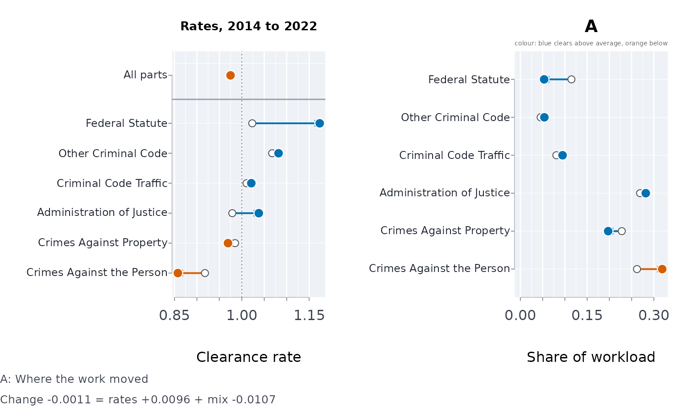
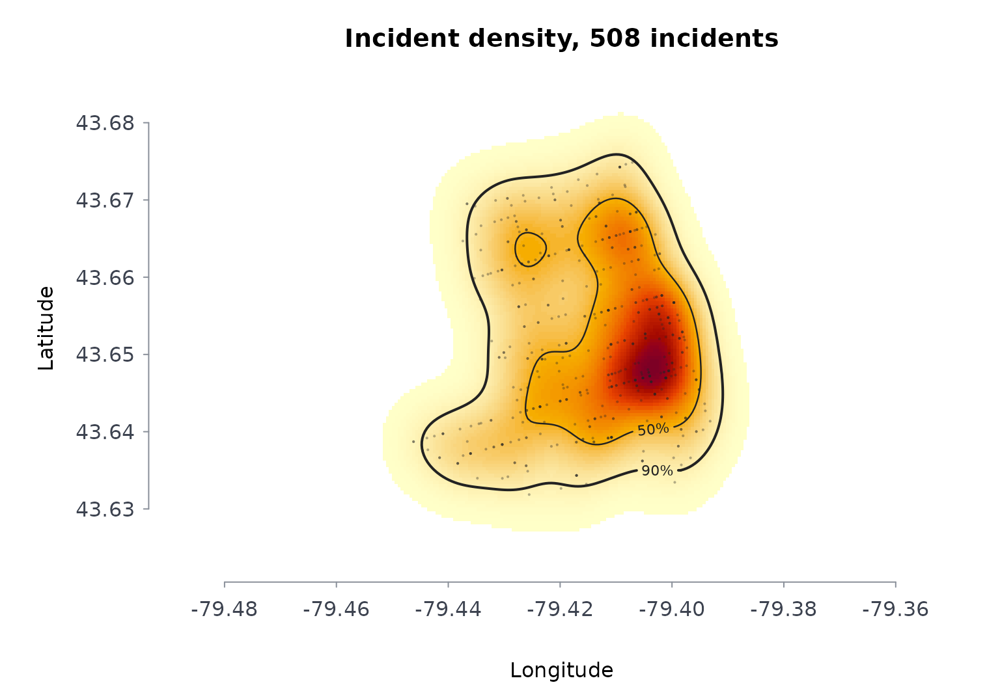
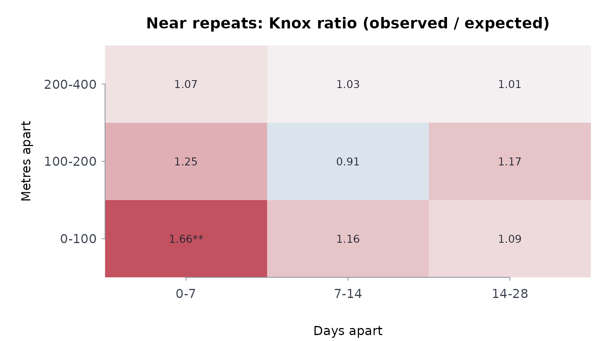

# Courts and crime: flow, time, outcomes, place and case mix

Court and police statistics are published as counts: cases received and
disposed each month, shares disposed within so many months, incidents
with a date and a place. This vignette works through the questions those
counts are asked to answer, on the Ontario Court of Justice’s criminal
statistics and the Toronto Police Service’s open data (see
`?justice-data` for every file and its source). Each section uses the
excerpt shipped with the package; the full tables, every edition and
every court, load from the data hub:

``` r

clearance <- dload("ocj_statistics/clearance_rate_criminal")
offences  <- dload("ocj_statistics/offence_based_criminal")
mci       <- dload("tps_open_data/major_crime_indicators_open_data_0")
```

## Is the court keeping up? Case flow and clearance

A court keeps up when it disposes of as many cases as it receives.
[`caseflow()`](https://rootcoder007.github.io/rmorie-bricklayer/reference/caseflow.md)
turns the monthly counts into the clearance rate (disposed per case
received) with an exact interval, its rolling twelve-month value, and,
from the pending count, how many months the inventory would take to
clear at the recent pace.

``` r

f <- ext("ocj_flow_ontario.csv")
cf <- caseflow(f$received, f$disposed, pend = f$pending, prd = f$month)
cf[
  c(1, 12, 24),
  c("period", "received", "disposed", "clearance", "rolclr", "pertoclear")
]
#>    period received disposed clearance    rolclr pertoclear
#> 1 2024-04    21265    22053  1.037056        NA   6.752097
#> 2 2025-03    20688    20996  1.014888 0.9742875   7.466076
#> 3 2026-03    20602    23136  1.122998 0.9937306   7.196190
plot(cf)
```


Over these 24 months the court disposed of 489,448 cases against 497,393
received, a clearance rate of 0.984. The monthly rate swings well beyond
its interval – summer months clear less – which is why the rolling rate
is the one to read.

## How long do cases take? A life table from banded times

The Court publishes the share of cases disposed within 10 months, 10 to
15, 15 to 18 and over 18.
[`lifetbl()`](https://rootcoder007.github.io/rmorie-bricklayer/reference/lifetbl.md)
reads those bands directly and gives the share still open at each band
edge, with a Greenwood interval, and the median.

``` r

d <- ext("ocj_time_to_disposition.csv")
last <- nrow(d)
shares <- unlist(d[last, c("under_10", "m10_15", "m15_18", "over_18")])
lt <- lifetbl(
  c(
    "Under 10 Months",
    "Between 10-15 Months",
    "Between 15-18 Months",
    "Over 18 Months"
  ),
  events = shares * f$disposed[last]
)
lt
#> ╭── Life table (actuarial) ────────────────────────────────────────────────╮
#> │   Bands     4                                                            │
#> │   Cases     23,136                                                       │
#> │   Events    23,136                                                       │
#> │   Censored  0                                                            │
#> │   Interval  95% log-log Greenwood                                        │
#> │                                                                          │
#> │   lower  upper  entering  events  censored  atrisk      q  survival      │
#> │   -----  -----  --------  ------  --------  ------  -----  --------      │
#> │       0     10    23,136  18,185         0  23,136  0.786   0.21400      │
#> │      10     15     4,951   2,869         0   4,951  0.579   0.09000      │
#> │      15     18     2,082     879         0   2,082  0.422   0.05200      │
#> │      18    Inf     1,203   1,203         0   1,203  1.000   0.00000      │
#> │                                                                          │
#> │   lower  95% CI              hazard                                      │
#> │   -----  ------------------  ------                                      │
#> │       0  [0.20874, 0.21931]  0.1295                                      │
#> │      10  [0.08636, 0.09373]  0.1632                                      │
#> │      15  [0.04919, 0.05491]  0.1784                                      │
#> │      18                                                                  │
#> │                                                                          │
#> │   Median time: 6.36 (linear within its band)                             │
#> │   survival is the share still without the event at the end of each band. │
#> │                                                                          │
#> │   A censored case counts as half a case at risk in its band.             │
#> ╰──────────────────────────────────────────────────────────────────────────╯
plot(lt)
```


The median of 6.4 months assumes cases are spread evenly within the
first band; the published average for the month is 185 days. Only
disposed cases are in these statistics, so the table describes the cases
that ended, not every case received.

## How do cases end? The mix of outcomes

``` r

x <- ext("ocj_dispositions.csv")
mix <- dispmix(x[, -(1:2)], prd = x$year, scores = x$year)
mix$trend[, c("outcome", "statistic", "pholm", "change")]
#>                         outcome    statistic        pholm        change
#> 1 withdrawn_stayed_before_trial 30150.915355 0.000000e+00  0.1292036827
#> 2      guilty_plea_before_trial 10825.914695 0.000000e+00 -0.0805960172
#> 3            other_before_trial     7.296441 6.909133e-03 -0.0002635828
#> 4            withdrawn_at_trial  2890.841438 0.000000e+00 -0.0127761314
#> 5          guilty_plea_at_trial  6782.412494 0.000000e+00 -0.0218969033
#> 6                other_at_trial   175.420561 9.691647e-40 -0.0006064793
#> 7               following_trial  2044.569303 0.000000e+00 -0.0130645687
plot(mix)
```


Every share comes with Goodman’s simultaneous interval (in
`mix$shares`). With a few hundred thousand cases a year every trend is
“significant”; the `change` column says how large each shift is. The
years are the scores, so the gaps at 2020 and 2023 (see `?justice-data`)
are spaced as they should be.

## Is a change in the clearance rate real? Simpson’s paradox and case mix

An aggregate clearance rate is a weighted average of the rates of its
parts – offence groups, courts – weighted by their share of the work. It
can fall while most parts improve, if the work shifts toward the parts
that clear more slowly. Demers and Rossmo (2015) found 210 such
reversals in fifteen years of clearance rates for Canada’s fifty largest
police services.
[`clrdcmp()`](https://rootcoder007.github.io/rmorie-bricklayer/reference/clrdcmp.md)
splits a change exactly into the change in the parts’ rates and the
change in the mix (Kitagawa, 1955), and tests the within-part change
with a Mantel-Haenszel rate ratio.

``` r

g <- ext("ocj_offence_groups.csv")
g <- g[g$year %in% c(2014, 2022), ]
cd <- clrdcmp(g$disposed, g$received, g$offence_group, g$year)
cd
#> ╭── Clearance rate, 2022 against 2014 (Kitagawa) ─────────────────────────────╮
#> │   Rate 2014                0.976                                            │
#> │   Rate 2022                0.9749                                           │
#> │   Change                   -0.0011 = rate effect +0.0096 + mix effect       │
#> │                            -0.0107                                          │
#> │   2022 at the 2014 mix     0.9912                                           │
#> │   2022 at the average mix  0.9830                                           │
#> │   Parts                    6                                                │
#> │                                                                             │
#> │   part                       rate 2014  rate 2022  share 2014  share 2022   │
#> │   -------------------------  ---------  ---------  ----------  ----------   │
#> │   Administration of Justice     0.9788      1.038      0.2689      0.2818   │
#> │   Crimes Against Property       0.9851      0.969      0.2279      0.1973   │
#> │   Crimes Against the Person     0.9180      0.858      0.2620      0.3187   │
#> │   Criminal Code Traffic         1.0105      1.021      0.0808      0.0948   │
#> │   Federal Statute               1.0232      1.173      0.1148      0.0534   │
#> │   Other Criminal Code           1.0675      1.082      0.0455      0.0539   │
#> │                                                                             │
#> │   part                       ratio  95% CI            rateeff     mixeff    │
#> │   -------------------------  -----  --------------  ---------  ---------    │
#> │   Administration of Justice  1.060  [1.048, 1.072]   0.016263   0.000424    │
#> │   Crimes Against Property    0.984  [0.971, 0.997]  -0.003375  -0.000052    │
#> │   Crimes Against the Person  0.934  [0.923, 0.945]  -0.017526  -0.004966    │
#> │   Criminal Code Traffic      1.011  [0.990, 1.031]   0.000939   0.000566    │
#> │   Federal Statute            1.147  [1.123, 1.171]   0.012631  -0.007535    │
#> │   Other Criminal Code        1.013  [0.987, 1.040]   0.000713   0.000834    │
#> │                                                                             │
#> │   4 of 6 parts rose, 2 fell.                                                │
#> │   Simpson's paradox through the mix: the aggregate fell, but at a fixed     │
#> │   mix it rose                                                               │
#> │   Rate effect: the change at a fixed case mix; mix effect: the change       │
#> │   from the mix of cases alone.                                              │
#> │                                                                             │
#> │   Rate ratio 2022/2014: crude 0.9989 (0.9929 to 1.0050); within parts       │
#> │   (Mantel-Haenszel) 1.0085 (1.0024 to 1.0146), p 0.006                      │
#> ╰─────────────────────────────────────────────────────────────────────────────╯
plot(cd)
```



``` r

# a group's share of the cases received in a year, as a percentage
caseshare <- function(group, yr) {
  sprintf(
    "%.0f%%",
    100 *
      sum(g$received[g$offence_group == group & g$year == yr]) /
      sum(g$received[g$year == yr])
  )
}
```

Between 2014 and 2022 the province-wide clearance rate moved by -0.0011.
Held at a fixed mix it moved by +0.0096; the shift of work contributed
-0.0107. Crimes against the person, the group with the lowest clearance
rate in both years, grew from 26% to 32% of the cases received, and
federal-statute cases, the group with the highest rate in 2022, fell
from 11% to 5%. 4 of the 6 groups cleared a larger share in 2022 and 2 a
smaller one. The crude ratio’s interval includes 1; the Mantel-Haenszel
ratio within offence groups is 1.0085 (1.0024 to 1.0146). Read alone,
the aggregate would say nothing changed; within the groups, taken
together, clearance improved, though not in every group.

The grouping matters, and so does the pair of years. By court, with
Toronto’s courthouses taken together (they were consolidated in 2023),
comparing 2012 with 2024:

``` r

c <- ext("ocj_courts.csv")
c <- aggregate(cbind(received, disposed) ~ year + court_series, c, sum)
c <- c[c$year %in% c(2012, 2024), ]
c <- c[c$court_series %in% names(which(table(c$court_series) == 2)), ]
cc <- clrdcmp(c$disposed, c$received, c$court_series, c$year)
cc$overall
#>       ratea     rateb       change     rateeff      mixeff staonbase  staonave
#> 1 0.9990086 0.9891387 -0.009869871 -0.01247238 0.002602504 0.9852411 0.9871899
cc$simpson$type
#> [1] "none"
```

Here the aggregate (-0.0099) and the rate at a fixed mix (-0.0125) move
the same way: no reversal, and 27 of 54 courts cleared a smaller share
in 2024. A decomposition does not always find a paradox; it says which
way the parts moved and how much the mix did.

## Where do incidents cluster? Kernel density

[`crmdens()`](https://rootcoder007.github.io/rmorie-bricklayer/reference/crmdens.md)
estimates the density of incidents in incidents per square kilometre and
outlines the smallest areas holding half and nine-tenths of them.

``` r

b <- ext("tps_break_enter_d14_2024.csv")
kd <- crmdens(b$lon, b$lat, ngrid = 150)
kd
#> ╭── Kernel density of incidents ───────────────────────────────────────╮
#> │   Incidents     508                                                  │
#> │   Coordinates   longitude and latitude, centred on -79.4114, 43.6508 │
#> │   Grid          150 x 150 cells                                      │
#> │   Bandwidth     0.337 km east-west, 0.412 km north-south             │
#> │   Peak density  77.92 incidents per km2                              │
#> │                                                                      │
#> │   The smallest areas holding each share of incidents                 │
#> │   incidents  areakm2  shrofmaparea  densatedge                       │
#> │   ---------  -------  ------------  ----------                       │
#> │   50%           5.50  11.9%              31.88                       │
#> │   90%          14.84  32.1%              11.23                       │
#> │                                                                      │
#> │   508 incidents; bandwidth 0.337 km east-west, 0.412 km north-south  │
#> │   50% of the incidents lie in 11.9% of the mapped area.              │
#> ╰──────────────────────────────────────────────────────────────────────╯
plot(kd)
```



## Do incidents repeat nearby, soon after? The Knox test

Break-ins close in space and time to an earlier one are the near-repeat
pattern. The Knox test compares the pairs close in both with the number
expected if the dates were shuffled among the places; the expectation is
exact, and a permutation test gives each cell’s p-value.

``` r

b <- b[!is.na(b$lon), ]
kn <- knoxtst(b$lon, b$lat, as.Date(b$occ_date), spcbands = c(100, 200, 400),
                tmbands = c(7, 14, 28), nsim = 199, seed = 1)
kn
#> ╭── Knox test of near-repeat incidents ───────────────────────────────────────╮
#> │   Incidents     508                                                         │
#> │   Permutations  199                                                         │
#> │   Close pairs   5,585                                                       │
#> │   Space bands   100, 200, 400                                               │
#> │   Time bands    7, 14, 28                                                   │
#> │                                                                             │
#> │   Knox ratios, observed / expected pairs                                    │
#> │   distance   0-7 d   7-14 d  14-28 d                                        │
#> │   ---------  ------  ------  -------                                        │
#> │   0-100 m    1.66**  1.16    1.09                                           │
#> │   100-200 m  1.25    0.91    1.17                                           │
#> │   200-400 m  1.07    1.03    1.01                                           │
#> │                                                                             │
#> │   A ratio above 1: more pairs this close in space and in time than          │
#> │   chance alone gives, the near-repeat pattern.                              │
#> │                                                                             │
#> │   * p < 0.05, ** p < 0.01, one-sided per cell (not adjusted for the number  │
#> │   of cells); - nothing expected                                             │
#> ╰─────────────────────────────────────────────────────────────────────────────╯
plot(kn)
```



## Do the hot spots last?

A hot spot that stays put is a place problem; one that moves is not.
[`hotpers()`](https://rootcoder007.github.io/rmorie-bricklayer/reference/hotpers.md)
counts the incidents in grid cells each period, reports the share of
places that holds half of them, which cells are hot (the busiest 5% of
the cells with any incident), and how much each period’s hot spots
overlap the previous period’s:

``` r

h <- hotpers(b$lon, b$lat, quarters(as.Date(b$occ_date)), cell = 0.3)
h
#> ╭── Hot spots ──────────────────────────────────────────────────────────────╮
#> │   Active cells             139                                            │
#> │   Cell side                0.3 km                                         │
#> │   Periods                  4                                              │
#> │   Hot cells                the busiest 7 (5%)                             │
#> │   Hot in half the periods  7                                              │
#> │                                                                           │
#> │   By period                                                               │
#> │   period  incidents  actcells  cellsforhalf  shrforhalf  hotcells  tiedin │
#> │   ------  ---------  --------  ------------  ----------  --------  ------ │
#> │   Q1            128        77            22  15.8%             11       4 │
#> │   Q2            133        74            22  15.8%              7       0 │
#> │   Q3            112        70            19  13.7%              7       0 │
#> │   Q4            135        72            23  16.5%              4       0 │
#> │                                                                           │
#> │   period  tiedout  hotshr  jacpre                                         │
#> │   ------  -------  ------  ------                                         │
#> │   Q1            0  32.8%                                                  │
#> │   Q2            0  22.6%   0.2857                                         │
#> │   Q3            0  26.8%   0.1667                                         │
#> │   Q4           12  13.3%   0.1000                                         │
#> │                                                                           │
#> │   The busiest 7 cells hold 13.3% to 32.8% of a period's incidents.        │
#> │   Their overlap with the period before averages 0.184: the hot set is     │
#> │   mostly new each period, so these spots do not persist. 7 cells are      │
#> │   hot in at least half the periods.                                       │
#> │                                                                           │
#> │   shrforhalf is the share of active cells that hold half the incidents,   │
#> │   hotshr the share of incidents in the hot cells, and jacpre the          │
#> │   overlap of the hot cells with the period before (1 = the same cells).   │
#> │   Cells tied with the busiest 7 were left out of the hot set: the         │
#> │   counts are too even (or the cells too small) to single out hot spots.   │
#> │   period Q4: 12 cells tied                                                │
#> ╰───────────────────────────────────────────────────────────────────────────╯
plot(h)
```


The hot set is the busiest 7 cells and every cell tied with the last of
them. When a tie would make more than twice that many cells hot, the
counts do not single those cells out, so the tied group is left out and
counted under `tiedout`: a quarter can then show fewer hot cells than 7,
a smaller hot share, and an overlap with its neighbours that cannot be
computed (left blank), as in Q4 here.

Pairs of break-ins within 100 metres and a week of each other occur 1.66
times as often as chance would give.

## Indigenous life expectancy

[`lifetbl()`](https://rootcoder007.github.io/rmorie-bricklayer/reference/lifetbl.md)
works from counts of events in age intervals. Where only published
summaries exist, as for Indigenous life expectancy, the comparison is
made on the published estimates and their intervals instead:

``` r

le <- indiex("lifeexp")
le[le$period == "2016/2021", c("group", "estimate", "lower", "upper")]
#>                                                group estimate lower upper
#> 15                                             Métis    80.47 79.98 80.95
#> 16                                             Inuit    71.91 70.80 73.03
#> 17              First Nations (Registered or Treaty)    73.98 73.63 74.33
#> 18  First Nations (Registered or Treaty), on reserve    71.42 71.02 71.81
#> 19 First Nations (Registered or Treaty), off reserve    76.04 75.37 76.71
#> 20          First Nations, without registered status    79.23 78.42 80.04
#> 21                                    Non-Indigenous    84.99 84.93 85.04
```

## References

Demers, S. and Rossmo, D. K. (2015). Simpson’s paradox in Canadian
police clearance rates. *Canadian Journal of Criminology and Criminal
Justice*, 57(3), 424-434.

Kitagawa, E. M. (1955). Components of a difference between two rates.
*Journal of the American Statistical Association*, 50(272), 1168-1194.

Knox, E. G. (1964). The detection of space-time interactions. *Journal
of the Royal Statistical Society, Series C*, 13(1), 25-30.
