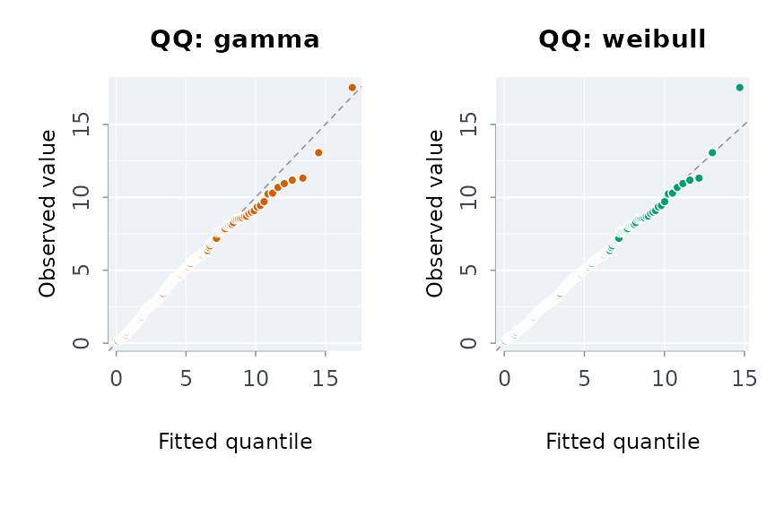

# The analysis dashboard

[`rmblapp()`](https://rootcoder007.github.io/rmorie-bricklayer/reference/rmblapp.md)
opens a dashboard over the package’s analyses in your browser. It runs
on your machine, in your R session. It needs the shiny package.

``` r

rmblapp()                          # start empty, load data at the left
rmblapp(indiex("health"))          # start with a data frame
rmblapp(capsule = "path/to/capsule")
```

From a terminal, `rmbl app [PATH] [--port N] [--no-browser]` does the
same. PATH is a CSV file or a capsule directory.

Every analysis shows the R call it ran, and it runs exactly that call.
Copy the call into a script and you get the same result. When a function
refuses, the tab shows the refusal in the package’s words, with
[`explerr()`](https://rootcoder007.github.io/rmorie-bricklayer/reference/explerr.md)’s
note on where it comes from.

## Loading data

The panel at the left takes a CSV file (plain or gzip), a capsule
directory, or a table from data.rmorie.com. For a capsule it loads the
pinned data file. For data.rmorie.com, sign in first with `rmbl login`.
The app never holds your data key:
[`dload()`](https://rootcoder007.github.io/rmorie-bricklayer/reference/dmnf.md)
reads it from where `rmbl login` stored it. The column types are listed
under the source. Each tab also offers example data, so you can try
every form before loading your own.

## The tabs

- **Describe**:
  [`profcols()`](https://rootcoder007.github.io/rmorie-bricklayer/reference/profcols.md),
  [`freqtbl()`](https://rootcoder007.github.io/rmorie-bricklayer/reference/freqtbl.md),
  [`cortbl()`](https://rootcoder007.github.io/rmorie-bricklayer/reference/cortbl.md),
  [`mahaoutl()`](https://rootcoder007.github.io/rmorie-bricklayer/reference/mahaoutl.md)
  and
  [`missgrid()`](https://rootcoder007.github.io/rmorie-bricklayer/reference/missgrid.md),
  plus ridgelines, distribution functions, violins, hexagonal bins and
  concentration curves.
- **Year over year**:
  [`yoy()`](https://rootcoder007.github.io/rmorie-bricklayer/reference/yoy.md)
  with the period, value, groups, the smallest base for a percentage and
  which direction is better. Download the result as the
  [`yoyhtml()`](https://rootcoder007.github.io/rmorie-bricklayer/reference/yoyren.md)
  page.
- **Rates**:
  [`rtcalc()`](https://rootcoder007.github.io/rmorie-bricklayer/reference/rtcalc.md),
  [`ratechg()`](https://rootcoder007.github.io/rmorie-bricklayer/reference/ratechg.md)
  and
  [`shrs()`](https://rootcoder007.github.io/rmorie-bricklayer/reference/shrs.md).
  A rate per population and a share of a total stay apart.
- **Trends**:
  [`trndtst()`](https://rootcoder007.github.io/rmorie-bricklayer/reference/trndtst.md)
  (Mann-Kendall with the Theil-Sen slope),
  [`stepchg()`](https://rootcoder007.github.io/rmorie-bricklayer/reference/stepchg.md),
  [`cnttrnd()`](https://rootcoder007.github.io/rmorie-bricklayer/reference/cnttrnd.md),
  a calendar heatmap, a horizon chart, small multiples and a bump chart.
- **Survey**:
  [`svydes()`](https://rootcoder007.github.io/rmorie-bricklayer/reference/svydes.md)
  with weights, strata, clusters or replicate weights, then
  [`svyest()`](https://rootcoder007.github.io/rmorie-bricklayer/reference/svyest.md)
  or
  [`svycmp()`](https://rootcoder007.github.io/rmorie-bricklayer/reference/svycmp.md).
- **Distributions**:
  [`dstfit()`](https://rootcoder007.github.io/rmorie-bricklayer/reference/dstfit.md)
  fits candidate distributions and ranks them, with density, QQ, PP and
  tail plots. You can draw a synthetic sample from the best fit with
  [`mksyncol()`](https://rootcoder007.github.io/rmorie-bricklayer/reference/mksyncol.md).
- **Drift**: the drift app, when this version has it.
- **Capsule**: a capsule’s provenance, manifest, attestation and bundle
  files. Its buttons run
  [`vrfcps()`](https://rootcoder007.github.io/rmorie-bricklayer/reference/vrfcps.md)
  and
  [`cpschk()`](https://rootcoder007.github.io/rmorie-bricklayer/reference/cpschk.md),
  or
  [`cpsrfrsh()`](https://rootcoder007.github.io/rmorie-bricklayer/reference/cpsrfrsh.md).
- **Policy**: the panel designs on unit-by-period data, from
  [`plndid()`](https://rootcoder007.github.io/rmorie-bricklayer/reference/plndid.md)
  and
  [`evstudy()`](https://rootcoder007.github.io/rmorie-bricklayer/reference/evstudy.md)
  to
  [`syndid()`](https://rootcoder007.github.io/rmorie-bricklayer/reference/syndid.md),
  [`wcb()`](https://rootcoder007.github.io/rmorie-bricklayer/reference/wcb.md),
  [`plnpwr()`](https://rootcoder007.github.io/rmorie-bricklayer/reference/plnpwr.md)
  and
  [`tse()`](https://rootcoder007.github.io/rmorie-bricklayer/reference/tse.md).
  The panel names the assumption they share: without the policy, the
  outcomes would have moved in parallel. Read the pre-period
  coefficients and the cohort trends before the estimate.
- **First Nations, Métis and Inuit**: Statistics Canada’s tables as
  [`indiex()`](https://rootcoder007.github.io/rmorie-bricklayer/reference/indiex.md)
  ships them, or your own in the same layout. Each distinction is
  reported on its own. Suppressed cells stay suppressed, and the quality
  flags are shown. The panel states the OCAP® and CARE principles and
  links the source tables.
- **Courts and corrections**:
  [`stkflow()`](https://rootcoder007.github.io/rmorie-bricklayer/reference/stkflow.md),
  [`caseflow()`](https://rootcoder007.github.io/rmorie-bricklayer/reference/caseflow.md),
  [`clrdcmp()`](https://rootcoder007.github.io/rmorie-bricklayer/reference/clrdcmp.md),
  [`dispmix()`](https://rootcoder007.github.io/rmorie-bricklayer/reference/dispmix.md),
  [`lifetbl()`](https://rootcoder007.github.io/rmorie-bricklayer/reference/lifetbl.md),
  [`crmdens()`](https://rootcoder007.github.io/rmorie-bricklayer/reference/crmdens.md),
  [`knoxtst()`](https://rootcoder007.github.io/rmorie-bricklayer/reference/knoxtst.md),
  [`rgnmapintg()`](https://rootcoder007.github.io/rmorie-bricklayer/reference/rgnmapintg.md),
  and the SIU readers
  [`siuprs()`](https://rootcoder007.github.io/rmorie-bricklayer/reference/siuprs.md)
  and
  [`siuso()`](https://rootcoder007.github.io/rmorie-bricklayer/reference/siuso.md)
  on pasted text.
- **Air pollution**: a plume map
  ([`plmfld()`](https://rootcoder007.github.io/rmorie-bricklayer/reference/plmfld.md)),
  a downwind profile and receptor concentrations
  ([`gplume()`](https://rootcoder007.github.io/rmorie-bricklayer/reference/pgsig.md)),
  the concentration-response functions,
  [`polbrdn()`](https://rootcoder007.github.io/rmorie-bricklayer/reference/polbrdn.md)
  and
  [`vrfpol()`](https://rootcoder007.github.io/rmorie-bricklayer/reference/vrfpol.md).
- **Hawkes**:
  [`chwkfit()`](https://rootcoder007.github.io/rmorie-bricklayer/reference/chwkfit.md)
  with
  [`plothwk()`](https://rootcoder007.github.io/rmorie-bricklayer/reference/plothwk.md)
  (intensity, time-rescaling check, branching tree) and
  [`chwksim()`](https://rootcoder007.github.io/rmorie-bricklayer/reference/chwksim.md).
- **Proof ledger**: a ledger from a file, a capsule or an installed
  package, its theorems and
  [`ldgrchk()`](https://rootcoder007.github.io/rmorie-bricklayer/reference/ldgrread.md)’s
  rows.
- **Report**: what you added from the tabs. Save it as one HTML page
  with the plots as inline SVG, as Markdown, or copy it as a GitHub
  comment.
- **Settings**: the theme (light, dark or as the system is set), printed
  digits, and the seed the seeded analyses use.

## The same work in a script

What the Distributions tab runs:

``` r

set.seed(1)
wait <- stats::rgamma(300, 2, 0.5)
fit <- dstfit(wait, nboot = 50)
fit$table[, c("rank", "family", "aic", "ks")]
#>   rank      family      aic         ks
#> 1    1     weibull 1351.093 0.02543328
#> 2    2       gamma 1352.651 0.03906373
#> 3    3   lognormal 1387.446 0.07363527
#> 4    4 exponential 1420.742 0.14763458
#> 5    5           t 1428.453 0.08260813
#> 6    6      normal 1438.345 0.09559638
#> 7    7      pareto 1895.463 0.36065534
plot(fit, which = "qq", fams = c("gamma", "weibull"))
```



And what the Proof ledger tab runs on the sample ledger:

``` r

led <- ldgrread(system.file("extdata", "ledger_sample.json", package = "rmoriebricklayer"))
led
#> Proof ledger rmoriebricklayer sample ledger: 3 theorems (1 proved, 1 sorry, 1 axiom)
#>   https://github.com/rootcoder007/rmorie-proofs @ 0123456789ab, Lean v4.12.0
ldgrchk(led)[, c("check", "ok", "severity")]
#>                                                check    ok severity
#> 1                                 proved: gini-equal  TRUE    error
#> 2     covered: gini-equal rmoriebricklayer::ginicoef  TRUE    error
#> 3                                  check: gini-equal  TRUE    error
#> 4                            proved: lorenz-monotone FALSE    error
#> 5 covered: lorenz-monotone rmoriebricklayer::lorenzc  TRUE    error
#> 6                                proved: float-round FALSE     warn
```

A ledger records the theorems of a formal-proof build and the functions
each one covers. Any package can ship one in `inst/ledger/`, and the tab
finds it there. A theorem counts as proved only when no `sorry` remains.
An axiom is assumed, not proved, so it shows as a warning. A ledger
pinned in a capsule (provenance `kind: "ledger"`) is checked by
`rmbl verify` too.
