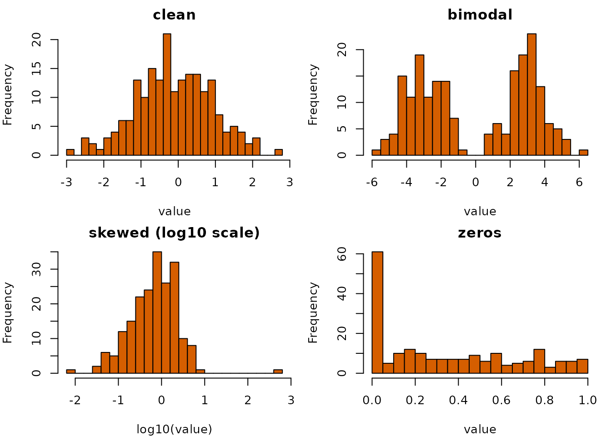

# Look at the data first

A capsule is only worth pinning if somebody looked at the data first.
Looking is the step that gets skipped, because it is tedious and because
it is never obviously necessary until afterwards.

This vignette is the short version of looking.

## One command

[`cpsrpt()`](https://rootcoder007.github.io/rmorie-bricklayer/reference/cpsrpt.md)
runs the checks this package provides and puts the findings in one
place, worst first.

``` r

reference <- data.frame(
  id = 1:300,
  score = stats::runif(300, 0, 10),
  grade = sample(c("a", "b", "c"), 300, TRUE),
  stringsAsFactors = FALSE
)

fresh <- reference
fresh$score <- stats::runif(300, 0, 10)

cpsrpt(fresh, ref = reference,
               schema = infsch(reference))
#> ╭── Capsule report ─────────────────────────────────────────╮
#> │   Verdict        ✓ these checks found nothing             │
#> │   Rows           300                                      │
#> │   Columns        3                                        │
#> │   Missing cells  0.0%                                     │
#> │   Complete rows  100.0%                                   │
#> │   Digest         6037a08fc090f81243bc07b5094099e0         │
#> │   Findings       0                                        │
#> │                                                           │
#> │   No finding is proof of correctness: each check has a    │
#> │   stated blind spot, and a small sample has little power. │
#> ╰───────────────────────────────────────────────────────────╯
```

Now a fetch that went wrong in four different ways at once — a rescaled
column, a category nobody expected, a column that arrived empty, and one
that arrived constant:

``` r

broken <- fresh
broken$score <- broken$score * 5
broken$grade[1:100] <- "z"
broken$dead <- NA_real_
broken$flat <- 7

report <- cpsrpt(broken, ref = reference,
                         schema = infsch(reference))
report
#> ╭── Capsule report ───────────────────────────────────────────────────────────╮
#> │   Verdict        ✗ WARNINGS: something moved                                │
#> │   Rows           300                                                        │
#> │   Columns        5                                                          │
#> │   Missing cells  20.0%                                                      │
#> │   Complete rows  0.0%                                                       │
#> │   Digest         a70671d4bd03067f631d54ce3143d9a2                           │
#> │   Findings       8                                                          │
#> │                                                                             │
#> │   No finding is proof of correctness: each check has a                      │
#> │   stated blind spot, and a small sample has little power.                   │
#> │                                                                             │
#> │   FAIL warn  drift      grade: categorical test, p = < 0.001                │
#> │   FAIL warn  drift      score: numeric test, p = < 0.001                    │
#> │   FAIL warn  missing    dead: column(s) entirely missing                    │
#> │   FAIL warn  schema     range_score: Column 'score' has 226 value(s)        │
#> │                         outside [-0.8488307, 10.90645]                      │
#> │   FAIL warn  schema     unexpected_grade: Column 'grade' has unexpected     │
#> │                         values: z                                           │
#> │   !    note  drift      dead, flat: column(s) not in the reference          │
#> │   !    note  missing    dead: a contiguous run of 300 missing values from   │
#> │                         row 1 -- one outage rather than scattered failures  │
#> │   !    note  shape      flat: constant: no information, and it breaks       │
#> │                         anything scaled by variance                         │
#> ╰─────────────────────────────────────────────────────────────────────────────╯
```

``` r

report$verdict
#> [1] "warn"
summary(report)
#> verdict   fatal    warn    note 
#>  "warn"     "0"     "5"     "3"
```

Each problem is reported **once**. An entirely missing column is
missing, is trivially constant, and makes any covariance singular —
reporting all three would bury the findings that matter under a single
cause.

[`rptmd()`](https://rootcoder007.github.io/rmorie-bricklayer/reference/rptmd.md)
writes the same assessment beside the capsule it describes, so it
outlives the console.

``` r

cat(head(rptmd(report), 12), sep = "\n")
#> # Capsule report
#> 
#> **Warnings** -- something moved.
#> 
#> | | |
#> |---|---|
#> | rows | 300 |
#> | columns | 5 |
#> | missing cells | 20.0% |
#> | complete rows | 0.0% |
#> | data digest | `a70671d4bd03067f631d54ce3143d9a29a498637315736cf2770ec5777746c33` |
```

## Per column

[`profcols()`](https://rootcoder007.github.io/rmorie-bricklayer/reference/profcols.md)
is the underlying description. It reports the classical and robust
centre side by side, which is the cheapest outlier detector there is:
where a mean and a median disagree, the mean is not describing the
column.

``` r

messy <- data.frame(
  clean = stats::rnorm(200),
  bimodal = c(stats::rnorm(100, -3), stats::rnorm(100, 3)),
  skewed = c(stats::rexp(199), 500),
  zeros = c(rep(0, 50), stats::runif(150))
)
profcols(messy)[, c("column", "mean", "median", "sd", "mad")]
#> ╭── Column profile ─────────────────────────────────────────────────────╮
#> │   Rows     4                                                          │
#> │   Columns  5                                                          │
#> │                                                                       │
#> │   column      mean   median      sd     mad                           │
#> │   -------  -------  -------  ------  ------                           │
#> │   clean    -0.1092  -0.1446   1.034  1.0397                           │
#> │   bimodal  -0.0061  -0.2015   3.221  4.4949                           │
#> │   skewed    3.6339   0.7332  35.295  0.8114                           │
#> │   zeros     0.3428   0.2657   0.320  0.3939                           │
#> │                                                                       │
#> │   Some of this result's columns are not here (a subset of it?), so it │
#> │   is shown as a plain table.                                          │
#> ╰───────────────────────────────────────────────────────────────────────╯
```

The `hist` column carries what no single number can:

``` r

profcols(messy)[, c("column", "hist")]
#> ╭── Column profile ─────────────────────────────────────────────────────╮
#> │   Rows     4                                                          │
#> │   Columns  2                                                          │
#> │                                                                       │
#> │   column   hist                                                       │
#> │   -------  ----------                                                 │
#> │   clean    ▁▂▃▇█▇▇▃▃▁                                                 │
#> │   bimodal  ▂▆▆▅ ▂▄█▄▁                                                 │
#> │   skewed   █        ▁                                                 │
#> │   zeros    █▃▂▂▂▂▂▃▁▂                                                 │
#> │                                                                       │
#> │   Some of this result's columns are not here (a subset of it?), so it │
#> │   is shown as a plain table.                                          │
#> ╰───────────────────────────────────────────────────────────────────────╯
```

`bimodal` is visibly two humps. Its mean and median agree perfectly and
tell you nothing about that.

## Where the gaps are

The *rate* of missingness is the least interesting thing about it. Two
frames with identical per-column rates can need completely different
handling:

``` r

structural <- data.frame(
  id = 1:20,
  a = c(rep(NA, 6), 7:20),
  b = c(rep(NA, 6), 7:20)
)
scattered <- data.frame(
  id = 1:20,
  a = c(rep(NA, 6), 7:20),
  b = c(1:14, rep(NA, 6))
)

c(structural = sum(is.na(structural$a)), scattered = sum(is.na(scattered$a)))
#> structural  scattered 
#>          6          6
```

``` r

misspat(structural)
#> ╭── Missingness patterns ─────────────────────────────────────────────────────╮
#> │   Columns   in pattern order: id, a, b                                      │
#> │   Patterns  2                                                               │
#> │   Rows      20                                                              │
#> │                                                                             │
#> │   pattern  n_rows  pctrows  n_missing  columns                              │
#> │   -------  ------  -------  ---------  -------                              │
#> │   ...          14  70.0             0                                       │
#> │   .XX           6  30.0             2  a, b                                 │
#> │                                                                             │
#> │   Each pattern marks the columns missing together; a few large patterns     │
#> │   point to a cause worth naming before rows are dropped.                    │
#> ╰─────────────────────────────────────────────────────────────────────────────╯
```

``` r

misspat(scattered)
#> ╭── Missingness patterns ─────────────────────────────────────────────────────╮
#> │   Columns   in pattern order: id, a, b                                      │
#> │   Patterns  3                                                               │
#> │   Rows      20                                                              │
#> │                                                                             │
#> │   pattern  n_rows  pctrows  n_missing  columns                              │
#> │   -------  ------  -------  ---------  -------                              │
#> │   ...           8  40.0             0                                       │
#> │   ..X           6  30.0             1  b                                    │
#> │   .X.           6  30.0             1  a                                    │
#> │                                                                             │
#> │   Each pattern marks the columns missing together; a few large patterns     │
#> │   point to a cause worth naming before rows are dropped.                    │
#> ╰─────────────────────────────────────────────────────────────────────────────╯
```

Two patterns against three. In the first, one structural gap took out
both columns in the same rows — those rows are a different population,
and often belong dropped or modelled separately. In the second the
failures are independent.

[`missruns()`](https://rootcoder007.github.io/rmorie-bricklayer/reference/missruns.md)
answers a different question again — whether a gap is one outage or many
failures:

``` r

missruns(data.frame(
  outage = c(1, 2, rep(NA, 8), 11:20),
  sporadic = c(1, NA, 3, NA, 5, NA, 7:20)
), minrun = 2)
#> ╭── Runs of consecutive missing values ───────────────────────────────────╮
#> │   Runs               1                                                  │
#> │   Columns with runs  1                                                  │
#> │   Longest run        8                                                  │
#> │                                                                         │
#> │   column  start  end  length                                            │
#> │   ------  -----  ---  ------                                            │
#> │   outage      3   10       8                                            │
#> │                                                                         │
#> │   Long runs of missing rows usually mean a source stopped reporting for │
#> │   a while, not values missing at random.                                │
#> ╰─────────────────────────────────────────────────────────────────────────╯
```

And
[`missgrid()`](https://rootcoder007.github.io/rmorie-bricklayer/reference/missgrid.md)
shows the whole table at once, with no graphics device, so it works over
SSH and inside a plain-text summary:

``` r

gappy <- data.frame(
  complete = 1:100,
  early = c(rep(NA, 30), 31:100),
  random = ifelse(stats::runif(100) < 0.3, NA, 1),
  late = c(1:70, rep(NA, 30))
)
missgrid(gappy, height = 10)
#> ── Missingness map ───────────────────────────────────────────────
#>          cerl
#>          oaaa
#>          mrnt
#>          plde
#>          lyo
#>          em
#>          t
#>          e
#>        1  █░ 
#>       11  █░ 
#>       21  █▒ 
#>       31     
#>       41   ░ 
#>       51   ▒ 
#>       61     
#>       71   ░█
#>       81   ░█
#>       91    █
#> 
#>   legend: ' ' none  '█' all missing
#> ──────────────────────────────────────────────────────────────────
```

## Is the missingness itself a problem?

Dropping incomplete rows is unbiased **only** if the data are missing
completely at random. Otherwise the complete cases are a biased sample
and every downstream estimate inherits the bias.

[`mcartst()`](https://rootcoder007.github.io/rmorie-bricklayer/reference/mcartst.md)
is Little’s test for that assumption. It needs maximum-likelihood
estimates of the mean and covariance *under* missingness, which have no
closed form, so it carries an EM estimator.

``` r

n <- 400
x <- stats::rnorm(n)
y <- x + stats::rnorm(n)

# Missing on a coin flip: nothing to find.
mcar <- data.frame(x = x, y = y)
mcar$y[sample(n, 120)] <- NA
mcartst(mcar)
#> ╭── Little's MCAR test ────────────────────────────────────────────╮
#> │   Verdict        ✓ no departure from MCAR detected               │
#> │   Statistic      0.817                                           │
#> │   df             1                                               │
#> │   p-value        0.366                                           │
#> │   Patterns       2                                               │
#> │   Variables      2                                               │
#> │   Rows used      400                                             │
#> │   EM iterations  12                                              │
#> │                                                                  │
#> │   Not evidence OF MCAR: a large p-value is a failure to detect a │
#> │   departure, and this test has little power on small samples.    │
#> ╰──────────────────────────────────────────────────────────────────╯
```

``` r

# Missing whenever x is large: the complete cases are a biased sample,
# and that is detectable because the pattern's mean of x is shifted.
mar <- data.frame(x = x, y = y)
mar$y[x > 0.4] <- NA
mcartst(mar)
#> ╭── Little's MCAR test ────────────────────────────────────────────────────╮
#> │   Verdict        ✗ MCAR rejected: the missingness is related to the data │
#> │   Statistic      247.984                                                 │
#> │   df             1                                                       │
#> │   p-value        < 0.001                                                 │
#> │   Patterns       2                                                       │
#> │   Variables      2                                                       │
#> │   Rows used      400                                                     │
#> │   EM iterations  71                                                      │
#> │                                                                          │
#> │   Rows with different patterns of missing values have different means:   │
#> │   an analysis of the complete rows alone may be biased.                  │
#> ╰──────────────────────────────────────────────────────────────────────────╯
```

Read the caveat the second report prints. A large p-value is a failure
to detect a departure, not evidence of MCAR, and the test has little
power on small samples. Neither this test nor any other can separate
missing-at-random from missing-**not**-at-random, because that depends
on values that were never observed — only knowing how the data were
collected settles it.

## Rows that do not belong

A row can be unremarkable on every column separately and impossible
jointly.

``` r

people <- data.frame(heightcm = stats::rnorm(300, 170, 10))
people$weightkg <- people$heightcm * 0.5 + stats::rnorm(300, 0, 5)

# Inside both marginal ranges, outside the cloud.
people[1, ] <- list(heightcm = 150, weightkg = 140)

range(people$heightcm)
#> [1] 146.2977 196.0117
range(people$weightkg)
#> [1]  61.95293 140.00000
```

``` r

head(mahaoutl(people), 3)
#> ╭── Mahalanobis outliers (robust) ──────────────────────────────────────╮
#> │   Verdict  ! 1 of 3 rows beyond alpha = 0.001                         │
#> │                                                                       │
#> │   Largest distances first                                             │
#> │   row  distance  p_value  logpvalue  outlier                          │
#> │   ---  --------  -------  ---------  -------                          │
#> │     1    10.803  < 0.001    -58.355  TRUE                             │
#> │    59     3.139    0.007     -4.926  FALSE                            │
#> │   203     2.908    0.015     -4.228  FALSE                            │
#> │                                                                       │
#> │   1 of 3 rows lie beyond alpha = 0.001: row 1 (distance 10.8).        │
#> │                                                                       │
#> │   The distance measures how far a row is from the centre of the data  │
#> │   once the columns' scales and correlations are allowed for; the      │
#> │   p-value is from the chi-square distribution it would follow without │
#> │   outliers, and logpvalue its natural log, for rows far in the tail.  │
#> ╰───────────────────────────────────────────────────────────────────────╯
```

The default is a robust centre and scale, and that default matters more
than it sounds: outliers inflate the very covariance used to judge them,
so with several of them the classical distance hides exactly the rows it
is meant to find.

``` r

many <- people
many[1:8, ] <- list(heightcm = rep(150, 8), weightkg = rep(140, 8))

c(robust = mahaoutl(many, robust = TRUE)$distance[1],
  classical = mahaoutl(many, robust = FALSE)$distance[1])
#>    robust classical 
#>  5.629601  5.510207
```

## Figures that were not measured

Quantities spanning several orders of magnitude follow Benford’s law.
Figures that were rounded, capped, rescaled or invented usually do not.

``` r

benfordtst(10^stats::runif(2000, 0, 6))
#> ╭── Benford first-digit screen ───────────────────────────────────────────╮
#> │   ✓ consistent with Benford's law                                       │
#> │                                                                         │
#> │   values used  2,000                                                    │
#> │   chi-square   3.183                                                    │
#> │   df           8                                                        │
#> │   p-value      0.922                                                    │
#> │                                                                         │
#> │   digit  observed  expected        shape                                │
#> │       1     0.305     0.301  ####################                       │
#> │       2     0.172     0.176  ###########                                │
#> │       3     0.127     0.125  ########                                   │
#> │       4     0.088     0.097  ######                                     │
#> │       5     0.083     0.079  #####                                      │
#> │       6     0.065     0.067  ####                                       │
#> │       7     0.060     0.058  ####                                       │
#> │       8     0.056     0.051  ####                                       │
#> │       9     0.044     0.046  ###                                        │
#> │                                                                         │
#> │   The leading digits are consistent with Benford's law (p = 0.922); the │
#> │   largest gap is at 4, 8.8% seen against 9.7% expected. Benford's law   │
#> │   expects a leading 1 about 30% of the time and a 9 under 5%. A         │
#> │   departure is a reason to look closer (rounding, thresholds, made-up   │
#> │   figures), never proof by itself.                                      │
#> ╰─────────────────────────────────────────────────────────────────────────╯
```

``` r

benfordtst(as.numeric(paste0(sample(1:9, 2000, TRUE), "000")))
#> ╭── Benford first-digit screen ───────────────────────────────────────────╮
#> │   ! departs from Benford's law (screen only, not a verdict)             │
#> │                                                                         │
#> │   values used  2,000                                                    │
#> │   chi-square   859.762                                                  │
#> │   df           8                                                        │
#> │   p-value      < 0.001                                                  │
#> │                                                                         │
#> │   digit  observed  expected        shape                                │
#> │       1     0.117     0.301  ###################                        │
#> │       2     0.103     0.176  #################                          │
#> │       3     0.098     0.125  ################                           │
#> │       4     0.120     0.097  ####################                       │
#> │       5     0.113     0.079  ##################                         │
#> │       6     0.101     0.067  ################                           │
#> │       7     0.122     0.058  ####################                       │
#> │       8     0.113     0.051  ##################                         │
#> │       9     0.113     0.046  ##################                         │
#> │                                                                         │
#> │   The leading digits depart from Benford's law (p < 0.001); the largest │
#> │   gap is at 1, 11.7% seen against 30.1% expected. Benford's law expects │
#> │   a leading 1 about 30% of the time and a 9 under 5%. A departure is a  │
#> │   reason to look closer (rounding, thresholds, made-up figures), never  │
#> │   proof by itself.                                                      │
#> ╰─────────────────────────────────────────────────────────────────────────╯
```

This is a **screen**, not a verdict. Postcodes, year fields, prices
ending in 99 and anything with a unit floor all violate Benford’s law
perfectly legitimately. A small p-value is a reason to look.

## What none of this does

Every check here has a blind spot, and a clean report means only that
these particular checks found nothing:

- the drift tests have little power on small samples;
- [`mcartst()`](https://rootcoder007.github.io/rmorie-bricklayer/reference/mcartst.md)
  assumes multivariate normality, so on markedly non-normal columns a
  rejection may be telling you about the distribution rather than the
  missingness;
- Mahalanobis distance assumes the bulk of the data is elliptical;
- Benford’s law does not apply to most bounded or assigned quantities.

None of them can tell you the data means what you think it means. That
still requires reading the documentation for the source, which is the
part
[`loadprov()`](https://rootcoder007.github.io/rmorie-bricklayer/reference/loadprov.md)
and the manifest exist to keep attached.

## Describing an Indigenous health table

The description functions take any data frame. On the bundled Canadian
Community Health Survey indicators by Aboriginal identity:

``` r

hi <- indiex("health")
profcols(hi[, c("estimate", "lower", "upper")])
#> ╭── Column profile ──────────────────────────────────────────────────────╮
#> │   Columns              3                                               │
#> │   Rows                 1,080                                           │
#> │   Numeric              3                                               │
#> │   With missing values  3                                               │
#> │                                                                        │
#> │   column    type         n  n_missing  pct_missing  n_distinct  nzero  │
#> │   --------  -------  -----  ---------  -----------  ----------  -----  │
#> │   estimate  numeric  1,080         74        6.852         544      0  │
#> │   lower     numeric  1,080         74        6.852         514      0  │
#> │   upper     numeric  1,080         74        6.852         576      0  │
#> │                                                                        │
#> │   column    nneg  ninf   mean     sd  median    mad     min    max     │
#> │   --------  ----  ----  -----  -----  ------  -----  ------  -----     │
#> │   estimate     0     0  31.23  23.37   26.20  20.90  0.2000  95.50     │
#> │   lower        0     0  27.61  22.60   22.05  18.61  0.1000  95.10     │
#> │   upper        0     0  35.30  24.15   30.10  23.28  0.3000  97.90     │
#> │                                                                        │
#> │   column    skewness  n_outliers  top    q25    q50    q75  hist       │
#> │   --------  --------  ----------  ---  -----  -----  -----  ---------- │
#> │   estimate    0.9636          36       13.50  26.20  42.80  ███▆▄▃▂▂▂▂ │
#> │   lower       1.1526          59       10.50  22.05  36.98  ██▇▅▃▂▂▂▂▁ │
#> │   upper       0.7558           1       17.12  30.10  48.88  ▇▇█▇▅▃▄▂▂▂ │
#> │                                                                        │
#> │   Where the mean and the median (or sd and mad) disagree, the column   │
#> │   has outliers or a heavy tail and the mean does not describe it;      │
#> │   n_outliers counts the values beyond the Tukey fences.                │
#> ╰────────────────────────────────────────────────────────────────────────╯
table(hi$quality, useNA = "ifany")
#> 
#>  ..   E   F  ok   x 
#>  40  72   7 934  27
```

The `quality` column carries Statistics Canada’s flags: `E` (use with
caution), `F` (too unreliable to publish), `x` (suppressed) and `..`
(not available).

## The distributions in a picture

The first figure draws each column of `messy` on its own scale: the
clean column is symmetric, the bimodal one has two peaks, the skewed one
a long right tail (drawn on a log scale), and the last a pile of zeros.
The second compares the fresh scores with the reference scores as
empirical distribution functions with
[`plotecdf()`](https://rootcoder007.github.io/rmorie-bricklayer/reference/plotmore.md);
where the curves part, the data have changed.

``` r

op <- par(mfrow = c(2, 2), mar = c(4, 4, 2, 1))
for (nm in names(messy)) {
  x <- messy[[nm]]
  if (nm == "skewed") {
    hist(
      log10(x),
      breaks = 30,
      col = blpal()[2],
      main = "skewed (log10 scale)",
      xlab = "log10(value)"
    )
  } else {
    hist(x, breaks = 30, col = blpal()[2], main = nm, xlab = "value")
  }
}
```



``` r

par(op)
plotecdf(
  c(reference$score, fresh$score),
  rep(c("reference", "fresh"), c(nrow(reference), nrow(fresh))),
  main = "Fresh scores against the reference"
)
```


