# Describing data and published tables

## Look at the data first

A capsule is only worth pinning if somebody looked at the data first.
Looking is the step that gets skipped, because it is tedious and because
it is never obviously necessary until afterwards.

This vignette is the short version of looking.

### One command

[`cpsrpt()`](https://rootcoder007.github.io/rmorie-bricklayer/reference/cpsrpt.md)
runs the checks this package provides and puts the findings in one
place, worst first.

``` r

reference <- data.frame(
  id = 1:300,
  score = stats::runif(300, 0, 10),
  grade = sample(c("a", "b", "c"), 300, TRUE),
  stringsAsFactors = FALSE
)

fresh <- reference
fresh$score <- stats::runif(300, 0, 10)

cpsrpt(fresh, ref = reference,
               schema = infsch(reference))
#> ── Capsule report ────────────────────────────────────────────────
#>   ✓ these checks found nothing
#> 
#>   rows           300
#>   columns        3
#>   missing cells  0.0%
#>   complete rows  100.0%
#>   digest         6037a08fc090f81243bc07b5094099e0
#> 
#>   No finding is proof of correctness: each check has a
#>   stated blind spot, and a small sample has little power.
#> ──────────────────────────────────────────────────────────────────
```

Now a fetch that went wrong in four different ways at once — a rescaled
column, a category nobody expected, a column that arrived empty, and one
that arrived constant:

``` r

broken <- fresh
broken$score <- broken$score * 5
broken$grade[1:100] <- "z"
broken$dead <- NA_real_
broken$flat <- 7

report <- cpsrpt(broken, ref = reference,
                         schema = infsch(reference))
report
#> ── Capsule report ────────────────────────────────────────────────
#>   ✗ WARNINGS: something moved
#> 
#>   rows           300
#>   columns        5
#>   missing cells  20.0%
#>   complete rows  0.0%
#>   digest         a70671d4bd03067f631d54ce3143d9a2
#> 
#> ── Findings (8) ──────────────────────────────────────────────────
#>   ✗ warn      drift      grade                  categorical test, p = <2e-16
#>   ✗ warn      drift      score                  numeric test, p = <2e-16
#>   ✗ warn      missing    dead                   column(s) entirely missing
#>   ✗ warn      schema     range_score            Column 'score' has 226 value(s) outside [-0.8488307, 10.90645]
#>   ✗ warn      schema     unexpected_grade       Column 'grade' has unexpected values: z
#>   ! note      drift      dead, flat             column(s) not in the reference
#>   ! note      missing    dead                   a contiguous run of 300 missing values from row 1 -- one outage rather than scattered failures
#>   ! note      shape      flat                   constant: no information, and it breaks anything scaled by variance
#> ──────────────────────────────────────────────────────────────────
```

``` r

report$verdict
#> [1] "warn"
summary(report)
#> verdict   fatal    warn    note 
#>  "warn"     "0"     "5"     "3"
```

Each problem is reported **once**. An entirely missing column is
missing, is trivially constant, and makes any covariance singular —
reporting all three would bury the findings that matter under a single
cause.

[`rptmd()`](https://rootcoder007.github.io/rmorie-bricklayer/reference/rptmd.md)
writes the same assessment beside the capsule it describes, so it
outlives the console.

``` r

cat(head(rptmd(report), 12), sep = "\n")
#> # Capsule report
#> 
#> **Warnings** -- something moved.
#> 
#> | | |
#> |---|---|
#> | rows | 300 |
#> | columns | 5 |
#> | missing cells | 20.0% |
#> | complete rows | 0.0% |
#> | data digest | `a70671d4bd03067f631d54ce3143d9a29a498637315736cf2770ec5777746c33` |
```

### Per column

[`profcols()`](https://rootcoder007.github.io/rmorie-bricklayer/reference/profcols.md)
is the underlying description. It reports the classical and robust
centre side by side, which is the cheapest outlier detector there is:
where a mean and a median disagree, the mean is not describing the
column.

``` r

messy <- data.frame(
  clean = stats::rnorm(200),
  bimodal = c(stats::rnorm(100, -3), stats::rnorm(100, 3)),
  skewed = c(stats::rexp(199), 500),
  zeros = c(rep(0, 50), stats::runif(150))
)
profcols(messy)[, c("column", "mean", "median", "sd", "mad")]
#>    column         mean     median         sd       mad
#> 1   clean -0.109165485 -0.1445507  1.0340169 1.0397160
#> 2 bimodal -0.006117203 -0.2014852  3.2205494 4.4949028
#> 3  skewed  3.633870943  0.7332377 35.2946592 0.8114156
#> 4   zeros  0.342795696  0.2656884  0.3197161 0.3939096
```

The `hist` column carries what no single number can:

``` r

profcols(messy)[, c("column", "hist")]
#>    column       hist
#> 1   clean ▁▂▃▇█▇▇▃▃▁
#> 2 bimodal ▂▆▆▅ ▂▄█▄▁
#> 3  skewed █        ▁
#> 4   zeros █▃▂▂▂▂▂▃▁▂
```

`bimodal` is visibly two humps. Its mean and median agree perfectly and
tell you nothing about that.

### Where the gaps are

The *rate* of missingness is the least interesting thing about it. Two
frames with identical per-column rates can need completely different
handling:

``` r

structural <- data.frame(
  id = 1:20,
  a = c(rep(NA, 6), 7:20),
  b = c(rep(NA, 6), 7:20)
)
scattered <- data.frame(
  id = 1:20,
  a = c(rep(NA, 6), 7:20),
  b = c(1:14, rep(NA, 6))
)

c(structural = sum(is.na(structural$a)), scattered = sum(is.na(scattered$a)))
#> structural  scattered 
#>          6          6
```

``` r

misspat(structural)
#> ── Missingness patterns ────────────────────────────────────────── 
#>   columns, in pattern order: id, a, b
#> 
#>  pattern n_rows pctrows n_missing columns
#>      ...     14    70.0         0        
#>      .XX      6    30.0         2    a, b
#> ──────────────────────────────────────────────────────────────────
```

``` r

misspat(scattered)
#> ── Missingness patterns ────────────────────────────────────────── 
#>   columns, in pattern order: id, a, b
#> 
#>  pattern n_rows pctrows n_missing columns
#>      ...      8    40.0         0        
#>      ..X      6    30.0         1       b
#>      .X.      6    30.0         1       a
#> ──────────────────────────────────────────────────────────────────
```

Two patterns against three. In the first, one structural gap took out
both columns in the same rows — those rows are a different population,
and often belong dropped or modelled separately. In the second the
failures are independent.

[`missruns()`](https://rootcoder007.github.io/rmorie-bricklayer/reference/missruns.md)
answers a different question again — whether a gap is one outage or many
failures:

``` r

missruns(data.frame(
  outage = c(1, 2, rep(NA, 8), 11:20),
  sporadic = c(1, NA, 3, NA, 5, NA, 7:20)
), minrun = 2)
#> ── Runs of consecutive missing values ──────────────────────────── 
#>  column start end length
#>  outage     3  10      8
#> ──────────────────────────────────────────────────────────────────
```

And
[`missgrid()`](https://rootcoder007.github.io/rmorie-bricklayer/reference/missgrid.md)
shows the whole table at once, with no graphics device, so it works over
SSH and inside a plain-text summary:

``` r

gappy <- data.frame(
  complete = 1:100,
  early = c(rep(NA, 30), 31:100),
  random = ifelse(stats::runif(100) < 0.3, NA, 1),
  late = c(1:70, rep(NA, 30))
)
missgrid(gappy, height = 10)
#> ── Missingness map ───────────────────────────────────────────────
#>          cerl
#>          oaaa
#>          mrnt
#>          plde
#>          lyo
#>          em
#>          t
#>          e
#>        1  █░ 
#>       11  █░ 
#>       21  █▒ 
#>       31     
#>       41   ░ 
#>       51   ▒ 
#>       61     
#>       71   ░█
#>       81   ░█
#>       91    █
#> 
#>   legend: ' ' none  '█' all missing
#> ──────────────────────────────────────────────────────────────────
```

### Is the missingness itself a problem?

Dropping incomplete rows is unbiased **only** if the data are missing
completely at random. Otherwise the complete cases are a biased sample
and every downstream estimate inherits the bias.

[`mcartst()`](https://rootcoder007.github.io/rmorie-bricklayer/reference/mcartst.md)
is Little’s test for that assumption. It needs maximum-likelihood
estimates of the mean and covariance *under* missingness, which have no
closed form, so it carries an EM estimator.

``` r

n <- 400
x <- stats::rnorm(n)
y <- x + stats::rnorm(n)

# Missing on a coin flip: nothing to find.
mcar <- data.frame(x = x, y = y)
mcar$y[sample(n, 120)] <- NA
mcartst(mcar)
#> ── Little's MCAR test ────────────────────────────────────────────
#>   ✓ no departure from MCAR detected
#> 
#>   statistic      0.817
#>   df             1
#>   p-value        0.366
#>   patterns       2
#>   variables      2
#>   rows used      400
#>   EM iterations  12
#> 
#>   Not evidence OF MCAR: a large p-value is a failure to detect a
#>   departure, and this test has little power on small samples.
#> ──────────────────────────────────────────────────────────────────
```

``` r

# Missing whenever x is large: the complete cases are a biased sample,
# and that is detectable because the pattern's mean of x is shifted.
mar <- data.frame(x = x, y = y)
mar$y[x > 0.4] <- NA
mcartst(mar)
#> ── Little's MCAR test ────────────────────────────────────────────
#>   ✗ MCAR rejected: the missingness is related to the data
#> 
#>   statistic      247.984
#>   df             1
#>   p-value        <2e-16
#>   patterns       2
#>   variables      2
#>   rows used      400
#>   EM iterations  71
#> ──────────────────────────────────────────────────────────────────
```

Read the caveat the second report prints. A large p-value is a failure
to detect a departure, not evidence of MCAR, and the test has little
power on small samples. Neither this test nor any other can separate
missing-at-random from missing-**not**-at-random, because that depends
on values that were never observed — only knowing how the data were
collected settles it.

### Rows that do not belong

A row can be unremarkable on every column separately and impossible
jointly.

``` r

people <- data.frame(heightcm = stats::rnorm(300, 170, 10))
people$weightkg <- people$heightcm * 0.5 + stats::rnorm(300, 0, 5)

# Inside both marginal ranges, outside the cloud.
people[1, ] <- list(heightcm = 150, weightkg = 140)

range(people$heightcm)
#> [1] 146.2977 196.0117
range(people$weightkg)
#> [1]  61.95293 140.00000
```

``` r

head(mahaoutl(people), 3)
#> ── Mahalanobis outliers (robust) ───────────────────────────────── 
#>   ! 1 of 3 rows beyond alpha = 0.001
#> 
#>  row distance p_value  logpvalue outlier
#>    1    10.80  <2e-16 -58.355041    TRUE
#>   59     3.14 0.00725  -4.926492   FALSE
#>  203     2.91  0.0146  -4.227502   FALSE
#> ──────────────────────────────────────────────────────────────────
```

The default is a robust centre and scale, and that default matters more
than it sounds: outliers inflate the very covariance used to judge them,
so with several of them the classical distance hides exactly the rows it
is meant to find.

``` r

many <- people
many[1:8, ] <- list(heightcm = rep(150, 8), weightkg = rep(140, 8))

c(robust = mahaoutl(many, robust = TRUE)$distance[1],
  classical = mahaoutl(many, robust = FALSE)$distance[1])
#>    robust classical 
#>  5.629601  5.510207
```

### Figures that were not measured

Quantities spanning several orders of magnitude follow Benford’s law.
Figures that were rounded, capped, rescaled or invented usually do not.

``` r

benfordtst(10^stats::runif(2000, 0, 6))
#> ── Benford first-digit screen ────────────────────────────────────
#>   ✓ consistent with Benford's law
#> 
#>   values used  2,000
#>   chi-square   3.183
#>   df           8
#>   p-value      0.922
#> 
#>   digit  observed  expected        shape
#>       1     0.305     0.301  ####################
#>       2     0.172     0.176  ###########         
#>       3     0.127     0.125  ########            
#>       4     0.088     0.097  ######              
#>       5     0.083     0.079  #####               
#>       6     0.065     0.067  ####                
#>       7     0.060     0.058  ####                
#>       8     0.056     0.051  ####                
#>       9     0.044     0.046  ###                 
#> ──────────────────────────────────────────────────────────────────
```

``` r

benfordtst(as.numeric(paste0(sample(1:9, 2000, TRUE), "000")))
#> ── Benford first-digit screen ────────────────────────────────────
#>   ! departs from Benford's law (screen only, not a verdict)
#> 
#>   values used  2,000
#>   chi-square   859.762
#>   df           8
#>   p-value      <2e-16
#> 
#>   digit  observed  expected        shape
#>       1     0.117     0.301  ################### 
#>       2     0.103     0.176  #################   
#>       3     0.098     0.125  ################    
#>       4     0.120     0.097  ####################
#>       5     0.113     0.079  ##################  
#>       6     0.101     0.067  ################    
#>       7     0.122     0.058  ####################
#>       8     0.113     0.051  ##################  
#>       9     0.113     0.046  ##################  
#> ──────────────────────────────────────────────────────────────────
```

This is a **screen**, not a verdict. Postcodes, year fields, prices
ending in 99 and anything with a unit floor all violate Benford’s law
perfectly legitimately. A small p-value is a reason to look.

### What none of this does

Every check here has a blind spot, and a clean report means only that
these particular checks found nothing:

- the drift tests have little power on small samples;
- [`mcartst()`](https://rootcoder007.github.io/rmorie-bricklayer/reference/mcartst.md)
  assumes multivariate normality, so on markedly non-normal columns a
  rejection may be telling you about the distribution rather than the
  missingness;
- Mahalanobis distance assumes the bulk of the data is elliptical;
- Benford’s law does not apply to most bounded or assigned quantities.

None of them can tell you the data means what you think it means. That
still requires reading the documentation for the source, which is the
part
[`loadprov()`](https://rootcoder007.github.io/rmorie-bricklayer/reference/loadprov.md)
and the manifest exist to keep attached.

### Describing an Indigenous health table

The description functions take any data frame. On the bundled Canadian
Community Health Survey indicators by Aboriginal identity:

``` r

hi <- indiex("health")
profcols(hi[, c("estimate", "lower", "upper")])
#> ── Column profile ──────────────────────────────────────────────── 
#>    column    type     n n_missing pct_missing n_distinct nzero  nneg  ninf
#>  estimate numeric  1080        74       6.852        544     0     0     0
#>     lower numeric  1080        74       6.852        514     0     0     0
#>     upper numeric  1080        74       6.852        576     0     0     0
#>   mean    sd median   mad   min   max skewness n_outliers top   q25   q50   q75
#>  31.23 23.37   26.2  20.9   0.2  95.5   0.9636         36   –  13.5  26.2  42.8
#>  27.61  22.6  22.05 18.61   0.1  95.1    1.153         59   –  10.5 22.05 36.98
#>   35.3 24.15   30.1 23.28   0.3  97.9   0.7558          1   – 17.12  30.1 48.88
#>        hist
#>  ███▆▄▃▂▂▂▂
#>  ██▇▅▃▂▂▂▂▁
#>  ▇▇█▇▅▃▄▂▂▂
#> ──────────────────────────────────────────────────────────────────
table(hi$quality, useNA = "ifany")
#> 
#>  ..   E   F  ok   x 
#>  40  72   7 934  27
```

The `quality` column carries Statistics Canada’s flags: `E` (use with
caution), `F` (too unreliable to publish), `x` (suppressed) and `..`
(not available).

### The distributions in a picture

The first figure draws each column of `messy` on its own scale: the
clean column is symmetric, the bimodal one has two peaks, the skewed one
a long right tail (drawn on a log scale), and the last a pile of zeros.
The second compares the fresh scores with the reference scores as
empirical distribution functions with
[`plotecdf()`](https://rootcoder007.github.io/rmorie-bricklayer/reference/plotmore.md);
where the curves part, the data have changed.

``` r

op <- par(mfrow = c(2, 2), mar = c(4, 4, 2, 1))
for (nm in names(messy)) {
  x <- messy[[nm]]
  if (nm == "skewed") {
    hist(log10(x), breaks = 30, col = blpal()[2], main = "skewed (log10 scale)", xlab = "log10(value)")
  } else {
    hist(x, breaks = 30, col = blpal()[2], main = nm, xlab = "value")
  }
}
```


``` r

par(op)
plotecdf(c(reference$score, fresh$score),
         rep(c("reference", "fresh"), c(nrow(reference), nrow(fresh))),
         main = "Fresh scores against the reference")
```

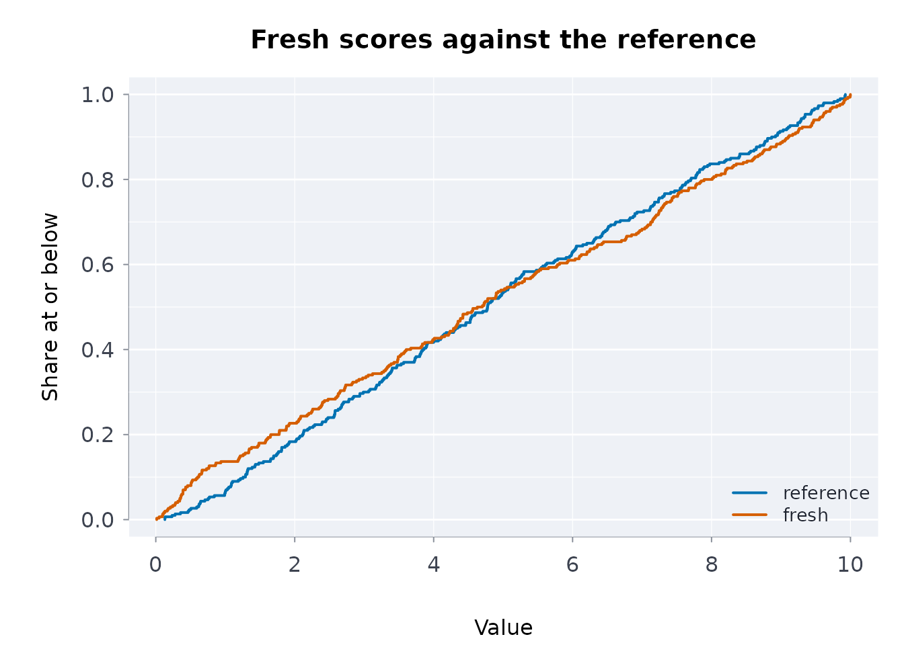

## Missingness, duplicates, outliers and distinct counts

Before a published table is analysed it should be looked at for the four
things that most often go wrong in ingestion: missing values with a
pattern, duplicated rows, rows that are ordinary on each column but
impossible jointly, and identifier columns with fewer distinct values
than they should have.

### Missingness

``` r

df <- data.frame(a = c(1, NA, 3), b = c(NA, NA, 3), c = 1:3)
misssmry(df)
#>             n_rows             n_cols          n_missing        pct_missing 
#>            3.00000            3.00000            3.00000           33.33333 
#>    n_complete_rows  pct_complete_rows n_cols_any_missing n_cols_all_missing 
#>            1.00000           33.33333            2.00000            0.00000
misssmry(data.frame(x = 1:3, y = 4:6))
#>             n_rows             n_cols          n_missing        pct_missing 
#>                  3                  2                  0                  0 
#>    n_complete_rows  pct_complete_rows n_cols_any_missing n_cols_all_missing 
#>                  3                100                  0                  0
```

A pattern matters more than a rate:
[`misspat()`](https://rootcoder007.github.io/rmorie-bricklayer/reference/misspat.md)
tabulates the combinations of missing columns,
[`missruns()`](https://rootcoder007.github.io/rmorie-bricklayer/reference/missruns.md)
finds runs of consecutive missing rows (a feed that stopped), and
[`missgrid()`](https://rootcoder007.github.io/rmorie-bricklayer/reference/missgrid.md)
draws an inline text map of where the gaps are.

``` r

set.seed(1)
big <- data.frame(id = 1:40, v = stats::rnorm(40), w = stats::rnorm(40))
big$v[c(10:14, 30)] <- NA
big$w[c(10:14)] <- NA
misspat(big)
#> ── Missingness patterns ────────────────────────────────────────── 
#>   columns, in pattern order: id, v, w
#> 
#>  pattern n_rows pctrows n_missing columns
#>      ...     34    85.0         0        
#>      .XX      5    12.5         2    v, w
#>      .X.      1     2.5         1       v
#> ──────────────────────────────────────────────────────────────────
missruns(big)
#> ── Runs of consecutive missing values ──────────────────────────── 
#>  column start end length
#>       v    10  14      5
#>       w    10  14      5
#> ──────────────────────────────────────────────────────────────────
```

Five rows missing both `v` and `w` in a block is a different problem
from six scattered gaps; the first points at the source, the second at
the records.

### Duplicates

``` r

d <- data.frame(id = c(1, 2, 2, 3, 3, 3), x = c("a", "b", "b", "c", "c", "d"))
duprows(d)
#>   id x dupe_count
#> 1  2 b          2
#> 2  2 b          2
#> 3  3 c          2
#> 4  3 c          2
duprows(d, cols = "id")
#>   id x dupe_count
#> 1  2 b          2
#> 2  2 b          2
#> 3  3 c          3
#> 4  3 c          3
#> 5  3 d          3
```

Full-row duplicates are usually an ingestion artefact; duplicates on the
key alone are usually a data-model finding (the key is not a key).

### Multivariate outliers

A row can be inside every column’s range and still be impossible: short
and heavy, young and retired. The Mahalanobis distance measures how far
a row is from the centre of the joint distribution in the metric of its
covariance. The **robust** version uses the median and the MAD, so a
cluster of bad rows cannot drag the centre toward itself and hide:

``` r

set.seed(1)
n <- 200
df <- data.frame(height = stats::rnorm(n, 170, 10))
df$weight <- df$height * 0.5 + stats::rnorm(n, 0, 5)
df[1, ] <- list(height = 155, weight = 100)      # ordinary on each, unlikely jointly

out <- mahaoutl(df)
head(out, 3)
#> ── Mahalanobis outliers (robust) ───────────────────────────────── 
#>   ! 1 of 3 rows beyond alpha = 0.001
#> 
#>  row distance  p_value logpvalue outlier
#>    1     4.30 9.61e-05 -9.249997    TRUE
#>   32     2.90   0.0149 -4.204956   FALSE
#>   14     2.81   0.0194 -3.940191   FALSE
#> ──────────────────────────────────────────────────────────────────
out$row[1] == 1
#> [1] TRUE
range(df$height[-1])
#> [1] 147.8530 194.0162
range(df$weight[-1])
#> [1]  67.07546 101.82631
```

With a cluster of bad rows, the classical distance of a bad row is
*smaller* than the robust one, because the cluster has pulled the
classical centre toward itself:

``` r

bad <- df
bad[2:21, ] <- list(height = 150, weight = 110)
dclassical <- mahaoutl(bad, robust = FALSE)
drobust <- mahaoutl(bad, robust = TRUE)
dclassical$distance[dclassical$row == 2] < drobust$distance[drobust$row == 2]
#> [1] TRUE
```

The flag threshold is a chi-square quantile (`alpha = 0.001` by default)
with the number of columns as degrees of freedom. A duplicated column
has no distance defined and is refused.

### Distinct counts in fixed memory

How many distinct identifiers does a 200-million-row file have? Holding
them all in a set needs memory proportional to the answer. A HyperLogLog
sketch answers to within about 1% in a few kilobytes, can be fed block
by block, and two sketches of two files merge into one:

``` r

set.seed(1)
x <- sample(1:5000, 200000, replace = TRUE)
dstncnt(dstnskch(x))
#> [1] 5039.269
length(unique(x))
#> [1] 5000

s <- dstnskch(x[1:100000])
s <- dstnskch(x[100001:200000], regstr = s)
dstncnt(s)
#> [1] 5039.269

a <- dstnskch(x[1:100000])
b <- dstnskch(x[100001:200000])
dstncnt(skchmrg(a, b))
#> [1] 5039.269
```

Small cardinalities are near-exact through linear counting, and an empty
input has no distinct values:

``` r

dstncnt(dstnskch(c("a", "b", "c", "a", "b")))
#> [1] 3.000275
dstncnt(dstnskch(character(0)))
#> [1] 0
```

An identifier column whose distinct count is far below its row count is
not an identifier;
[`cpsdrft()`](https://rootcoder007.github.io/rmorie-bricklayer/reference/cpsdrft.md)
uses the same reasoning to decide which columns to compare as
categories.

### Does the data look fabricated or truncated?

Benford’s law gives the expected distribution of leading digits for a
quantity that spans several orders of magnitude; a strong departure is a
reason to ask how the numbers were produced (rounding, capping,
invention), never a proof of anything on its own:

``` r

set.seed(3)
benfordtst(10^stats::runif(2000, 0, 6))$p_value
#> [1] 0.2599175
benfordtst(as.numeric(paste0(sample(1:9, 2000, TRUE), "000")))$p_value
#> [1] 9.672166e-161
```

### Order of operations

1.  [`misssmry()`](https://rootcoder007.github.io/rmorie-bricklayer/reference/misssmry.md)
    and
    [`misspat()`](https://rootcoder007.github.io/rmorie-bricklayer/reference/misspat.md);
    decide whether gaps are structural.
2.  [`duprows()`](https://rootcoder007.github.io/rmorie-bricklayer/reference/duprows.md)
    on the full row and on the key.
3.  [`mahaoutl()`](https://rootcoder007.github.io/rmorie-bricklayer/reference/mahaoutl.md)
    on the numeric columns, robust.
4.  [`dstnskch()`](https://rootcoder007.github.io/rmorie-bricklayer/reference/dstn.md)
    on identifiers when the table is large.
5.  Then, and only then, the analysis.

### Suppression in published tables

In a published table, missing values are usually suppression, and the
flag says why. On the bundled infant mortality rates by Indigenous
identity:

``` r

im <- indiex("infantmort")
misssmry(im)
#>             n_rows             n_cols          n_missing        pct_missing 
#>           18.00000            7.00000           18.00000           14.28571 
#>    n_complete_rows  pct_complete_rows n_cols_any_missing n_cols_all_missing 
#>           12.00000           66.66667            3.00000            0.00000
table(im$period, im$quality)
#>            
#>             .. E ok
#>   1994/1996  6 0  0
#>   2004/2006  0 3  3
#>   2014/2016  0 4  2
```

The 1994/1996 rates are all `..`: not available for that period, not a
gap in the file.

### The outliers in a picture

On the clean table
[`mahaoutl()`](https://rootcoder007.github.io/rmorie-bricklayer/reference/mahaoutl.md)
flags one row, drawn first. The second figure puts the two distances
side by side for the table with twenty planted rows: each point is a
row, the planted rows in the accent colour (all twenty have the same
values, so they share one point). That point sits above the diagonal:
the robust centre is not pulled toward the planted rows, so the robust
distance places them further out.

``` r

plot(out)
```


``` r

planted <- dclassical$row %in% 2:21
plot(dclassical$distance, drobust$distance[match(dclassical$row, drobust$row)],
     pch = 19, col = ifelse(planted, blpal()[2], blpal()[1]),
     xlab = "classical distance", ylab = "robust distance",
     main = "Planted rows: classical against robust distance")
abline(0, 1, lty = 2)
legend("topleft", c("planted rows", "other rows"), pch = 19, col = blpal()[c(2, 1)], bty = "n")
```

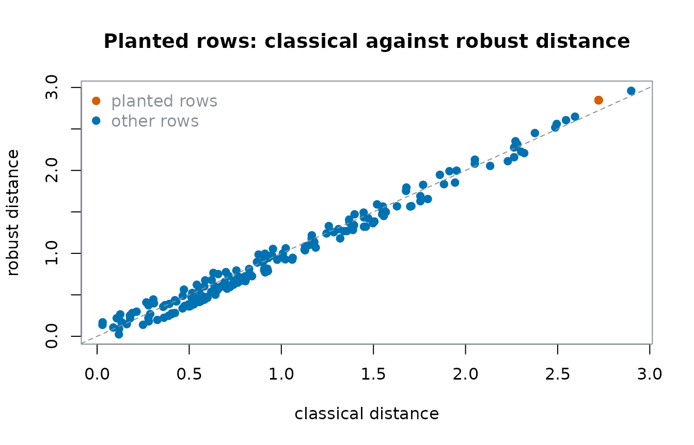

## Categorical integrity: labels that cannot be swapped quietly

In August 2020 the Ontario Human Rights Commission published *A
Disparate Impact*, whose multivariate tables said Black civilians in
Toronto were 30 to 58 times as likely as White civilians to experience
police use of force, and other racialized civilians 5 to 14 times. On 26
January 2023 the Commission published a correction: the figures are 4 to
5 times for Black civilians, and other racialized civilians were about
40% *less* likely. Between the SPSS file and the R analysis the four
race codes had been rotated one place (White read as Black, Black as
other racialized, other racialized as unknown, unknown as White), so the
largest group was being compared with the smallest. The independent
review attributed the rotation to the transfer between the two packages.
Nothing in either package rotates labels on its own; what was missing
was a step that would have refused the rotation, or named it, on the
day. This vignette is that step. Sources: OHRC, *Correction to A
Disparate Impact* (2023-01-26); Jung, M. (2022), *Independent Expert
Review of Part E of the Use of Force by the Toronto Police Service
report*, submitted to the OHRC, December 2022.

### The report’s numbers against the table’s labels

Start with what a reader can check: a table of counts as labelled (the
counts below are illustrative, shaped like the case: a large White
group, a Black group with a real disparity, and a very small unknown
group), the reference group, and the odds ratios a report states.

``` r

tab <- matrix(c(9000, 120, 2000, 220, 1500, 60, 4000, 1), ncol = 2, byrow = TRUE,
              dimnames = list(c("White", "Black", "Other", "Unknown"), c("no", "yes")))
tab
#>           no yes
#> White   9000 120
#> Black   2000 220
#> Other   1500  60
#> Unknown 4000   1
ref <- 120 / 9000
orchk(tab, "White", c(Black = 220 / 2000 / ref, Other = 60 / 1500 / ref,
                                 Unknown = 1 / 4000 / ref))$verdict
#> [1] "the reported odds ratios follow from the table as labelled"
```

Now rotate the labels one place, as happened in the transfer, and read
off the odds ratios a report would print:

``` r

rotated <- tab[c("Unknown", "White", "Black", "Other"), ]
rownames(rotated) <- rownames(tab)
rref <- rotated["White", 2] / rotated["White", 1]
reported <- c(Black = rotated["Black", 2] / rotated["Black", 1] / rref,
              Other = rotated["Other", 2] / rotated["Other", 1] / rref,
              Unknown = rotated["Unknown", 2] / rotated["Unknown", 1] / rref)
round(reported, 1)
#>   Black   Other Unknown 
#>    53.3   440.0   160.0
r <- orchk(tab, "White", reported)
r$consistent
#> [1] FALSE
r$matches
#>                                                          relabelling
#> 1 White -> Black, Black -> Other, Other -> Unknown, Unknown -> White
#>   outcome_columns_swapped
#> 1                   FALSE
r$verdict
#> [1] "the reported odds ratios do NOT follow from the table as labelled; they are reproduced under a relabelling (White -> Black, Black -> Other, Other -> Unknown, Unknown -> White): the groups were mislabelled, not the software"
```

The function tries every relabelling of the rows (and the two outcome
columns) and names the one that reproduces the reported figures: here
the one-place rotation, with the “White” odds actually those of the tiny
unknown group, which is exactly how a real disparity of about 4 becomes
a reported one of about 50. Numbers that no relabelling produces are
reported as exactly that.

``` r

orchk(tab, "White", c(Black = 36, Other = 4, Unknown = 1))$verdict
#> [1] "the reported odds ratios follow from no relabelling of this table"
```

### Codes that arrive without their labels

Data exported from SPSS, Stata or SAS often lands as integer codes.
[`deccodes()`](https://rootcoder007.github.io/rmorie-bricklayer/reference/deccodes.md)
needs the code-to-label dictionary written out and refuses a code it
does not know;
[`audcats()`](https://rootcoder007.github.io/rmorie-bricklayer/reference/audcats.md)
flags the columns that still look like codes.

``` r

raw <- data.frame(race = c(1, 2, 2, 3, 1), stringsAsFactors = FALSE)
audcats(data.frame(race = factor(raw$race)))
#> Categorical audit: 1 column(s)
#>   race             factor     3 level(s), reference ‘1’
#>     !! HAZARD: all labels numeric-looking (1,2,3...): likely imported CODES whose value labels were lost; as.numeric() on this column returns level INDICES, not data
race <- deccodes(raw$race, c("1" = "White", "2" = "Black", "3" = "Indigenous"))
race
#> [1] "White"      "Black"      "Black"      "Indigenous" "White"     
#> attr(,"recode_audit")
#> attr(,"recode_audit")$mapping
#>            1            2            3 
#>      "White"      "Black" "Indigenous" 
#> 
#> attr(,"recode_audit")$kept
#> character(0)
#> 
#> attr(,"recode_audit")$checksum
#> [1] "be0b0dcd1bb12223f6d28bc031e1accfd45a3f700d18c920b54d7d766905bdd0"
```

### A recode you can prove

[`grdrcd()`](https://rootcoder007.github.io/rmorie-bricklayer/reference/grdrcd.md)
maps by name only and errors on anything unmapped;
[`vrfrcd()`](https://rootcoder007.github.io/rmorie-bricklayer/reference/vrfrcd.md)
cross-tabulates before against after and errors unless each old label
went to exactly one new label, the one the mapping declares;
[`grdlvls()`](https://rootcoder007.github.io/rmorie-bricklayer/reference/grdlvls.md)
fixes the level order so the reference group is a decision, not an
accident of the alphabet.

``` r

x <- c("W", "B", "W", "I", "B")
y <- grdrcd(x, c(W = "White", B = "Black", I = "Indigenous"))
vrfrcd(x, y, c(W = "White", B = "Black", I = "Indigenous"))
grdlvls(y, c("White", "Black", "Indigenous"), ref = "White")
#> [1] White      Black      White      Indigenous Black     
#> Levels: White Black Indigenous
```

And the swap, caught on the day:

``` r

vrfrcd(c("W", "B"), c("Black", "White"), c(W = "White", B = "Black"))
#> Error:
#> ! vrfrcd: ‘B’ was mapped to ‘White’ but the declared mapping says ‘Black’. THIS is how groups get swapped; fix the recode before any model runs.
```

### Counts against what was published

If the release states how many rows each label has, the recode must
reproduce those counts. When it does not, the function tries every
permutation of the labels and says which one would make the counts
match: the fingerprint of labels attached to the wrong groups.

``` r

vrfmrg(y, c(White = 2, Black = 2, Indigenous = 1))
vrfmrg(y, c(White = 2, Black = 1, Indigenous = 2))
#> Error:
#> ! vrfmrg: recoded counts do not match the published counts. White: observed 2, published 2; Black: observed 2, published 1; Indigenous: observed 1, published 2. The observed counts match the published ones if the labels are permuted (Black -> Indigenous, Indigenous -> Black): the labels are attached to the wrong groups.
```

### The record

[`rcdmnf()`](https://rootcoder007.github.io/rmorie-bricklayer/reference/rcdmnf.md)
writes down the mapping and its digest, the counts before and after, the
checks that passed, and, with a key, a signature over the record. A
later reader verifies the file against the data.

``` r

key <- pqckg(height = 2)
m <- rcdmnf(x, y, c(W = "White", B = "Black", I = "Indigenous"),
                     pub = c(White = 2, Black = 2, Indigenous = 1),
                     key = key, ctx = "vignette")
p <- wrrcdmnf(m, tempfile(fileext = ".json"))
vrfrcdmnf(p, x, y)[c("ok", "signature_ok")]
#> $ok
#> [1] TRUE
#> 
#> $signature_ok
#> [1] TRUE
```

Change the data or the file afterwards and verification says so, with
the reason.

``` r

yswapped <- as.character(y)
yswapped[yswapped == "Black"] <- "Indigenous"
vrfrcdmnf(p, x, yswapped)[c("ok", "reasons")]
#> $ok
#> [1] FALSE
#> 
#> $reasons
#> [1] "vrfrcd: ‘B’ was mapped to ‘Indigenous’ but the declared mapping says ‘Black’. THIS is how groups get swapped; fix the recode before any model runs."
#> [2] "recoded counts differ from the manifest"
```

Finally, the guard that stops a factor from reaching a numeric treatment
slot, where [`as.numeric()`](https://rdrr.io/r/base/numeric.html) would
hand a model the level indices instead of the data:

``` r

grdbin(c("treated", "control"), "treatment")
#> Error:
#> ! Column ‘treatment’ is categorical (‘treated’, ‘control’...). Refusing to coerce: as.numeric() on a factor returns level INDICES (1, 2, ...), not your data, and a mis-ordered level silently relabels every observation. Encode explicitly first, e.g. grdrcd() + as.integer(x == "treated_label").
```

### The transfer that matters: SPSS (or Stata, SAS) to R

The documented failure happened between two programs. The source stores
each category as a code with a value label; the destination receives the
codes, and the labels are re-attached in the analysis. The only faithful
way to re-attach them is by code. Here is what arrives from a `.sav`
file (haven keeps the labels as an attribute, label = code), and the two
things the source program printed that make the import checkable: its
code book and its frequency table.

``` r

arrived <- structure(c(1, 1, 2, 4, 1, 3, 1, 2),
                     labels = c(White = 1, Black = 2, Other = 3, Unknown = 4))
code_book <- c("1" = "White", "2" = "Black", "3" = "Other", "4" = "Unknown")
spssfre <- c(White = 4, Black = 2, Other = 1, Unknown = 1)
chk <- xfrvrf(arrived, spssfre, codebook = code_book)
chk$ok
#> [1] TRUE
levels(chk$decoded)
#> [1] "White"   "Black"   "Other"   "Unknown"
```

The levels are in code order, not alphabetical order, because the code
book says so. Now the idiom that produced the documented rotation: the
labels, in the order R sorts them, assigned to the codes by position.

``` r

f <- factor(c(1, 2, 3, 4, 1))
levels(f) <- sort(unname(code_book))
data.frame(code = c(1, 2, 3, 4, 1), became = as.character(f))
#>   code  became
#> 1    1   Black
#> 2    2   Other
#> 3    3 Unknown
#> 4    4   White
#> 5    1   Black
```

Code 1 (White) became “Black”, 2 (Black) became “Other”, 3 (Other)
became “Unknown”, 4 (Unknown) became “White”: the four-way rotation in
the correction notice, from one line.
[`relbl()`](https://rootcoder007.github.io/rmorie-bricklayer/reference/relbl.md)
refuses that line:

``` r

relbl(factor(c(1, 2, 3, 4, 1)), sort(unname(code_book)))
#> Error:
#> ! relabel: `map` must be NAMED (old label = new label). Assigning labels by POSITION is how four race codes were rotated in a published analysis (OHRC correction, 26 January 2023): the labels were in alphabetical order, the codes were not.
relbl(factor(c(1, 2, 3, 4, 1)), code_book)
#> [1] White   Black   Other   Unknown White  
#> attr(,"recode_audit")
#> attr(,"recode_audit")$mapping
#>       1       2       3       4 
#>   White   Black   Other Unknown 
#> 
#> attr(,"recode_audit")$kept
#> character(0)
#> 
#> attr(,"recode_audit")$checksum
#> [1] 3d394c3d6f779a313f8fbeecaf5bc4f104738096c07f03c48ab68d5eb52e8de4
#> 
#> Levels: White Black Other Unknown
```

And
[`xfrvrf()`](https://rootcoder007.github.io/rmorie-bricklayer/reference/xfrvrf.md)
refuses the result if it somehow got past that, because the frequency
table no longer matches by label:

``` r

xfrvrf(as.character(f), c(White = 2, Black = 1, Other = 1, Unknown = 1))
#> Error:
#> ! vrfmrg: recoded counts do not match the published counts. White: observed 1, published 2; Black: observed 2, published 1; Other: observed 1, published 1; Unknown: observed 1, published 1. The observed counts match the published ones if the labels are permuted (White -> Black, Black -> White): the labels are attached to the wrong groups.
```

### Exonerating the software, or not

When a permutation is blamed on the transfer, the question to ask is
which deterministic step, applied to the code book, yields exactly the
permutation observed.
[`rlblfrns()`](https://rootcoder007.github.io/rmorie-bricklayer/reference/rlblfrns.md)
tries the known ones.

``` r

observed <- c(White = "Black", Black = "Other", Other = "Unknown", Unknown = "White")
rlblfrns(code_book, observed)
#> Mechanism(s) reproducing the observed permutation:
#>   * labels sorted alphabetically, assigned by code position
#>       White -> Black, Black -> Other, Other -> Unknown, Unknown -> White
#>   * labels sorted case-insensitively, assigned by code position
#>       White -> Black, Black -> Other, Other -> Unknown, Unknown -> White
#>   * rotation by 1 position(s)
#>       White -> Black, Black -> Other, Other -> Unknown, Unknown -> White
#> 
#> The observed permutation is reproduced EXACTLY by: labels sorted alphabetically, assigned by code position; labels sorted case-insensitively, assigned by code position; rotation by 1 position(s). No import routine (haven, foreign, pandas, pyreadstat) reorders value labels; each carries them keyed by code. A transfer fault does not select the sort order of the labels. The step that did this was a positional relabel in the analysis, and it is reproducible from the code book alone.
```

No import routine in R or Python (haven, foreign, pandas, pyreadstat)
sorts value labels onto codes; each keeps them keyed by code. A
permutation that coincides with the alphabetical order of the labels was
made by a positional relabel in the analysis, and anyone with the code
book can reproduce it. A permutation that no mechanism reproduces points
at a merge, a manual edit, or the file, and the function says so instead
of guessing.

### The rotation in a picture

Each bar is the odds of the outcome in a group relative to White, on a
log scale. The light bars use the correct labels; the dark bars use the
labels rotated one place, which is what the published ratios match. A
rotation of four codes is enough to turn ratios near 1 into ratios in
the hundreds.

``` r

odds_vs_white <- function(t) (t[, "yes"] / t[, "no"]) / (t["White", "yes"] / t["White", "no"])
r <- rbind(correct = odds_vs_white(tab), rotated = odds_vs_white(rotated))[, -1]
barplot(r, beside = TRUE, log = "y", col = blpal()[c(2, 1)], ylab = "odds ratio vs White (log scale)",
        legend.text = c("correct labels", "labels rotated one place"),
        args.legend = list(x = "topleft", bty = "n"), main = "Same counts, rotated labels")
#> Warning in yinch(0.1): y log scale: yinch() is nonsense
abline(h = 1, lty = 2)
```

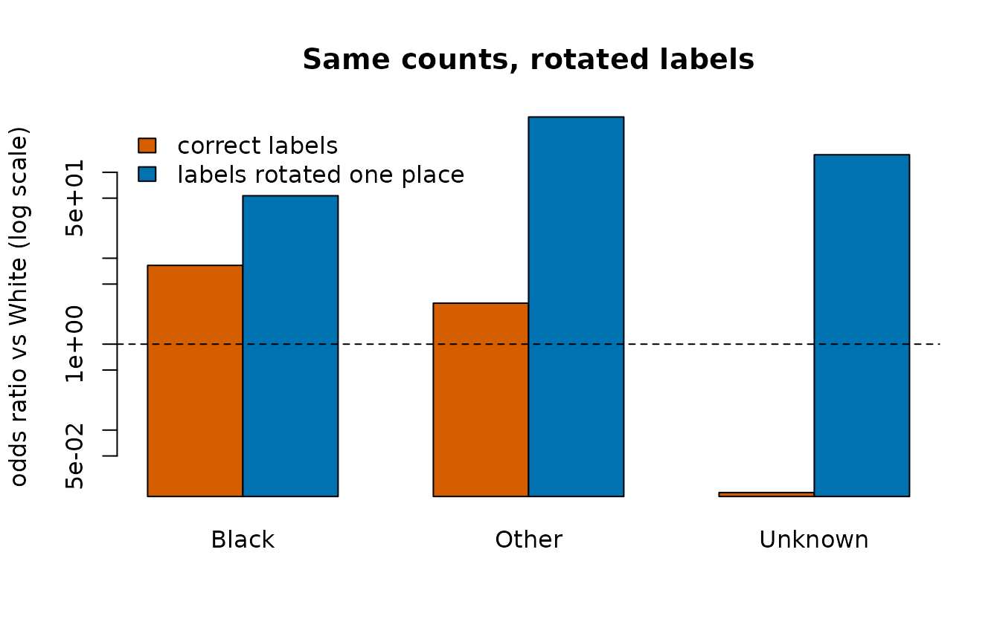

## Statistics for a published administrative table

An open-data extract from a criminal-justice system has a particular
shape: a handful of fiscal years, counts rather than measurements,
categories reported as bands rather than values, and a region code with
no geometry attached. The general-purpose toolkits assume none of that.
This vignette covers the functions that do.

The running example is the shape Ontario’s inmate datasets have – one
row per placement, keyed on the fiscal year’s end year, with banded
counts and a region.

### A Statistics Canada table, as published

A Statistics Canada full-table download puts each estimate, its
confidence limits (or its coefficient of variation), and a quality flag
on separate rows.
[`sctidy()`](https://rootcoder007.github.io/rmorie-bricklayer/reference/sctidy.md)
reads the flags and never keeps a suppressed value.
[`scests()`](https://rootcoder007.github.io/rmorie-bricklayer/reference/scests.md)
puts each estimate beside its limits, whatever form the limits take.
Here, a table with three measures per cell, and limits that name their
measure only in part:

``` r

pyll <- data.frame(GEO = rep(c("Inuit Nunangat", "Rest of Canada"), each = 5),
                   Characteristics = rep(c("Number of potential years of life lost",
                                           "Crude rate of potential years of life lost",
                                           "Age-standardized rate of potential years of life lost",
                                           "Low 95% confidence interval, potential years of life lost",
                                           "High 95% confidence interval, potential years of life lost"), 2),
                   VALUE = c(5000, 900, 1100, 1000, 1200, 7000, 800, 950, 870, 1030), STATUS = "")
scests(pyll)[, c("GEO", "measure", "estimate", "lower", "upper")]
#>              GEO                                               measure estimate
#> 1 Inuit Nunangat                Number of potential years of life lost     5000
#> 2 Inuit Nunangat            Crude rate of potential years of life lost      900
#> 3 Inuit Nunangat Age-standardized rate of potential years of life lost     1100
#> 4 Rest of Canada                Number of potential years of life lost     7000
#> 5 Rest of Canada            Crude rate of potential years of life lost      800
#> 6 Rest of Canada Age-standardized rate of potential years of life lost      950
#>   lower upper
#> 1    NA    NA
#> 2    NA    NA
#> 3  1000  1200
#> 4    NA    NA
#> 5    NA    NA
#> 6   870  1030
```

The limits belong to the age-standardised rate: they are the only pair
that contains its estimate in every cell. (The values are made up; the
layout is that of table 13-10-0402.)

### Bands

Published categories are intervals. Anything computed from them rests on
an assumption about where inside each band the mass sits, and on a
second assumption about where the open top band ends.

``` r

bands <- prsbands(c("1", "2 to 5", "6 to 10", "Greater than 10"))
bands
#>             label lower upper openlo openup
#> 1               1     1     1  FALSE  FALSE
#> 2          2 to 5     2     5  FALSE  FALSE
#> 3         6 to 10     6    10  FALSE  FALSE
#> 4 Greater than 10    11    NA  FALSE   TRUE
```

Note what the bounds say. `"Greater than 10"` starts at 11, because the
quantity is a count of placements; `"10 or more"` would start at 10. One
whole placement separates the two readings, and only the label says
which was meant.

The representative value needs a rule, and the open band needs a cap:

``` r

bandvals(bands)
#>             label lower upper openlo openup value assumed
#> 1               1     1     1  FALSE  FALSE   1.0   FALSE
#> 2          2 to 5     2     5  FALSE  FALSE   3.5   FALSE
#> 3         6 to 10     6    10  FALSE  FALSE   8.0   FALSE
#> 4 Greater than 10    11    NA  FALSE   TRUE  16.5    TRUE
```

The last row is marked `assumed`, because a band with no upper bound has
no midpoint. Everything downstream inherits that assumption, so measure
how much it matters:

``` r

counts <- c(1200, 430, 110, 38)
bandsens(bands, counts)
#> ── Sensitivity to the open top band's assumed cap ──────────────── 
#>        cap     value
#>   11.55000 0.4254708
#>   15.09841 0.4346095
#>   19.73696 0.4461100
#>   25.80058 0.4604302
#>   33.72707 0.4780278
#>   44.08875 0.4993060
#>   57.63375 0.5245371
#>   75.34008 0.5537719
#>   98.48616 0.5867522
#>  128.74322 0.6228545
#>  168.29590 0.6610951
#>  220.00000 0.7002144
#> 
#>   span over the caps tried: 0.2747 (53.7% of the typical value)
#>   The statistic moves by more than a tenth of itself across the
#>   caps tried, so it is a property of the assumption as much as
#>   of the data. Report the range, not a single figure.
#> ──────────────────────────────────────────────────────────────────
```

Read the span, not the middle row. A statistic that moves by more than a
tenth of itself across plausible caps is a property of the assumption as
much as of the data, and the honest report is the range.

### Concentration

The recurring question is whether a few individuals account for most of
the total.

``` r

placements <- expbands(bands, counts, openupcap = 25)
ginicoef(placements)
#> [1] 0.4585838
topshr(placements, c(0.01, 0.05, 0.1))
#>   fraction units      share
#> 1     0.01    18 0.07589599
#> 2     0.05    89 0.25579761
#> 3     0.10   178 0.39095807
```

Gini has a ceiling that depends on the number of units: for `n` units
the maximum is `1 - 1/n`, not 1. A Gini of 0.9 means something different
across ten units than across ten thousand.

``` r

c(ten = 1 - 1 / 10, thousand = 1 - 1 / 1000)
#>      ten thousand 
#>    0.900    0.999
```

If the tail looks heavy, fit it rather than asserting it – and read the
goodness-of-fit distance before the exponent:

``` r

fit <- hilltlidx(placements, xmin = 1)
c(alpha = round(fit$alpha, 2), ks = round(fit$ks, 3),
  reliable = fit$reliable)
#>    alpha       ks reliable 
#>    2.100    0.044    1.000
```

A large `ks` means the tail is not a power law, whatever `alpha` came
out as. The estimator maximises the exact discrete likelihood: the
closed-form continuity correction usually quoted is an asymptotic
approximation in the threshold, and at a threshold of one – where counts
start – it is badly biased.

### Trend across a handful of years

Five annual points support a rank test and a resistant slope. They do
not support a model with an autocorrelation structure.

``` r

y <- c(402, 377, 190, 268, 331)
tt <- trndtst(y)
c(tau = tt$tau, p = round(tt$p_value, 4), slope = tt$slope)
#>      tau        p    slope 
#>  -0.4000   0.4833 -21.3750
tt$method
#> [1] "Mann-Kendall, exact over all 120 orderings"
```

The p-value is exact, by enumerating all 120 orderings. For counts, the
trend is better expressed as a multiplicative change per year:

``` r

ct <- cnttrnd(y)
c(rateratio = round(ct$rateratio, 3),
  lower = round(ct$lower, 3), upper = round(ct$upper, 3),
  dispersion = round(ct$dispersion, 2))
#>  rateratio      lower      upper dispersion 
#>      0.923      0.696      1.223     24.390
```

The dispersion is reported because a Poisson interval assumes it is one.
Above 1.5 the interval is widened to the quasi-Poisson one rather than
being left too narrow.

#### Did it change when the policy changed?

``` r

sc <- stepchg(c(100, 104, 98, 60, 63, 58), x = 2018:2023)
c(after = sc$breakafter, before = sc$before, aftermean = sc$after,
  p = round(sc$p_value, 4))
#>      after     before  aftermean          p 
#> 2020.00000  100.66667   60.33333    0.10000
```

The p-value comes from the permutation distribution of the **maximum**
over splits, not from the best split’s own test. That distinction is the
difference between a change-point test and a way of finding a break in
noise. It also has a consequence worth stating plainly: six points
cannot produce a p-value below about 0.1, however clean the step,
because only 72 of the 720 orderings separate three low values from
three high ones.

``` r

(1 + 2 * factorial(3)^2) / (1 + factorial(6))
#> [1] 0.1012483
```

### Points, and the regions that contain them

Before a regional count means anything, something has to have decided
which region each facility is in. That decision is a region map: built
once, from coordinates and a boundary file, and then read by everything
downstream.

Which is exactly why recomputing the downstream tables cannot check it.
An error in the region map reproduces perfectly in every table built on
it, because those tables are where it is read. The region map has to be
checked on its own terms.

``` r

cw <- data.frame(
  facility = c("North Jail", "South Jail", "Hill Jail", "Lake Jail"),
  region   = c("3557", "3520", "3553", "3520"),
  stringsAsFactors = FALSE
)
pop <- data.frame(
  region     = c("3557", "3520", "3553", "3552", "3519"),
  population = c(114094, 3025647, 171568, 22746, 1173334),
  stringsAsFactors = FALSE
)
```

[`rgnmapintg()`](https://rootcoder007.github.io/rmorie-bricklayer/reference/rgnmapintg.md)
finds the failures that a comparison against published output cannot,
because they would be present on both sides of it: a facility assigned
two regions, a facility assigned none, a region code that belongs to a
different province.

``` r

rgnmapintg(cw, "facility", "region", regs = pop$region)
#>                                         check observed expected pass
#> 1         units assigned more than one region        0        0 TRUE
#> 2                    units assigned no region        0        0 TRUE
#> 3 region codes not in the reference geography        0        0 TRUE
```

Every check is written so that zero is the passing value, which is what
makes the frame safe to record directly into a manifest.

``` r

bad <- cw
bad$region[3] <- "2406"          # a code from another province
rgnmapintg(bad, "facility", "region", regs = pop$region)
#>                                         check observed expected  pass
#> 1         units assigned more than one region        0        0  TRUE
#> 2                    units assigned no region        0        0  TRUE
#> 3 region codes not in the reference geography        1        0 FALSE
```

#### Recomputing is not the same as checking

[`rgnmapcmp()`](https://rootcoder007.github.io/rmorie-bricklayer/reference/rgnmapcmp.md)
matches a recomputed region map against the published one and compares
them cell by cell. Numeric columns go through
[`all.equal()`](https://rdrr.io/r/base/all.equal.html), so a coordinate
that survived a round trip through text is not reported as a change.

``` r

recomputed <- cw
recomputed$region[2] <- "3519"
rgnmapcmp(cw, recomputed, "facility")
#>   column cells mismatched                                       first
#> 1   rows     4          0                                            
#> 2 region     4          1 South Jail: published 3520, recomputed 3519
```

That is worth having, and it is worth being clear about what it
establishes: the recomputation reproduced the published assignment. Run
the same method against the same boundary file and a *definitional*
error reproduces perfectly too. Both sides move together.

#### A second route can disagree

The check that can catch an error in the original method is one that
does not use that method. Derive the region a different way – from a
place name, a postal geography, an administrative lookup – and compare.

A name-based route is the usual second route, and it has understood
weaknesses. Names collide. In Ontario, census division 3552 is named
“Sudbury” and is a thinly populated district; census division 3553 is
named “Greater Sudbury” and is the city inside it. A facility in the
city has a postal address in Sudbury, and a name route sends it to the
district.

``` r

route <- c("North Jail" = "3557", "South Jail" = "3520",
           "Hill Jail" = "3552", "Lake Jail" = "3520")
rgnmapalt(cw, "facility", "region", route,
                       known = "Hill Jail")
#>        unit primary second known
#> 1 Hill Jail    3553   3552  TRUE
```

The known-bad case is listed by NAME rather than allowed for by widening
a tolerance, and the distinction matters. A tolerance of “one
disagreement is acceptable” would swallow a second, different
disagreement silently. Naming it means `sum(!x$known)` stays the number
that must be zero.

``` r

route["South Jail"] <- "3599"    # an assignment nobody documented
d <- rgnmapalt(cw, "facility", "region", route,
                            known = "Hill Jail")
d
#>         unit primary second known
#> 1 South Jail    3520   3599 FALSE
#> 2  Hill Jail    3553   3552  TRUE
sum(!d$known)
#> [1] 1
```

Facilities the route does not cover are skipped rather than counted as
disagreements, so a partial second route is still usable. Record how
many it covered: a route that quietly stops matching anything leaves the
disagreement check passing over an empty set.

``` r

length(route)
#> [1] 4
```

[`rgnmappts()`](https://rootcoder007.github.io/rmorie-bricklayer/reference/rgnmappts.md)
does the geometric recompute, projecting the points onto the boundary
file’s own coordinate system rather than the reverse, since reprojecting
polygons moves their edges. It needs `sf` and a boundary file and
returns `NULL` without either, so a verification script records the
check as unavailable instead of failing over an optional dependency. It
also returns `nreg` rather than silently resolving it: any value but 1
means the point fell outside the geography, or the boundaries overlap.

#### The coverage share is not a denominator

With the region map checked, the obvious next step is a rate per region.
[`rgncov()`](https://rootcoder007.github.io/rmorie-bricklayer/reference/rgncov.md)
reports the ingredients and, every time it prints, declines to supply
that rate.

``` r

units <- vapply(pop$region, function(r) sum(cw$region == r), numeric(1))
cov <- rgncov(pop$region, pop$population, units)
cov
#> ── 4 units in 3 of 5 regions ───────────────────────────────────── 
#>   those regions hold 3,311,309 of 4,507,389 residents (73.5%)
#>   2 regions hold none; 1,196,080 residents (26.5%) live there
#> 
#>  region population units hasunit     popshr
#>    3520    3025647     2    TRUE 67.1263785
#>    3553     171568     1    TRUE  3.8063722
#>    3557     114094     1    TRUE  2.5312659
#>    3519    1173334     0   FALSE 26.0313454
#>    3552      22746     0   FALSE  0.5046381
#> 
#>   The covered share is context, not a denominator: units serve
#>   catchments, so a rate over these regions alone would take its
#>   numerator from the whole territory and is inflated.
#> ──────────────────────────────────────────────────────────────────
```

Two of the five regions hold no facility at all. It is tempting to read
their population as uncovered, and to build a regional rate on the
population of the regions that do hold one. Both readings are wrong, for
the same reason.

A facility serves a catchment: an administrative fact about where people
are sent from, which a coordinate does not state and cannot imply. Some
geographies were never meant to have one facility each. So summing the
populations of facility-holding regions gives a denominator covering
part of the territory while the numerator counts people drawn from all
of it. Every rate built that way is inflated, and inflated unevenly – a
dense region holding one facility and a sparse region holding seven
distort it in opposite directions.

``` r

a <- attr(cov, "coverage")
c(covered = a$covpop, uncovered = a$uncpop,
  share = round(a$covshr, 1))
#>   covered uncovered     share 
#> 3311309.0 1196080.0      73.5
```

Where the numerator and the denominator have to cover the same people,
the defensible figure is the whole-territory one. That is the next
section.

### Regions

A region code is an areal unit, not a coordinate. Three things go wrong
with a table of regional counts: the regions hold different numbers of
people, they hold different *kinds* of people, and a small region’s rate
is mostly noise.

``` r

d <- expand.grid(
  region = c("Central", "Eastern", "Northern", "Toronto", "Western"),
  age = c("18 to 24", "25 to 49", "50+"),
  stringsAsFactors = FALSE
)
d$pop <- rep(c(4000, 3000, 800, 5000, 2500), 3) *
  rep(c(0.3, 0.55, 0.15), each = 5)
set.seed(13)
rate <- c(Central = 0.006, Eastern = 0.011, Northern = 0.010,
          Toronto = 0.016, Western = 0.012)
d$n <- rpois(nrow(d), lambda = d$pop * rate[d$region])
```

Indirect standardisation handles the second problem: the expected count
is what each region would have under the overall rate in every age band,
given its own age composition.

``` r

e <- expcnts(d$n, d$pop, d$region, strata = d$age)
e
#>       area observed population  expected
#> 1  Central       17       4000 48.366013
#> 2  Eastern       36       3000 36.274510
#> 3 Northern        9        800  9.673203
#> 4  Toronto       86       5000 60.457516
#> 5  Western       37       2500 30.228758
```

The expected counts total the observed ones. That identity is what makes
them a standardisation rather than a prediction.

``` r

c(observed = sum(e$observed), expected = sum(e$expected))
#> observed expected 
#>      185      185
```

The ratio, with an exact interval – the counts here are small, and a
normal approximation on a count of six is a decoration rather than an
interval:

``` r

stdinc(e$observed, e$expected, e$area)
#>       area observed  expected       sir     lower     upper excess deficit
#> 1  Central       17 48.366013 0.3514865 0.2047538 0.5627639  FALSE    TRUE
#> 2  Eastern       36 36.274510 0.9924324 0.6950875 1.3739448  FALSE   FALSE
#> 3 Northern        9  9.673203 0.9304054 0.4254406 1.7661993  FALSE   FALSE
#> 4  Toronto       86 60.457516 1.4224865 1.1378056 1.7567592   TRUE   FALSE
#> 5  Western       37 30.228758 1.2240000 0.8618090 1.6871228  FALSE   FALSE
#>   significant
#> 1        TRUE
#> 2       FALSE
#> 3       FALSE
#> 4        TRUE
#> 5       FALSE
```

And the third problem. A league table of rates ranks the small regions
to both ends by construction, so borrow strength across regions:

``` r

ebrates(e$observed, e$expected, e$area)
#>       area observed  expected       sir        eb  shrinkage       nu    alpha
#> 1  Central       17 48.366013 0.3514865 0.4301763 0.12133873 6.679104 6.679104
#> 2  Eastern       36 36.274510 0.9924324 0.9936092 0.15549575 6.679104 6.679104
#> 3 Northern        9  9.673203 0.9304054 0.9588313 0.40845028 6.679104 6.679104
#> 4  Toronto       86 60.457516 1.4224865 1.3804553 0.09948526 6.679104 6.679104
#> 5  Western       37 30.228758 1.2240000 1.1834634 0.18096698 6.679104 6.679104
```

`shrinkage` is how far each estimate was pulled toward the overall rate.
It is governed by the expected count, which is to say by how much
information the region carries – not by how extreme its ratio was.

The funnel plot shows the reader the same thing directly: what range a
region’s ratio could take, given its size, if it were no different from
anywhere else.

``` r

fnllim(c(5, 20, 50, 200))
#>   expected level lower upper
#> 1        5 0.950 0.200 2.000
#> 2       20 0.950 0.600 1.450
#> 3       50 0.950 0.740 1.280
#> 4      200 0.950 0.865 1.140
#> 5        5 0.998 0.000 2.600
#> 6       20 0.998 0.400 1.750
#> 7       50 0.998 0.600 1.460
#> 8      200 0.998 0.790 1.225
```

#### Autocorrelation, if you have a neighbour list

``` r

nb <- list(c(2L, 4L), c(1L, 3L), c(2L, 5L), c(1L, 5L), c(3L, 4L))
set.seed(1)
mi <- morani(e$observed / e$expected, nb, nperm = 999L)
c(I = round(mi$I, 3), expectation = round(mi$expectation, 3),
  p = mi$p_value)
#>           I expectation           p 
#>      -0.292      -0.250       0.842
```

The neighbour list has to be supplied. An extract keyed on a region
ships no geometry, and a guessed adjacency would make the answer a
property of the guess. Note too that the null expectation is
`-1/(n - 1)`, not zero: with five regions, a small negative `I` is what
independence looks like.

``` r

-1 / (5 - 1)
#> [1] -0.25
```

### Indigenous examples

Statistics Canada tables on Indigenous health come in several layouts;
[`scests()`](https://rootcoder007.github.io/rmorie-bricklayer/reference/scests.md)
reads them all into estimate, lower and upper. The bundled excerpts are
already in that form, and
[`stdprev()`](https://rootcoder007.github.io/rmorie-bricklayer/reference/stdprev.md)
and
[`indgap()`](https://rootcoder007.github.io/rmorie-bricklayer/reference/indgap.md)
take them directly; see
[`vignette("applied-analyses")`](https://rootcoder007.github.io/rmorie-bricklayer/articles/applied-analyses.md).
A trend across the three life expectancy periods:

``` r

le <- indiex("lifeexp")
inuit <- le[le$group == "Inuit", ]
inuit[, c("period", "estimate", "lower", "upper")]
#>       period estimate lower upper
#> 2  2006/2011    71.83 70.44 73.23
#> 9  2011/2016    74.18 72.17 76.19
#> 16 2016/2021    71.91 70.80 73.03
trndtst(inuit$estimate, x = 1:3)$p_value
#> [1] 1
```

Three periods cannot show a trend: the exact Mann-Kendall p-value is 1.

### The results in a picture

[`plot()`](https://rdrr.io/r/graphics/plot.default.html) draws the count
trend and the regional coverage computed above.

``` r

plot(ct)
```


``` r

plot(cov)
```


## Banded tables and concentration: from ‘6 to 10’ to a Gini

Published frequency tables band their values: “1”, “2 to 5”, “6 to 10”,
“Greater than 10”. To compute anything about the underlying
distribution, the bands have to be parsed, given representative values,
and expanded into per-unit values, and the result has to be checked
against the one assumption that cannot be verified: what the open top
band contains.

### Parsing band labels

``` r

prsbands(c("1", "2 to 5", "6 to 10", "Greater than 10"))
#>             label lower upper openlo openup
#> 1               1     1     1  FALSE  FALSE
#> 2          2 to 5     2     5  FALSE  FALSE
#> 3         6 to 10     6    10  FALSE  FALSE
#> 4 Greater than 10    11    NA  FALSE   TRUE
prsbands(c("18 to 24", "25 to 49", "50+"))
#>      label lower upper openlo openup
#> 1 18 to 24    18    24  FALSE  FALSE
#> 2 25 to 49    25    49  FALSE  FALSE
#> 3      50+    50    NA  FALSE   TRUE
```

An unrecognised label is reported as unparsed, never guessed at:

``` r

prsbands(c("3", "unknown", "not stated"))
#>        label lower upper openlo openup
#> 1          3     3     3  FALSE  FALSE
#> 2    unknown    NA    NA  FALSE  FALSE
#> 3 not stated    NA    NA  FALSE  FALSE
```

### Representative values

Each band needs one value to stand for its members: the midpoint by
default, or the lower or upper edge, or the geometric mean for skewed
quantities. The open top band has no upper edge, so a cap or a factor on
its lower edge is supplied explicitly:

``` r

b <- prsbands(c("1", "2 to 5", "6 to 10", "Greater than 10"))
bandvals(b, rule = "midpoint", openupcap = 20)
#>             label lower upper openlo openup value assumed
#> 1               1     1     1  FALSE  FALSE   1.0   FALSE
#> 2          2 to 5     2     5  FALSE  FALSE   3.5   FALSE
#> 3         6 to 10     6    10  FALSE  FALSE   8.0   FALSE
#> 4 Greater than 10    11    NA  FALSE   TRUE  15.5    TRUE
bandvals(b, rule = "geometric", openupcap = 20)
#>             label lower upper openlo openup     value assumed
#> 1               1     1     1  FALSE  FALSE  1.000000   FALSE
#> 2          2 to 5     2     5  FALSE  FALSE  3.162278   FALSE
#> 3         6 to 10     6    10  FALSE  FALSE  7.745967   FALSE
#> 4 Greater than 10    11    NA  FALSE   TRUE 14.832397    TRUE
```

### Expanding to per-unit values

With counts per band,
[`expbands()`](https://rootcoder007.github.io/rmorie-bricklayer/reference/expbands.md)
returns one value per unit, ready for any statistic:

``` r

x <- expbands(c("1", "2 to 5", "Greater than 5"), cnts = c(10, 4, 2),
                  openupcap = 12)
table(x)
#> x
#>   1 3.5   9 
#>  10   4   2
ginicoef(x)
#> [1] 0.452381
```

### Concentration

The **Gini coefficient** measures how unequally a total is spread across
units: 0 when every unit holds the same, approaching 1 when one unit
holds everything.
[`topshr()`](https://rootcoder007.github.io/rmorie-bricklayer/reference/concentration.md)
reports what the most frequent few account for, and
[`lorenzc()`](https://rootcoder007.github.io/rmorie-bricklayer/reference/concentration.md)
gives the curve behind the Gini.

``` r

ginicoef(rep(1, 10))             # no concentration
#> [1] 0
ginicoef(c(rep(0, 9), 1))        # one unit holds everything
#> [1] 0.9
1 - 1 / 10                   # the maximum for ten units
#> [1] 0.9

placements <- c(rep(1, 1200), rep(3, 430), rep(8, 110), rep(20, 38))
ginicoef(placements)
#> [1] 0.461225
topshr(placements, c(0.01, 0.05, 0.1))
#>   fraction units      share
#> 1     0.01    18 0.08716707
#> 2     0.05    89 0.28280872
#> 3     0.10   178 0.41888620
head(lorenzc(placements))
#>     population        value
#> 1 0.0000000000 0.0000000000
#> 2 0.0005624297 0.0002421308
#> 3 0.0011248594 0.0004842615
#> 4 0.0016872891 0.0007263923
#> 5 0.0022497188 0.0009685230
#> 6 0.0028121485 0.0012106538
```

Here the top 1% of people account for a disproportionate share of
placements: the substantive finding a banded table hides.

### The assumption you cannot check: sensitivity to the open band

Everything above depends on what the “Greater than 10” band is taken to
contain. If the statistic barely moves as that assumption varies, it has
been measured; if it swings, it has not, and the honest report says so.
[`bandsens()`](https://rootcoder007.github.io/rmorie-bricklayer/reference/bandsens.md)
recomputes a statistic over a range of caps:

``` r

counts <- c(1200, 430, 110, 38)
bandsens(b, counts)
#> ── Sensitivity to the open top band's assumed cap ──────────────── 
#>        cap     value
#>   11.55000 0.4254708
#>   15.09841 0.4346095
#>   19.73696 0.4461100
#>   25.80058 0.4604302
#>   33.72707 0.4780278
#>   44.08875 0.4993060
#>   57.63375 0.5245371
#>   75.34008 0.5537719
#>   98.48616 0.5867522
#>  128.74322 0.6228545
#>  168.29590 0.6610951
#>  220.00000 0.7002144
#> 
#>   span over the caps tried: 0.2747 (53.7% of the typical value)
#>   The statistic moves by more than a tenth of itself across the
#>   caps tried, so it is a property of the assumption as much as
#>   of the data. Report the range, not a single figure.
#> ──────────────────────────────────────────────────────────────────
bandsens(b, counts, stat = mean)
#> ── Sensitivity to the open top band's assumed cap ──────────────── 
#>        cap    value
#>   11.55000 2.257283
#>   15.09841 2.295202
#>   19.73696 2.344771
#>   25.80058 2.409567
#>   33.72707 2.494271
#>   44.08875 2.604998
#>   57.63375 2.749742
#>   75.34008 2.938955
#>   98.48616 3.186298
#>  128.74322 3.509629
#>  168.29590 3.932296
#>  220.00000 4.484814
#> 
#>   span over the caps tried: 2.228 (83.2% of the typical value)
#>   The statistic moves by more than a tenth of itself across the
#>   caps tried, so it is a property of the assumption as much as
#>   of the data. Report the range, not a single figure.
#> ──────────────────────────────────────────────────────────────────
```

### Heavy tails

When the open band holds a long tail, the question is how heavy. The
Hill estimator gives the tail index of a power law; for counts, the
exact discrete likelihood matters, because the continuous closed form is
badly biased at a threshold of one:

``` r

k <- 1:10000
p <- k^(-2.5) / sum(k^(-2.5))
set.seed(2)
z <- sample(k, 5000, replace = TRUE, prob = p)
c(exact = round(hilltlidx(z, xmin = 1)$alpha, 2),
  approx = round(hilltlidx(z, xmin = 1, approx = TRUE)$alpha, 2))
#>  exact approx 
#>   2.46   2.00
```

A short tail still returns an estimate, marked as not to be leaned on:

``` r

short <- hilltlidx(c(3, 4, 5, 9), xmin = 3)
c(alpha = round(short$alpha, 2), n = short$ntl, reliable = short$reliable)
#>    alpha        n reliable 
#>     2.59     4.00     0.00
```

### Workflow

1.  [`prsbands()`](https://rootcoder007.github.io/rmorie-bricklayer/reference/prsbands.md);
    stop if anything is unparsed.
2.  [`bandvals()`](https://rootcoder007.github.io/rmorie-bricklayer/reference/bandvals.md)
    or
    [`expbands()`](https://rootcoder007.github.io/rmorie-bricklayer/reference/expbands.md)
    with an explicit cap for the open band.
3.  The statistic:
    [`ginicoef()`](https://rootcoder007.github.io/rmorie-bricklayer/reference/concentration.md),
    [`topshr()`](https://rootcoder007.github.io/rmorie-bricklayer/reference/concentration.md),
    [`lorenzc()`](https://rootcoder007.github.io/rmorie-bricklayer/reference/concentration.md),
    [`hilltlidx()`](https://rootcoder007.github.io/rmorie-bricklayer/reference/hilltlidx.md).
4.  [`bandsens()`](https://rootcoder007.github.io/rmorie-bricklayer/reference/bandsens.md)
    over the cap, and report the range, not the point.

### How unevenly a population is spread

Concentration measures apply to any non-negative counts. With the 2021
Census counts of First Nations people by province and territory (bundled
with the package), the Gini coefficient and top shares say how
concentrated the population is in a few jurisdictions:

``` r

cp <- indiex("censuspop")
tot <- cp[cp$GEO_LEVEL != "Country" & cp$AGE_GROUP == "Total - Age groups" &
            cp$RESIDENCE == "Total - Residence on or off reserve" &
            grepl("^Total - Average age", cp$CHARACTERISTIC_NAME), ]
ginicoef(tot$FIRST_NATIONS)
#> [1] 0.5291808
topshr(tot$FIRST_NATIONS, fracs = c(0.25, 0.5))
#>   fraction units     share
#> 1     0.25     4 0.6787850
#> 2     0.50     7 0.9326599
```

### The bands and the curve in a picture

The left panel shows the banded counts as published. The right panel
draws the Lorenz curve of the placements with
[`plotlrnz()`](https://rootcoder007.github.io/rmorie-bricklayer/reference/plotlrnz.md):
the further it bows below the diagonal, the more unevenly the population
is spread.

``` r

op <- par(mfrow = c(1, 2))
barplot(counts, names.arg = b$label, col = blpal()[2], main = "Counts by band", ylab = "count")
plotlrnz(placements, main = "Concentration of placements")
```


``` r

par(op)
```

## Year-over-year change, and the three ways it goes wrong

A year-over-year percent change is the most-quoted number in open-data
reporting and the least qualified.
[`yoy()`](https://rootcoder007.github.io/rmorie-bricklayer/reference/yoy.md)
computes it, and refuses to compute it in the three cases where the
figure would describe something other than the data.

### The data

Ontario’s inmate data is published one row per placement, by fiscal year
and by group. A realistic shape:

``` r

seg <- data.frame(
  EndFiscalYear = rep(2019:2023, each = 2),
  Gender = rep(c("Female", "Male"), 5),
  NumberOfPlacements = c(31, 402, 28, 377, 12, 190, 19, 268, 24, 331)
)
```

Segregation placements rising is bad news, so the direction is declared.
That affects colour and the verdict column, never the arithmetic.

``` r

y <- yoy(seg,
  value = NumberOfPlacements,
  prd = EndFiscalYear,
  by = "Gender",
  dir = "lower"
)
y
#> Gender  EndFiscalYear  NumberOfPlacements  previous  change  change %  interval     
#> ──────  ─────────────  ──────────────────  ────────  ──────  ────────  ─────────────
#> Female  2019           31                  —         —         —       —            
#>     ↳ note: no comparison period
#> Female  2020           28                  31        -3      ▼ -9.7%   [-48%, +56%] 
#> Female  2021           12                  28        -16     ▼ -57.1%  [-80%, -13%] 
#> Female  2022           19                  12        7       ▲ +58.3%  [-27%, +258%]
#> Female  2023           24                  19        5       ▲ +26.3%  [-34%, +144%]
#> Male    2019           402                 —         —         —       —            
#>     ↳ note: no comparison period
#> Male    2020           377                 402       -25     ▼ -6.2%   [-19%, +8%]  
#> Male    2021           190                 377       -187    ▼ -49.6%  [-58%, -40%] 
#> Male    2022           268                 190       78      ▲ +41.1%  [+17%, +71%] 
#> Male    2023           331                 268       63      ▲ +23.5%  [+5%, +46%]  
#> 
#> lag 1 period · units: count · 95% exact rate-ratio interval · lower is better
```

The interval is exact. Conditional on the two periods’ total, the
current count is binomial, so the ratio of the two has a Clopper-Pearson
interval, which is the same construction
[`stats::poisson.test()`](https://rdrr.io/r/stats/poisson.test.html)
uses:

``` r

stats::poisson.test(c(331, 268), c(1, 1))$conf.int
#> [1] 1.048162 1.456380
#> attr(,"conf.level")
#> [1] 0.95
```

### The first failure: matching on row order

With a year missing, comparing row *i* with row *i - 1* compares 2023
with 2021 and labels it a one-year change. Matching on the period’s own
value cannot do that:

``` r

gap <- data.frame(year = c(2019, 2020, 2022, 2023), n = c(100, 120, 140, 150))
yoy(gap, value = n, prd = year)
#> year  n    previous  change  change %  interval    
#> ────  ───  ────────  ──────  ────────  ────────────
#> 2019  100  —         —         —       —           
#>     ↳ note: no comparison period
#> 2020  120  100       20      ▲ +20.0%  [-9%, +58%] 
#> 2021  —    120       —         —       —           
#>     ↳ note: no data
#> 2022  140  —         —         —       —           
#>     ↳ note: no comparison period
#> 2023  150  140       10      ▲ +7.1%   [-15%, +36%]
#> 
#> lag 1 period · units: count · 95% exact rate-ratio interval
```

2021 appears as a row with no value, and 2022 has no comparison period
rather than a quietly three-year one.

### The second failure: a percent off a small base

Two placements becoming twenty is a 900% rise, and the same rise off a
base of two is far less certain than off a base of two hundred. The
percent is still the right number; what changes is its interval:

``` r

tiny <- data.frame(year = 2019:2021, n = c(2, 20, 25))
as.data.frame(yoy(tiny, value = n, prd = year))[, c("year", "pctchg",
                                                     "pctlo", "pctup")]
#>   year pctchg    pctlo     pctup
#> 1 2019     NA       NA        NA
#> 2 2020    900 142.9205 8724.1205
#> 3 2021     25 -33.3407  137.3319
```

Every non-zero base gets its percent and exact interval, however small
the base or the change. Set `minbase` to add a note to small-base rows;
nothing is withheld either way:

``` r

as.data.frame(yoy(tiny, value = n, prd = year, minbase = 20))$flag
#> [1] "no comparison period"  "small base (below 20)" NA
```

### The third failure: a percent of a percent

If a rate moves from 4% to 5% that is one percentage point. Calling it
25% answers a different question:

``` r

rate <- data.frame(year = 2019:2023, share = c(4.1, 4.6, 5.2, 5.0, 5.4))
yoy(rate, value = share, prd = year, units = "percent")
#> year  share  previous  change  points  
#> ────  ─────  ────────  ──────  ────────
#> 2019  4.1    —         —         —     
#>     ↳ note: no comparison period
#> 2020  4.6    4.1       0.5     ▲ +0.5pp
#> 2021  5.2    4.6       0.6     ▲ +0.6pp
#> 2022  5.0    5.2       -0.2    ▼ -0.2pp
#> 2023  5.4    5.0       0.4     ▲ +0.4pp
#> 
#> lag 1 period · units: percent · percentage-point change, not percent of a percent
```

The column is named `points`, and no count interval is offered, because
these are not counts.

### Seasonal series

A monthly series compares with the same month a year earlier. The lag
follows the series’ own frequency, so January is never put against
December:

``` r

m <- stats::ts(c(10:21, 20:31), start = c(2021, 1), frequency = 12)
head(as.data.frame(yoy(m, minbase = 0))[12:14, c("period", "value",
                                                  "previous", "change")], 3)
#>      period value previous change
#> 12 2021.917    21       NA     NA
#> 13 2022.000    20       10     10
#> 14 2022.083    21       11     10
```

### Across the span

``` r

yoysmry(y)
#>   Gender from   to first last  totalpct   cagrpct periods up down flat
#> 1 Female 2019 2023    31   24 -22.58065 -6.197938       5  2    2    0
#> 2   Male 2019 2023   402  331 -17.66169 -4.742214       5  2    2    0
```

`cagrpct` is the compound rate per period: applying it across the span
returns `totalpct` exactly.

### Rates, when the denominator moves too

[`yoy()`](https://rootcoder007.github.io/rmorie-bricklayer/reference/yoy.md)
compares counts. A count is not comparable across places of different
size, or across years whose populations differ, and the fix is a rate –
but a rate is not made trustworthy by being a rate.

``` r

stops <- data.frame(
  division = c("North", "South", "East"),
  stops = c(412, 77, 3),
  residents = c(120000, 41000, 9500))

rtcalc(stops, stops, residents, by = "division", per = "100k")
#> ── Rate per 100,000, 95% exact Poisson interval ────────────────── 
#>  division count population      rate      lower     upper flag
#>      East     3       9500  31.57895   6.512338  92.28708 <NA>
#>     North   412     120000 343.33333 310.977110 378.14142 <NA>
#>     South    77      41000 187.80488 148.212673 234.72387 <NA>
#> ──────────────────────────────────────────────────────────────────
```

East’s interval is wider than its own estimate. That is the honest
reading of three events, and it is the reason the interval is printed
beside the rate rather than left to the reader to imagine. The interval
is the exact Poisson one, so a count of zero has a lower limit of
exactly zero instead of a negative rate.

A share is a different quantity. Its denominator is the total of the
same events, not a population, so shares over a complete grouping sum to
100:

``` r

shrs(stops, stops, by = "division")
#> ── Share of 492, 95% Wilson interval ───────────────────────────── 
#>  division count total      share      lower     upper
#>      East     3   492  0.6097561  0.2075843  1.777215
#>     North   412   492 83.7398374 80.2200225 86.736863
#>     South    77   492 15.6504065 12.7074531 19.125597
#> ──────────────────────────────────────────────────────────────────
```

“40% of stops” and “40 stops per 1,000 residents” are different claims,
and a table that labels one as the other is wrong however carefully the
arithmetic was done. That is why these are separate functions.

For the change in a rate, both the counts and the denominators move:

``` r

d <- data.frame(
  year = rep(2021:2023, each = 2),
  division = rep(c("North", "South"), 3),
  stops = c(400, 70, 430, 66, 455, 61),
  residents = c(120000, 41000, 122000, 41500, 125000, 42000))

ratechg(d, stops, residents, year, by = "division", per = "100k")
#> ── Change in rate per 100,000, lag 1, 95% exact conditional interval  
#>  division year count population     rate  prerate precnt prepop rateratio
#>     North 2021   400     120000 333.3333       NA     NA     NA        NA
#>     North 2022   430     122000 352.4590 333.3333    400 120000 1.0573770
#>     North 2023   455     125000 364.0000 352.4590    430 122000 1.0327442
#>     South 2021    70      41000 170.7317       NA     NA     NA        NA
#>     South 2022    66      41500 159.0361 170.7317     70  41000 0.9314974
#>     South 2023    61      42000 145.2381 159.0361     66  41500 0.9132395
#>     pctchg      pctlo    pctup                 flag
#>         NA         NA       NA no comparison period
#>   5.737705  -7.937165 21.46533                 <NA>
#>   3.274419  -9.679876 18.10199                 <NA>
#>         NA         NA       NA no comparison period
#>  -6.850258 -34.473784 32.29053                 <NA>
#>  -8.676046 -36.596300 31.35600                 <NA>
#> ──────────────────────────────────────────────────────────────────
```

North’s count rose, and so did its population, so the rate change is
smaller than the count change – which is the whole reason to look at the
rate. The interval conditions on the two counts and corrects for the
ratio of the two exposures; with equal populations it reduces to exactly
the conditional-binomial interval
[`yoy()`](https://rootcoder007.github.io/rmorie-bricklayer/reference/yoy.md)
uses above.

### Output

The same object writes to six formats. The format follows the file name.

``` r

dir <- tempdir()
for (ext in c("csv", "tsv", "json", "md", "html", "pdf")) {
  f <- file.path(dir, paste0("placements.", ext))
  yoywr(y, f, title = "Placements by gender")
  cat(sprintf("%-5s %6d bytes\n", ext, file.size(f)))
}
#> csv      952 bytes
#> tsv      952 bytes
#> json    3233 bytes
#> md      1575 bytes
#> html    6769 bytes
#> pdf     5092 bytes
```

The delimited writers lead with the settings as comments, and carry the
`flag` column, so a row’s note (a zero base, a missing period) travels
with it:

``` r

cat(yoycsv(y, NULL, digits = 1L))
#> # value: NumberOfPlacements; period: EndFiscalYear; by: Gender; lag: 1; units: count; interval: 95% exact rate ratio; direction: lower is better
#> Gender,EndFiscalYear,value,previous,change,pctchg,flag,pctlo,pctup,verdict
#> Female,2019,31,,,,no comparison period,,,
#> Female,2020,28,31,-3,-9.7,,-47.8,55.6,better
#> Female,2021,12,28,-16,-57.1,,-80.1,-13,better
#> Female,2022,19,12,7,58.3,,-27,257.7,worse
#> Female,2023,24,19,5,26.3,,-33.7,143.9,worse
#> Male,2019,402,,,,no comparison period,,,
#> Male,2020,377,402,-25,-6.2,,-18.7,8.2,better
#> Male,2021,190,377,-187,-49.6,,-57.9,-39.8,better
#> Male,2022,268,190,78,41.1,,16.7,70.8,worse
#> Male,2023,331,268,63,23.5,,4.8,45.6,worse
```

Markdown, for a report:

``` r

cat(yoymd(yoy(gap, value = n, prd = year), NULL))
#> | year |   n | previous | change | change % |     interval | note                 |
#> | ---- | --: | -------: | -----: | -------: | -----------: | -------------------- |
#> | 2019 | 100 |        — |      — |        — |              | no comparison period |
#> | 2020 | 120 |      100 |     20 |   +20.0% |  [-9%, +58%] |                      |
#> | 2021 |   — |      120 |      — |        — |              | no data              |
#> | 2022 | 140 |        — |      — |        — |              | no comparison period |
#> | 2023 | 150 |      140 |     10 |    +7.1% | [-15%, +36%] |                      |
#> 
#> _value: n; period: year; lag: 1; units: count; interval: 95% exact rate ratio_
```

The HTML is a single self-contained file: it makes no network request,
so the page renders later exactly as it rendered when the capsule was
sealed. It defines its palette as custom properties and carries a dark
variant. The PDF is drawn on R’s own device and paginates rather than
truncating, so neither needs a package beyond base R.

``` r

yoypals()
#> [1] "diverging" "safe"      "mono"
```

`"safe"` is a blue/orange pair that survives both common forms of colour
blindness; `"mono"` emits no colour at all, for print.

### Indigenous examples

Change between survey cycles in percentage points, here the share of
adults rating their mental health very good or excellent, 2015/2018 to
2019/2022, from the bundled health indicators:

``` r

hi <- indiex("health")
m <- hi[hi$age == "Total, 18 years and over" &
          hi$indicator == "Perceived mental health, very good or excellent", ]
# yoy() steps through consecutive periods: number the two survey cycles 1 and 2
m$cycle <- match(m$period, c("2015/2018", "2019/2022"))
for (g in unique(m$group)) {
  s <- m[m$group == g, ]
  print(as.data.frame(yoy(s, value = estimate, prd = cycle, units = "percent"))[
    2, c("value", "previous", "ppchg", "verdict")])
}
#>   value previous ppchg verdict
#> 2  45.8     59.8   -14    down
#>   value previous ppchg verdict
#> 2  52.8       61  -8.2    down
#>   value previous ppchg verdict
#> 2  47.8     49.1  -1.3    down
#>   value previous ppchg verdict
#> 2  61.5     70.6  -9.1    down
```

### The change in a picture

[`plot()`](https://rdrr.io/r/graphics/plot.default.html) draws the
year-over-year result: each year’s change with its interval.

``` r

plot(y)
```

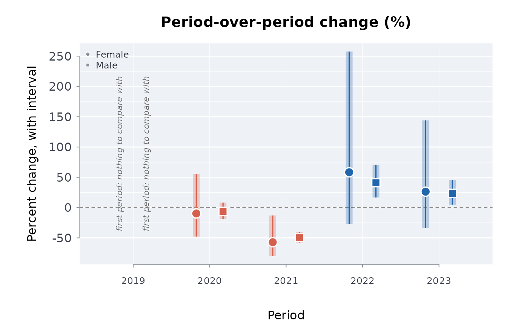

## Trends and change in short count series

A published series is usually short: five to ten annual counts. Three
questions recur. Is there a monotone trend? How fast is the count
changing per period? Did something change at one point? Each has a
method suited to short series, and each is wrong to answer with a
least-squares line on five points.

### A monotone trend: Mann–Kendall and Sen’s slope

The Mann–Kendall test counts, over all pairs of periods, how many later
values exceed earlier ones minus how many fall below. It is
distribution-free and exact for small *n*, so it is informative where a
regression’s standard error would be nearly meaningless. Sen’s slope is
the median of all pairwise slopes, a robust rate of change.

``` r

y <- c(402, 377, 190, 268, 331)        # five years of placements
trndtst(y)
#> $S
#> [1] -4
#> 
#> $tau
#> [1] -0.4
#> 
#> $p_value
#> [1] 0.4833333
#> 
#> $slope
#> [1] -21.375
#> 
#> $intercept
#> [1] 419.75
#> 
#> $slopelo
#> [1] -187
#> 
#> $slopeup
#> [1] 78
#> 
#> $slopecicla
#> [1] TRUE
#> 
#> $n
#> [1] 5
#> 
#> $var_S
#> [1] 16.66667
#> 
#> $alternative
#> [1] "two.sided"
#> 
#> $conflvl
#> [1] 0.95
#> 
#> $method
#> [1] "Mann-Kendall, exact over all 120 orderings"
```

A monotone series is detected even at *n* = 5:

``` r

trndtst(c(1, 2, 3, 4, 5))
#> $S
#> [1] 10
#> 
#> $tau
#> [1] 1
#> 
#> $p_value
#> [1] 0.01666667
#> 
#> $slope
#> [1] 1
#> 
#> $intercept
#> [1] 0
#> 
#> $slopelo
#> [1] 1
#> 
#> $slopeup
#> [1] 1
#> 
#> $slopecicla
#> [1] TRUE
#> 
#> $n
#> [1] 5
#> 
#> $var_S
#> [1] 16.66667
#> 
#> $alternative
#> [1] "two.sided"
#> 
#> $conflvl
#> [1] 0.95
#> 
#> $method
#> [1] "Mann-Kendall, exact over all 120 orderings"
```

One aberrant period does not create a trend:

``` r

trndtst(c(100, 100, 100, 100, 900))$p_value
#> [1] 0.4
```

From a data frame, with a direction when one is hypothesised in advance:

``` r

d <- data.frame(year = 2019:2023, n = y)
trndtst(d, value = "n", prd = "year")$slope
#> [1] -21.375
trndtst(d, value = "n", prd = "year", alt = "decreasing")$p_value
#> [1] 0.2416667
```

### The rate of change: a Poisson trend

For counts, the natural model is a Poisson log-linear trend:
`log E[y] = a + b * t`, so `exp(b)` is the **rate ratio per period**,
the multiplicative change from one period to the next.
[`cnttrnd()`](https://rootcoder007.github.io/rmorie-bricklayer/reference/cnttrnd.md)
fits it with an interval:

``` r

set.seed(3)
y <- stats::rpois(8, lambda = 200 * 0.85^(0:7))   # falling ~15% a year
fit <- cnttrnd(y)
round(fit$rateratio, 3)
#> [1] 0.869
```

With a varying denominator the trend is in the *rate*, via an offset:

``` r

cnttrnd(c(20, 25, 30), offset = c(1000, 1500, 2500))$rateratio
#> [1] 0.7708656
```

Counts here rise while the rate per 1,000 falls, which is the finding.

### A step change

A trend test asks “is it drifting?”; a step-change test asks “did it
jump once?”. The best single split point is found by maximising the
between-segment difference, and its significance is judged by
permutation, which accounts for having searched over every possible
split:

``` r

stepchg(c(100, 104, 98, 60, 63, 58))
#> $breakafter
#> [1] 3
#> 
#> $index
#> [1] 3
#> 
#> $before
#> [1] 100.6667
#> 
#> $after
#> [1] 60.33333
#> 
#> $difference
#> [1] -40.33333
#> 
#> $statistic
#> [1] 2440.167
#> 
#> $p_value
#> [1] 0.1
#> 
#> $nperm
#> [1] 720
#> 
#> $method
#> [1] "exact over all 720 orderings"
```

Pure noise still yields a best split, and it is not significant:

``` r

set.seed(2)
stepchg(stats::rnorm(12))$p_value
#> [1] 0.6223
```

### Two survey periods

Survey tables often give only two periods, each with its confidence
interval. The change between them has an interval of its own.
[`healchg()`](https://rootcoder007.github.io/rmorie-bricklayer/reference/healchg.md)
gives it for every group and indicator at once. It lists wellness
indicators first, reading change as Indigenous scholars of mental health
read it, as a process of healing (Stewart 2008). Perceived mental health
of adults, 2015/2018 and 2019/2022, by Statistics Canada (table
13-10-0924-01):

``` r

h <- indiex("health")
h <- h[h$age == "Total, 18 years and over" &
         h$indicator == "Perceived mental health, very good or excellent", ]
healchg(h, "group", "indicator", "period", "estimate", "lower", "upper",
               from = "2015/2018", to = "2019/2022", qual = "quality")
#>            group                                       indicator side from   to
#> 1  First Nations Perceived mental health, very good or excellent <NA> 59.8 45.8
#> 2          Métis Perceived mental health, very good or excellent <NA> 61.0 52.8
#> 3          Inuit Perceived mental health, very good or excellent <NA> 49.1 47.8
#> 4 Non-Indigenous Perceived mental health, very good or excellent <NA> 70.6 61.5
#>   change      lower      upper usewithcau
#> 1  -14.0 -17.687818 -10.312182      FALSE
#> 2   -8.2 -11.925923  -4.474077      FALSE
#> 3   -1.3  -9.974243   7.374243      FALSE
#> 4   -9.1  -9.702080  -8.497920      FALSE
```

### A pace, projected

Some counts accumulate toward a fixed number: the 94 Calls to Action of
the Truth and Reconciliation Commission, for instance.
[`trcprog()`](https://rootcoder007.github.io/rmorie-bricklayer/reference/trcprog.md)
takes the pace so far as a Poisson rate with its exact interval, and
gives the year all would be complete at that pace. That is a description
of the pace, not a forecast.

``` r

trcprog()
#>   completed remaining years     rate    ratelo   rateup   cmplby cmplbyearly
#> 1        13        81  7.04 1.846591 0.9832319 3.157727 2066.865    2048.651
#>   cmplbylate
#> 1   2105.381
```

### Choosing between them

| Question | Tool | Reports |
|----|----|----|
| Is the series moving in one direction? | [`trndtst()`](https://rootcoder007.github.io/rmorie-bricklayer/reference/trndtst.md) | Mann–Kendall p-value, Sen’s slope with interval |
| By what factor per period? | [`cnttrnd()`](https://rootcoder007.github.io/rmorie-bricklayer/reference/cnttrnd.md) | rate ratio with interval, optional offset |
| Did it change once, and when? | [`stepchg()`](https://rootcoder007.github.io/rmorie-bricklayer/reference/stepchg.md) | split point, segment means, permutation p-value |
| Year over year, with publication rounding | [`yoy()`](https://rootcoder007.github.io/rmorie-bricklayer/reference/yoy.md) (its own vignette) | exact intervals on each change |

All of them work on the five to ten values a published table gives, and
none of them assumes the counts are large.

### The trend in a picture

[`plot()`](https://rdrr.io/r/graphics/plot.default.html) draws the
counts with the fitted trend.

``` r

plot(fit)
```


### References

Mann (1945). Nonparametric tests against trend. *Econometrica* 13(3).
Kendall (1975). *Rank Correlation Methods*. 4th ed. Sen (1968).
Estimates of the regression coefficient based on Kendall’s tau. *JASA*
63(324).

## Plotting results

Every result the package returns draws itself. `plot(x)` needs nothing
but the object; the chart is the one that result calls for, drawn with
base graphics (no new dependency), with one shared look across the
package. Every method takes the same customisation, and every method
returns the numbers it drew, so a figure can be checked or redrawn
another way.

### One call per result

Stock and flow after Lakner (1976): the average daily population and the
length of stay, one panel per measure.

``` r

sf <- stkflow(days = c(13500, 14600, 15100, 14200), people = c(300, 320, 310, 290),
                 prd = 2020:2023)
plot(sf)
```

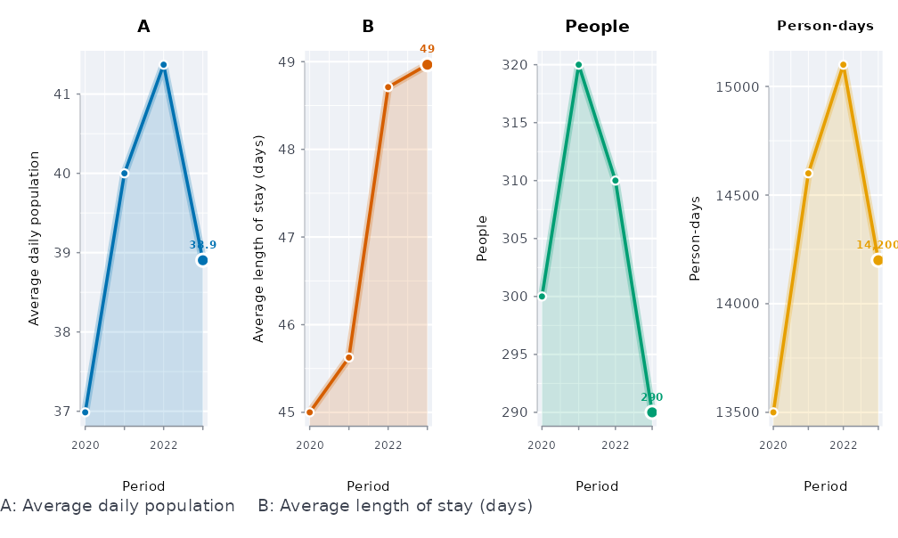

Period-over-period change with its interval, coloured by verdict:

``` r

y <- yoy(data.frame(year = 2018:2023, n = c(40, 44, 41, 55, 52, 61)), value = "n",
         prd = "year")
plot(y)
```

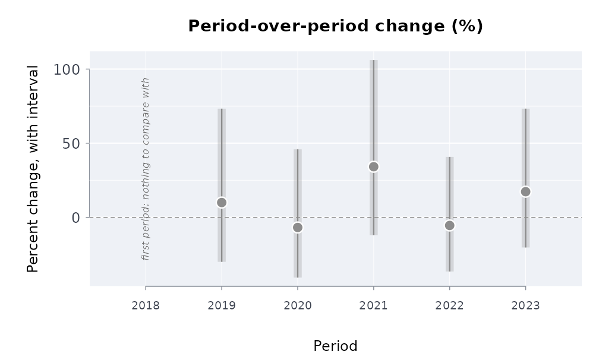

Small counts get their percentages too: each comes with its exact
interval, as wide as the base is small. Only a zero base has no
percentage, and its row says so.

``` r

plot(yoy(data.frame(year = 2019:2023, n = c(10, 12, 11, 15, 14)), value = "n", prd = "year"))
```

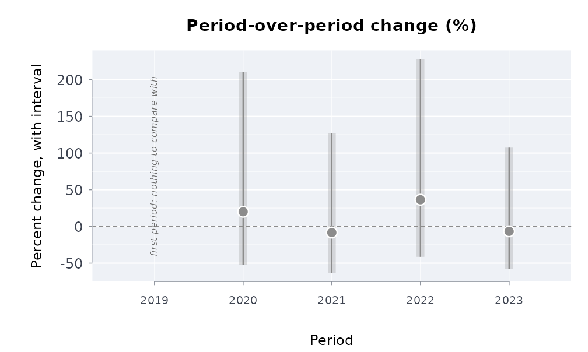

Rates with their intervals, and the change in a rate:

``` r

d <- data.frame(division = rep(c("north", "east", "west"), 2), year = rep(2022:2023, each = 3),
                stops = c(120, 90, 60, 150, 85, 70), residents = c(1e4, 8e3, 5e3, 1e4, 8e3, 5e3))
plot(rtcalc(d[d$year == 2023, ], count = "stops", pop = "residents", by = "division"))
```


``` r

plot(ratechg(d, count = "stops", pop = "residents", prd = "year", by = "division"))
```


First digits against Benford’s law, the power curve of a check, and a
permutation null:

``` r

set.seed(1)
amounts <- round(exp(rnorm(400, 6, 1.4)))
plot(benfordtst(amounts))
```


``` r

dd <- data.frame(x = rnorm(120), y = rnorm(120))
shift <- function(z, s) {
  z$y <- z$y + s * z$x
  z
}
plot(cpspwr(dd, function(z) cor(z$x, z$y), inject = shift, trt = "x",
                   sizes = c(0, 0.2, 0.4, 0.6), n = 49, reps = 6, seed = 1))
```

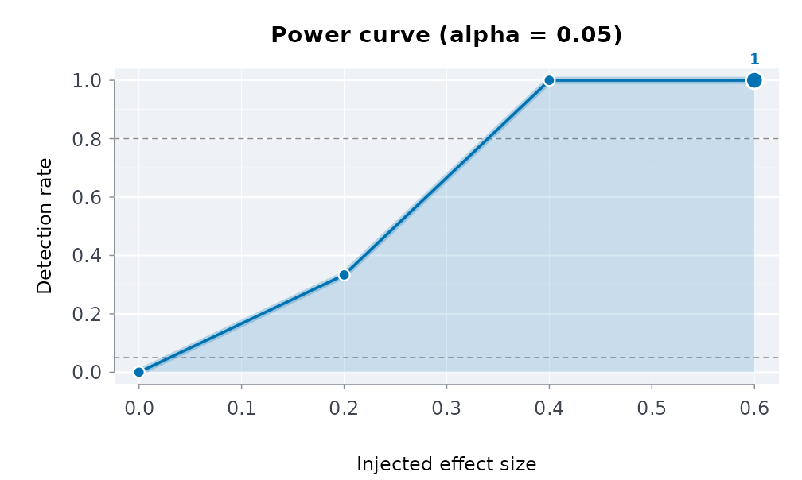

### Air pollution

The concentration-response curve with the exposure marked, the burden it
implies, and the whole
[`vrfpol()`](https://rootcoder007.github.io/rmorie-bricklayer/reference/vrfpol.md)
report on one page (curve, burden and the concentration curve of
exposure over income):

``` r

plot(crfno2(25))
```


``` r

plot(polbrdn(25, 1, 0.008, 1e6, poll = "NO2"))
```

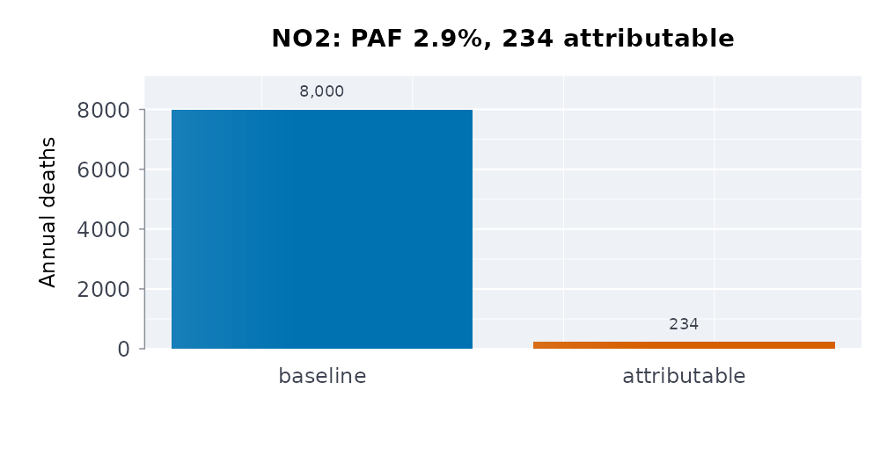

``` r

plot(vrfpol("no2", demo = TRUE))
```


A plume on a grid, and the particle cloud of the random walk:

``` r

plot(plmfld(q = 100, u = 5, h = 50, x = seq(100, 3000, by = 100),
                 y = seq(-500, 500, by = 50)))
```


``` r

plot(lagrprt(500, 0, 0, u = 2, v = 0.5, kx = 1, ky = 1, dt = 1, nsteps = 60,
                          grid = c(0, 200, -60, 100, 40, 32)))
```

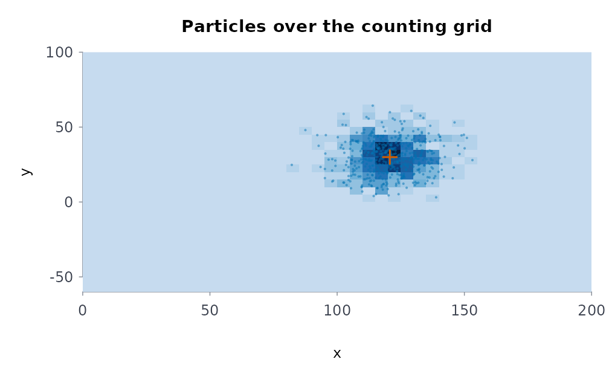

The footprint of a computation: CPU, memory and the total in one unit
chosen to fit, with its everyday equivalents under the bars:

``` r

plot(co2fp(for (i in 1:20) sum(sqrt(seq_len(2e5))), loc = "CA",
                       cpupwrw = 45, memgb = 8))
```

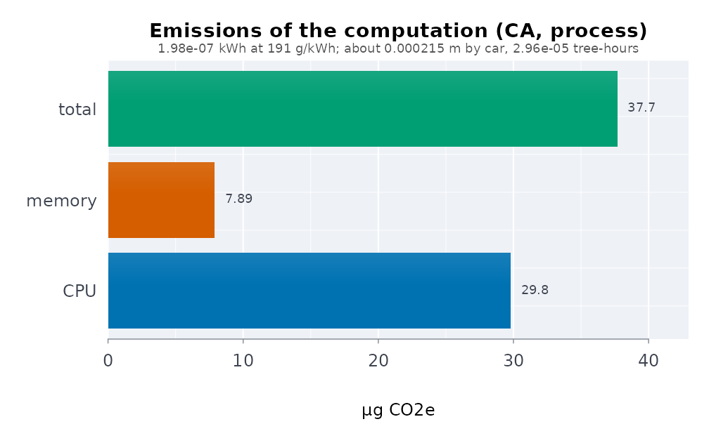

### Courts and crime

The Ontario Court of Justice and Toronto Police Service data shipped
with the package (see
[`vignette("applied-analyses")`](https://rootcoder007.github.io/rmorie-bricklayer/articles/applied-analyses.md)
for the analysis behind each one):

``` r

ext <- function(f) read.csv(system.file("extdata", f, package = "rmoriebricklayer"))
f <- ext("ocj_flow_ontario.csv")
d <- ext("ocj_time_to_disposition.csv")
x <- ext("ocj_dispositions.csv")
g <- ext("ocj_offence_groups.csv")
g <- g[g$year %in% c(2014, 2022), ]
b <- ext("tps_break_enter_d14_2024.csv")
b <- b[!is.na(b$lon), ]
```

Cases received and disposed, and the clearance rate:

``` r

plot(caseflow(f$received, f$disposed, pend = f$pending, prd = f$month))
```


How long cases stay open, from the published time-to-disposition bands:

``` r

last <- nrow(d)
plot(lifetbl(c(0, 10, 15, 18, Inf), unlist(d[last, 2:5]) * f$disposed[last]))
```


The mix of outcomes over the years:

``` r

plot(dispmix(x[, -(1:2)], prd = x$year))
```


A Simpson’s-paradox check: the parts’ rates, where the work moved, and
the change split into rate and mix effects:

``` r

plot(clrdcmp(g$disposed, g$received, g$offence_group, g$year))
```


Where break-and-enters cluster, and whether they repeat near each other
soon after:

``` r

plot(crmdens(b$lon, b$lat, ngrid = 120))
```


``` r

plot(knoxtst(b$lon, b$lat, as.Date(b$occ_date), c(100, 200, 400), c(7, 14, 28),
               nsim = 99, seed = 1))
```

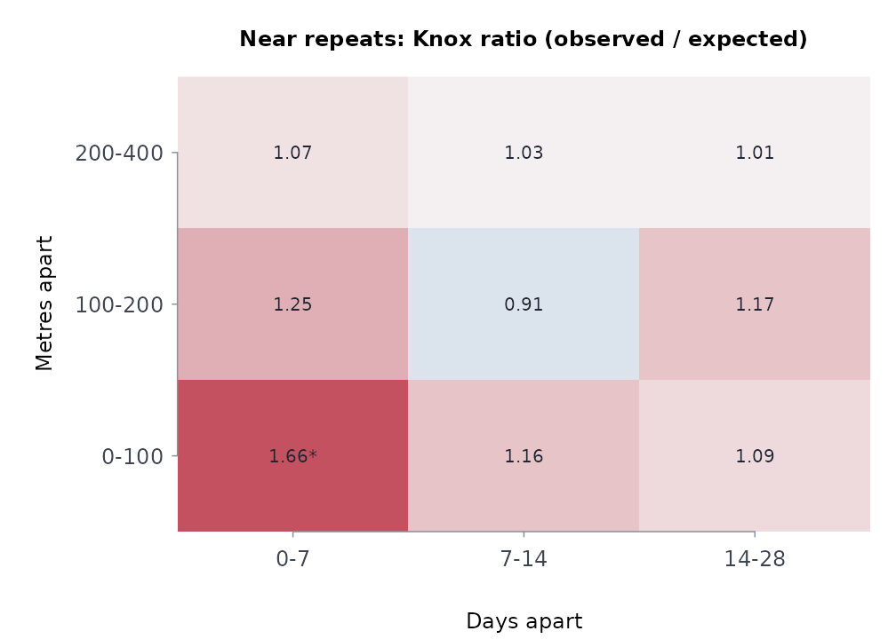

### First Nations, Metis and Inuit health

Published Statistics Canada estimates bundled with the package
([`?indiex`](https://rootcoder007.github.io/rmorie-bricklayer/reference/indiex.md);
see
[`vignette("applied-analyses")`](https://rootcoder007.github.io/rmorie-bricklayer/articles/applied-analyses.md)
for the methods and the governance behind them). Each group is drawn on
its own: the plots never pool First Nations, Metis and Inuit.

``` r

h <- indiex("health")
adults <- h[h$age == "Total, 18 years and over", ]
mh <- adults[adults$period == "2019/2022" & adults$indicator == "Perceived mental health, very good or excellent", ]
```

Each group against non-Indigenous adults, with intervals from the
published ones:

``` r

plot(indgap(mh, "group", "estimate", "lower", "upper", qual = "quality"))
```

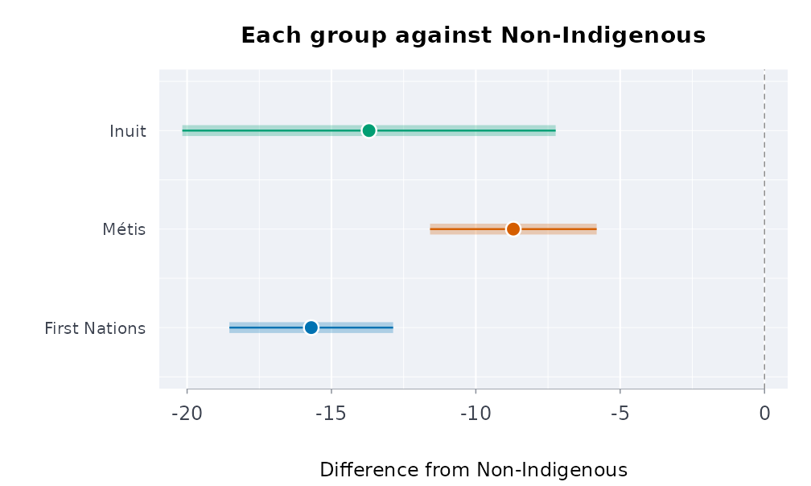

Perceived mental health on its whole scale (2022 Indigenous Peoples
Survey):

``` r

r <- indiex("mentalhealth")
r <- r[r$region == "Canada", ]
plot(ordcmp(r, "group", "rating", "estimate", "lower", "upper",
                     lvls = c("Fair or poor", "Good", "Very good", "Excellent"),
                     ref = "M\u00e9tis", qual = "quality"))
```


Wellness beside distress, and the two as separate axes (2024 well-being
table):

``` r

wb <- indiex("wellbeing")
w <- welprof(wb, "group", "indicator", "estimate", "lower", "upper",
                      well = c("Always or often has a hopeful outlook",
                                   "Sense of meaning and purpose rating of 8, 9 or 10"),
                      distress = c("Rarely or never has a hopeful outlook",
                                   "Life satisfaction rating between 0 and 5"),
                      qual = "quality")
plot(w)
```

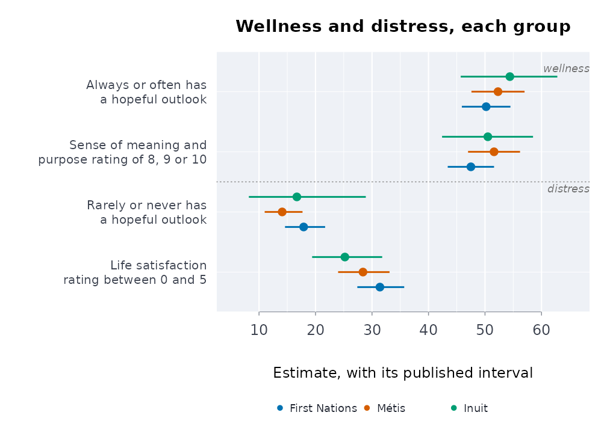

``` r

plot(dualcont(w, "Always or often has a hopeful outlook", "Life satisfaction rating between 0 and 5"))
```


Change between the two survey periods, wellness first:

``` r

hc <- healchg(adults[adults$indicator %in% c("Perceived mental health, very good or excellent",
                                                    "Mood disorder"), ],
                     "group", "indicator", "period", "estimate", "lower", "upper",
                     from = "2015/2018", to = "2019/2022", qual = "quality",
                     well = "Perceived mental health, very good or excellent")
plot(hc)
```


The Truth and Reconciliation Commission’s Calls to Action, completed and
projected:

``` r

plot(trcprog())
```


### Evaluating a policy

The designs of
[`vignette("statistical-methods")`](https://rootcoder007.github.io/rmorie-bricklayer/articles/statistical-methods.md),
on its made-up panel of twenty districts where a reform arrives in three
stages: the outcome by adoption cohort before any model, the event
study, the Goodman-Bacon weights behind a two-way fixed-effects
estimate, and the randomisation null of the assignment.

``` r

p <- polex()
```

``` r

plot(cohtrnd(p, "district", "month", "crmrate", "refmonth", win = c(-10, 10)))
```


``` r

es <- evstudy(p, "district", "month", "crmrate", "refmonth", leads = 4, lags = 6)
plot(es)
```


``` r

plot(bacondcmp(p, "district", "month", "crmrate", "reformed"))
```


``` r

plot(perminf(p, "district", "month", "crmrate", "refmonth", cl = "region"))
```

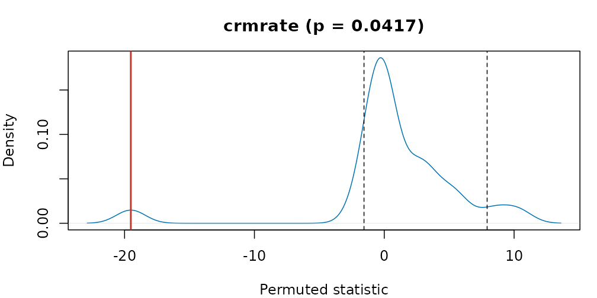

Whether one district drives the estimate, and a single treated place
against its synthetic control and its synthetic difference in
differences:

``` r

plot(loounit(p, "district", "month", "crmrate", "reformed"))
```


``` r

p13 <- p[is.na(p$refmonth) | p$district == "D13", ]
plot(synctl(p13, "district", "month", "crmrate", "D13", adopt = 13))
```


``` r

plot(syndid(p13, "district", "month", "crmrate", "refmonth", reps = 50, seed = 1))
```

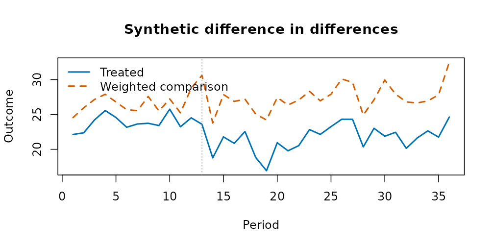

The power of the design on the untreated data, and the cross-fitted AIPW
estimate of
[`vignette("statistical-methods")`](https://rootcoder007.github.io/rmorie-bricklayer/articles/statistical-methods.md)
with its overlap and balance checks:

``` r

plot(plnpwr(p[p$month <= 12, ], "district", "month", "crmrate", ntrt = 10, adopt = 7:10,
            eff = c(0, 0.5, 1, 1.5), reps = 40, seed = 1))
```


``` r

set.seed(7)
n <- 600
d <- data.frame(age = runif(n, 18, 70), income = rnorm(n))
d$t <- rbinom(n, 1, plogis(-2 + 0.04 * d$age + 0.5 * d$income))
d$y <- 10 + 3 * d$t + 0.2 * d$age + d$income + rnorm(n)
fit <- aipwcf(d, "y", "t", c("age", "income"), lrn = "ols")
plot(fit)
```

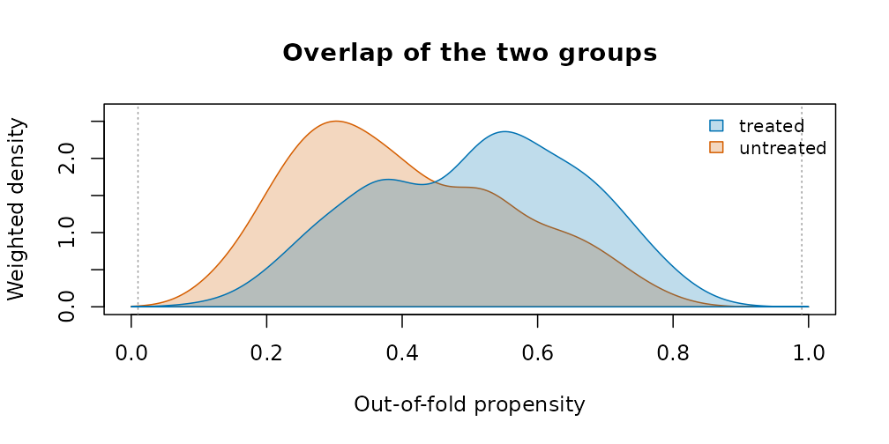

``` r

plot(fit, type = "estimate")
```

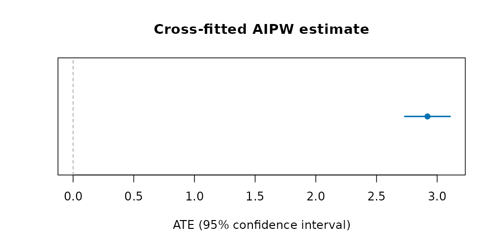

``` r

e <- pmin(pmax(attr(fit, "propensity")$propensity, 0.01), 0.99)
d$ipw <- ifelse(d$t == 1, 1 / e, 1 / (1 - e))
plot(baltab(d, "t", c("age", "income")), after = baltab(d, "t", c("age", "income"), w = "ipw"))
```


### Customising

Every method takes `main`, `col` (or a `palette` name), `grid`, and
`...` for the base-graphics call.
[`plotopt()`](https://rootcoder007.github.io/rmorie-bricklayer/reference/blpal.md)
sets the session defaults;
[`blpal()`](https://rootcoder007.github.io/rmorie-bricklayer/reference/blpal.md)
gives the colour-blind-safe sets the package uses.

``` r

plot(sf, what = "alos", col = "firebrick", main = "Length of stay (days)", lwd = 3)
```


``` r

old <- plotopt(palette = "grey", grid = FALSE)
plot(y, what = "value")
```


``` r

plotopt(palette = old$palette, grid = old$grid)
blpal("okabe", 4)
#> [1] "#0072B2" "#D55E00" "#009E73" "#E69F00"
```

Every method returns the data it drew, invisibly:

``` r

drawn <- plot(y)
```


``` r

head(drawn, 3)
#>   label    pctchg     lower    upper verdict   at
#> 1  2018        NA        NA       NA    <NA> 2018
#> 2  2019 10.000000 -29.95683 73.20735      up 2019
#> 3  2020 -6.818182 -40.61975 45.94265    down 2020
```

Results that are plain data frames have a plot function of their own:
the Lorenz curve of a vector, and the funnel plot of observed against
expected counts per area.

``` r

plotlrnz(c(1, 1, 2, 3, 5, 8, 13, 21))
```


``` r

plotfnl(obs = c(4, 20, 50, 9, 31), expd = c(5, 22, 40, 20, 30),
            area = c("a", "b", "c", "d", "e"))
```

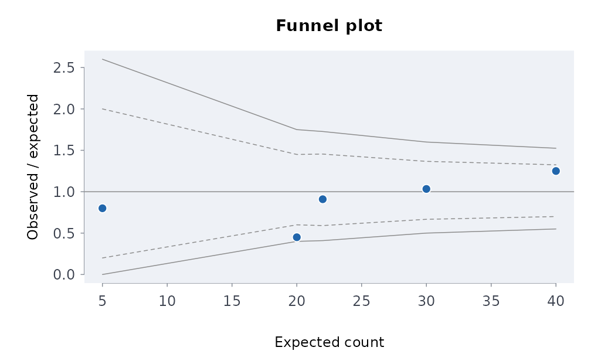
