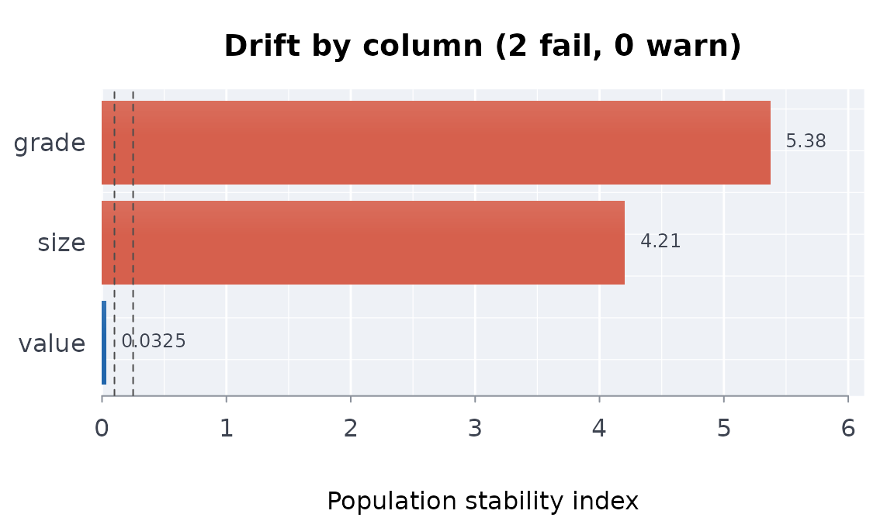
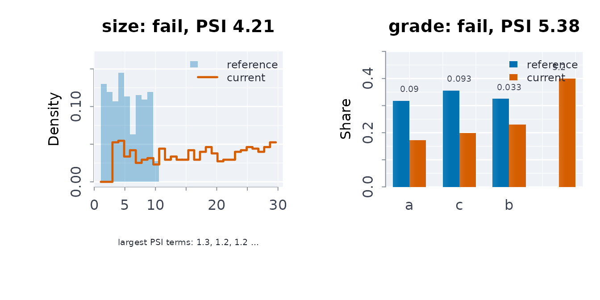

# Has the data changed?

A capsule pins a dataset so a result can be reproduced. The pin is a
SHA-256, and it answers exactly one question: are these the same bytes?

That is not the question that usually matters. Two different questions
hide behind it:

- The bytes changed, but the data did not. An open-data portal
  re-exports its extract with a new timestamp in the header, or reorders
  rows, or switches line endings. The digest changes; nothing you
  compute from it does.
- The bytes are plausible and the data changed anyway. A column that was
  reported in dollars is now reported in thousands. The name, the type
  and the row count are identical. The digest changes, so you know
  *something* happened – but a digest cannot tell you *what*, and if you
  re-pin without looking, the change is now baked in.

[`cpsdrft()`](https://rootcoder007.github.io/rmorie-bricklayer/reference/cpsdrft.md)
answers the second question.

## A re-release that is statistically the same

Suppose the capsule was built from one sample and a fresh fetch gives
another draw from the same process.

``` r

reference <- data.frame(
  value = rnorm(500),
  size  = runif(500, 1, 10),
  grade = sample(c("a", "b", "c"), 500, TRUE),
  stringsAsFactors = FALSE
)

current <- data.frame(
  value = rnorm(500),
  size  = runif(500, 1, 10),
  grade = sample(c("a", "b", "c"), 500, TRUE),
  stringsAsFactors = FALSE
)
```

The two have different bytes, so their digests differ:

``` r

dgstobj(reference) == dgstobj(current)
#> [1] FALSE
```

But nothing moved distributionally, and the report says so:

``` r

cpsdrft(reference, current)
#> ╭── Capsule drift report ─────────────────────────────────────────────────╮
#> │   Verdict          ✓ no drift detected                                  │
#> │   Reference rows   500                                                  │
#> │   Current rows     500                                                  │
#> │   Columns tested   3                                                    │
#> │   Columns drifted  0                                                    │
#> │   Alpha            0.01                                                 │
#> │                                                                         │
#> │   Per-column tests                                                      │
#> │      column  type            stat      p      psi                       │
#> │   -  ------  -----------  -------  -----  -------                       │
#> │   ✔  size    numeric      0.07800  0.095  0.05893                       │
#> │   ✔  grade   categorical  3.07609  0.215  0.01232                       │
#> │   ✔  value   numeric      0.03400  0.935  0.03250                       │
#> │                                                                         │
#> │   None of the 3 columns changed by more than chance at alpha 0.01; psi  │
#> │   above 0.25 is the usual sign of a material shift.                     │
#> │                                                                         │
#> │   plot(x, what = "columns") draws the columns; drfthtml(x, file) writes │
#> │   an interactive report.                                                │
#> ╰─────────────────────────────────────────────────────────────────────────╯
```

## A silently rescaled column

Now the same fetch, except `size` arrives on a different scale and a
category appears that the capsule never saw.

``` r

moved <- current
moved$size <- moved$size * 3
moved$grade[1:200] <- "z"

cpsdrft(reference, moved)
#> ╭── Capsule drift report ─────────────────────────────────────────────────╮
#> │   Verdict          ✗ DRIFT DETECTED                                     │
#> │   Reference rows   500                                                  │
#> │   Current rows     500                                                  │
#> │   Columns tested   3                                                    │
#> │   Columns drifted  2                                                    │
#> │   Alpha            0.01                                                 │
#> │                                                                         │
#> │   Per-column tests                                                      │
#> │      column  type             stat        p    psi                      │
#> │   -  ------  -----------  --------  -------  -----                      │
#> │   ✖  size    numeric        0.7380  < 0.001  4.205                      │
#> │   ✖  grade   categorical  252.5695  < 0.001  5.376                      │
#> │   ✔  value   numeric        0.0340    0.935  0.033                      │
#> │                                                                         │
#> │   2 of 3 columns changed between the reference and the current table by │
#> │   more than chance at alpha 0.01; check those columns before trusting   │
#> │   results built on the reference.                                       │
#> │                                                                         │
#> │   plot(x, what = "columns") draws the columns; drfthtml(x, file) writes │
#> │   an interactive report.                                                │
#> ╰─────────────────────────────────────────────────────────────────────────╯
```

`value` is untouched and is not flagged. `size` and `grade` are.

## Looking at the drift

[`plot()`](https://rdrr.io/r/graphics/plot.default.html) draws the
population stability index of each column, worst first, coloured by its
verdict, with the warn and fail bands as dashed lines. A column is
`fail` when its test rejects at `alpha` or its PSI is above the fail
band on large samples, `warn` when its PSI is above the warn band, and
`ok` otherwise.

``` r

d <- cpsdrft(reference, moved)
plot(d)
```



`what = "columns"` shows where each column moved: the two distributions,
with each PSI bin’s share of the index written on it.

``` r

plot(d, what = "columns", cols = c("size", "grade"))
```



`what = "ecdf"` and `what = "quantiles"` show the same moves as
cumulative shares and as quantiles against the identity line, and
`what = "fingerprint"` puts every column on one chart: a spoke per
column at its PSI, the bands as rings.

``` r

plot(d, what = "fingerprint")
```


For someone who will not run R,
[`drfthtml()`](https://rootcoder007.github.io/rmorie-bricklayer/reference/drfthtml.md)
writes the same report as one HTML file. It fetches nothing, so it opens
from disk and stays as it was written, and it holds only the binned
summaries, never the rows. It opens on the chosen column’s two
distributions drawn in on a canvas, with the verdict and the capsule’s
provenance beside them. The Columns tab has the table, which can be
searched, filtered and sorted (the up and down keys move through it),
and the column detail: both samples’ statistics, a sentence on the
verdict, and charts that each carry a line on how to read them, namely
the density overlay (a category flow for a categorical column), the ECDF
overlay, the quantile shift, the PSI by bin and the first digits against
Benford’s law. The Overview tab has the fingerprint and a tile per
column. Further tabs show the manifest diff as a tree, the PSI over
earlier runs as a heatmap, and the capsule chain from provenance to
attestation. Sliders move the bands and alpha and score every chart
again. Buttons export Markdown, JSON, SVG or a GitHub comment.

``` r

f <- file.path(tempdir(), "drift.html")
drfthtml(d, f, title = "Pinned against fetched")
file.exists(f)
#> [1] TRUE
```

On the command line `rmbl drift PATH --html FILE` writes it for each
capsule whose source moved. `drftapp(d)` opens the report as a Shiny app
that also reruns the comparison and shows what would clear a column.

## Which test, and why

For a numeric column,
[`cpsdrft()`](https://rootcoder007.github.io/rmorie-bricklayer/reference/cpsdrft.md)
runs a two-sample Kolmogorov-Smirnov test and computes the population
stability index. The KS p-value drives the flag because it is
*calibrated* – under no drift it is uniform, so a threshold means what
it says.

The population stability index is reported alongside it as an effect
size, but by default it is not allowed to raise the flag on its own
until both samples reach `psiminn`. The reason is worth stating, because
the index is widely used without it: PSI’s conventional bands (0.1
“investigate”, 0.25 “material shift”) are large-sample heuristics with
no calibrated null distribution. On a few hundred rows, binning noise
alone clears 0.25 routinely:

``` r

a <- data.frame(v = rnorm(80))
b <- data.frame(v = rnorm(80))

# Two draws from the SAME distribution.
cpsdrft(a, b)$columns[, c("p_value", "psi")]
#>     p_value       psi
#> 1 0.5595597 0.1376677
```

The PSI is above the conventional threshold; the p-value correctly is
not. Flagging on PSI here would manufacture drift.

For a categorical column the test is
[`drfthomog()`](https://rootcoder007.github.io/rmorie-bricklayer/reference/drfthomog.md),
a two-sample chi-square on the 2-by-k table – *not* a goodness-of-fit
test against the reference proportions. The distinction matters: the
reference is itself a finite sample, and treating its proportions as
known ignores their sampling error, which inflates the false-positive
rate.

``` r

x <- sample(c("p", "q", "r"), 300, TRUE)
y <- sample(c("p", "q", "r"), 300, TRUE)

# The homogeneity test is the more conservative, and the correct one here.
c(homogeneity = drfthomog(x, y)[["p_value"]],
  goooffit = drftchisq(y, x)[["p_value"]])
#>  homogeneity     goooffit 
#> 5.992249e-03 9.970333e-06
```

## Screening for figures that were not measured

Benford’s law describes the leading digits of quantities that span
several orders of magnitude. Figures that were rounded, capped,
re-scaled or invented typically do not follow it.

``` r

# A quantity spanning several orders of magnitude.
benfordtst(10^runif(2000, 0, 6))
#> ╭── Benford first-digit screen ───────────────────────────────────────────╮
#> │   ✔ consistent with Benford's law                                       │
#> │                                                                         │
#> │   values used  2,000                                                    │
#> │   chi-square   2.067                                                    │
#> │   df           8                                                        │
#> │   p-value      0.979                                                    │
#> │                                                                         │
#> │   digit  observed  expected        shape                                │
#> │       1     0.305     0.301  ####################                       │
#> │       2     0.174     0.176  ###########                                │
#> │       3     0.127     0.125  ########                                   │
#> │       4     0.088     0.097  ######                                     │
#> │       5     0.082     0.079  #####                                      │
#> │       6     0.068     0.067  ####                                       │
#> │       7     0.059     0.058  ####                                       │
#> │       8     0.052     0.051  ###                                        │
#> │       9     0.044     0.046  ###                                        │
#> │                                                                         │
#> │   The leading digits are consistent with Benford's law (p = 0.979); the │
#> │   largest gap is at 4, 8.8% seen against 9.7% expected. Benford's law   │
#> │   expects a leading 1 about 30% of the time and a 9 under 5%. A         │
#> │   departure is a reason to look closer (rounding, thresholds, made-up   │
#> │   figures), never proof by itself.                                      │
#> ╰─────────────────────────────────────────────────────────────────────────╯
```

``` r

# Leading digits drawn uniformly -- not what measurement looks like.
benfordtst(as.numeric(paste0(sample(1:9, 2000, TRUE), "000")))
#> ╭── Benford first-digit screen ───────────────────────────────────────────╮
#> │   ! departs from Benford's law (screen only, not a verdict)             │
#> │                                                                         │
#> │   values used  2,000                                                    │
#> │   chi-square   846.893                                                  │
#> │   df           8                                                        │
#> │   p-value      < 0.001                                                  │
#> │                                                                         │
#> │   digit  observed  expected        shape                                │
#> │       1     0.121     0.301  ####################                       │
#> │       2     0.102     0.176  #################                          │
#> │       3     0.099     0.125  ################                           │
#> │       4     0.117     0.097  ###################                        │
#> │       5     0.113     0.079  ###################                        │
#> │       6     0.100     0.067  ################                           │
#> │       7     0.121     0.058  ####################                       │
#> │       8     0.112     0.051  ##################                         │
#> │       9     0.115     0.046  ###################                        │
#> │                                                                         │
#> │   The leading digits depart from Benford's law (p < 0.001); the largest │
#> │   gap is at 1, 12.1% seen against 30.1% expected. Benford's law expects │
#> │   a leading 1 about 30% of the time and a 9 under 5%. A departure is a  │
#> │   reason to look closer (rounding, thresholds, made-up figures), never  │
#> │   proof by itself.                                                      │
#> ╰─────────────────────────────────────────────────────────────────────────╯
```

This is a screen and not a verdict. Columns with a narrow range, a unit
floor, or an assigned-identifier structure (postcodes, year fields,
prices ending in 99) violate Benford’s law perfectly legitimately. A
small p-value is a reason to look.

## Structure, separately

Drift is about distributions. Structure – names, types, bounds, allowed
values – is
[`valsch()`](https://rootcoder007.github.io/rmorie-bricklayer/reference/valsch.md)’s
job, and the two complement each other.
[`infsch()`](https://rootcoder007.github.io/rmorie-bricklayer/reference/infsch.md)
writes the schema for you from data you trust:

``` r

schema <- infsch(reference)
schema
#> ╭── Inferred schema ──────────────────────────────────────────────────────────╮
#> │   Columns         3                                                         │
#> │   Rows            450 to 550                                                │
#> │   Value sets      1                                                         │
#> │   Numeric ranges  2                                                         │
#> │                                                                             │
#> │   What later extracts must look like to pass valsch(): these columns and    │
#> │   types, missingness at most as shown, values inside these sets.            │
#> │                                                                             │
#> │   value                numeric    max NA  10.0%  [-3.69, 4.492]             │
#> │   size                 numeric    max NA  10.0%  [0.1196, 10.86]            │
#> │   grade                character  max NA  10.0%  a, b, c                    │
#> ╰─────────────────────────────────────────────────────────────────────────────╯
```

``` r

# It accepts the data it learned from.
length(valsch(reference, list(schema = schema)))
#> [1] 0

# And catches the rescaled column, which is now outside its pinned range.
issues <- valsch(moved, list(schema = schema))
issues[["rangesize"]]$message
#> NULL
```

Read what
[`infsch()`](https://rootcoder007.github.io/rmorie-bricklayer/reference/infsch.md)
produces before committing it. It describes one extract, and cannot know
that a category which happens not to occur is nonetheless legal, or that
a range is a physical bound rather than an accident of this sample.

## Two cycles of the same survey

Drift checks fit a question a re-release raises: did the distribution of
a published table change between cycles? On the bundled indicators, the
2015/2018 and 2019/2022 estimates:

``` r

hi <- indiex("health")
a <- hi$estimate[hi$period == "2015/2018"]
b <- hi$estimate[hi$period == "2019/2022"]
drftks(a[is.finite(a)], b[is.finite(b)])
#> ╭── Two-sample Kolmogorov-Smirnov test ───────────────────────────────────────╮
#> │   Samples  500 and 506 values                                               │
#> │                                                                             │
#> │   statistic  value                                                          │
#> │   ---------  -------                                                        │
#> │   statistic  0.05261                                                        │
#> │   p_value    0.489                                                          │
#> │   neff       251.5                                                          │
#> │                                                                             │
#> │   No difference in distribution is detected (p = 0.489, not below 0.05).    │
#> │   At its widest the two cumulative distributions are 5.3 percentage points  │
#> │   apart.                                                                    │
#> │                                                                             │
#> │   D is the largest gap between the two empirical distribution               │
#> │   functions. The p-value is the asymptotic one: rough below a few           │
#> │   dozen values; stats::ks.test() gives an exact one.                        │
#> ╰─────────────────────────────────────────────────────────────────────────────╯
```
