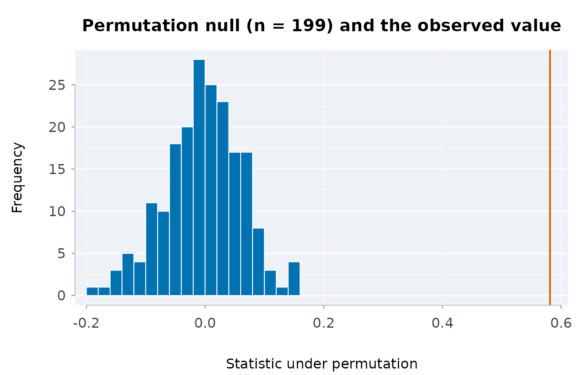
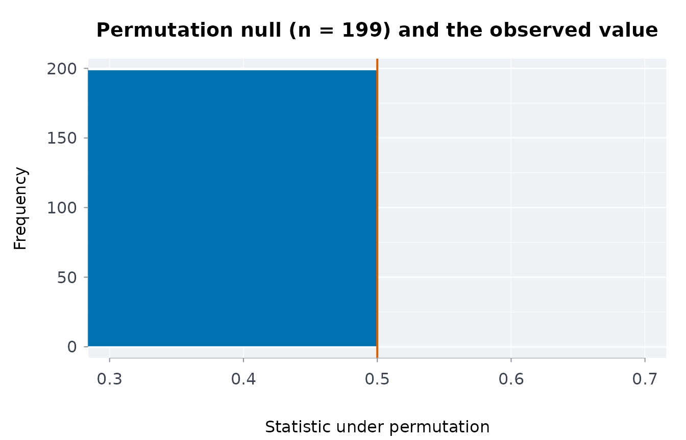
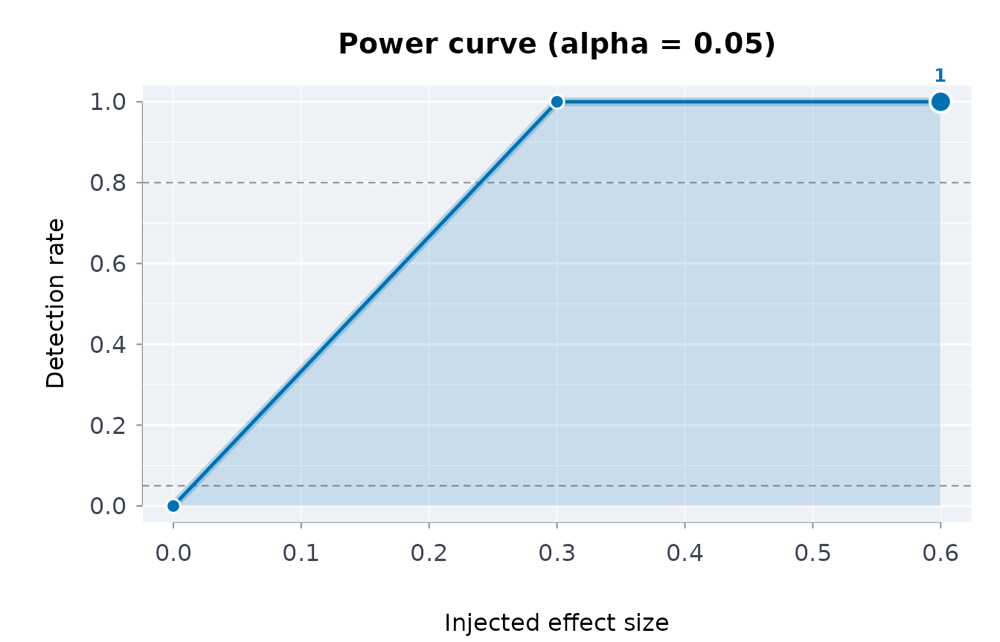

# Falsification controls and power curves: is the statistic real?

A capsule can prove that a statistic was computed from exactly these
bytes. It cannot, by itself, say whether the statistic means anything.
Two complementary checks address that: a **falsification control** asks
whether the statistic survives deliberate attempts to break it, and a
**power curve** asks whether the procedure could have detected an effect
of a given size at all. Both are borrowed from the refutation tests of
causal-inference practice (placebo treatments, random subsets,
permutation) and made to run on any statistic you can write as a
function of the data.

## Falsification controls

[`cpsfals()`](https://rootcoder007.github.io/rmorie-bricklayer/reference/cpsfals.md)
takes the data, a statistic (a function of the data frame) and the name
of the treatment column, and runs the controls that a real association
must pass:

- **permutation**: shuffle the treatment; the statistic should collapse
  toward its null;
- **placebo**: replace the treatment with noise; the statistic should
  collapse;
- **subsets**: recompute on random subsets; the statistic should stay
  stable.

``` r

set.seed(1)
d <- data.frame(x = rnorm(200))
d$y <- 0.8 * d$x + rnorm(200)

real <- cpsfals(d, function(z) cor(z$x, z$y), trt = "x", n = 199, seed = 42)
real$controls[, c("control", "passed")]
#>               control passed
#> 1         permutation   TRUE
#> 2             placebo   TRUE
#> 3 random_common_cause   TRUE
#> 4    subset_stability   TRUE
```

A statistic that ignores the data fails the controls that can see it. A
constant “0.5” passes the subset check (it is perfectly stable) and
fails the permutation check (it does not collapse when the treatment is
destroyed):

``` r

fake <- cpsfals(d, function(z) 0.5, trt = "x", n = 199, seed = 42)
fake$controls[fake$controls$control == "permutation", "passed"]
#> [1] FALSE
```

This is the point of running controls rather than looking at a p-value:
the p-value of a constant is undefined, but its behaviour under
permutation is not.

## Power curves

A null result is only informative if the procedure could have found
something.
[`cpspwr()`](https://rootcoder007.github.io/rmorie-bricklayer/reference/cpspwr.md)
injects an effect of known size into the data, re-runs the statistic
with its permutation test, and reports the detection rate at each size:

``` r

set.seed(1)
d <- data.frame(x = rnorm(120), y = rnorm(120))
inj <- function(z, size) {
  z$y <- z$y + size * z$x
  z
}

pw <- cpspwr(d, function(z) cor(z$x, z$y), inj,
                    sizes = c(0, 0.3, 0.6), trt = "x",
                    n = 99, reps = 5, seed = 42)
pw$curve
#>   size detected reps rate
#> 1  0.0        0    5    0
#> 2  0.3        5    5    1
#> 3  0.6        5    5    1
```

The rate at size 0 estimates the false-positive rate. With few
repetitions it is usually 0, because alpha is small (five draws at 0.05
come up empty about three times in four), so read it as a sanity check
that it is not *large*, not as an estimate of alpha:

``` r

pw$curve[pw$curve$size == 0, "rate"]
#> [1] 0
```

Use more `reps` for a real study; the example keeps them small so the
vignette builds quickly. The curve answers the question a reviewer will
ask of a null finding: “what effect size would you have detected with
this data?”

## Families of statistics: the multiple-testing correction

When several statistics are examined, the smallest p-value among them is
not the finding.
[`falsfam()`](https://rootcoder007.github.io/rmorie-bricklayer/reference/falsfam.md)
applies a multiple-testing correction across a family of falsification
results, so one real association is still reported as real and the noise
is not:

``` r

set.seed(1)
d <- data.frame(x = rnorm(150))
d$y <- 0.6 * d$x + rnorm(150)
d$a <- rnorm(150)
d$b <- rnorm(150)
fam <- list(
  real    = cpsfals(d, function(z) cor(z$x, z$y), trt = "x", n = 199, seed = 1),
  noisea = cpsfals(d, function(z) cor(z$a, z$y), trt = "a", n = 199, seed = 2),
  noiseb = cpsfals(d, function(z) cor(z$b, z$y), trt = "b", n = 199, seed = 3)
)
falsfam(fam)
#> ╭── Family of 3, corrected by holm at alpha 0.05 ─────────────────────────────╮
#> │   Method       holm                                                         │
#> │   Family size  3                                                            │
#> │   Alpha        0.05                                                         │
#> │   Survive      1                                                            │
#> │                                                                             │
#> │   name        p  adjusted_p  survives                                       │
#> │   ------  -----  ----------  --------                                       │
#> │   real    0.005       0.015  survives                                       │
#> │   noisea  0.955       1.000                                                 │
#> │   noiseb  0.995       1.000                                                 │
#> │                                                                             │
#> │   1 of 3 result(s) survive once the size of the family is counted.          │
#> │                                                                             │
#> │   at the permutation floor (more permutations would be needed to say        │
#> │   more): real                                                               │
#> ╰─────────────────────────────────────────────────────────────────────────────╯
```

It also accepts bare p-values, which is what stops the smallest of
several from being read as the finding:

``` r

falsfam(c(a = 0.01, b = 0.04, c = 0.2, d = 0.5))$results
#>   name    p adjusted survives
#> 1    a 0.01     0.04     TRUE
#> 2    b 0.04     0.12    FALSE
#> 3    c 0.20     0.40    FALSE
#> 4    d 0.50     0.50    FALSE
```

## Sensitivity to an unmeasured confounder

For an observed risk ratio, the E-value (VanderWeele and Ding 2017) is
the minimum strength of association an unmeasured confounder would need
with both treatment and outcome to explain the result away:

``` r

evlrr(2) # needs a confounder associated by 3.41 with both
#> evlpoint 
#> 3.414214
evlrr(0.5) # a protective effect is inverted; same answer
#> evlpoint 
#> 3.414214
evlrr(2, lo = 0.9, hi = 4.4) # an interval that includes the null needs nothing
#> evlpoint evllimit 
#> 3.414214 1.000000
evlrr(3, lo = 2.1, hi = 4.3) # a strong result with a limit well above the null
#> evlpoint evllimit 
#> 5.449490 3.619868
```

## Does it recover a known effect?

Falsification asks whether a result survives attempts to explain it
away.
[`cpsplant()`](https://rootcoder007.github.io/rmorie-bricklayer/reference/cpsplant.md)
asks the complementary question: does the statistic measure what it is
meant to? It shuffles the outcome, which removes its real association
with the treatment, plants effects of known size, and checks the
statistic gets each one back. A planted 0 catches a statistic that finds
effects that are not there; 0.5 and 1 catch one that gets their size
wrong.

``` r

set.seed(4)
tr <- data.frame(x = rbinom(150, 1, 0.5))
tr$y <- 1.5 * tr$x + rnorm(150)
diffmeans <- function(z) mean(z$y[z$x == 1]) - mean(z$y[z$x == 0])
cpsplant(tr, diffmeans, y = "y", trt = "x", n = 25, seed = 4)
#> ╭── Planted-effect recovery: FAILED ──────────────────────────────────────────╮
#> │ ✖ NOT VERIFIED                                                              │
#> │                                                                             │
#> │   Outcome                    y                                              │
#> │   Treatment                  x                                              │
#> │   Data sets per effect       25                                             │
#> │   Tolerance                  0.1                                            │
#> │   Estimate on the real data  1.358                                          │
#> │   Seed                       4                                              │
#> │                                                                             │
#> │   planted  recovered      bias       se  result                             │
#> │   -------  ---------  --------  -------  ---------                          │
#> │    0.0000     0.0593   0.05934  0.03462  ok                                 │
#> │    0.5000     0.4677  -0.03235  0.04025  ok                                 │
#> │    1.0000     1.0012   0.00119  0.05026  too noisy                          │
#> │                                                                             │
#> │   The statistic missed at least one planted effect: it does not measure     │
#> │   what it is meant to on this data. Check it before reporting its           │
#> │   estimate.                                                                 │
#> │                                                                             │
#> │   Each planted data set shuffles the outcome, removing its real             │
#> │   association, then adds effect x treatment.                                │
#> ╰─────────────────────────────────────────────────────────────────────────────╯
```

[`cpsspec()`](https://rootcoder007.github.io/rmorie-bricklayer/reference/cpsspec.md)
runs the reasonable alternative analyses side by side and says whether
they agree in sign with the one reported, and
[`recevid()`](https://rootcoder007.github.io/rmorie-bricklayer/reference/recevid.md)
writes either check, and the falsification controls, into the manifest,
so the capsule carries the evidence with the numbers.

## Where this fits in a capsule

[`cpsrpt()`](https://rootcoder007.github.io/rmorie-bricklayer/reference/cpsrpt.md)
runs the falsification controls alongside the schema, rule and drift
checks when a statistic is supplied, so the capsule records not only
that the number was computed from these bytes but that it survived its
controls. A pre-registered hypothesis
([`prrgdecl()`](https://rootcoder007.github.io/rmorie-bricklayer/reference/prrgdecl.md),
[`prrgchk()`](https://rootcoder007.github.io/rmorie-bricklayer/reference/prrgdecl.md))
pins what was going to be tested before the data were seen, which is the
other half of keeping a finding honest.

## Several gaps, one family of tests

A report on Indigenous health usually tests many indicators at once.
[`falsfam()`](https://rootcoder007.github.io/rmorie-bricklayer/reference/falsfam.md)
adjusts the family; here the differences from non-Indigenous adults in
2019/2022 for First Nations adults, with z statistics from the published
95 percent intervals:

``` r

hi <- indiex("health")
s <- hi[hi$period == "2019/2022" & hi$age == "Total, 18 years and over" &
          hi$quality == "ok", ]
fn <- s[s$group == "First Nations", ]
ni <- s[s$group == "Non-Indigenous", ]
both <- merge(fn, ni, by = "indicator", suffixes = c("fn", "ni"))
se <- function(l, u) (u - l) / (2 * 1.96)
z <- (both$estimatefn - both$estimateni) /
  sqrt(se(both$lowerfn, both$upperfn)^2 + se(both$lowerni, both$upperni)^2)
p <- stats::setNames(2 * stats::pnorm(-abs(z)), both$indicator)
res <- falsfam(p, meth = "holm")
head(res)
#> $results
#>                                                                     name
#> 1                                    Current smoker, daily or occasional
#> 2                                                  Current smoker, daily
#> 3                        Perceived mental health, very good or excellent
#> 4                               Perceived health, very good or excellent
#> 5                                                       Anxiety disorder
#> 6                  Body mass index, adjusted self-reported, adult, obese
#> 7                                                          Mood disorder
#> 8                                  Perceived mental health, fair or poor
#> 9                                         Perceived health, fair or poor
#> 10                                                        Heavy drinking
#> 11                        Life satisfaction, satisfied or very satisfied
#> 12                      At least one underlying chronic health condition
#> 13            Body mass index, adjusted self-reported, adult, overweight
#> 14                                     Has a regular healthcare provider
#> 15                                         Perceived mental health, good
#> 16                                                Perceived health, good
#> 17                                                   Has ever had cancer
#> 18                                                             Arthritis
#> 19 Sense of belonging to local community, somewhat strong or very strong
#> 20   Perceived life stress, most days quite a bit or extremely stressful
#> 21                                                   Effects of a stroke
#> 22                                                              Diabetes
#> 23                                 Two or more chronic health conditions
#> 24                                                   High blood pressure
#> 25                      Never had alcoholic drinks in the past 12 months
#> 26                                                         Heart disease
#>               p     adjusted survives
#> 1  4.799378e-47 1.247838e-45     TRUE
#> 2  6.666055e-33 1.666514e-31     TRUE
#> 3  1.977723e-27 4.746535e-26     TRUE
#> 4  4.701772e-27 1.081408e-25     TRUE
#> 5  8.269913e-26 1.819381e-24     TRUE
#> 6  1.570439e-24 3.297922e-23     TRUE
#> 7  2.217733e-22 4.435465e-21     TRUE
#> 8  8.105074e-22 1.539964e-20     TRUE
#> 9  5.917920e-20 1.065226e-18     TRUE
#> 10 2.383432e-15 4.051834e-14     TRUE
#> 11 4.967275e-13 7.947640e-12     TRUE
#> 12 4.149245e-11 6.223867e-10     TRUE
#> 13 6.976248e-10 9.766747e-09     TRUE
#> 14 4.744043e-05 6.167256e-04     TRUE
#> 15 1.916130e-04 2.299356e-03     TRUE
#> 16 1.986114e-04 2.299356e-03     TRUE
#> 17 7.953428e-04 7.953428e-03     TRUE
#> 18 5.573725e-03 5.016352e-02    FALSE
#> 19 9.255276e-03 7.404220e-02    FALSE
#> 20 1.455855e-02 1.019099e-01    FALSE
#> 21 1.616352e-02 1.019099e-01    FALSE
#> 22 2.409857e-02 1.204929e-01    FALSE
#> 23 3.100005e-02 1.240002e-01    FALSE
#> 24 2.077056e-01 6.231168e-01    FALSE
#> 25 6.863741e-01 1.000000e+00    FALSE
#> 26 1.000000e+00 1.000000e+00    FALSE
#> 
#> $method
#> [1] "holm"
#> 
#> $famsz
#> [1] 26
#> 
#> $alpha
#> [1] 0.05
#> 
#> $atflr
#> character(0)
```

## The tests in a picture

[`plot()`](https://rdrr.io/r/graphics/plot.default.html) draws each
result. For the real statistic, the observed correlation stands far
outside the correlations the permuted tables give. The fake statistic
returns 0.5 whatever the data, so every permuted table also gives 0.5:
the null collapses onto the observed value, and the permutation control
fails, as it should. The last panel is the power of the test across
injected effect sizes.

``` r

plot(real)
```



``` r

plot(fake)
```



``` r

plot(pw)
```



## References

VanderWeele, Ding (2017). Sensitivity analysis in observational
research: introducing the E-value. *Annals of Internal Medicine* 167(4).
Benjamini, Hochberg (1995). Controlling the false discovery rate. *JRSS
B* 57(1).
