# First Nations, Métis and Inuit health: published tables, distinctions and governance

This vignette covers the tools for First Nations, Métis and Inuit
health, mental health and wellness data, as Statistics Canada publishes
them. It also covers the rules those tools follow, because with these
data, how you work matters as much as what you compute.

Every example runs on published values.
[`indiex()`](https://rootcoder007.github.io/rmorie-bricklayer/reference/indiex.md)
bundles excerpts of eight Statistics Canada tables, reproduced under the
Statistics Canada Open Licence:

| Excerpt | Table | Survey and period |
|----|----|----|
| `"health"` | 13-10-0924-01 | Canadian Community Health Survey, 2015/2018 and 2019/2022 |
| `"mentalhealth"` | 41-10-0067-01 | Indigenous Peoples Survey, 2022 |
| `"wellbeing"` | 41-10-0082-01 | 2024 |
| `"suiide"` | 41-10-0021-01 | Aboriginal Peoples Survey, 2017 |
| `"lifeexp"` | 17-10-0160-01 | Projected life expectancy at birth |
| `"infmort"` | 17-10-0161-01 | Infant mortality |
| `"censuspop"` | 98-510-X2021001 | 2021 Census Indigenous Population Profile, population |
| `"censushh"` | 98-510-X2021016 | 2021 Census Indigenous Population Profile, households |

The 13-10-0924 excerpt is the table behind The Daily of 2025-02-13. The
full tables, and the other Indigenous-titled tables, are at the data
service: see
[`indtabs()`](https://rootcoder007.github.io/rmorie-bricklayer/reference/indtabs.md).

> Some of this vignette concerns suicide. If you or someone you know
> needs support, the Hope for Wellness Help Line (1-855-242-3310, or the
> online chat at hopeforwellness.ca) offers counselling and crisis
> support to Indigenous people across Canada, in English and French, and
> in Cree, Ojibway and Inuktitut on request. You can also call or text
> 9-8-8.

## Whose data these are

Two sets of principles govern Indigenous data in Canada.

- **OCAP®** comes from the First Nations Information Governance Centre.
  It stands for Ownership, Control, Access and Possession. It says First
  Nations own their information and decide how it is collected, used and
  shared.
- **The CARE Principles** come from Carroll et al. (2020). They stand
  for Collective benefit, Authority to control, Responsibility and
  Ethics, and apply to Indigenous data everywhere.

Walter and Andersen (2013) set out what a quantitative methodology looks
like when it starts from Indigenous standpoints. Walter (2016) names the
pattern it pushes against: statistics about Indigenous peoples clustered
around five Ds, namely disparity, deprivation, disadvantage, dysfunction
and difference.

The package follows these principles in six ways.

- **Only open aggregate data.** The data service mirrors only aggregate
  tables published under the Statistics Canada Open Licence. It never
  holds First Nations-held survey data, such as the First Nations
  Regional Health Survey. Those are reached through the FNIGC, on its
  terms.
- **Distinctions-based.** First Nations, Métis and Inuit are reported
  separately. A pooled “Indigenous” total is marked wherever it appears.
  [`dstntst()`](https://rootcoder007.github.io/rmorie-bricklayer/reference/dstntst.md)
  shows when pooling would hide a difference.
- **Off-reserve coverage.** The First Nations figures in these surveys
  are for people living off reserve. Reserves are outside the surveys’
  coverage.
- **Suppressed cells stay suppressed.** A cell is suppressed (`x`) to
  protect the people in it, and small communities most of all. `F` cells
  are too unreliable to publish. Both become `NA`, and nothing in the
  package imputes them or works them back from totals.
- **Strengths beside gaps.** Wellness is reported beside distress, and
  [`frmaud()`](https://rootcoder007.github.io/rmorie-bricklayer/reference/frmaud.md)
  checks how deficit-framed a report is.
- **A gap is not a deficit of the people.** A difference between groups
  measures the effects of colonial policy, the residential schools and
  unequal services. Report it with that context, and with the
  communities’ own interpretation where they have given one.

## Reading a table as published

A Statistics Canada table puts each estimate and its limits on separate
rows.
[`scests()`](https://rootcoder007.github.io/rmorie-bricklayer/reference/scests.md)
puts them side by side. It reads every layout the Indigenous tables use:

- confidence limits named in any of their forms;
- coefficients of variation, or standard errors, in place of limits;
- several measures per cell;
- tables with no limits at all.

``` r

d <- data.frame(
  REF_DATE = "2022",
  GEO = "Canada",
  `Indigenous identity` = rep(c("First Nations", "M\u00e9tis"), each = 4),
  Statistics = rep(
    c(
      "Number of persons",
      "Percent",
      "Low 95% confidence interval",
      "High 95% confidence interval"
    ),
    2
  ),
  UOM = rep(c("Persons", "Percent", "Percent", "Percent"), 2),
  VALUE = c(415000, 47.1, 45.2, 49.0, 320000, 50.3, 48.1, 52.5),
  STATUS = "",
  check.names = FALSE,
  stringsAsFactors = FALSE
)
scests(d)
#>   REF_DATE    GEO Indigenous.identity           measure estimate lower upper
#> 1     2022 Canada       First Nations Number of persons 415000.0    NA    NA
#> 2     2022 Canada       First Nations           Percent     47.1  45.2  49.0
#> 3     2022 Canada               Métis Number of persons 320000.0    NA    NA
#> 4     2022 Canada               Métis           Percent     50.3  48.1  52.5
#>       cisou quality
#> 1      <NA>      ok
#> 2 published      ok
#> 3      <NA>      ok
#> 4 published      ok
```

A mirrored table loads by its id. This needs the data service key, so it
is not run here:

``` r

indtabs("mental health")
e <- scests("41100067")
```

## Perceived mental health, against non-Indigenous adults

The share of adults who rate their mental health very good or excellent,
2019/2022, from table 13-10-0924-01:

``` r

h <- indiex("health")
mh <- h[h$period == "2019/2022" & h$age == "Total, 18 years and over" &
          h$indicator == "Perceived mental health, very good or excellent", ]
g <- indgap(mh, "group", "estimate", "lower", "upper", qual = "quality")
g
#> ╭── Gap against a reference group ──────────────────────────────────────────╮
#> │   Reference  Non-Indigenous                                               │
#> │   Groups     3                                                            │
#> │   Intervals  95%                                                          │
#> │                                                                           │
#> │   group          estimate  refest   ratio  ratio CI        difference     │
#> │   -------------  --------  ------  ------  --------------  ----------     │
#> │   First Nations     45.80   61.50  0.7447  [0.700, 0.792]      -15.70     │
#> │   Métis             52.80   61.50  0.8585  [0.813, 0.907]       -8.70     │
#> │   Inuit             47.80   61.50  0.7772  [0.679, 0.890]      -13.70     │
#> │                                                                           │
#> │   group          difference CI                                            │
#> │   -------------  --------------                                           │
#> │   First Nations  [-18.5, -12.9]                                           │
#> │   Métis          [-11.6, -5.8]                                            │
#> │   Inuit          [-20.2, -7.2]                                            │
#> │                                                                           │
#> │   Below the reference (interval below 1): First Nations, Métis and Inuit. │
#> │                                                                           │
#> │   ratio: the group's estimate over the reference's; difference: the       │
#> │   group's less the reference's, in the estimate's own units.              │
#> │   Report a gap beside each group's own level, not alone.                  │
#> ╰───────────────────────────────────────────────────────────────────────────╯
plot(g)
```

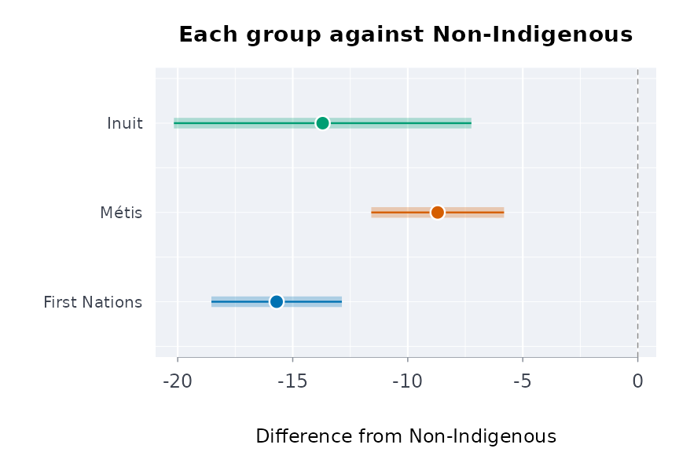

Before pooling the three groups into one “Indigenous” figure, test
whether they differ:

``` r

dt <- dstntst(
  mh[mh$group != "Non-Indigenous", ],
  "group",
  "estimate",
  "lower",
  "upper"
)
dt
#> ╭── Distinctions test ───────────────────────────────────────────────────╮
#> │   Groups       3                                                       │
#> │   Cochran's Q  11.97 on 2 df                                           │
#> │   p-value      0.003                                                   │
#> │   I-squared    83% of the variation is beyond chance                   │
#> │   Pooled       49.11 (se 0.973, inverse-variance mean)                 │
#> │                                                                        │
#> │   group          estimate     se  95% CI                               │
#> │   -------------  --------  -----  --------------                       │
#> │   First Nations     45.80  1.429  [43.00, 48.60]                       │
#> │   Métis             52.80  1.454  [49.95, 55.65]                       │
#> │   Inuit             47.80  3.291  [41.35, 54.25]                       │
#> │                                                                        │
#> │   Q says the groups differ: report each one, not the pooled figure.    │
#> │   Q = 11.97, p = 0.00252.                                              │
#> │                                                                        │
#> │   Distinctions-based: each group is reported on its own; a             │
#> │   pan-Indigenous total is left out of the test, never used as a group. │
#> │   Higgins and Thompson (2002) for Q and I-squared.                     │
#> ╰────────────────────────────────────────────────────────────────────────╯
plot(dt)
```


## The whole scale, not one cut of it

“Very good or excellent” cuts a five-point scale at one place (the table
publishes it in four categories, with fair and poor together).
[`ordcmp()`](https://rootcoder007.github.io/rmorie-bricklayer/reference/ordcmp.md)
compares the whole distribution. It gives the probability that a person
in one group rates their mental health higher than a person in the
reference group, with ties counted half (Agresti 1980). The data are
from the 2022 Indigenous Peoples Survey, table 41-10-0067-01:

``` r

r <- indiex("mentalhealth")
r <- r[r$region == "Canada", ]
oc <- ordcmp(
  r,
  "group",
  "rating",
  "estimate",
  "lower",
  "upper",
  lvls = c("Fair or poor", "Good", "Very good", "Excellent"),
  ref = "M\u00e9tis",
  qual = "quality"
)
oc
#> ╭── Ordinal comparison against a reference group ────────────────────────╮
#> │   Reference       Métis                                                │
#> │   Reference neff  3,884                                                │
#> │   Levels          4                                                    │
#> │   Measure         chance a person in the group rates higher, ties half │
#> │                                                                        │
#> │   group          probbet  95% CI             delta   neff              │
#> │   -------------  -------  --------------  --------  -----              │
#> │   First Nations   0.4653  [0.453, 0.477]  -0.06940  4,021              │
#> │   Inuit           0.5062  [0.493, 0.520]   0.01247  2,792              │
#> │                                                                        │
#> │   Rate lower than Métis (interval below 0.5): First Nations.           │
#> │   Not distinguishable from 0.5 (interval includes it): Inuit.          │
#> │                                                                        │
#> │   probbet 0.5 is no difference; above 0.5 the group rates higher.      │
#> │   delta (Cliff's) = share rating higher less share rating lower.       │
#> │   neff: the effective sample size the published limits imply (it       │
#> │   carries the survey's design effect).                                 │
#> ╰────────────────────────────────────────────────────────────────────────╯
plot(oc)
```

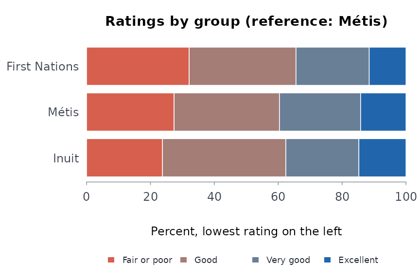

## Age standardisation

First Nations, Métis and Inuit populations are younger than the
non-Indigenous population, and many outcomes vary steeply with age.
[`stdprev()`](https://rootcoder007.github.io/rmorie-bricklayer/reference/stdprev.md)
standardises survey percentages to one age structure. Here it is applied
to serious thoughts of suicide in the past year, from the 2017
Aboriginal Peoples Survey (table 41-10-0021-01):

``` r

si <- indiex("suicide")
si <- si[si$measure == "Seriously contemplated suicide in the past 12 months" &
           si$age != "Total, 15 years and over", ]
si <- si[order(si$group, si$age), ]
sp <- stdprev(si$estimate, si$lower, si$upper, std = c(20, 18, 17, 17, 28),
                             grp = si$group, qual = si$quality)
sp
#> ╭── Age-standardised prevalence ──────────────────────────────────────────────╮
#> │   Groups  3                                                                 │
#> │   Method  direct standardisation to the standard population given           │
#> │                                                                             │
#> │   group            estimate  95% CI              se                         │
#> │   ---------------  --------  --------------  ------                         │
#> │   First Nations *     5.792  [5.141, 6.443]  0.3321                         │
#> │   Inuit *             5.940  [5.036, 6.844]  0.4612                         │
#> │   Métis *             4.742  [4.125, 5.359]  0.3148                         │
#> │                                                                             │
#> │   Highest prevalence: Inuit * (5.94); lowest: Métis * (4.742).              │
#> │   Their intervals overlap, which alone does not mean they are the same:     │
#> │   the difference has its own, narrower interval (svycmp() for survey        │
#> │   domains).                                                                 │
#> │                                                                             │
#> │   Each group's prevalence as if it had the standard population's ages,      │
#> │   so the groups compare without their age structures.                       │
#> │   Compare only rates standardised to the same population.                   │
#> │   * use with caution: the source flags the estimate (E, high sampling       │
#> │   variability).                                                             │
#> ╰─────────────────────────────────────────────────────────────────────────────╯
plot(sp)
```

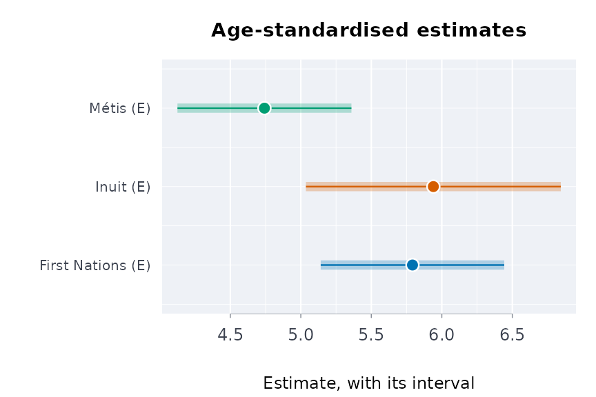

For counts of events (deaths, hospitalisations),
[`agestd()`](https://rootcoder007.github.io/rmorie-bricklayer/reference/agestd.md)
gives directly standardised rates with the Fay-Feuer gamma interval, and
[`rategap()`](https://rootcoder007.github.io/rmorie-bricklayer/reference/rategap.md)
compares two of them.

## Wellness beside distress

Indigenous scholars of mental health describe it as wellness, and as a
process of healing, grounded in community, cultural identity, a holistic
view and interdependence (Stewart 2008). They ask that strengths be
reported together with disparities (Stewart 2020).

The estimators in this section and the next put that into how published
tables are analysed. They are our translation, inspired by that work,
not methods its authors state, and they say what they cannot show.

[`welprof()`](https://rootcoder007.github.io/rmorie-bricklayer/reference/welprof.md)
puts wellness indicators first and distress after them. This example
uses the 2024 well-being table, 41-10-0082-01:

``` r

wb <- indiex("wellbeing")
w <- welprof(
  wb,
  "group",
  "indicator",
  "estimate",
  "lower",
  "upper",
  well = c(
    "Life satisfaction rating of 8, 9 or 10",
    "Sense of meaning and purpose rating of 8, 9 or 10",
    "Always or often has a hopeful outlook"
  ),
  distress = c(
    "Life satisfaction rating between 0 and 5",
    "Rarely or never has a hopeful outlook"
  ),
  qual = "quality"
)
plot(w)
```

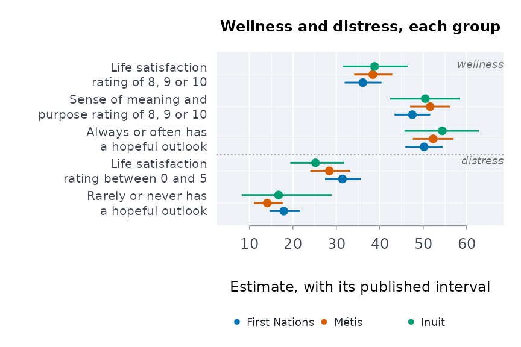

``` r

frmaud(w)
#> ╭── Framing audit ────────────────────────────────────────────────────╮
#> │   Groups               3                                            │
#> │   Wellness indicators  9                                            │
#> │   Distress indicators  6                                            │
#> │   Deficit-framed       40%                                          │
#> │                                                                     │
#> │   By group (shrdef: the deficit-framed share)                       │
#> │   group          wellness  distress  shrdef                         │
#> │   -------------  --------  --------  ------                         │
#> │   First Nations         3         2  0.4000                         │
#> │   Métis                 3         2  0.4000                         │
#> │   Inuit                 3         2  0.4000                         │
#> │                                                                     │
#> │   40% of the indicators reported are deficit-framed.                │
#> │                                                                     │
#> │   Walter (2016): statistics about Indigenous peoples cluster around │
#> │   disparity, deprivation, disadvantage, dysfunction and difference. │
#> │   This audits the report, not the people it describes.              │
#> ╰─────────────────────────────────────────────────────────────────────╯
```

[`dualcont()`](https://rootcoder007.github.io/rmorie-bricklayer/reference/dualcont.md)
places each group on two axes, wellness and distress. They are related
but distinct (Keyes 2002, 2005):

``` r

dc <- dualcont(
  w,
  "Always or often has a hopeful outlook",
  "Life satisfaction rating between 0 and 5"
)
dc
#> ╭── Dual continuum: wellness beside distress ────────────────────────────────╮
#> │   Wellness  Always or often has a hopeful outlook                          │
#> │   Distress  Life satisfaction rating between 0 and 5                       │
#> │   Groups    3                                                              │
#> │   Ratio     wellness over distress, log-normal interval                    │
#> │                                                                            │
#> │   group          wellness  interval        distress  interval        ratio │
#> │   -------------  --------  --------------  --------  --------------  ----- │
#> │   First Nations     50.20  [45.90, 54.50]     31.40  [27.40, 35.70]  1.599 │
#> │   Métis             52.30  [47.60, 57.00]     28.40  [24.00, 33.10]  1.842 │
#> │   Inuit             54.40  [45.70, 62.80]     25.20  [19.40, 31.80]  2.159 │
#> │                                                                            │
#> │   group          ratio interval                                            │
#> │   -------------  --------------                                            │
#> │   First Nations  [1.37, 1.87]                                              │
#> │   Métis          [1.53, 2.21]                                              │
#> │   Inuit          [1.61, 2.90]                                              │
#> │                                                                            │
#> │   A ratio above 1: more people report the wellness than the distress.      │
#> │   3 of 3 groups have the whole interval above 1.                           │
#> │                                                                            │
#> │   Both estimates come from the same respondents and their covariance       │
#> │   is not published: the interval treats them as independent.               │
#> ╰────────────────────────────────────────────────────────────────────────────╯
plot(dc)
```

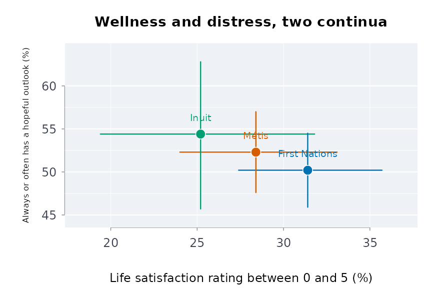

## Holistic balance

Wellness is a balance among the domains of a person; illness is a loss
of that balance (Stewart 2008; Gabriel, Mirza and Stewart 2022). An
average of domains cannot show balance.
[`holbal()`](https://rootcoder007.github.io/rmorie-bricklayer/reference/holbal.md)
measures it as the ratio of the geometric mean of the domain levels to
their arithmetic mean. That ratio is 1 when every domain is level, and
falls as one domain falls behind the others.

Which indicator stands for each domain is a choice for the people whose
data these are to make. The choice below is one reading of it:

``` r

dom <- c(
  "Perceived health, very good or excellent" = "physical",
  "Perceived mental health, very good or excellent" = "mental",
  "Life satisfaction, satisfied or very satisfied" = "emotional",
  "community"
)
names(dom)[4] <- paste(
  "Sense of belonging to local community,",
  "somewhat strong or very strong"
)
d <- h[
  h$period == "2019/2022" &
    h$age == "Total, 18 years and over" &
    h$indicator %in% names(dom),
]
d$domain <- dom[d$indicator]
hb <- holbal(
  d,
  "group",
  "domain",
  "estimate",
  "lower",
  "upper",
  qual = "quality"
)
hb
#> ╭── Holistic balance across the domains ──────────────────────────────────────╮
#> │   Groups   4                                                                │
#> │   Weights  equal, over 4 domains                                            │
#> │   Balance  weighted geometric over arithmetic mean of the domain levels     │
#> │                                                                             │
#> │   group           level  95% level CI    balance  95% balance CI  weakest   │
#> │   --------------  -----  --------------  -------  --------------  --------  │
#> │   First Nations   59.52  [58.25, 60.80]   0.9641  [0.958, 0.970]  physical  │
#> │   Métis           63.73  [62.44, 65.01]   0.9752  [0.971, 0.979]  physical  │
#> │   Inuit           63.80  [60.74, 66.86]   0.9700  [0.956, 0.981]  mental    │
#> │   Non-Indigenous  69.80  [69.60, 70.00]   0.9847  [0.984, 0.985]  physical  │
#> │                                                                             │
#> │   Domain levels (percent)                                                   │
#> │   group           physical  mental  community  emotional                    │
#> │   --------------  --------  ------  ---------  ---------                    │
#> │   First Nations      43.90   45.80      63.70      84.70                    │
#> │   Métis              49.70   52.80      65.10      87.30                    │
#> │   Inuit              49.40   47.80      73.50      84.50                    │
#> │   Non-Indigenous     58.90   61.50      67.40      91.40                    │
#> │                                                                             │
#> │   Highest balance: Non-Indigenous (0.9847); lowest: First Nations (0.9641). │
#> │   Their intervals do not overlap: the gap is more than sampling error.      │
#> │   The weakest domain is physical for 3 of 4 groups.                         │
#> │                                                                             │
#> │   balance is 1 when every domain is at the same level and falls toward      │
#> │   0 as one falls behind; level is the weighted mean, reported beside it.    │
#> │   Our method, inspired by Stewart (2008), not taken from it.                │
#> │   The weights say how much each domain counts; a community may set          │
#> │   its own (CARE: authority to control, Carroll et al. 2020).                │
#> ╰─────────────────────────────────────────────────────────────────────────────╯
plot(hb)
```

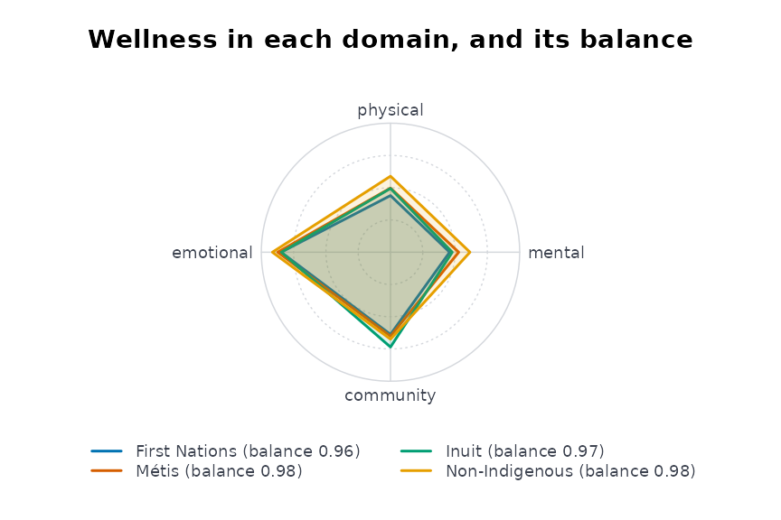

A community that weighs the domains differently sets `weights`. The
result says which weights it used.

## The four directions

The First Nations Mental Wellness Continuum Framework (Health Canada and
Assembly of First Nations 2015) describes mental wellness in four
directions: hope, belonging, meaning and purpose.
[`mhcont()`](https://rootcoder007.github.io/rmorie-bricklayer/reference/mhcont.md)
lays out the published proxies for each direction. It says which
directions the tables do not measure, and does not fill them in:

``` r

mw <- mhcont(
  wb,
  "group",
  "indicator",
  "estimate",
  "lower",
  "upper",
  hope = "Always or often has a hopeful outlook",
  meaning = "Sense of meaning and purpose rating of 8, 9 or 10",
  purp = "Sense of meaning and purpose rating of 8, 9 or 10",
  qual = "quality"
)
mw[, c("group", "indicator", "domain", "estimate", "shared")]
#>            group indicator                                            domain
#> 1  First Nations      hope             Always or often has a hopeful outlook
#> 2  First Nations belonging                                no published proxy
#> 3  First Nations   meaning Sense of meaning and purpose rating of 8, 9 or 10
#> 4  First Nations   purpose Sense of meaning and purpose rating of 8, 9 or 10
#> 5          Métis      hope             Always or often has a hopeful outlook
#> 6          Métis belonging                                no published proxy
#> 7          Métis   meaning Sense of meaning and purpose rating of 8, 9 or 10
#> 8          Métis   purpose Sense of meaning and purpose rating of 8, 9 or 10
#> 9          Inuit      hope             Always or often has a hopeful outlook
#> 10         Inuit belonging                                no published proxy
#> 11         Inuit   meaning Sense of meaning and purpose rating of 8, 9 or 10
#> 12         Inuit   purpose Sense of meaning and purpose rating of 8, 9 or 10
#>    estimate shared
#> 1      50.2  FALSE
#> 2        NA  FALSE
#> 3      47.5   TRUE
#> 4      47.5   TRUE
#> 5      52.3  FALSE
#> 6        NA  FALSE
#> 7      51.6   TRUE
#> 8      51.6   TRUE
#> 9      54.4  FALSE
#> 10       NA  FALSE
#> 11     50.5   TRUE
#> 12     50.5   TRUE
plot(mw)
```

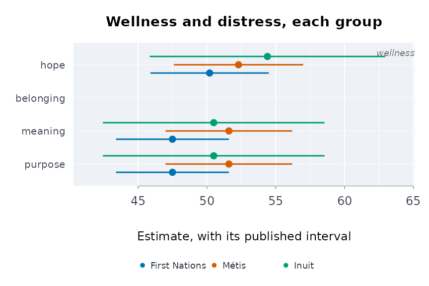

## Healing as a process

A process shows in change.
[`healchg()`](https://rootcoder007.github.io/rmorie-bricklayer/reference/healchg.md)
gives the change between survey periods, wellness first. It uses the two
periods of table 13-10-0924-01:

``` r

hc <- healchg(
  h[h$age == "Total, 18 years and over", ],
  "group",
  "indicator",
  "period",
  "estimate",
  "lower",
  "upper",
  from = "2015/2018",
  to = "2019/2022",
  qual = "quality",
  well = c(
    "Perceived mental health, very good or excellent",
    "Sense of belonging to local community, somewhat strong or very strong"
  )
)
hc <- hc[
  hc$indicator %in%
    c(
      "Perceived mental health, very good or excellent",
      "Sense of belonging to local community, somewhat strong or very strong",
      "Mood disorder",
      "Anxiety disorder"
    ),
]
plot(hc)
```

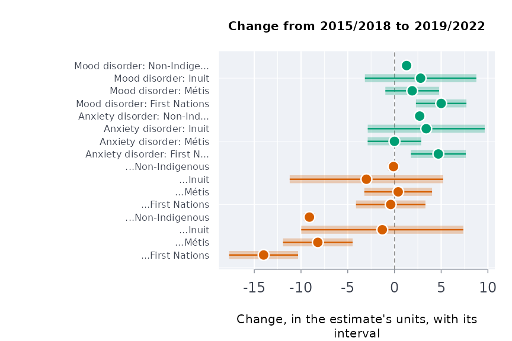

Between the two periods, which span the COVID-19 pandemic, the share
rating their mental health very good or excellent fell for First
Nations, Métis and non-Indigenous adults. The Inuit interval includes no
change. Because the reference group fell too, a group’s change is read
against the reference group’s change, not on its own.

## Connection across places

The land is “an instrumental part of all aspects of Indigenous life
including health and well-being” (Mashford-Pringle and Stewart 2019).
Health and education are interconnected (Mashford-Pringle 2016). Across
places, connections of this kind leave a trace: do two indicators rise
together where people live?

[`connassoc()`](https://rootcoder007.github.io/rmorie-bricklayer/reference/connassoc.md)
measures this with Spearman’s rho. Its p-value is exact for up to eight
places, and a Monte Carlo estimate beyond. Its band is a sensitivity
band, not a confidence interval: it shows how far the published sampling
error alone moves rho for these places. Here, by region, it asks whether
First Nations and Métis people’s mental health rise together, using
table 41-10-0067-01:

``` r

r <- indiex("mentalhealth")
r <- r[r$rating == "Excellent or very good" & r$region != "Canada", ]
pair <- merge(
  r[r$group == "First Nations", ],
  r[r$group == "M\u00e9tis", ],
  by = "region",
  suffixes = c("fn", "me")
)
ca <- connassoc(
  pair,
  "region",
  "estimatefn",
  "estimateme",
  "lowerfn",
  "upperfn",
  "lowerme",
  "upperme"
)
ca
#> ╭── Connection across places ──────────────────────────────────────────────╮
#> │   Places            11                                                   │
#> │   Indicators        estimatefn and estimateme                            │
#> │   Rank correlation  rho = 0.52                                           │
#> │   p-value           0.106 (permutation)                                  │
#> │   Interval          95% [-0.19, 0.77], with the published sampling error │
#> │                                                                          │
#> │   Rank correlation across 11 places: rho = 0.52, permutation p = 0.106   │
#> │   Across these places the two rank moderately together.                  │
#> │                                                                          │
#> │   An association across places only:                                     │
#> │   it does not show that one causes the other for any person.             │
#> ╰──────────────────────────────────────────────────────────────────────────╯
plot(
  ca,
  xlab = "First Nations: excellent or very good (%)",
  ylab = "M\u00e9tis: excellent or very good (%)"
)
```

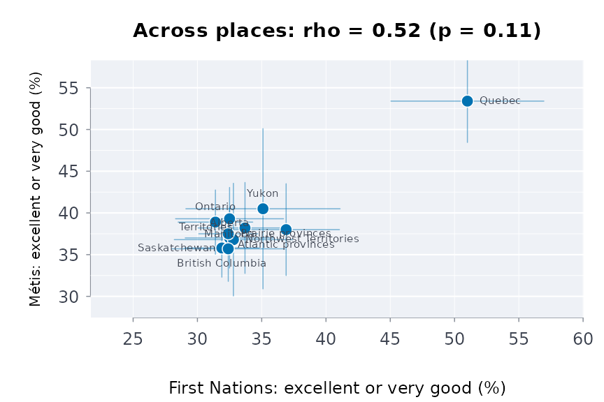

This is an association across places. It cannot say that one thing makes
a person well.

## Community-set weights, and the Community Well-Being index

[`commidx()`](https://rootcoder007.github.io/rmorie-bricklayer/reference/commidx.md)
combines protective and risk factors with weights the community sets. It
follows the structure of Inuit Tapiriit Kanatami’s National Inuit
Suicide Prevention Strategy (2016). The function never chooses the
weights. A factor the tables do not publish leaves the index `NA`; it is
not filled in.

``` r

h2 <- h[h$period == "2019/2022" & h$age == "Total, 18 years and over", ]
ci <- commidx(
  h2,
  "group",
  "indicator",
  "estimate",
  "lower",
  "upper",
  qual = "quality",
  w = c(
    "Sense of belonging to local community, somewhat strong or very strong" = 2,
    "Has a regular healthcare provider" = 1,
    "Perceived life stress, most days quite a bit or extremely stressful" = -2,
    "Heavy drinking" = -1
  )
)
plot(ci)
```

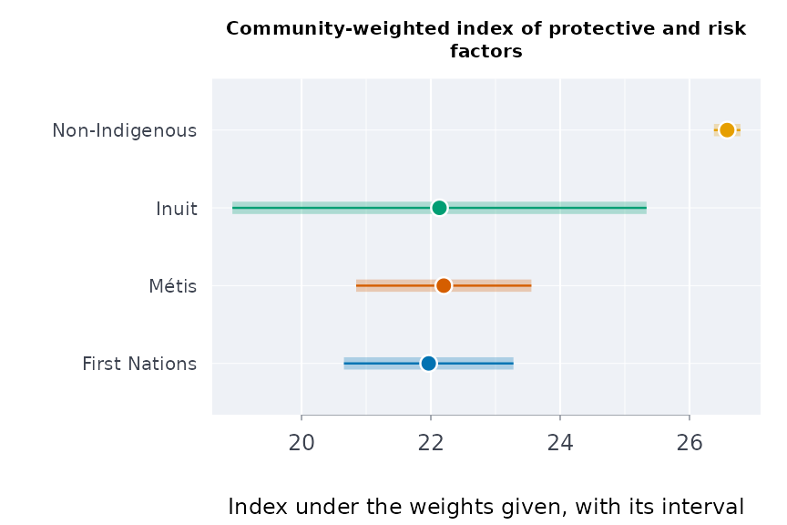

[`cwbscr()`](https://rootcoder007.github.io/rmorie-bricklayer/reference/cwbscr.md)
computes Indigenous Services Canada’s Community Well-Being index from
census profile figures: income, education, housing and labour force
activity. The index measures socio-economic conditions only. It is not a
measure of wellness as First Nations and Inuit define it.

## The 2021 Census

The Indigenous Population Profile of the 2021 Census gives counts for
every geography, by gender, age group and about two thousand
characteristics, with First Nations, Métis, Inuit and non-Indigenous
people in their own columns. In the provincial table, residence on and
off reserve is split out too.
[`cnsprof()`](https://rootcoder007.github.io/rmorie-bricklayer/reference/cnsprof.md)
reads it with the hierarchy of the characteristics.
[`profshr()`](https://rootcoder007.github.io/rmorie-bricklayer/reference/profshr.md)
takes a share with an interval for the 25% long-form sample and the
random rounding of the counts.

Foster children among children under 15, Canada, 2021:

``` r

p <- cnsprof(indiex("censuspop"))
fc <- profshr(p, "Foster children", "Total - Children in census families")
fc <- fc[
  fc$geo == "Canada" &
    fc$age == "0 to 14 years" &
    fc$group %in% c("First Nations", "M\u00e9tis", "Inuit", "Non-Indigenous"),
]
fc[, c(
  "residence",
  "group",
  "numerator",
  "denominator",
  "estimate",
  "lower",
  "upper"
)]
#>                              residence          group numerator denominator
#> 1  Total - Residence on or off reserve  First Nations     11735      265405
#> 2                           On reserve  First Nations      2350       90270
#> 3                          Off reserve  First Nations      9385      175135
#> 4  Total - Residence on or off reserve          Métis      1975      134670
#> 5                           On reserve          Métis        15         610
#> 6                          Off reserve          Métis      1960      134060
#> 7  Total - Residence on or off reserve          Inuit       770       21525
#> 8                           On reserve          Inuit        35         100
#> 9                          Off reserve          Inuit       735       21425
#> 10 Total - Residence on or off reserve Non-Indigenous     12705     5502310
#> 11                          On reserve Non-Indigenous        20        4070
#> 12                         Off reserve Non-Indigenous     12690     5498235
#>      estimate      lower      upper
#> 1   4.4215444  4.2880409  4.5590064
#> 2   2.6033012  2.5989608  2.6076487
#> 3   5.3587233  5.1789488  5.5443733
#> 4   1.4665479  1.3593905  1.5820167
#> 5   2.4590164  1.8933392  3.1882099
#> 6   1.4620319  1.3548094  1.5776046
#> 7   3.5772358  3.1713963  4.0328470
#> 8  35.0000000 30.9738945 39.2518422
#> 9   3.4305718  3.0324927  3.8788168
#> 10  0.2309030  0.2240599  0.2379546
#> 11  0.4914005  0.4040293  0.5975523
#> 12  0.2308013  0.2239573  0.2378541
plot(fc[fc$residence == "Total - Residence on or off reserve", ])
```

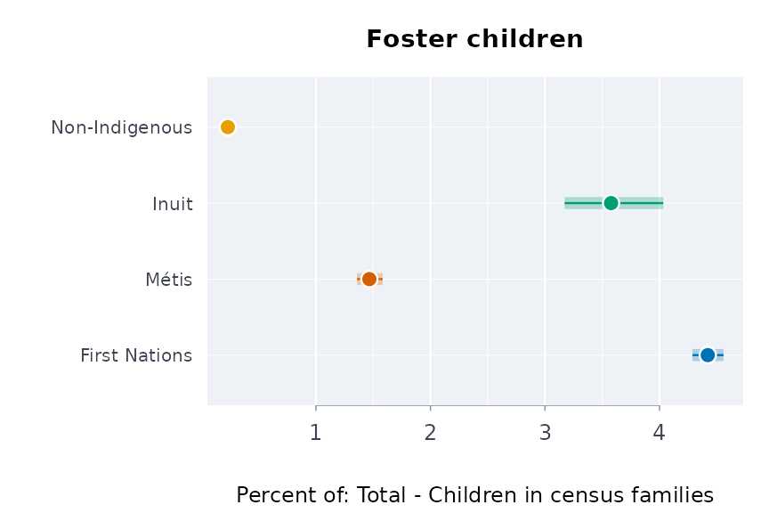

The overrepresentation of First Nations, Métis and Inuit children in
care is the subject of the first five Calls to Action of the Truth and
Reconciliation Commission.

Knowledge of an Indigenous language (all ages):

``` r

know <- paste(
  "Total - Knowledge of Indigenous languages for the population in private",
  "households - 25% sample data"
)
la <- profshr(p, "Indigenous languages", know)
la[
  la$geo == "Canada" &
    la$age == "Total - Age groups" &
    la$residence == "Total - Residence on or off reserve" &
    la$group %in% c("First Nations", "M\u00e9tis", "Inuit"),
  c("group", "estimate", "lower", "upper")
]
#>           group  estimate    lower     upper
#> 1 First Nations 17.530439 17.40473 17.656859
#> 2         Métis  1.332062  1.28369  1.382232
#> 3         Inuit 58.130139 57.49824 58.759377
```

The census age structure of the Indigenous population is the standard to
use when age-standardising First Nations, Métis and Inuit rates (Kumar
and Tjepkema 2019):

``` r

cnsstd(p)
#>                  age population     weight
#> 1       0 to 4 years     137510 0.07608819
#> 2       5 to 9 years     155565 0.08607853
#> 3     10 to 14 years     166135 0.09192722
#> 4     15 to 19 years     148820 0.08234633
#> 5     20 to 24 years     136070 0.07529140
#> 6     25 to 34 years     263655 0.14588780
#> 7     35 to 44 years     217990 0.12062006
#> 8     45 to 54 years     206360 0.11418485
#> 9     55 to 64 years     202785 0.11220670
#> 10    65 to 74 years     119410 0.06607295
#> 11 75 years and over      52945 0.02929597
```

A Community Well-Being score from the public profile (income, education,
housing, labour force), by distinction. The household table splits
Indigenous from non-Indigenous households only, so First Nations, Métis
and Inuit people share the Indigenous households’ housing component.
[`?cnscwb`](https://rootcoder007.github.io/rmorie-bricklayer/reference/cnscwb.md)
explains where it departs from the Department’s own index:

``` r

h <- cnsprof(indiex("censushh"))
cw <- cnscwb(p, h)
cw[
  cw$geo %in% c("Canada", "Nunavut"),
  c("geo", "group", "income", "education", "housing", "labour", "cwb")
]
#> ╭── Community Well-Being index, from the census ──────────────────────────────╮
#> │   Rows         8                                                            │
#> │   Geographies  Canada; Nunavut                                              │
#> │   Groups       First Nations; Métis; Inuit; Non-Indigenous                  │
#> │   Not scored   2                                                            │
#> │   Scale        0 to 100 for each component and the score                    │
#> │                                                                             │
#> │   geo      group           income  education  housing  labour    cwb        │
#> │   -------  --------------  ------  ---------  -------  ------  -----        │
#> │   Canada   First Nations    71.03      51.62    91.88   75.85  72.59        │
#> │   Canada   Métis            78.73      59.56    91.88   83.15  78.33        │
#> │   Canada   Inuit            72.13      38.51    91.88   74.75  69.32        │
#> │   Canada   Non-Indigenous   84.38      68.01    95.99   86.30  83.67        │
#> │   Nunavut  First Nations                                                    │
#> │   Nunavut  Métis                                                            │
#> │   Nunavut  Inuit            70.22      28.49    70.82   69.85  59.85        │
#> │   Nunavut  Non-Indigenous  100.00      79.89    93.30   94.85  92.01        │
#> │                                                                             │
#> │   Highest score: Nunavut, Non-Indigenous (92.01); lowest: Nunavut, Inuit    │
#> │   (59.85).                                                                  │
#> │   Within a geography the groups' scores are furthest apart in Nunavut       │
#> │   (32.2 points) and closest in Canada (14.4).                               │
#> │                                                                             │
#> │   cwb is the mean of income, education, housing and labour force            │
#> │   activity (Indigenous Services Canada's Community Well-Being index).       │
#> │   CWB-style, close to but not the Department's index: the public            │
#> │   profile's inputs differ (ages 25 and over; housing from households,       │
#> │   pooled for First Nations, Métis and Inuit people).                        │
#> │   Never a measure of wellness as First Nations, Métis or Inuit              │
#> │   people define it. A group below minpop people gets no score.              │
#> │   Housing needs the household table (dwell).                                │
#> ╰─────────────────────────────────────────────────────────────────────────────╯
plot(cw)
```


## Intergenerational exposure

Studies of the residential schools ask whether harm passes down
families. Among them are Bombay, Matheson and Anisman (2014), Kaspar
(2014), Hackett, Feeny and Tompa (2016), and McQuaid et al. (2017).

- [`genexpo()`](https://rootcoder007.github.io/rmorie-bricklayer/reference/genexpo.md)
  codes how many of the two generations before a respondent attended. An
  unknown generation stays unknown.
- [`exptrnd()`](https://rootcoder007.github.io/rmorie-bricklayer/reference/exptrnd.md)
  gives the odds ratio at each level, and the Cochran-Armitage test for
  a trend.

The counts below are made up, to show the computation:

``` r

genexpo(
  parent = c(TRUE, FALSE, TRUE, NA),
  gparent = c(TRUE, FALSE, FALSE, TRUE)
)
#> [1]  2  0  1 NA
et <- exptrnd(cases = c(60, 95, 70), n = c(500, 520, 300))
plot(et)
```

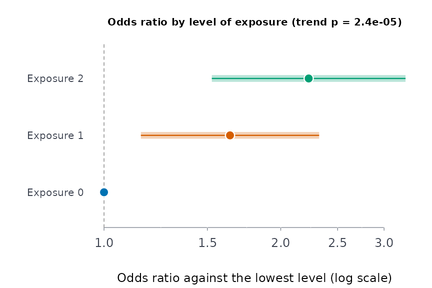

Individual-level data of this kind belong to the communities who
collected them. These functions are for analyses done under their
authority, or on tables they have published.

## The Calls to Action

Call to Action 19 asks for “measurable goals to identify and close the
gaps in health outcomes between Aboriginal and non-Aboriginal
communities”, for indicators that include infant mortality, suicide,
mental health, addictions, life expectancy and chronic diseases.
[`trcind()`](https://rootcoder007.github.io/rmorie-bricklayer/reference/trcind.md)
lists which published table measures each of them.
[`trchlthgap()`](https://rootcoder007.github.io/rmorie-bricklayer/reference/trchlthgap.md)
measures every gap against non-Indigenous people on one scale, the
disadvantage ratio: the ratio of the two estimates, turned so that above
1 means the group fares worse, with its interval. It is a ratio of
published estimates, not a relative risk.

``` r

g <- trchlthgap()
g[
  g$measure %in% c("Life expectancy at birth", "Infant mortality rate"),
  c(
    "measure",
    "period",
    "group",
    "estimate",
    "refest",
    "disratio",
    "lower",
    "upper"
  )
]
#>                     measure    period
#> 1  Life expectancy at birth 2016/2021
#> 2  Life expectancy at birth 2016/2021
#> 3  Life expectancy at birth 2016/2021
#> 4  Life expectancy at birth 2016/2021
#> 5  Life expectancy at birth 2016/2021
#> 6  Life expectancy at birth 2016/2021
#> 7     Infant mortality rate 2014/2016
#> 8     Infant mortality rate 2014/2016
#> 9     Infant mortality rate 2014/2016
#> 10    Infant mortality rate 2014/2016
#> 11    Infant mortality rate 2014/2016
#>                                                group estimate refest disratio
#> 1                                              Métis    80.47  84.99 1.056170
#> 2                                              Inuit    71.91  84.99 1.181894
#> 3               First Nations (Registered or Treaty)    73.98  84.99 1.148824
#> 4   First Nations (Registered or Treaty), on reserve    71.42  84.99 1.190003
#> 5  First Nations (Registered or Treaty), off reserve    76.04  84.99 1.117701
#> 6           First Nations, without registered status    79.23  84.99 1.072700
#> 7                                              Métis     5.20   4.20 1.238095
#> 8                                              Inuit    13.50   4.20 3.214286
#> 9               First Nations (Registered or Treaty)     9.60   4.20 2.285714
#> 10  First Nations (Registered or Treaty), on reserve    10.00   4.20 2.380952
#> 11 First Nations (Registered or Treaty), off reserve     8.10   4.20 1.928571
#>        lower    upper
#> 1  1.0497867 1.062592
#> 2  1.1636936 1.200379
#> 3  1.1433513 1.154323
#> 4  1.1833943 1.196648
#> 5  1.1078697 1.127620
#> 6  1.0617669 1.083745
#> 7  0.8366176 1.832235
#> 8  2.0315414 5.085613
#> 9  1.7776500 2.938987
#> 10 1.4796282 3.831323
#> 11 1.3632810 2.728262
plot(g)
```

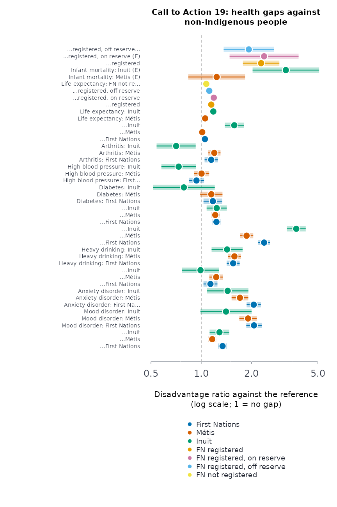

Life expectancy at birth in 2016/2021 was 71.4 years for First Nations
people living on reserve and 71.9 for Inuit, against 85.0 for
non-Indigenous people. Infant mortality among Inuit was 13.5 per 1,000
live births in 2014/2016, against 4.2.

How fast the Calls themselves are being completed:

The Truth and Reconciliation Commission made 94 Calls to Action in 2015.
[`trccmpl()`](https://rootcoder007.github.io/rmorie-bricklayer/reference/trccmpl.md)
holds the number completed each year, as the Yellowhead Institute counts
them (Jewell and Mosby 2021, 2022).
[`trcprog()`](https://rootcoder007.github.io/rmorie-bricklayer/reference/trcprog.md)
takes that pace as a Poisson rate:

``` r

p <- trcprog()
p
#> ╭── Truth and Reconciliation Calls to Action: progress ────────────────────╮
#> │   Completed        13 of 94                                              │
#> │   Remaining        81                                                    │
#> │   Years counted    7.04                                                  │
#> │   Calls a year     1.85 [0.983, 3.160]                                   │
#> │   All complete by  2066 (2048 to 2105)                                   │
#> │                                                                          │
#> │   At this pace the remaining 81 Calls are complete around 2066.          │
#> │                                                                          │
#> │   Completions taken as a Poisson process at a constant rate; the range   │
#> │   comes from the rate's interval. Trackers count completion differently. │
#> ╰──────────────────────────────────────────────────────────────────────────╯
plot(p)
```


The projection only extends the pace so far. It is not a forecast.

## Cultural continuity

Chandler and Lalonde (1998) found that British Columbia First Nations
communities with more markers of cultural continuity had far fewer youth
suicides. Hallett, Chandler and Lalonde (2007) found the same for
knowledge of an Indigenous language. Their unit was the community.
Across provinces and territories, the published tables allow a coarser
question: where more First Nations people know an Indigenous language,
do more rate their mental health highly?

``` r

prof <- cnsprof(indiex("censuspop"))
la <- profshr(prof, "Indigenous languages", know)
la <- la[
  la$age == "Total - Age groups" &
    la$group == "First Nations" &
    la$geo != "Canada" &
    la$residence == "Total - Residence on or off reserve",
]
mh2 <- indiex("mentalhealth")
mh2 <- mh2[
  mh2$rating == "Excellent or very good" & mh2$group == "First Nations",
]
both <- merge(
  la[c("geo", "estimate", "lower", "upper")],
  mh2[c("region", "estimate", "lower", "upper")],
  by.x = "geo",
  by.y = "region",
  suffixes = c("lang", "mh")
)
cc <- connassoc(
  both,
  "geo",
  "estimatelang",
  "estimatemh",
  "lowerlang",
  "upperlang",
  "lowermh",
  "uppermh"
)
cc
#> ╭── Connection across places ──────────────────────────────────────────────╮
#> │   Places            8                                                    │
#> │   Indicators        estimatelang and estimatemh                          │
#> │   Rank correlation  rho = 0.47                                           │
#> │   p-value           0.247 (exact, every permutation)                     │
#> │   Interval          95% [-0.31, 0.79], with the published sampling error │
#> │                                                                          │
#> │   Rank correlation across 8 places: rho = 0.47, exact p = 0.247          │
#> │   Across these places the two rank moderately together.                  │
#> │                                                                          │
#> │   An association across places only:                                     │
#> │   it does not show that one causes the other for any person.             │
#> ╰──────────────────────────────────────────────────────────────────────────╯
plot(
  cc,
  xlab = "First Nations who know an Indigenous language (%)",
  ylab = "First Nations: mental health excellent or very good (%)"
)
```

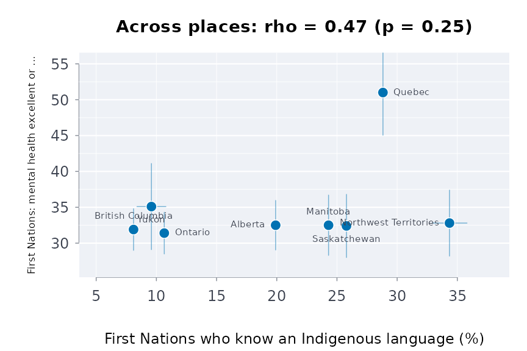

Across these eight provinces and territories, the rank correlation is
positive but far from settled: its exact p-value is large and its
sensitivity band includes zero. That is not evidence for or against the
communities’ findings. Eight places are far too few, a province mixes
many communities, and the two measures come from different surveys and
years. The community-level design needs the census profile of each First
Nations community (98-510-X2021002 at the data service), and outcomes
measured for the same communities.

## Your own data, step by step

Nothing here is tied to Canada or to these tables. Each estimator takes
a data frame with a group column, an estimate and its limits, and the
arguments name those columns: `grp`, `est`, `lower`, `upper`, with `ind`
(or `cat`, `domain`) for the indicator and `qual` for quality flags.

**1. A published table.** A table from another agency needs two steps
first: limits from whatever it publishes in their place
([`limfrom()`](https://rootcoder007.github.io/rmorie-bricklayer/reference/limfrom.md)
takes a standard error, a coefficient of variation or a margin of
error), and its quality flags mapped onto suppressed and
use-with-caution
([`qltyrcd()`](https://rootcoder007.github.io/rmorie-bricklayer/reference/qltyrcd.md)).
Here, made-up numbers in an Australian layout, with relative standard
errors and that agency’s flags:

``` r

own <- data.frame(
  group = c(
    "Aboriginal",
    "Torres Strait Islander",
    "Non-Indigenous Australians"
  ),
  pct = c(31.2, 27.5, 18.9),
  rse = c(4.1, 22.0, 1.2),
  flag = c("", "*", ""),
  stringsAsFactors = FALSE
)
own <- cbind(own, limfrom(own$pct, cv = own$rse)[c("lower", "upper")])
own$quality <- qltyrcd(own$flag, suppr = "**", caution = "*")
indgap(
  own,
  "group",
  "pct",
  "lower",
  "upper",
  ref = "Non-Indigenous Australians",
  qual = "quality"
)
#> ╭── Gap against a reference group ────────────────────────────────────────────╮
#> │   Reference  Non-Indigenous Australians                                     │
#> │   Groups     2                                                              │
#> │   Intervals  95%                                                            │
#> │                                                                             │
#> │   group                     estimate  refest  ratio  ratio CI               │
#> │   ------------------------  --------  ------  -----  ------------           │
#> │   Aboriginal                   31.20   18.90  1.651  [1.52, 1.80]           │
#> │   Torres Strait Islander *     27.50   18.90  1.455  [0.92, 2.31]           │
#> │                                                                             │
#> │   group                     difference  difference CI                       │
#> │   ------------------------  ----------  -------------                       │
#> │   Aboriginal                     12.30  [9.8, 14.8]                         │
#> │   Torres Strait Islander *        8.60  [-3.3, 20.5]                        │
#> │                                                                             │
#> │   Above the reference (interval above 1): Aboriginal.                       │
#> │   Not distinguishable from 1 (interval includes it): Torres Strait          │
#> │   Islander *.                                                               │
#> │                                                                             │
#> │   ratio: the group's estimate over the reference's; difference: the         │
#> │   group's less the reference's, in the estimate's own units.                │
#> │   Report a gap beside each group's own level, not alone.                    │
#> │   * use with caution: the source flags the estimate (E, high sampling       │
#> │   variability).                                                             │
#> ╰─────────────────────────────────────────────────────────────────────────────╯
```

Name the groups as the peoples concerned name themselves, and give
`pooled` any row that pools several of them, so it is never set beside
its own parts.

**2. Microdata.** With one row per respondent, estimate first, then
compare.
[`svydes()`](https://rootcoder007.github.io/rmorie-bricklayer/reference/svydes.md)
describes the design (here only a weight; strata, clusters and replicate
weights are its other arguments), and
[`svyest()`](https://rootcoder007.github.io/rmorie-bricklayer/reference/svyest.md)
gives each group’s estimate with its limits in the columns the
estimators take. Made-up responses:

``` r

set.seed(7)
n <- 600
resp <- data.frame(
  group = sample(c("First Nations", "Inuit", "Non-Indigenous"), n, TRUE),
  wt = runif(n, 50, 150)
)
resp$goodmh <- rbinom(n, 1, ifelse(resp$group == "Non-Indigenous", 0.6, 0.5))
des <- svydes(resp, w = "wt")
tab <- as.data.frame(
  svyest(des, resp, "goodmh", by = "group", stat = "proportion", lvls = "1")
)
indgap(tab, "group", "estimate", "lower", "upper")
#> ╭── Gap against a reference group ──────────────────────────────────────╮
#> │   Reference  Non-Indigenous                                           │
#> │   Groups     2                                                        │
#> │   Intervals  95%                                                      │
#> │                                                                       │
#> │   group          estimate  refest   ratio  ratio CI        difference │
#> │   -------------  --------  ------  ------  --------------  ---------- │
#> │   First Nations    0.5152  0.5710  0.9023  [0.747, 1.090]     -0.0558 │
#> │   Inuit            0.4227  0.5710  0.7402  [0.600, 0.913]     -0.1484 │
#> │                                                                       │
#> │   group          difference CI                                        │
#> │   -------------  ----------------                                     │
#> │   First Nations  [-0.158, 0.046]                                      │
#> │   Inuit          [-0.250, -0.047]                                     │
#> │                                                                       │
#> │   Below the reference (interval below 1): Inuit.                      │
#> │   Not distinguishable from 1 (interval includes it): First Nations.   │
#> │                                                                       │
#> │   ratio: the group's estimate over the reference's; difference: the   │
#> │   group's less the reference's, in the estimate's own units.          │
#> │   Report a gap beside each group's own level, not alone.              │
#> ╰───────────────────────────────────────────────────────────────────────╯
```

**3. The other estimators, same layout.** A table with an indicator
column goes to
[`welprof()`](https://rootcoder007.github.io/rmorie-bricklayer/reference/welprof.md),
[`mhcont()`](https://rootcoder007.github.io/rmorie-bricklayer/reference/mhcont.md),
[`healchg()`](https://rootcoder007.github.io/rmorie-bricklayer/reference/healchg.md)
(add a period column),
[`holbal()`](https://rootcoder007.github.io/rmorie-bricklayer/reference/holbal.md)
(a domain column) or
[`commidx()`](https://rootcoder007.github.io/rmorie-bricklayer/reference/commidx.md)
(with the community’s own weights), named the same way:

``` r

prof <- data.frame(
  community = rep(c("Lakeside", "Riverbend"), each = 3),
  item = rep(c("Hopeful", "Satisfied", "Rarely hopeful"), 2),
  pct = c(64, 71, 12, 58, 66, 16),
  lo = c(59, 66, 9, 52, 60, 12),
  hi = c(69, 76, 15, 64, 72, 20),
  stringsAsFactors = FALSE
)
welprof(prof, "community", "item", "pct", "lo", "hi",
        well = c("Hopeful", "Satisfied"), distress = "Rarely hopeful")
#> ╭── Wellness profile ─────────────────────────────────────────────────────────╮
#> │   Groups               Lakeside; Riverbend                                  │
#> │   Wellness indicators  2                                                    │
#> │   Distress indicators  1                                                    │
#> │                                                                             │
#> │   Hopeful (wellness)                                                        │
#> │   group      estimate  interval                                             │
#> │   ---------  --------  --------                                             │
#> │   Lakeside         64  [59, 69]                                             │
#> │   Riverbend        58  [52, 64]                                             │
#> │                                                                             │
#> │   Satisfied (wellness)                                                      │
#> │   group      estimate  interval                                             │
#> │   ---------  --------  --------                                             │
#> │   Lakeside         71  [66, 76]                                             │
#> │   Riverbend        66  [60, 72]                                             │
#> │                                                                             │
#> │   Rarely hopeful (distress)                                                 │
#> │   group      estimate  interval                                             │
#> │   ---------  --------  --------                                             │
#> │   Lakeside         12  [9, 15]                                              │
#> │   Riverbend        16  [12, 20]                                             │
#> │                                                                             │
#> │   On none of the 3 indicators do the groups' intervals part: the data       │
#> │   cannot rank the groups on any of them.                                    │
#> │                                                                             │
#> │   Wellness indicators come first, so each group's strengths are read        │
#> │   before its distress (Stewart 2008).                                       │
#> ╰─────────────────────────────────────────────────────────────────────────────╯
```

**4. Plain numbers.** Counts by age group go to
[`agestd()`](https://rootcoder007.github.io/rmorie-bricklayer/reference/agestd.md)
and age-specific percentages to
[`stdprev()`](https://rootcoder007.github.io/rmorie-bricklayer/reference/stdprev.md),
as vectors, with your own standard population:

``` r

agestd(events = c(4, 9, 11, 6, 3), pop = c(9000, 8000, 6000, 4000, 2000),
       std = c(30000, 25000, 20000, 15000, 10000))
#> ╭── Directly age-standardised rate ─────────────────────────────────╮
#> │   Groups    1                                                     │
#> │   Events    33                                                    │
#> │   Rate per  100,000                                               │
#> │   Interval  gamma (Fay and Feuer 1997)                            │
#> │                                                                   │
#> │   group  events   rate  95% CI                                    │
#> │   -----  ------  -----  ---------------                           │
#> │   all        33  115.6  [79.24, 165.00]                           │
#> │                                                                   │
#> │   all: rate 115.6 [79.24, 165.00].                                │
#> │                                                                   │
#> │   Each rate is what the group's age-specific rates give for the   │
#> │   standard population's ages, so the groups compare without them. │
#> │   Compare only rates standardised to the same population.         │
#> ╰───────────────────────────────────────────────────────────────────╯
```

## What the package does not compute

Some instruments are individual questionnaires, and aggregate tables
cannot reproduce them:

- the Native Wellness Assessment (Fiedeldey-Van Dijk et al. 2017);
- the Cultural Connectedness Scale (Snowshoe et al. 2015);
- the Historical Loss Scale (Whitbeck et al. 2004).

Two-Eyed Seeing (Bartlett, Marshall and Marshall 2012) is a way of
bringing knowledges together, not a formula. The package follows it by
reporting results beside one another without merging them into one index
([`dualcont()`](https://rootcoder007.github.io/rmorie-bricklayer/reference/dualcont.md),
[`welprof()`](https://rootcoder007.github.io/rmorie-bricklayer/reference/welprof.md)).

## Acknowledgements

The estimators for holistic balance, wellness beside distress, the four
directions, healing as a process and connection across places put to
quantitative use the frameworks of Professor Suzanne Stewart
(Yellowknives Dene First Nation), Director of the Waakebiness-Bryce
Institute for Indigenous Health at the University of Toronto’s Dalla
Lana School of Public Health, and Professor Angela Mashford-Pringle
(Timiskaming First Nation), its Associate Director. This work stands on
theirs. Any error in turning their qualitative work into estimators is
the package’s, not theirs.

## References

- Agresti A (1980). Generalized odds ratios for ordinal data.
  *Biometrics* 36(1):59-67.
- Bartlett C, Marshall M, Marshall A (2012). Two-Eyed Seeing and other
  lessons learned within a co-learning journey of bringing together
  indigenous and mainstream knowledges and ways of knowing. *Journal of
  Environmental Studies and Sciences* 2(4):331-340.
- Bombay A, Matheson K, Anisman H (2014). The intergenerational effects
  of Indian Residential Schools: implications for the concept of
  historical trauma. *Transcultural Psychiatry* 51(3):320-338.
- Chandler MJ, Lalonde C (1998). Cultural continuity as a hedge against
  suicide in Canada’s First Nations. *Transcultural Psychiatry*
  35(2):191-219.
- Carroll SR, Garba I, Figueroa-Rodriguez OL, et al. (2020). The CARE
  Principles for Indigenous Data Governance. *Data Science Journal*
  19:43.
- Fiedeldey-Van Dijk C, Rowan M, Dell C, et al. (2017). Honoring
  Indigenous culture-as-intervention: development and validity of the
  Native Wellness Assessment. *Journal of Ethnicity in Substance Abuse*
  16(2):181-218.
- Gabriel MD, Mirza S, Stewart SL (2022). Exploring mental health and
  holistic healing through the life stories of Indigenous youth who have
  experienced homelessness. *International Journal of Environmental
  Research and Public Health* 19(20):13402.
- Hackett C, Feeny D, Tompa E (2016). Canada’s residential school
  system: measuring the intergenerational impact of familial attendance
  on health and mental health outcomes. *Journal of Epidemiology and
  Community Health* 70(11):1096-1105.
- Hallett D, Chandler MJ, Lalonde CE (2007). Aboriginal language
  knowledge and youth suicide. *Cognitive Development* 22(3):392-399.
- Health Canada, Assembly of First Nations (2015). *First Nations Mental
  Wellness Continuum Framework*.
- Inuit Tapiriit Kanatami (2016). *National Inuit Suicide Prevention
  Strategy*.
- Jewell E, Mosby I (2021, 2022). *Calls to Action Accountability*.
  Yellowhead Institute.
- Kaspar V (2014). The lifetime effect of residential school attendance
  on Indigenous health status. *American Journal of Public Health*
  104(11):2184-2190.
- Keyes CLM (2002). The mental health continuum: from languishing to
  flourishing in life. *Journal of Health and Social Behavior*
  43(2):207-222.
- Keyes CLM (2005). Mental illness and/or mental health? Investigating
  axioms of the complete state model of health. *Journal of Consulting
  and Clinical Psychology* 73(3):539-548.
- Mashford-Pringle A (2016). Aboriginal health and Aboriginal education
  are interconnected. *Research in the Sociology of Health Care*
  34:85-96.
- Mashford-Pringle A, Stewart SL (2019). Akiikaa (it is the land):
  exploring land-based experiences with university students in Ontario.
  *Global Health Promotion* 26(3 suppl):64-72.
- McQuaid RJ, Bombay A, McInnis OA, et al. (2017). Suicide ideation and
  attempts among First Nations peoples living on-reserve in Canada: the
  intergenerational and cumulative effects of Indian Residential
  Schools. *Canadian Journal of Psychiatry* 62(6):422-430.
- Snowshoe A, Crooks CV, Tremblay PF, Craig WM, Hinson RE (2015).
  Development of a Cultural Connectedness Scale for First Nations youth.
  *Psychological Assessment* 27(1):249-259.
- Stewart SL (2008). Promoting Indigenous mental health: cultural
  perspectives on healing from Native counsellors in Canada.
  *International Journal of Health Promotion and Education* 46(2):49-56.
- Stewart S (2020). Addressing strengths and disparities in Indigenous
  health. *International Journal of Indigenous Health* 15(1):4.
- Walter M (2016). Data politics and Indigenous representation in
  Australian statistics. In Kukutai T, Taylor J (eds), *Indigenous Data
  Sovereignty: Toward an Agenda*, 79-97. ANU Press.
- Walter M, Andersen C (2013). *Indigenous Statistics: A Quantitative
  Research Methodology*. Left Coast Press.
- Whitbeck LB, Adams GW, Hoyt DR, Chen X (2004). Conceptualizing and
  measuring historical trauma among American Indian people. *American
  Journal of Community Psychology* 33(3-4):119-130.
