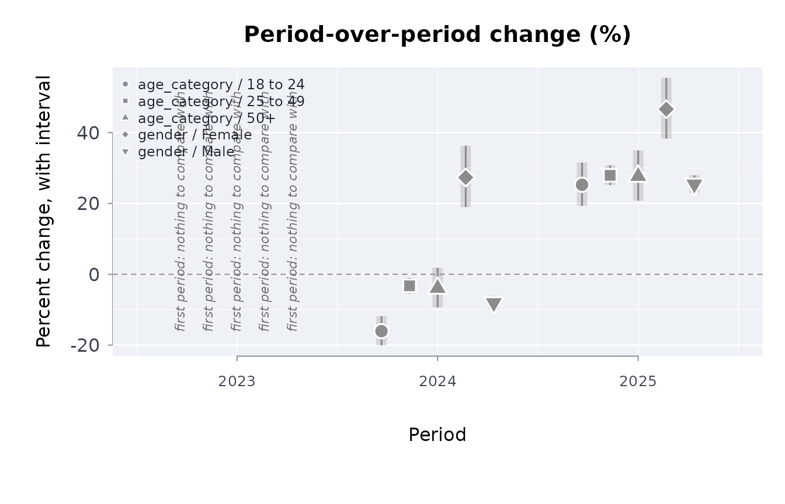
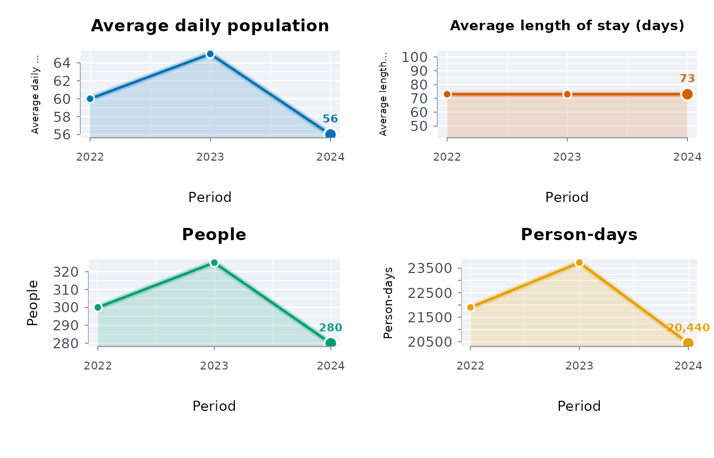

# Your first capsule: a published table, analysed and recorded

Most published administrative data arrives as a table of counts by
period and group. The questions are always the same: what changed, how
sure can we be, is there a trend, and is this release the one we had
before. This vignette answers them for one real table in twenty lines,
then records the run so someone else can repeat it.

## The table

Ontario publishes the number of distinct individuals held in restrictive
confinement each fiscal year, by age category and gender. A tidy copy of
the published figures ships with the package.

``` r

library(rmoriebricklayer)
otis <- read.csv(system.file("extdata", "otis_a01_individuals.csv",
                             package = "rmoriebricklayer"))
otis
#>           table    group year individuals
#> 1  age_category 18 to 24 2023        3507
#> 2  age_category 18 to 24 2024        2944
#> 3  age_category 18 to 24 2025        3688
#> 4  age_category 25 to 49 2023       14930
#> 5  age_category 25 to 49 2024       14445
#> 6  age_category 25 to 49 2025       18482
#> 7  age_category      50+ 2023        2344
#> 8  age_category      50+ 2024        2252
#> 9  age_category      50+ 2025        2875
#> 10       gender   Female 2023        1511
#> 11       gender   Female 2024        1924
#> 12       gender   Female 2025        2821
#> 13       gender     Male 2023       19270
#> 14       gender     Male 2024       17717
#> 15       gender     Male 2025       22224
```

## One call

``` r

a <- anltab(otis, value = "individuals", prd = "year",
                   by = c("table", "group"))
a
#> ╭── Analysis of a published table ────────────────────────────────────────╮
#> │   Value       `individuals`                                             │
#> │   Period      year                                                      │
#> │   Periods     3 (2023 to 2025)                                          │
#> │   Grouped by  table x group                                             │
#> │   Rows        15                                                        │
#> │   Columns     4                                                         │
#> │   Missing     no missing values                                         │
#> │   Changes     10 comparison(s), 9 significant after BH at 0.05          │
#> │   Trend       0 of 5 series with Mann-Kendall p < 0.05                  │
#> │                                                                         │
#> │   Changes are between consecutive periods with exact or interval tests, │
#> │   adjusted for the number of comparisons; rptanl() writes the full      │
#> │   tables as a report, and x$change, x$rates and x$trend hold them.      │
#> │                                                                         │
#> │   Run 2026-10-28 05:00                                                  │
#> ╰─────────────────────────────────────────────────────────────────────────╯
```

The change table carries an exact interval for every percent change and
a p-value that is exact too. Five groups are compared twice each, so the
p-values are adjusted over the scan (Benjamini-Hochberg) before any row
is called significant. A row that looks striking on its own is judged in
the company of the other nine.

``` r

a$change[, c("table", "group", "year", "value", "previous",
             "pctchg", "pctlo", "pctup", "padj",
             "significant")]
#>           table    group year value previous     pctchg      pctlo      pctup
#> 1  age_category 18 to 24 2023  3507       NA         NA         NA         NA
#> 2  age_category 18 to 24 2024  2944     3507 -16.053607 -20.094317 -11.813237
#> 3  age_category 18 to 24 2025  3688     2944  25.271739  19.315638  31.533918
#> 4  age_category 25 to 49 2023 14930       NA         NA         NA         NA
#> 5  age_category 25 to 49 2024 14445    14930  -3.248493  -5.443046  -1.003220
#> 6  age_category 25 to 49 2025 18482    14445  27.947387  25.185677  30.771917
#> 7  age_category      50+ 2023  2344       NA         NA         NA         NA
#> 8  age_category      50+ 2024  2252     2344  -3.924915  -9.363927   1.838757
#> 9  age_category      50+ 2025  2875     2252  27.664298  20.771500  34.963148
#> 10       gender   Female 2023  1511       NA         NA         NA         NA
#> 11       gender   Female 2024  1924     1511  27.332892  18.974672  36.297285
#> 12       gender   Female 2025  2821     1924  46.621622  38.316800  55.450157
#> 13       gender     Male 2023 19270       NA         NA         NA         NA
#> 14       gender     Male 2024 17717    19270  -8.059159  -9.920858  -6.159393
#> 15       gender     Male 2025 22224    17717  25.438844  22.981369  27.946827
#>             padj significant
#> 1             NA       FALSE
#> 2   3.164937e-12        TRUE
#> 3   1.664477e-19        TRUE
#> 4             NA       FALSE
#> 5   5.269786e-03        TRUE
#> 6  3.609584e-109        TRUE
#> 7             NA       FALSE
#> 8   1.794906e-01       FALSE
#> 9   6.794641e-18        TRUE
#> 10            NA       FALSE
#> 11  2.786935e-12        TRUE
#> 12  2.223495e-38        TRUE
#> 13            NA       FALSE
#> 14  1.161620e-15        TRUE
#> 15 8.427443e-112        TRUE
```

## What the release withheld

Published counts are often rounded. If this table had been rounded to
the nearest five, each cell could have come from any count within two
and a half of it, and the percent change inherits that. `rounding = 5`
adds the envelope and a combined interval that is the union of the
sampling interval and the envelope: the honest range for a number read
off a rounded table. Suppressed cells (`"x"`, `"<5"`) are handled the
same way through `suplim`.

``` r

b <- anltab(otis, value = "individuals", prd = "year",
                   by = c("table", "group"), rnd = 5)
b$change[!is.na(b$change$previous),
         c("group", "year", "pctchg", "pctlo", "pctup",
           "compctlo", "compctup")]
#>       group year     pctchg      pctlo      pctup   compctlo   compctup
#> 1  18 to 24 2024 -16.053607 -20.094317 -11.813237 -20.094317 -11.813237
#> 2  18 to 24 2025  25.271739  19.315638  31.533918  19.315638  31.533918
#> 3  25 to 49 2024  -3.248493  -5.443046  -1.003220  -5.443046  -1.003220
#> 4  25 to 49 2025  27.947387  25.185677  30.771917  25.185677  30.771917
#> 5       50+ 2024  -3.924915  -9.363927   1.838757  -9.363927   1.838757
#> 6       50+ 2025  27.664298  20.771500  34.963148  20.771500  34.963148
#> 7    Female 2024  27.332892  18.974672  36.297285  18.974672  36.297285
#> 8    Female 2025  46.621622  38.316800  55.450157  38.316800  55.450157
#> 9      Male 2024  -8.059159  -9.920858  -6.159393  -9.920858  -6.159393
#> 10     Male 2025  25.438844  22.981369  27.946827  22.981369  27.946827
```

## Trend

Three fiscal years is a short series. The Mann-Kendall test is exact for
it, and its smallest possible p-value with three points is one third, so
no trend can be declared from three years; the table says so instead of
hiding it. The Poisson rate ratio per year is still informative as a
description.

``` r

a$trend
#>          table    group periods first  last       tau     trndp  slope
#> 1 age_category 18 to 24       3  3507  3688 0.3333333 1.0000000   90.5
#> 2 age_category 25 to 49       3 14930 18482 0.3333333 1.0000000 1776.0
#> 3 age_category      50+       3  2344  2875 0.3333333 1.0000000  265.5
#> 4       gender   Female       3  1511  2821 1.0000000 0.3333333  655.0
#> 5       gender     Male       3 19270 22224 0.3333333 1.0000000 1477.0
#>   rateratio rateratiolo rateratioup
#> 1  1.027143   0.2491778    4.234015
#> 2  1.118024   0.4111145    3.040459
#> 3  1.112728   0.4023851    3.077062
#> 4  1.376319   0.8250989    2.295790
#> 5  1.077781   0.3556341    3.266310
```

## Has the data changed since last time?

Keep the previous release and pass it as `prior`; every column is
screened. Before trusting a drift verdict, ask how often the screens
fire on data that has not changed:
[`drftcal()`](https://rootcoder007.github.io/rmorie-bricklayer/reference/drftcal.md)
splits one release into random halves and reports the false-alarm rate
per column.

``` r

drftcal(otis, n = 10)
#> ╭── Drift screen calibration ─────────────────────────────────────────────╮
#> │   Identical re-fetches         10                                       │
#> │   Alpha                        0.01                                     │
#> │   Columns screened             4                                        │
#> │   At least one column flagged  0% of re-fetches                         │
#> │   Per-screen alpha             0.0025 for a family-wise 0.01            │
#> │                                                                         │
#> │   Each re-fetch splits the same table in two at random and runs the     │
#> │   drift screen on the halves, so every flag is a false alarm. No column │
#> │   fired on identical data.                                              │
#> ╰─────────────────────────────────────────────────────────────────────────╯
```

## Stock and flow

A count of people in confinement on a day is a stock; the people who
pass through in a year are a flow. Lakner’s decomposition ties them
exactly: average daily population is person-days over the days in the
period, average length of stay is person-days over the people served,
and the identity `adp = admissions * alos / t` means a change in days
must multiply out of a change in people and a change in stay.
[`stkflow()`](https://rootcoder007.github.io/rmorie-bricklayer/reference/stkflow.md)
reports both sides and checks the identity.

``` r

sf <- stkflow(days = c(21900, 23725, 20440), people = c(300, 325, 280),
                 prd = c(2022, 2023, 2024), t = 365)
sf
#> ╭── Stock and flow over 3 periods ────────────────────────────────────────────╮
#> │   Periods          2022 to 2024                                             │
#> │   Period length    365 days                                                 │
#> │   Changes against  the first period                                         │
#> │   Columns          alos = days per person; adp = people held on an average  │
#> │                    day                                                      │
#> │                                                                             │
#> │   period  people    days  alos  adp                                         │
#> │   ------  ------  ------  ----  ---                                         │
#> │   2022       300  21,900    73   60                                         │
#> │   2023       325  23,725    73   65                                         │
#> │   2024       280  20,440    73   56                                         │
#> │                                                                             │
#> │   2022 to 2024: people -6.7%, stay +0.0%, days -6.7%                        │
#> │                                                                             │
#> │   Lakner (1976): adp = people x alos / t, exact only in a steady state.     │
#> │   A period shorter than the longest stay cuts unfinished stays short,       │
#> │   so alos is biased downward (p.16-17).                                     │
#> ╰─────────────────────────────────────────────────────────────────────────────╯
```

A population that rose while stays shortened, or fell while stays
lengthened, reads differently from one where both moved together;
[`adp()`](https://rootcoder007.github.io/rmorie-bricklayer/reference/adp.md),
[`alos()`](https://rootcoder007.github.io/rmorie-bricklayer/reference/alos.md)
and
[`admits()`](https://rootcoder007.github.io/rmorie-bricklayer/reference/admits.md)
give the single measures.

## Stock and flow

A count of people in confinement on a day is a stock; the people who
pass through in a year are a flow. Lakner’s decomposition ties them
exactly: average daily population is person-days over the days in the
period, average length of stay is person-days over the people served,
and the identity `adp = admissions * alos / t` means a change in days
must multiply out of a change in people and a change in stay.
[`stkflow()`](https://rootcoder007.github.io/rmorie-bricklayer/reference/stkflow.md)
reports both sides and checks the identity.

``` r

sf <- stkflow(days = c(21900, 23725, 20440), people = c(300, 325, 280),
                 prd = c(2022, 2023, 2024), t = 365)
sf
#> ╭── Stock and flow over 3 periods ────────────────────────────────────────────╮
#> │   Periods          2022 to 2024                                             │
#> │   Period length    365 days                                                 │
#> │   Changes against  the first period                                         │
#> │   Columns          alos = days per person; adp = people held on an average  │
#> │                    day                                                      │
#> │                                                                             │
#> │   period  people    days  alos  adp                                         │
#> │   ------  ------  ------  ----  ---                                         │
#> │   2022       300  21,900    73   60                                         │
#> │   2023       325  23,725    73   65                                         │
#> │   2024       280  20,440    73   56                                         │
#> │                                                                             │
#> │   2022 to 2024: people -6.7%, stay +0.0%, days -6.7%                        │
#> │                                                                             │
#> │   Lakner (1976): adp = people x alos / t, exact only in a steady state.     │
#> │   A period shorter than the longest stay cuts unfinished stays short,       │
#> │   so alos is biased downward (p.16-17).                                     │
#> ╰─────────────────────────────────────────────────────────────────────────────╯
```

A population that rose while stays shortened, or fell while stays
lengthened, reads differently from one where both moved together;
[`adp()`](https://rootcoder007.github.io/rmorie-bricklayer/reference/adp.md),
[`alos()`](https://rootcoder007.github.io/rmorie-bricklayer/reference/alos.md)
and
[`admits()`](https://rootcoder007.github.io/rmorie-bricklayer/reference/admits.md)
give the single measures.

## Other published tables

The same approach works on any table with an estimate and its interval.
The package also bundles Statistics Canada estimates of First Nations,
Métis and Inuit health and mental health
([`?indiex`](https://rootcoder007.github.io/rmorie-bricklayer/reference/indiex.md)).
[`vignette("first-nations-metis-inuit-health")`](https://rootcoder007.github.io/rmorie-bricklayer/articles/first-nations-metis-inuit-health.md)
analyses them: by distinction, with suppressed cells never imputed, and
with wellness reported beside distress.

## Record it

[`rptanl()`](https://rootcoder007.github.io/rmorie-bricklayer/reference/rptanl.md)
writes the whole analysis as Markdown or a single HTML file, and
[`usecpstmpl()`](https://rootcoder007.github.io/rmorie-bricklayer/reference/usecpstmpl.md)
writes a folder with the provenance file, an `analysis.R` that pins the
source bytes and runs the steps above, and a README. The template runs
as written against this table.

``` r

d <- usecpstmpl(tempfile("capsule-"), ex = TRUE)
list.files(d)
#> [1] "analysis.R"           "data_provenance.json" "README.md"
cat(readLines(file.path(d, "analysis.R"))[1:12], sep = "\n")
#> # Reproducible capsule: fetch, verify, analyse, record.
#> # Run with: Rscript analysis.R
#> library(rmoriebricklayer)
#> arg <- grep("^--file=", commandArgs(), value = TRUE)
#> here <- if (length(arg)) dirname(normalizePath(sub("^--file=", "", arg[1]))) else getwd()
#> prov <- loadprov(file.path(here, "data_provenance.json"))
#> 
#> # 1. Fetch (a local path is read directly; a URL is downloaded with a
#> #    Wayback Machine fallback) and pin the bytes.
#> src <- prov$source$url
#> local <- if (file.exists(src)) src else
#>   fdl(src, file.path(here, basename(src)))
```

From here, replace the source URL and the column names in
`data_provenance.json`, run `Rscript analysis.R`, and copy the SHA-256
it prints back into the provenance file. Later runs refuse to proceed if
the bytes change, and
[`mnfrcmp()`](https://rootcoder007.github.io/rmorie-bricklayer/reference/mnfrcmp.md)
compares two runs number by number.

## The analysis in a picture

[`plot()`](https://rdrr.io/r/graphics/plot.default.html) draws the
analysis of the published table and the stock-and-flow result.

``` r

plot(a)
```



``` r

plot(sf)
```


