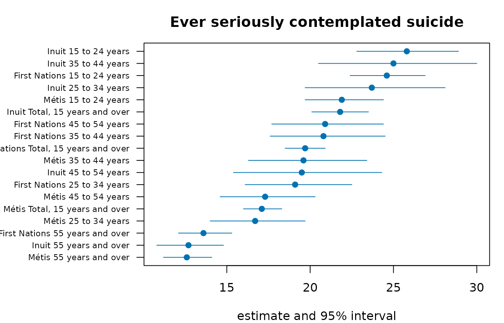
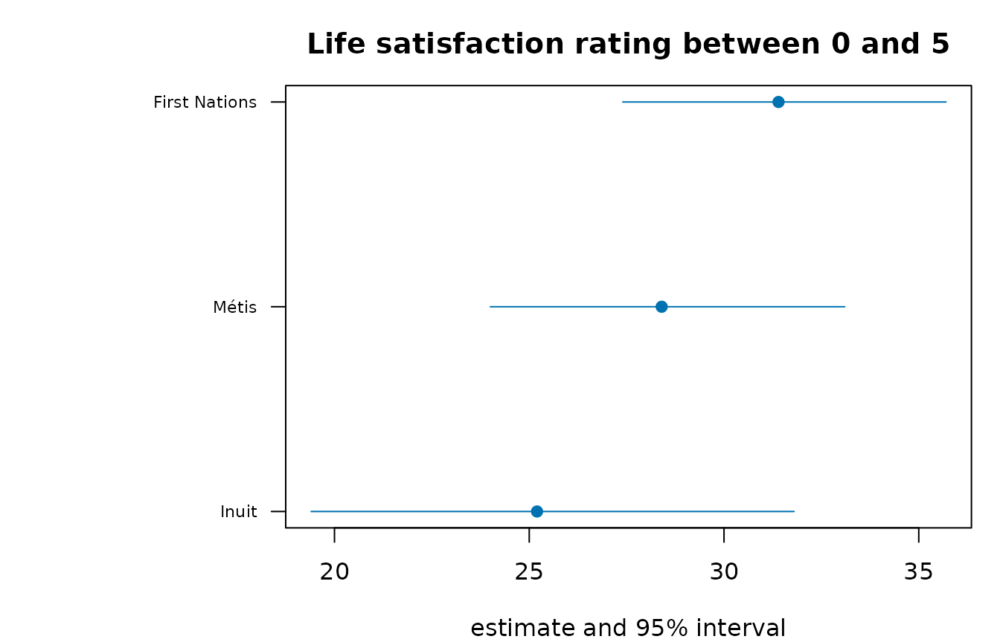
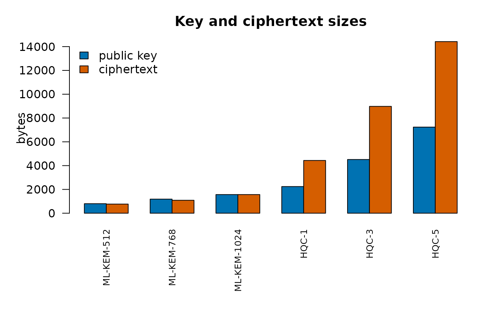
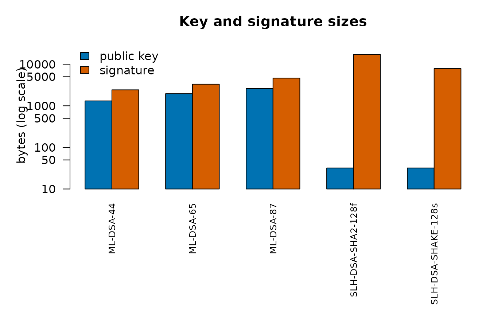
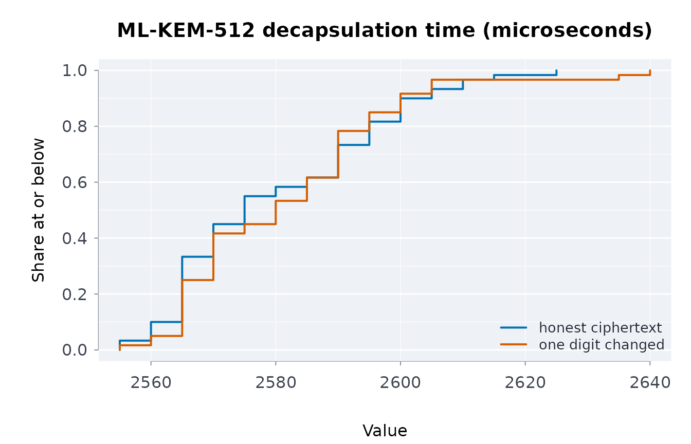

# Integrity, signatures and cryptography

## Hashing, keyed digests, key derivation and Merkle trees

Everything a capsule pins is pinned by a digest. This vignette covers
the hashing primitives, how to compare digests safely, how to derive a
key from a passphrase, how to get randomness, and how a Merkle tree lets
a large file be pinned and partially verified.

### Digests of text and files

``` r

csha256("hello capsule")
#> [1] "97cdf3978fc8755453e42fb3d0384a6612f1dde79c46cf422abc0563cf8426e2"
csha512("hello capsule")
#> [1] "aa92b1aa2bf977ec1c4b3a47795d24e98ab595464236b9c59696c1999794714639df0fa5e66fb7be86bf2d05e4a45b6207a40fc4ae1f3458ca40ceed87a9d76e"
cblake2b("hello capsule")
#> [1] "061431a711a23d1745664ba6d36ad517ab6f48db421d492f13cd110f2067b9ce"
ccrc32("hello capsule")
#> [1] 1607001718
```

Files are hashed in blocks, so a multi-gigabyte file does not need to
fit in memory:

``` r

f <- tempfile()
writeLines("hello capsule", f)
sha256file(f)
#> [1] "55d6110230c260319d580bb6274db530b7e751c4f687fc00d0736ec531260a02"
sha512file(f)
#> [1] "358665f1505b7dced4ab0e1d7cf5b634bc60f8cbdf7c59f8ec6957f8e1a0df990fbaf92e6dc662662cca542e475b0862453a932d9fa58c2bc7a4b3de8cecdfc4"
crc32file(f)
#> [1] 2347637372

before <- sha256file(f)
writeLines("hello capsule (edited)", f)
sha256file(f) == before
#> [1] FALSE
```

CRC-32 is a checksum, not a cryptographic hash: it detects accidental
corruption and nothing more. SHA-256 and SHA-512 (FIPS 180-4) and
BLAKE2b are collision-resistant;
[`vrfsha256()`](https://rootcoder007.github.io/rmorie-bricklayer/reference/vrfsha256.md)
checks a file against a pinned digest.

### Digests of R objects

[`dgstobj()`](https://rootcoder007.github.io/rmorie-bricklayer/reference/dgstobj.md)
serialises an object canonically and hashes the bytes, so attributes,
names and types are part of the identity:

``` r

dgstobj(list(a = 1L, b = "x"))
#> [1] "bf5d21a8b26f6cec8503a46f69e854bf98fea03b62dfaf90cb780feac7165b27"
identical(dgstobj(1:10), dgstobj(1:10))
#> [1] TRUE
dgstobj(1:10) == dgstobj(1:11)
#> [1] FALSE
dgstobj(matrix(1:6, nrow = 2)) == dgstobj(1:6)   # dimensions count
#> [1] FALSE
dgstobj(data.frame(x = 1:3))
#> [1] "24b0995a368ea8d1178b7f6e44c6d8956db4aadfc91d3e6f6911868b38c06d21"
```

### Keyed digests and constant-time comparison

An HMAC (RFC 2104) is a digest that only the holder of the key can
produce, so a manifest cannot be re-signed without the key:

``` r

chmac("Jefe", "what do ya want for nothing?")   # RFC 4231 test case 2
#> [1] "5bdcc146bf60754e6a042426089575c75a003f089d2739839dec58b964ec3843"
chmac("key-a", "manifest")
#> [1] "463b8b2c47caadd6334c53e4d9492fdac6fcaca185f56229043e1a025138ceae"
chmac("key-b", "manifest")
#> [1] "f3ebaf1b8fad504c57fd4cf82b163e30eac6eabd31b7c41a2a6e268ec445b134"
```

**Never compare a tag with `==`.** A string comparison stops at the
first differing character, so its running time tells an attacker how
many leading characters were right.
[`cdgsteq()`](https://rootcoder007.github.io/rmorie-bricklayer/reference/keyeddgst.md)
compares every byte regardless and returns `FALSE` for a length mismatch
without erroring:

``` r

tag <- chmac("k", "m")
cdgsteq(tag, chmac("k", "m"))
#> [1] TRUE
cdgsteq(tag, chmac("k", "tampered"))
#> [1] FALSE
cdgsteq(tag, "too-short")
#> [1] FALSE
```

### Deriving a key from a passphrase

A passphrase is not a key: it is short, low-entropy and chosen by a
person. PBKDF2 (RFC 8018) stretches it with a salt and an iteration
count that makes each guess expensive:

``` r

drvkey("password", "salt", iter = 1)     # the published test vector
#> [1] "120fb6cffcf8b32c43e7225256c4f837a86548c92ccc35480805987cb70be17b"
identical(drvkey("pw", "s", 1000), drvkey("pw", "s", 1000))
#> [1] TRUE
drvkey("pw", "salt-a", 1000) == drvkey("pw", "salt-b", 1000)
#> [1] FALSE
```

The salt must be random and stored beside the ciphertext or signature;
the default of 100,000 iterations is the floor for interactive use. A
derived key signs a manifest symmetrically:

``` r

salt <- paste(format(rndbytes(16)), collapse = "")
key <- drvkey("correct horse battery staple", salt)
sig <- cpssign("manifest-digest", key, scheme = "hmac")
cpsvrf("manifest-digest", sig, key)
#> [1] TRUE
```

### Randomness

[`rndbytes()`](https://rootcoder007.github.io/rmorie-bricklayer/reference/rndbytes.md)
draws from the operating system (`getrandom` or `/dev/urandom` on Unix,
`RtlGenRandom` on Windows) and does **not** consume R’s seeded stream,
so a reproducible analysis is unaffected by key generation happening
beside it:

``` r

set.seed(1)
a <- stats::runif(1)
set.seed(1)
invisible(rndbytes(32))
identical(stats::runif(1), a)
#> [1] TRUE
```

For tests that need reproducible “random” bytes, the package’s AES-256
CTR_DRBG (SP 800-90A) gives the same bytes from the same seed, exactly
as NIST’s known-answer files use it; a personalization string separates
streams:

``` r

d <- drbgnew(as.raw(0:47))
drbggen(d, 16)
#>  [1] 06 15 50 23 4d 15 8c 5e c9 55 95 fe 04 ef 7a 25
a <- drbgnew(as.raw(1:48), person = charToRaw("session 1"))
b <- drbgnew(as.raw(1:48), person = charToRaw("session 2"))
identical(drbggen(a, 16), drbggen(b, 16))
#> [1] FALSE
```

### Merkle trees: pin a large file, verify a piece

A Merkle tree hashes a file in chunks, then hashes pairs of digests up
to one root. The root pins the whole file; a *proof* of `log2(n)`
digests shows that one chunk belongs without holding the others, and a
diff of the leaves names exactly which chunk changed.

``` r

chunks <- c("row1,row2", "row3,row4", "row5,row6", "row7,row8")
root <- mrkroot(chunks)
root
#> [1] "3b1537c90e21c2e66f341b946388abbb78bf249fb433f961fba223b67141be31"

before <- mrklvs(chunks)
after <- mrklvs(c(chunks[1:2], "row5,row6-EDITED", chunks[4]))
which(before != after)
#> [1] 3

pr <- mrkprf(chunks, 3)
mrkvrf(chunks[3], pr, root)
#> [1] TRUE
mrkvrf("row5,row6-EDITED", pr, root)
#> [1] FALSE
```

[`chnkfile()`](https://rootcoder007.github.io/rmorie-bricklayer/reference/chnkfile.md)
splits a real file into fixed-size chunks that concatenate back to its
bytes:

``` r

p <- tempfile()
writeLines(rep("some capsule content", 50), p)
ch <- chnkfile(p, chnkbytes = 128)
length(ch)
#> [1] 9
mrkroot(ch)
#> [1] "3f565b39becbebbc336618294525d7a1ff45394d68ecaec899d292bb0fd357c1"
identical(unlist(ch), readBin(p, "raw", file.size(p)))
#> [1] TRUE
```

[`cpsbndl()`](https://rootcoder007.github.io/rmorie-bricklayer/reference/cpsbndl.md)
pins each data file by one whole-file digest
([`sha256file()`](https://rootcoder007.github.io/rmorie-bricklayer/reference/sha256file.md));
the Merkle tree is for pinning the parts of a large file, so a mismatch
identifies which part of it changed rather than only that something did.

### How these implementations are checked

The digests are compared with OpenSSL at every block boundary, run
against the NIST ACVP sets for SHA-3, SHAKE, HMAC and PBKDF2, and fuzzed
differentially against OpenSSL 3.5. The keyed-digest comparison and
PBKDF2 run under valgrind with the key marked undefined to prove their
timing does not depend on it, and dudect measures the comparison and
PBKDF2 on real CPUs.

### Pinning a community’s copy of a table

Ownership and control of data, in the sense of the First Nations
principles of OCAP, include knowing that a copy has not been altered. A
digest of the table and a Merkle root over its rows let a community
check its copy, and check single rows without the rest:

``` r

d <- indiex("suicide")
dgstobj(d)
#> [1] "b8faefff893183d72b4030a00407eb55c8952cedc4a35beb3416fece9d85c90f"
rows <- apply(d, 1, paste, collapse = ",")
root <- mrkroot(rows)
proof <- mrkprf(rows, 3)
mrkvrf(rows[3], proof, root)
#> [1] TRUE
```

### The pinned table in a picture

The digests above pin this table. Its estimates and intervals for the
first measure are drawn here: a reader who verifies the digest is
looking at exactly these numbers.

``` r

ci_plot <- function(t, lab, main) {
  o <- order(t$estimate)
  t <- t[o, ]
  y <- seq_len(nrow(t))
  op <- par(mar = c(4, 10, 3, 1))
  on.exit(par(op))
  plot(t$estimate, y, xlim = range(t$lower, t$upper, na.rm = TRUE), yaxt = "n", pch = 19,
       col = blpal()[1], xlab = "estimate and 95% interval", ylab = "", main = main)
  segments(t$lower, y, t$upper, y, col = blpal()[1])
  axis(2, y, lab[o], las = 1, cex.axis = 0.7)
}
t1 <- d[d$measure == d$measure[1], ]
ci_plot(t1, paste(t1$group, t1$age), t1$measure[1])
```



## Attestations, signed bundles and tamper-evident chains

The *Building reproducible data capsules* vignette shows how a capsule
pins data and describes it in a manifest. This one covers the three ways
of putting a signature on that work so a reader can check it: an
**attestation** of a manifest, a **bundle** of a whole capsule
directory, and a **chain** that makes a sequence of manifests
tamper-evident.

### Attesting a manifest

An attestation binds a signature to a manifest *and* to what the
manifest covers, with an optional note from the person signing:

``` r

m <- mkmnf(list(dataset = "otis", rows = 1200L), env = FALSE)
key <- fipskg("ML-DSA-65")
att <- cpsatst(m, key, note = "counts as published")

res <- cpschkatst(att, m)
res$ok
#> [1] TRUE
res$checks
#>                  check   ok
#> 1 attestation_complete TRUE
#> 2      manifest_digest TRUE
#> 3            signature TRUE
#>                                                             detail
#> 1                                                                 
#> 2 efa1b7387f225380245de0b5170999e87ad4044f3e8fd2ef6a6bfbc2bd0a9c90
#> 3
```

A verifier needs the attestation and the manifest, nothing else. Any
change to the manifest breaks it, and so does presenting a different
key:

``` r

m2 <- m
m2$meta$rows <- 1201L
cpschkatst(att, m2)$ok
#> [1] FALSE

cpschkatst(att, m, keyexp = fipskg("ML-DSA-65")$public)$ok
#> [1] FALSE
```

`keyexp` is how a reader pins the signer: the attestation carries the
public key that made it, but a reader who knows which key to expect
should say so, or any key would do.

### Bundling a capsule

A bundle is one signed artifact covering a directory: every file is
hashed (hidden files included), the hashes and the manifest are signed,
and the bundle verifies against the directory later:

``` r

dir <- tempfile()
dir.create(dir)
write.csv(data.frame(x = 1:3), file.path(dir, "data.csv"), row.names = FALSE)
m <- mkmnf(list(dataset = "demo"), env = FALSE)
key <- fipskg("ML-DSA-44")

b <- cpsbndl(dir, m, key, note = "as published")
cpsbndlvrf(attr(b, "path"), dir, man = m)$ok
#> [1] TRUE
```

Touch a byte of the data and the bundle no longer holds; the result
names the file:

``` r

write.csv(data.frame(x = 1:4), file.path(dir, "data.csv"), row.names = FALSE)
v <- cpsbndlvrf(attr(b, "path"), dir, man = m)
v$ok
#> [1] FALSE
```

``` r

cpsbndlrd(attr(b, "path"))$attestation$note
#> [1] "as published"
unlink(dir, recursive = TRUE)
```

### A chain of manifests

A per-manifest signature proves each manifest is intact but says nothing
about the *sequence*: a run could be deleted from the middle of a
series, or two swapped, and every remaining signature would still
verify. A hash chain links each entry to the one before it, so deletion,
insertion and reordering all break it:

``` r

ch <- chnnew()
ch <- chnapp(ch, "manifest for run 1", label = "run-1")
ch <- chnapp(ch, "manifest for run 2", label = "run-2")
ch <- chnapp(ch, "manifest for run 3", label = "run-3")
chnvrf(ch)$valid
#> [1] TRUE
```

Editing an entry breaks the chain and names where:

``` r

edited <- ch
edited$entries[[2]]$digest <- csha256("something else")
chnvrf(edited)$valid
#> [1] FALSE
chnvrf(edited)$broken_at
#> [1] 2
```

Deleting one breaks it too, which a per-manifest digest would never
catch:

``` r

dropped <- ch
dropped$entries[[2]] <- NULL
chnvrf(dropped)$valid
#> [1] FALSE
```

#### Sealing the chain

The seal covers the links *and the length* together, so one signature
over the seal fixes the whole history. Truncating the chain still seals,
but to a different value:

``` r

key <- fipskg("ML-DSA-44")
sig <- cpssign(chnseal(ch), key)
cpsvrf(chnseal(ch), sig, fipspubkey(key))
#> [1] TRUE

truncated <- ch
truncated$entries[[3]] <- NULL
cpsvrf(chnseal(truncated), sig, fipspubkey(key))
#> [1] FALSE
```

A chain whose links disagree has no seal to present at all:

``` r

chnseal(dropped)
#> [1] NA
```

### Which to use

- One manifest, one signer:
  [`cpsatst()`](https://rootcoder007.github.io/rmorie-bricklayer/reference/cpsatst.md).
- A directory of files that must travel together:
  [`cpsbndl()`](https://rootcoder007.github.io/rmorie-bricklayer/reference/cpsbndl.md).
- A series of runs, releases or data refreshes where order and
  completeness matter:
  [`chnapp()`](https://rootcoder007.github.io/rmorie-bricklayer/reference/chn.md)
  after each, sign
  [`chnseal()`](https://rootcoder007.github.io/rmorie-bricklayer/reference/chn.md)
  at each release.

All three accept any signing key the package knows: ML-DSA and SLH-DSA
([`fipskg()`](https://rootcoder007.github.io/rmorie-bricklayer/reference/fipskg.md))
or XMSS
([`pqckg()`](https://rootcoder007.github.io/rmorie-bricklayer/reference/pqckg.md),
with the key state carried forward). A shared secret from
[`drvkey()`](https://rootcoder007.github.io/rmorie-bricklayer/reference/drvkey.md)
is for keyed digests
([`chmac()`](https://rootcoder007.github.io/rmorie-bricklayer/reference/keyeddgst.md)),
not for attestations: an attestation names a public key, and a shared
secret has none.

### Releases of Indigenous health tables

A chain fits data a community needs to be able to trust release after
release. Here each link pins one of the Statistics Canada tables on
Indigenous health bundled with the package, so a later reader can tell
whether any release was altered or dropped:

``` r

ch <- chnnew()
for (nm in c("health", "mentalhealth", "wellbeing")) {
  d <- indiex(nm)
  ch <- chnapp(ch, list(table = nm, rows = nrow(d), sha256 = dgstobj(d)),
                     label = nm)
}
chnvrf(ch)$valid
#> [1] TRUE
```

### The table in a picture

The chain and the bundle above record this table, one indicator per
release. Its estimates and intervals, drawn here for the first
indicator, are what a reader sees after verification.

``` r

ci_plot <- function(t, lab, main) {
  o <- order(t$estimate)
  t <- t[o, ]
  y <- seq_len(nrow(t))
  op <- par(mar = c(4, 10, 3, 1))
  on.exit(par(op))
  plot(t$estimate, y, xlim = range(t$lower, t$upper, na.rm = TRUE), yaxt = "n", pch = 19,
       col = blpal()[1], xlab = "estimate and 95% interval", ylab = "", main = main)
  segments(t$lower, y, t$upper, y, col = blpal()[1])
  axis(2, y, lab[o], las = 1, cex.axis = 0.7)
}
t1 <- d[d$indicator == d$indicator[1], ]
ci_plot(t1, t1$group, t1$indicator[1])
```



## Key encapsulation: ML-KEM and HQC

A key-encapsulation mechanism (KEM) lets two parties agree on a shared
secret over a public channel: the sender *encapsulates* a fresh secret
under the recipient’s public key, producing a ciphertext; the recipient
*decapsulates* the ciphertext with the secret key and recovers the same
secret. The package implements **ML-KEM** (FIPS 203, lattice-based) and
**HQC** (code-based), natively.

### ML-KEM

``` r

key <- kemkg(768)
pub <- kempubkey(key)

# the sender holds only the public key
sent <- kemencap(pub)
# the recipient recovers the same secret from the ciphertext
got <- kemdecap(key, sent$ciphertext)
identical(sent$shared, got)
#> [1] TRUE
```

Three parameter sets trade size for security margin:

``` r

kemsz(512)
#>     public     secret ciphertext       seed     shared 
#>        800       1632        768         64         32
kemsz(768)
#>     public     secret ciphertext       seed     shared 
#>       1184       2400       1088         64         32
kemsz(1024)
#>     public     secret ciphertext       seed     shared 
#>       1568       3168       1568         64         32
```

#### Implicit rejection

ML-KEM is designed so that a corrupted ciphertext does **not** produce
an error. It produces a *different*, pseudorandom secret derived from
the secret key and the ciphertext. This is the Fujisaki–Okamoto
transform’s *implicit rejection*: an attacker who tampers with
ciphertexts learns nothing from the recipient’s behaviour, because the
recipient behaves identically either way.

``` r

bad <- sent$ciphertext
substring(bad, 1L, 2L) <- "00"
other <- kemdecap(key, bad)
nchar(other) == 64L          # a 32-byte secret, as always
#> [1] TRUE
identical(other, got)        # but not the one the sender has
#> [1] FALSE
```

#### Masked decapsulation (the default)

Decapsulation is the operation that uses the secret key, so it is the
one a power or electromagnetic side channel would target. Since 0.5.10
it runs **first-order masked** by default: every value that depends on
the secret key is held as two random shares that are refreshed from the
operating system’s randomness on every call, and the re-encryption
comparison of the FO transform is done on shares (the decompressed
comparison of Bhasin et al., TCHES 2021). The result is byte-identical
to the plain computation:

``` r

identical(kemdecap(key, sent$ciphertext, masked = FALSE), got)
#> [1] TRUE
identical(kemdecap(key, bad, masked = FALSE), other)
#> [1] TRUE
```

`masked = FALSE` is three to four times faster for decapsulation (seven
to eleven for ML-DSA signing) and is the right choice where no physical
attacker is in the threat model (a server in a locked room). The
*Side-channel assurance* vignette explains what the masking defends
against and how it was verified.

#### Key validation

FIPS 203 §7.3 requires a decapsulation key to be checked before use: its
stored hash of the encapsulation key must match the key it contains. A
key that fails this check is refused rather than used. This check was
added after the Wycheproof vectors showed the earlier code accepted such
a key.

### HQC

HQC rests on the hardness of decoding random quasi-cyclic codes, an
assumption unrelated to lattices, which is why NIST selected it as the
second KEM. The interface is the same:

``` r

hkey <- hqckg(1)
hpub <- hqcpubkey(hkey)

hsent <- hqcencap(hpub)
identical(hqcdecap(hkey, hsent$ciphertext), hsent$shared)
#> [1] TRUE
hqcsz(1)
#>     public     secret ciphertext       seed    message       salt     shared 
#>       2241       2321       4433         32         16         16         32
```

Two revisions are implemented: the 2025 specification (`version = "v5"`,
the default) and the round-4 submission (`version = "round4"`), which
differ in their shared-secret derivation. A key made under one does not
interoperate with the other, and the version is recorded in the key:

``` r

old <- hqckg(1, ver = "round4")
cap <- hqcencap(hqcpubkey(old))
identical(hqcdecap(old, cap$ciphertext), cap$shared)
#> [1] TRUE
```

#### Reproducible keys for tests

Both KEMs accept a seed so a test can regenerate the same key: 64 bytes
for ML-KEM (FIPS 203’s `d || z`) and 32 bytes for HQC v5 (its
`seed_KEM`). Never use this outside tests: a key derived from a
guessable seed is no key at all.

``` r

identical(hqckg(1, seed = as.raw(1:32))$public,
          hqckg(1, seed = as.raw(1:32))$public)
#> [1] TRUE
```

### Using the shared secret

The shared secret is 32 bytes of hex. It is a *key*, not a password: use
it directly as the key of
[`chmac()`](https://rootcoder007.github.io/rmorie-bricklayer/reference/keyeddgst.md)
or to derive further keys, never as text to be stored.

``` r

tag <- chmac(sent$shared, "the capsule manifest")
cdgsteq(tag, chmac(got, "the capsule manifest"))
#> [1] TRUE
```

### How these implementations are checked

ML-KEM runs against the NIST ACVP and C2SP Wycheproof sets (key
generation, encapsulation, decapsulation and key validation), is
compared byte for byte with OpenSSL 3.5, and is differentially fuzzed
against it. Decapsulation’s timing is measured on real x86-64 and arm64
CPUs with dudect, its constant-time property is proved under valgrind,
and its masked arithmetic is assessed for first-order power leakage in a
Cortex-M4 simulation. See `SECURITY.md` in the repository.

### Sending a table to a community data steward

Key encapsulation lets a sender share a table so only the holder of a
secret key can read it, for instance a First Nations data steward
receiving a release:

``` r

steward <- kemkg(768)
pub <- kempubkey(steward)
sent <- kemencap(pub)
msg <- tojs(indiex("wellbeing"))
# the shared secret keys an authentication tag the steward can recompute
tag <- chmac(msg, sent$shared)
identical(chmac(msg, kemdecap(steward, sent$ciphertext)), tag)
#> [1] TRUE
```

### The sizes in a picture

What each parameter set puts on the wire: the public key the steward
publishes and the ciphertext each sender transmits, in bytes, for ML-KEM
([`kemsz()`](https://rootcoder007.github.io/rmorie-bricklayer/reference/kemsz.md))
and HQC
([`hqcsz()`](https://rootcoder007.github.io/rmorie-bricklayer/reference/hqcsz.md)).

``` r

sz <- rbind(
  "ML-KEM-512" = kemsz(512L)[c("public", "ciphertext")],
  "ML-KEM-768" = kemsz(768L)[c("public", "ciphertext")],
  "ML-KEM-1024" = kemsz(1024L)[c("public", "ciphertext")],
  "HQC-1" = hqcsz(1L)[c("public", "ciphertext")],
  "HQC-3" = hqcsz(3L)[c("public", "ciphertext")],
  "HQC-5" = hqcsz(5L)[c("public", "ciphertext")]
)
op <- par(mar = c(7, 5, 3, 1))
barplot(t(sz), beside = TRUE, col = blpal()[1:2], ylab = "bytes", las = 2, cex.names = 0.8,
        legend.text = c("public key", "ciphertext"), args.legend = list(x = "topleft", bty = "n"),
        main = "Key and ciphertext sizes")
```



``` r

par(op)
```

## Post-quantum signatures: ML-DSA, SLH-DSA and XMSS

A capsule is only as trustworthy as the signature on its manifest.
`rmoriebricklayer` implements the three NIST post-quantum signature
standards natively, with no system cryptography library: **ML-DSA**
(FIPS 204, lattice-based), **SLH-DSA** (FIPS 205, hash-based, stateless)
and **XMSS** (RFC 8391, hash-based, stateful). All three are used
through the same two calls,
[`cpssign()`](https://rootcoder007.github.io/rmorie-bricklayer/reference/cpssign.md)
and
[`cpsvrf()`](https://rootcoder007.github.io/rmorie-bricklayer/reference/cpsvrf.md).

### Why post-quantum, and why three schemes

A signature made today may need to verify in twenty years, when a large
quantum computer could break RSA and ECDSA with Shor’s algorithm. The
three schemes rest on different assumptions, so a break of one does not
take the others:

- **ML-DSA** (Module-Lattice Digital Signature Algorithm, formerly
  Dilithium) rests on the hardness of Module-LWE and Module-SIS. Small
  keys and signatures, fast. The default.
- **SLH-DSA** (Stateless Hash-based, formerly SPHINCS+) rests only on
  the security of a hash function. Conservative; its signatures are
  large.
- **XMSS** is also hash-based but *stateful*: every key signs a fixed
  number of times and an index must never be reused. The package carries
  the state forward for you.

### ML-DSA: the default

``` r

key <- fipskg("ML-DSA-65")
key$scheme
#> [1] "ML-DSA-65"

sig <- cpssign("a manifest digest", key)
cpsvrf("a manifest digest", sig, fipspubkey(key))
#> [1] TRUE
```

The verifier needs only the public key. Any change to the message is
caught:

``` r

cpsvrf("a manifest digest (edited)", sig, fipspubkey(key))
#> [1] FALSE
```

#### Context strings bind a signature to its purpose

FIPS 204 lets a signature carry a *context*: a short string hashed in
with the message. The same message signed for one purpose does not
verify under another, which stops a signature made for “staging” being
replayed as a “release” approval:

``` r

sig2 <- cpssign("a manifest digest", key, ctx = "release")
cpsvrf("a manifest digest", sig2, key, ctx = "release")
#> [1] TRUE
cpsvrf("a manifest digest", sig2, key, ctx = "staging")
#> [1] FALSE
```

#### Hedged and deterministic signing

By default ML-DSA signing is *hedged*: fresh randomness enters every
signature, so two signatures of one message differ (FIPS 204 recommends
this; it also protects against fault attacks on the nonce).
`deterministic = TRUE` gives the variant where the signature depends
only on the key and the message:

``` r

s1 <- cpssign("same message", key, determ = TRUE)
s2 <- cpssign("same message", key, determ = TRUE)
identical(s1$signature, s2$signature)
#> [1] TRUE

h1 <- cpssign("same message", key)
h2 <- cpssign("same message", key)
identical(h1$signature, h2$signature)
#> [1] FALSE
```

#### Signing a digest computed elsewhere

ML-DSA signs `mu = H(tr || M')`, a digest of the message that depends on
the public key but not on the secret.
[`fipsmu()`](https://rootcoder007.github.io/rmorie-bricklayer/reference/fipsmu.md)
computes it from the *public* key, so the machine holding the secret
never needs to see the message:

``` r

mu <- fipsmu(fipspubkey(key), "a manifest digest", ctx = "release")
sig3 <- fipssignmu(key, mu)
fipsvrfmu(key, mu, sig3)
#> [1] TRUE
# the same signature verifies the ordinary way
cpsvrf("a manifest digest", sig3, key, ctx = "release")
#> [1] TRUE
```

Since 0.5.10, ML-DSA signing runs **first-order masked** by default (see
the *Side-channel assurance* vignette): every secret-dependent value is
held as two random shares. The signatures are byte-identical to the
unmasked computation; only the cost differs.

### SLH-DSA: hash-based, stateless

``` r

fipssz("ML-DSA-65")
#> public_key secret_key  signature       seed        rnd 
#>       1952       4032       3309         32         32
fipssz("SLH-DSA-SHAKE-128f")
#> public_key secret_key  signature       seed        rnd 
#>         32         64      17088         48         16
```

The price of dropping the lattice assumption is size: an SLH-DSA
signature is far larger than an ML-DSA signature at the same security
level.

``` r

fipssz("SLH-DSA-SHAKE-128f")[["signature"]] > fipssz("ML-DSA-44")[["signature"]]
#> [1] TRUE
```

The calls are identical:

``` r

hkey <- fipskg("SLH-DSA-SHAKE-128f")
hsig <- cpssign("a manifest digest", hkey)
cpsvrf("a manifest digest", hsig, fipspubkey(hkey))
#> [1] TRUE
```

#### Pre-hash variants

HashML-DSA and HashSLH-DSA sign a digest of the message instead of the
message itself, for very large inputs or when the message is hashed on
another machine. The hash function’s OID is bound into the signature, so
two digests of the same length never verify for each other:

``` r

p <- cpssign("a large artifact", key, prehash = "sha512")
cpsvrf("a large artifact", p, key, prehash = "sha512")
#> [1] TRUE
cpsvrf("a large artifact", p, key, prehash = "sha3_512")
#> [1] FALSE
```

### XMSS: hash-based, stateful

An XMSS key of height *h* signs 2^h messages. The package stores the
next index in the key and `xmssadv(key, signature)` gives the advanced
key after every signature; reusing an index would break security, so
always advance the key with
[`xmssadv()`](https://rootcoder007.github.io/rmorie-bricklayer/reference/xmssadv.md)
and save that:

``` r

xkey <- pqckg(height = 3)
xkey$capacity
#> [1] 8
xkey$next_index
#> [1] 0

s1 <- cpssign("manifest-1", xkey)
cpsvrf("manifest-1", s1, signpubkey(xkey))
#> [1] TRUE

xkey <- xmssadv(xkey, s1)
xkey$next_index
#> [1] 1
s2 <- cpssign("manifest-2", xkey)
cpsvrf("manifest-2", s2, signpubkey(xkey))
#> [1] TRUE

# a signature does not transfer to another message
cpsvrf("manifest-1", s2, signpubkey(xkey))
#> [1] FALSE
```

The key is a value, so an old copy of it still says an old `next_index`.
The package therefore also keeps a record of the highest index each key
has used on this machine
([`?xmssadv`](https://rootcoder007.github.io/rmorie-bricklayer/reference/xmssadv.md)
says where), and refuses a used index even from a stale copy. A key
generated here is entered at birth; a key from another machine, one
rebuilt from its seeds, or one used in a CI job or a container with a
fresh home directory is unknown to the record and must be vouched for
once with `xmssregkey(key)` before it signs from index 0.

#### The key file is the state

RFC 10033 (*Hash-Based Signatures: State and Backup Management*)
separates the private key, which never changes, from the state, the
indices already used, which must be updated and saved before a signature
is released, and warns that a copied or restored state signs used
indices again. `rmbl sign` follows it: with
`--scheme xmss-sha256 --key-file key.json` the key file is the state. It
is rewritten atomically, with `next_index` advanced and a `used` field,
before any bundle is written, and the run signs from the indices it
reserved.

``` r

root <- tempfile("capsules-")
for (nm in c("one", "two")) {
  d <- file.path(root, nm)
  dir.create(d, recursive = TRUE)
  utils::write.csv(data.frame(x = 1:3), file.path(d, "data.csv"), row.names = FALSE)
  writeLines('{"resource": {"filename": "data.csv"}}', file.path(d, "data_provenance.json"))
}
kf <- tempfile(fileext = ".json")
writeLines(tojs(unclass(pqckg(height = 4)), auto_unbox = TRUE), kf)
copy <- tempfile(fileext = ".json")
invisible(file.copy(kf, copy))   # an old copy of the key, kept by mistake

status <- blcli(c("sign", root, "--scheme", "xmss-sha256", "--key-file", kf, "--json"),
                out = function(s) NULL)
status
#> [1] 0
state <- fromjs(paste(readLines(kf), collapse = "\n"))
state$next_index                # two capsules signed, two indices used
#> [1] 2
state$used$generation
#> [1] 1

# the old copy is refused: the bundles show indices it does not know are used
blcli(c("sign", root, "--scheme", "xmss-sha256", "--key-file", copy, "--overwrite"),
      out = function(s) cat(s[grepl("stale", s)]))
#> rmoriebricklayer: stale copy of the key: index 1 of it was already signed (seen in /tmp/Rtmp3IiGhR/capsules-35aa600ca3f/two/capsule_bundle.json), but this state says the highest used in its range is -1. Signing would reuse an index: use the copy that made that signature, or generate a new key
xmssidxseen(root)[, c("index", "reused")]
#>   index reused
#> 1     0  FALSE
#> 2     1  FALSE
```

`--state-file` keeps the state in a file of its own.
`--sectors K --sector-index I` splits the indices into K disjoint ranges
so that K signers can share one key, each in its own range (RFC 10033,
section 5.3), and `--reserve N` marks N indices used in one write and
signs from them (section 5.9; the ones a run does not use are lost). A
key kept as a CI secret is a fixed copy that every job starts from, so
every job would sign the same indices: in CI, sign with ML-DSA unless
the XMSS state lives in a file that persists between jobs. NIST SP
800-208 approves XMSS only inside a hardware module that never exports
the key, which a key file is not.

### Every way of being wrong returns FALSE

Verification returns `FALSE` for every signature of the right shape that
does not verify: a truncated or edited signature, a foreign key and an
edited message all fail the same way. (An object that is not a signature
at all, a key of the wrong class or a missing message is an error,
because that is a programming mistake rather than a tampered artefact.)

``` r

pub <- fipspubkey(key)
bad <- sig
bad$signature <- paste0("ff", substring(bad$signature, 3))
cpsvrf("a manifest digest", bad, pub)
#> [1] FALSE
trunc <- sig
trunc$signature <- substring(sig$signature, 1, 64)
cpsvrf("a manifest digest", trunc, pub)
#> [1] FALSE
cpsvrf("a manifest digest", sig, fipspubkey(fipskg("ML-DSA-65")))
#> [1] FALSE
```

### How these implementations are checked

ML-DSA and SLH-DSA are compared byte for byte with OpenSSL 3.5 and run
against the NIST ACVP and C2SP Wycheproof vector sets on every change
(6,848 checks, 0 failures at 0.5.10), and fuzzed differentially against
OpenSSL; XMSS, which OpenSSL does not implement, is checked against the
RFC 8391 vectors. Every signer runs under valgrind with the secret key
marked undefined, a dynamic check that no executed branch or memory
address depends on it. `SECURITY.md` in the package repository has the
full table of what each check catches and what it does not.

### Signing a release of Indigenous tables

A signature lets anyone check that a release came from its publisher and
has not changed:

``` r

key <- fipskg("ML-DSA-65")
d <- indiex("mentalhealth")
msg <- dgstobj(d)
sig <- cpssign(msg, key)
cpsvrf(msg, sig, fipspubkey(key))
#> [1] TRUE
```

### The sizes in a picture

What a signature costs on the wire, from
[`fipssz()`](https://rootcoder007.github.io/rmorie-bricklayer/reference/fipssz.md):
the public key a verifier keeps and the signature attached to each
release, in bytes, for ML-DSA and two SLH-DSA sets. The scale is
logarithmic, because an SLH-DSA signature is several times larger.

``` r

sch <- c("ML-DSA-44", "ML-DSA-65", "ML-DSA-87", "SLH-DSA-SHA2-128f", "SLH-DSA-SHAKE-128s")
sz <- t(vapply(sch, function(s) fipssz(s)[c("public_key", "signature")], numeric(2)))
op <- par(mar = c(9, 5, 3, 1))
barplot(t(sz), beside = TRUE, log = "y", ylim = c(10, 2 * max(sz)), col = blpal()[1:2],
        ylab = "bytes (log scale)", las = 2, cex.names = 0.8, legend.text = c("public key", "signature"),
        args.legend = list(x = "topleft", bty = "n"), main = "Key and signature sizes")
#> Warning in yinch(0.1): y log scale: yinch() is nonsense
```



``` r

par(op)
```

## Side-channel assurance: constant time, timing tests, masking and simulated power analysis

Correct cryptography can still leak its key through *how* it computes:
how long an operation takes, how much power the chip draws while it
runs, what it radiates. This vignette explains what the package does
about each channel, how that was verified, and exactly what remains
outside the verification. The harnesses live under `inst/` in the
installed package and run in continuous integration on every change.

``` r

list.files(system.file(package = "rmoriebricklayer"), pattern = "^(ctcheck|dudect|tvla|fuzz)$")
#> [1] "ctcheck" "dudect"  "fuzz"    "tvla"
```

### 1. Timing

#### The threat

An operation’s duration depends on a secret when a branch condition
depends on it, when a memory address depends on it (cache timing), or
when an instruction’s latency depends on its operand (division on many
cores). An attacker who can time the operation, locally or across a
network, recovers the secret bit by bit.

#### Dynamic check: ctgrind (`inst/ctcheck`)

The secret key is marked *undefined* to valgrind memcheck (Langley’s
ctgrind, 2010). Memcheck then reports every conditional jump and every
memory address that depends on undefined data, which is exactly the set
a timing attacker can observe. A clean run shows that, for the inputs
the harness exercised, no branch or address of that binary depended on
the secret; it is evidence about that binary and those inputs, not a
proof over every input of that length. The only branches allowed are the
ones the standards publish by design (a rejected sample in ML-DSA, the
challenge, the hints), each passed through an explicit declassification
point. The harness is built from the package’s own sources with GCC and
Clang, and it also scans the dead stack after each operation for
surviving copies of the secret.

``` sh
bash inst/ctcheck/build.sh     # needs R, a C++17 compiler, valgrind headers
bash inst/ctcheck/run.sh       # exit 0 = every case clean
```

#### Measured on hardware: dudect (`inst/dudect`)

Reparaz, Balasch and Verbauwhede’s *Dude, is my code constant time?*
(DATE 2017): each measurement times the operation on an input drawn at
random from a *fixed* class or a *random* class; Welch’s t compares the
two timing distributions. \|t\| \> 10 is a real difference; \|t\| \< 4.5
is none. A positive control, an early-exit comparison, must be flagged
or the run is invalid. CI runs it on x86-64 Linux, arm64 Linux and Apple
silicon.

``` sh
bash inst/dudect/build.sh
N=300000 bash inst/dudect/run.sh     # exit 1 on any |t| > 10
```

#### What this found

ML-KEM compression divided by *q*; at `-O0` the compiler emitted a
hardware divide whose latency depends on the operand (the KyberSlash
class of bug). It is a multiply-and-shift now. Three “add *q* when
negative” corrections had compiled to conditional execution on a secret
share’s sign; they are branch-free masks now.

### 2. Power and electromagnetic emanation

#### The threat

A CMOS circuit draws power when its transistors switch. Under the
**Hamming-weight model** a power sample is proportional to the number of
1-bits in a value being written; under the **Hamming-distance model** it
is proportional to the number of bits that *flip* in a register or bus
between its old and new value. Either lets an attacker correlate
recorded traces against hypotheses on a secret-dependent intermediate
(differential and correlation power analysis). Constant-time code is
fully exposed to this: the values are secret even when the timing is
not. EM attacks read the same switching through a near-field probe.

#### The countermeasure: first-order masking

Every secret-dependent intermediate *x* is split into two shares that
are each uniformly random on their own, `x = x0 XOR x1` (Boolean) or
`x = x0 + x1 mod q` (arithmetic). Linear operations act share by share;
non-linear ones consume fresh randomness so that no single intermediate
depends on the secret. In the probing model of Ishai, Sahai and Wagner
(2003) this is *first-order security*: any one observed value is
independent of the secret. The cost an attacker then pays grows
exponentially in the masking order with the measurement noise as the
base.

ML-KEM decapsulation and ML-DSA signing are masked by default. The
output is byte-identical to the unmasked computation, which the full
vector suite checks on every vector:

``` r

key <- kemkg(512)
sent <- kemencap(kempubkey(key))
identical(kemdecap(key, sent$ciphertext, masked = TRUE),
          kemdecap(key, sent$ciphertext, masked = FALSE))
#> [1] TRUE

skey <- fipskg("ML-DSA-44")
sig <- cpssign("manifest", skey, determ = TRUE)
cpsvrf("manifest", sig, fipspubkey(skey))
#> [1] TRUE
```

The gadgets (`src/rmbl_masked.h`) are the published ones: Trichina’s
two-share AND; a bitsliced ripple-carry adder over Boolean shares
(Goubin 2001; Bronchain and Cassiers 2022); arithmetic-to-Boolean
conversion by the decoding of Bos et al. (TCHES 2021) and the
decompressed ciphertext comparison of Bhasin et al. (TCHES 2021);
Boolean-to-arithmetic conversion by masked modular subtraction; masked
centred-binomial sampling; and the masked Keccak of Bertoni et
al. (2010). For ML-DSA, `HighBits(w)` is public (it is hashed into the
challenge) and is revealed one bit at a time; the three rejection tests
reveal one bit each.

#### Why the share-pair operations are assembly

A C compiler may place share 0 and then share 1 of one value in the same
register. Under the Hamming-distance model that register’s flips are
`HW(x0 XOR x1) = HW(x)`: the secret, in the clear. The simulator below
showed exactly this for the C gadgets (\|t\| up to 135) while the
Hamming-weight model reported them clean. So every operation that
touches both shares is inline assembly (Thumb-2, x86-64, aarch64) with a
fixed register order, every temporary and destination zeroed before use,
a zero stored between the share-0 and share-1 stores, and the registers
scrubbed between passes that handle one share at a time. On any other
CPU the same operations run as plain C, with the same results and
without the register discipline.

#### Simulated power analysis: TVLA (`inst/tvla`)

The target is the Cortex-M4, the reference core of the embedded
post-quantum literature. The package’s own headers are compiled for it
and executed instruction by instruction in the unicorn emulator;
capstone decodes which registers each instruction writes, and one sample
per instruction is recorded under both leakage models. The statistic is
TVLA (Goodwill et al. 2011; ISO/IEC 17825): a fixed secret against
random secrets, Welch’s t at every sample, in two independent
experiments; a point leaks when \|t\| \> 4.5 in both with the same sign.
Each masked kernel runs beside its unmasked control (the same code with
share 1 zero), because a control that does not leak means the harness
sees nothing.

``` sh
bash inst/tvla/build.sh                 # arm-none-eabi-g++, unicorn, capstone
cd inst/tvla && ./build/tvla all 5000   # Hamming-weight model
TVLA_MODEL=hd ./build/tvla all 5000     # Hamming-distance model
```

At 2 x 3,000 traces every masked kernel is clean under both models (max
\|t\| 3.0) and every unmasked control leaks (\|t\| 87 to 163). CI fails
on a masked leak under either model. The full table is in
`inst/tvla/README.md`.

``` r

readLines(system.file("tvla", "README.md", package = "rmoriebricklayer"), n = 12)
#>  [1] "# Simulated power analysis (TVLA)"                                                         
#>  [2] ""                                                                                          
#>  [3] "`inst/ctcheck` shows no branch or memory address depends on a secret, and `inst/dudect`"   
#>  [4] "measures that timing does not. Neither says anything about **power**: a CPU's power draw"  
#>  [5] "depends on the values it handles even when its timing does not, and that is what power and"
#>  [6] "electromagnetic attacks read."                                                             
#>  [7] ""                                                                                          
#>  [8] "This directory assesses the package's ML-KEM code for first-order power leakage before"    
#>  [9] "silicon. `kernels.cpp` compiles the package's own `src/rmbl_mlkem_arith.h` and"            
#> [10] "`src/rmbl_masked.h` for a Cortex-M4 (the reference target of the post-quantum embedded"    
#> [11] "literature); `tvla.cpp` runs them instruction by instruction in unicorn and records one"   
#> [12] "sample per instruction. Capstone decodes which registers each instruction writes, and the"
```

### 3. What is outside these checks

Honesty about scope is part of the assurance. The checks do **not**
model:

- **Electromagnetic emanation** on a specific board. The simulation
  models switching activity, which is the source of EM leakage too, but
  a measurement needs a probe.
- **Fault injection**: glitching the clock or voltage to skip an
  instruction. The checks assume the program runs as written.
- **Glitches and coupling** a leakage model omits: pipeline forwarding,
  write-back buffers and capacitive coupling between wires, which can
  combine shares (the MIRACLE study, TCHES 2021, catalogues them).
- **Higher-order attacks**: two shares resist one probe; a second-order
  attacker combines two leakage points.

Each has a software route (richer fitted leakage models such as ELMO, a
fault campaign in the same emulator, higher-order gadgets, formal
verification of the gadgets with maskVerif) and, for EM and for
confirming a given chip, a hardware route. The repository’s
`SECURITY.md` states the current boundary. The package itself ships no
firmware; the side-channel review bundle distributed alongside the
release (a separate archive) carries firmware for a ChipWhisperer
Cortex-M4 target (CW-Lite Arm, CW308 STM32F3) running the same kernels,
and a fixed-versus-random capture script. No capture has been run, and
every power figure above comes from the emulator.

### 4. Choosing the plain path

Masking costs about 2.3 to 3.4 times the plain time on decapsulation (4
ms for ML-KEM-768 against 1.2 ms on this package’s test machine) and 7
to 10 times on signing (17 ms for ML-DSA-65 against 2.4 ms), depending
on the CPU. Where the threat model has no physical attacker,
`kemdecap(masked = FALSE)`, `cpssign(masked = FALSE)` and
`fipssignmu(masked = FALSE)` keep the plain path, and
`options(rmoriebricklayer.masked = FALSE)` makes that the default for a
session (a chain or bundle signs many times). Timing protections cannot
be switched off; they are not optional.

### Indigenous examples

Side-channel assurance concerns the cryptography, not the data; the keys
it tests are the ones that sign and encrypt releases such as the
Indigenous tables shown in
[`vignette("integrity-and-cryptography")`](https://rootcoder007.github.io/rmorie-bricklayer/articles/integrity-and-cryptography.md)
and
[`vignette("integrity-and-cryptography")`](https://rootcoder007.github.io/rmorie-bricklayer/articles/integrity-and-cryptography.md).
The masked implementation is used by default:

``` r

getOption("rmoriebricklayer.masked", TRUE)
#> [1] TRUE
```

### Constant time in a picture

A side-channel test asks whether the time an operation takes depends on
secret data. This chart is a picture of the question, not the test (that
is the dudect and TVLA harnesses above). It times ML-KEM decapsulation
of the honest ciphertext and of the same ciphertext with one hex digit
changed, alternating the two so that drift in the machine’s clock speed
falls on both alike. Implicit rejection sends the changed ciphertext
down the same path as the honest one, so the two curves should lie close
together; the timing harnesses are what decide whether they are
indistinguishable.

``` r

bad <- sent$ciphertext
substr(bad, 1, 1) <- if (substr(bad, 1, 1) == "0") "1" else "0"  # one hex digit changed
tm <- function(ct) {
  s <- proc.time()[["elapsed"]]
  for (i in 1:200) kemdecap(key, ct)
  (proc.time()[["elapsed"]] - s) / 200 * 1e6
}
honest <- tampered <- numeric(60)
for (k in 1:60) {
  honest[k] <- tm(sent$ciphertext)
  tampered[k] <- tm(bad)
}
plotecdf(c(honest, tampered), rep(c("honest ciphertext", "one digit changed"), each = 60),
         main = "ML-KEM-512 decapsulation time (microseconds)")
```


