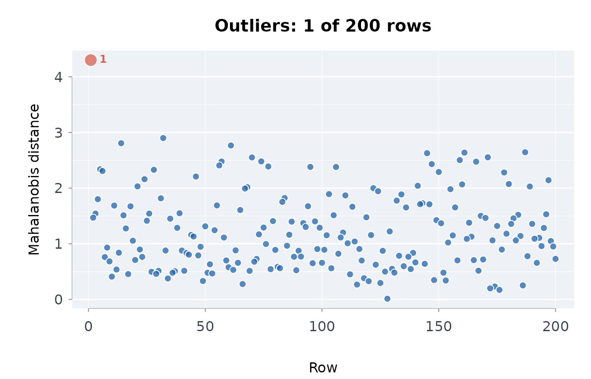
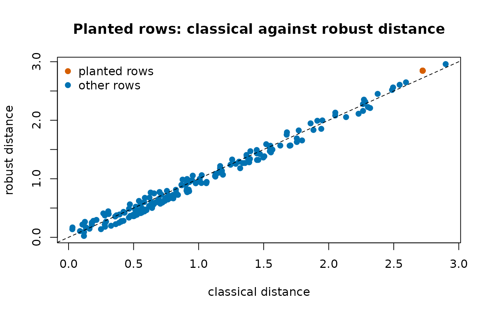

# Missingness, duplicates, outliers and distinct counts

Before a published table is analysed it should be looked at for the four
things that most often go wrong in ingestion: missing values with a
pattern, duplicated rows, rows that are ordinary on each column but
impossible jointly, and identifier columns with fewer distinct values
than they should have.

## Missingness

``` r

df <- data.frame(a = c(1, NA, 3), b = c(NA, NA, 3), c = 1:3)
misssmry(df)
#>             n_rows             n_cols          n_missing        pct_missing 
#>            3.00000            3.00000            3.00000           33.33333 
#>    n_complete_rows  pct_complete_rows n_cols_any_missing n_cols_all_missing 
#>            1.00000           33.33333            2.00000            0.00000
misssmry(data.frame(x = 1:3, y = 4:6))
#>             n_rows             n_cols          n_missing        pct_missing 
#>                  3                  2                  0                  0 
#>    n_complete_rows  pct_complete_rows n_cols_any_missing n_cols_all_missing 
#>                  3                100                  0                  0
```

A pattern matters more than a rate:
[`misspat()`](https://rootcoder007.github.io/rmorie-bricklayer/reference/misspat.md)
tabulates the combinations of missing columns,
[`missruns()`](https://rootcoder007.github.io/rmorie-bricklayer/reference/missruns.md)
finds runs of consecutive missing rows (a feed that stopped), and
[`missgrid()`](https://rootcoder007.github.io/rmorie-bricklayer/reference/missgrid.md)
draws an inline text map of where the gaps are.

``` r

set.seed(1)
big <- data.frame(id = 1:40, v = stats::rnorm(40), w = stats::rnorm(40))
big$v[c(10:14, 30)] <- NA
big$w[10:14] <- NA
misspat(big)
#> ╭── Missingness patterns ─────────────────────────────────────────────────────╮
#> │   Columns   in pattern order: id, v, w                                      │
#> │   Patterns  3                                                               │
#> │   Rows      40                                                              │
#> │                                                                             │
#> │   pattern  n_rows  pctrows  n_missing  columns                              │
#> │   -------  ------  -------  ---------  -------                              │
#> │   ...          34  85.0             0                                       │
#> │   .XX           5  12.5             2  v, w                                 │
#> │   .X.           1  2.5              1  v                                    │
#> │                                                                             │
#> │   Each pattern marks the columns missing together; a few large patterns     │
#> │   point to a cause worth naming before rows are dropped.                    │
#> ╰─────────────────────────────────────────────────────────────────────────────╯
missruns(big)
#> ╭── Runs of consecutive missing values ───────────────────────────────────╮
#> │   Runs               2                                                  │
#> │   Columns with runs  2                                                  │
#> │   Longest run        5                                                  │
#> │                                                                         │
#> │   column  start  end  length                                            │
#> │   ------  -----  ---  ------                                            │
#> │   v          10   14       5                                            │
#> │   w          10   14       5                                            │
#> │                                                                         │
#> │   Long runs of missing rows usually mean a source stopped reporting for │
#> │   a while, not values missing at random.                                │
#> ╰─────────────────────────────────────────────────────────────────────────╯
```

Five rows missing both `v` and `w` in a block is a different problem
from six scattered gaps; the first points at the source, the second at
the records.

## Duplicates

``` r

d <- data.frame(
  id = c(1, 2, 2, 3, 3, 3),
  x = c("a", "b", "b", "c", "c", "d"),
  stringsAsFactors = FALSE
)
duprows(d)
#> ╭── Duplicate rows ───────────────────────────────────────────────────────────╮
#> │   Table           6 rows, 2 columns                                         │
#> │   Compared on     every column                                              │
#> │   Duplicate rows  4                                                         │
#> │   Groups          2                                                         │
#> │   Extra copies    2                                                         │
#> │                                                                             │
#> │   4 rows fall in 2 groups of identical rows: dropping the repeats would     │
#> │   remove 2.                                                                 │
#> │                                                                             │
#> │   quiet = TRUE, or suppressMessages(), silences this summary.               │
#> ╰─────────────────────────────────────────────────────────────────────────────╯
#>   id x dupe_count
#> 1  2 b          2
#> 2  2 b          2
#> 3  3 c          2
#> 4  3 c          2
duprows(d, cols = "id")
#> ╭── Duplicate rows ───────────────────────────────────────────────────────────╮
#> │   Table           6 rows, 2 columns                                         │
#> │   Compared on     id                                                        │
#> │   Duplicate rows  5                                                         │
#> │   Groups          2                                                         │
#> │   Extra copies    3                                                         │
#> │                                                                             │
#> │   5 rows fall in 2 groups of identical rows: dropping the repeats would     │
#> │   remove 3.                                                                 │
#> │                                                                             │
#> │   quiet = TRUE, or suppressMessages(), silences this summary.               │
#> ╰─────────────────────────────────────────────────────────────────────────────╯
#>   id x dupe_count
#> 1  2 b          2
#> 2  2 b          2
#> 3  3 c          3
#> 4  3 c          3
#> 5  3 d          3
```

Full-row duplicates are usually an ingestion artefact; duplicates on the
key alone are usually a data-model finding (the key is not a key).

## Multivariate outliers

A row can be inside every column’s range and still be impossible: short
and heavy, young and retired. The Mahalanobis distance measures how far
a row is from the centre of the joint distribution in the metric of its
covariance. The **robust** version uses the median and the MAD, so a
cluster of bad rows cannot drag the centre toward itself and hide:

``` r

set.seed(1)
n <- 200
df <- data.frame(height = stats::rnorm(n, 170, 10))
df$weight <- df$height * 0.5 + stats::rnorm(n, 0, 5)
df[1, ] <- list(height = 155, weight = 100) # ordinary on each, unlikely jointly

out <- mahaoutl(df)
head(out, 3)
#> ╭── Mahalanobis outliers (robust) ──────────────────────────────────────╮
#> │   Verdict  ! 1 of 3 rows beyond alpha = 0.001                         │
#> │                                                                       │
#> │   Largest distances first                                             │
#> │   row  distance  p_value  logpvalue  outlier                          │
#> │   ---  --------  -------  ---------  -------                          │
#> │     1     4.301  < 0.001     -9.250  TRUE                             │
#> │    32     2.900    0.015     -4.205  FALSE                            │
#> │    14     2.807    0.019     -3.940  FALSE                            │
#> │                                                                       │
#> │   1 of 3 rows lie beyond alpha = 0.001: row 1 (distance 4.3).         │
#> │                                                                       │
#> │   The distance measures how far a row is from the centre of the data  │
#> │   once the columns' scales and correlations are allowed for; the      │
#> │   p-value is from the chi-square distribution it would follow without │
#> │   outliers, and logpvalue its natural log, for rows far in the tail.  │
#> ╰───────────────────────────────────────────────────────────────────────╯
out$row[1] == 1
#> [1] TRUE
range(df$height[-1])
#> [1] 147.8530 194.0162
range(df$weight[-1])
#> [1]  67.07546 101.82631
```

With a cluster of bad rows, the classical distance of a bad row is
*smaller* than the robust one, because the cluster has pulled the
classical centre toward itself:

``` r

bad <- df
bad[2:21, ] <- list(height = 150, weight = 110)
dclassical <- mahaoutl(bad, robust = FALSE)
drobust <- mahaoutl(bad, robust = TRUE)
dclassical$distance[dclassical$row == 2] < drobust$distance[drobust$row == 2]
#> [1] TRUE
```

The flag threshold is a chi-square quantile (`alpha = 0.001` by default)
with the number of columns as degrees of freedom. A duplicated column
has no distance defined and is refused.

## Distinct counts in fixed memory

How many distinct identifiers does a 200-million-row file have? Holding
them all in a set needs memory proportional to the answer. A HyperLogLog
sketch answers to within about 1% in a few kilobytes, can be fed block
by block, and two sketches of two files merge into one:

``` r

set.seed(1)
x <- sample(1:5000, 200000, replace = TRUE)
dstncnt(dstnskch(x))
#> [1] 5039.269
length(unique(x))
#> [1] 5000

s <- dstnskch(x[1:100000])
s <- dstnskch(x[100001:200000], regstr = s)
dstncnt(s)
#> [1] 5039.269

a <- dstnskch(x[1:100000])
b <- dstnskch(x[100001:200000])
dstncnt(skchmrg(a, b))
#> [1] 5039.269
```

Small cardinalities are near-exact through linear counting, and an empty
input has no distinct values:

``` r

dstncnt(dstnskch(c("a", "b", "c", "a", "b")))
#> [1] 3.000275
dstncnt(dstnskch(character(0)))
#> [1] 0
```

An identifier column whose distinct count is far below its row count is
not an identifier;
[`cpsdrft()`](https://rootcoder007.github.io/rmorie-bricklayer/reference/cpsdrft.md)
uses the same reasoning to decide which columns to compare as
categories.

## Does the data look fabricated or truncated?

Benford’s law gives the expected distribution of leading digits for a
quantity that spans several orders of magnitude; a strong departure is a
reason to ask how the numbers were produced (rounding, capping,
invention), never a proof of anything on its own:

``` r

set.seed(3)
benfordtst(10^stats::runif(2000, 0, 6))$p_value
#> [1] 0.2599175
benfordtst(as.numeric(paste0(sample(1:9, 2000, TRUE), "000")))$p_value
#> [1] 9.672166e-161
```

## Order of operations

1.  [`misssmry()`](https://rootcoder007.github.io/rmorie-bricklayer/reference/misssmry.md)
    and
    [`misspat()`](https://rootcoder007.github.io/rmorie-bricklayer/reference/misspat.md);
    decide whether gaps are structural.
2.  [`duprows()`](https://rootcoder007.github.io/rmorie-bricklayer/reference/duprows.md)
    on the full row and on the key.
3.  [`mahaoutl()`](https://rootcoder007.github.io/rmorie-bricklayer/reference/mahaoutl.md)
    on the numeric columns, robust.
4.  [`dstnskch()`](https://rootcoder007.github.io/rmorie-bricklayer/reference/dstn.md)
    on identifiers when the table is large.
5.  Then, and only then, the analysis.

## Suppression in published tables

In a published table, missing values are usually suppression, and the
flag says why. On the bundled infant mortality rates by Indigenous
identity:

``` r

im <- indiex("infantmort")
misssmry(im)
#>             n_rows             n_cols          n_missing        pct_missing 
#>           18.00000            7.00000           18.00000           14.28571 
#>    n_complete_rows  pct_complete_rows n_cols_any_missing n_cols_all_missing 
#>           12.00000           66.66667            3.00000            0.00000
table(im$period, im$quality)
#>            
#>             .. E ok
#>   1994/1996  6 0  0
#>   2004/2006  0 3  3
#>   2014/2016  0 4  2
```

The 1994/1996 rates are all `..`: not available for that period, not a
gap in the file.

## The outliers in a picture

On the clean table
[`mahaoutl()`](https://rootcoder007.github.io/rmorie-bricklayer/reference/mahaoutl.md)
flags one row, drawn first. The second figure puts the two distances
side by side for the table with twenty planted rows: each point is a
row, the planted rows in the accent colour (all twenty have the same
values, so they share one point). That point sits above the diagonal:
the robust centre is not pulled toward the planted rows, so the robust
distance places them further out.

``` r

plot(out)
```



``` r

planted <- dclassical$row %in% 2:21
plot(
  dclassical$distance,
  drobust$distance[match(dclassical$row, drobust$row)],
  pch = 19,
  col = ifelse(planted, blpal()[2], blpal()[1]),
  xlab = "classical distance",
  ylab = "robust distance",
  main = "Planted rows: classical against robust distance"
)
abline(0, 1, lty = 2)
legend(
  "topleft",
  c("planted rows", "other rows"),
  pch = 19,
  col = blpal()[c(2, 1)],
  bty = "n"
)
```


