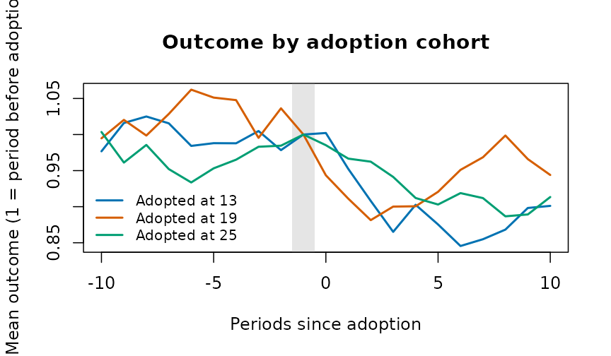
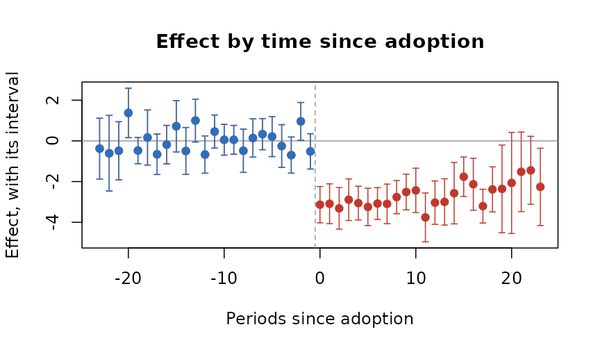
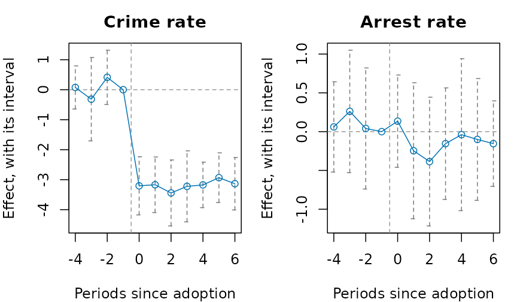
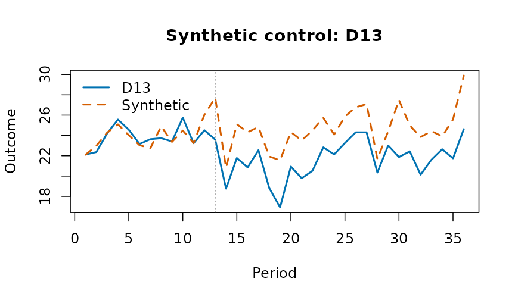
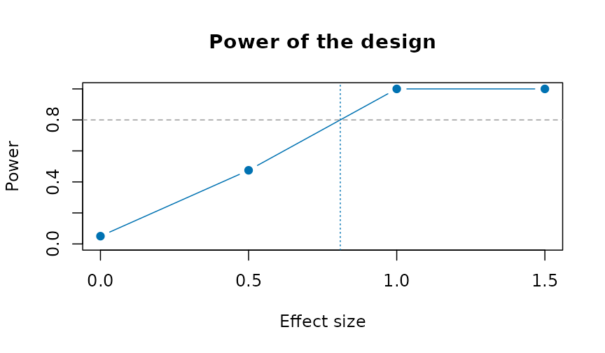
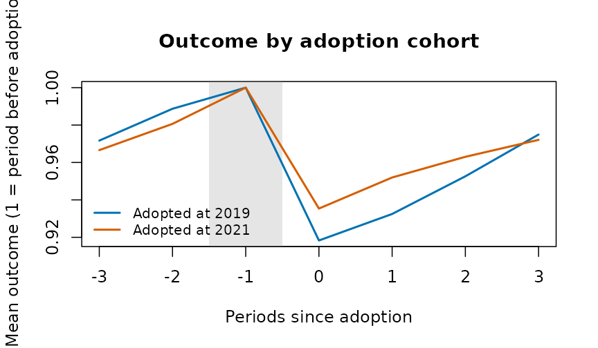
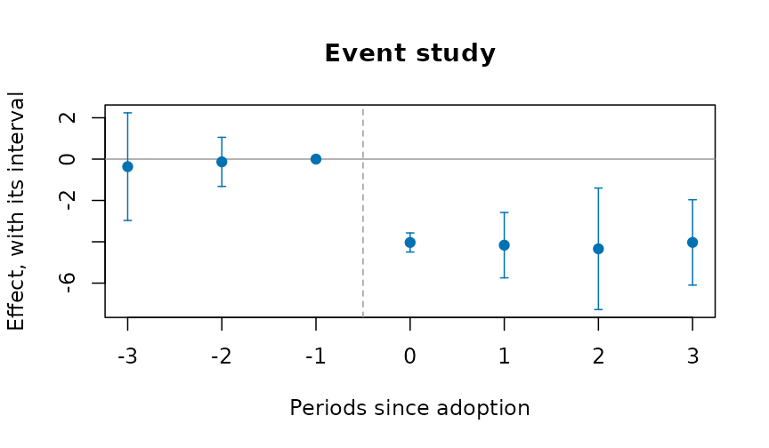

# Evaluating a policy from administrative panels

A reform reaches some places before others: a new criminal procedure
rolled out district by district, a policing program adopted city by
city, a ward boundary redrawn. Agencies publish the outcomes as counts
or rates by place and period. This vignette covers the designs that turn
such a table into an estimate of the reform’s effect, with honest
uncertainty. Each estimator gives the same answer as the reference
implementation (`fixest`, `did`, `bacondecomp`) to rounding error, and
none of them needs a package outside base R.

The examples use
[`polex()`](https://rootcoder007.github.io/rmorie-bricklayer/reference/polex.md):
twenty districts in four regions over 36 months, with a reform that
reaches the regions in three stages (months 13, 19 and 25) and never
reaches the fourth. The numbers are made up, with a known effect: the
reform lowers the crime rate by 3.

``` r

p <- polex()
head(p)
#>   district region month refmonth reformed population   logpop crimes crmrate
#> 1      D01     R1     1       13        0     152152 11.93264     80  39.732
#> 2      D01     R1     2       13        0     152152 11.93264     56  42.708
#> 3      D01     R1     3       13        0     152152 11.93264     68  41.228
#> 4      D01     R1     4       13        0     152152 11.93264     68  43.296
#> 5      D01     R1     5       13        0     152152 11.93264     62  42.036
#> 6      D01     R1     6       13        0     152152 11.93264     59  40.197
#>   arrrate
#> 1  15.394
#> 2  16.387
#> 3  16.043
#> 4  17.148
#> 5  15.443
#> 6  15.568
```

## Difference in differences

[`plndid()`](https://rootcoder007.github.io/rmorie-bricklayer/reference/plndid.md)
fits the two-way fixed-effects regression, with standard errors
clustered by unit (or any coarser grouping), and reports the effect
relative to the comparison units’ mean before the reform:

``` r

plndid(p, "district", "month", "crmrate", "reformed")
#> ╭── Difference in differences ────────────────────────────────────────────────╮
#> │   Method           fixed-effects least squares, cluster-robust (CR1) errors │
#> │   Observations     720                                                      │
#> │   Clusters         20                                                       │
#> │   Confidence       95%                                                      │
#> │   Comparison mean  26.52                                                    │
#> │   Relative effect  -12.2% of the comparison mean                            │
#> │                                                                             │
#> │   Estimates                                                                 │
#> │   term     estimate      se  95% CI                 t  p_value              │
#> │   -------  --------  ------  ----------------  ------  -------              │
#> │   treated    -3.232  0.1164  [-3.475, -2.988]  -27.76  < 0.001              │
#> │                                                                             │
#> │   The policy's effect on the outcome is -3.232 (95% interval [-3.475,       │
#> │   -2.988]): the interval excludes 0, so the data distinguish it from no     │
#> │   effect.                                                                   │
#> │                                                                             │
#> │   The comparison mean is the pre-period mean outcome of the units not       │
#> │   (yet) treated.                                                            │
#> ╰─────────────────────────────────────────────────────────────────────────────╯
```

## Before any model

[`cohtrnd()`](https://rootcoder007.github.io/rmorie-bricklayer/reference/cohtrnd.md)
shows each adoption cohort’s outcome around its adoption, scaled to 1
just before it:

``` r

plot(cohtrnd(p, "district", "month", "crmrate", "refmonth", win = c(-10, 10)))
```



## Leads and lags

[`evstudy()`](https://rootcoder007.github.io/rmorie-bricklayer/reference/evstudy.md)
estimates the effect period by period around adoption. The leads
(periods before adoption) should be near zero; the joint test of that is
printed below the table:

``` r

es <- evstudy(
  p,
  "district",
  "month",
  "crmrate",
  "refmonth",
  leads = 4,
  lags = 6
)
es
#> ╭── Event study ──────────────────────────────────────────────────────────────╮
#> │   Method              fixed-effects regression on the periods since         │
#> │                       adoption                                              │
#> │   Observations        720                                                   │
#> │   Clusters            20                                                    │
#> │   Periods             -4 to 6 since adoption                                │
#> │   Reference period    -1                                                    │
#> │   Confidence          95%                                                   │
#> │   Leads jointly zero  F(3, 19) = 1.263, p = 0.315                           │
#> │                                                                             │
#> │   evtm  estimate      se  95% CI                 t  p_value                 │
#> │   ----  --------  ------  ----------------  ------  -------                 │
#> │     -4     0.075  0.3433  [-0.643, 0.794]    0.220    0.828                 │
#> │     -3    -0.317  0.6646  [-1.708, 1.074]   -0.476    0.639                 │
#> │     -2     0.412  0.4327  [-0.493, 1.318]    0.953    0.352                 │
#> │     -1     0.000  0.0000  [0.000, 0.000]                                    │
#> │      0    -3.205  0.4630  [-4.174, -2.235]  -6.921  < 0.001                 │
#> │      1    -3.169  0.4427  [-4.095, -2.242]  -7.158  < 0.001                 │
#> │      2    -3.443  0.5254  [-4.542, -2.343]  -6.552  < 0.001                 │
#> │      3    -3.223  0.5659  [-4.407, -2.038]  -5.695  < 0.001                 │
#> │      4    -3.174  0.3626  [-3.933, -2.415]  -8.754  < 0.001                 │
#> │      5    -2.933  0.3955  [-3.760, -2.105]  -7.416  < 0.001                 │
#> │      6    -3.134  0.4182  [-4.010, -2.259]  -7.494  < 0.001                 │
#> │                                                                             │
#> │   Each row is the effect that many periods from adoption, measured          │
#> │   against the reference period. The leads are jointly consistent with       │
#> │   zero, the testable part of parallel trends.                               │
#> ╰─────────────────────────────────────────────────────────────────────────────╯
plot(es)
```


## Staggered adoption

When districts adopt at different times, the two-way estimate uses
districts already treated as controls for later ones.
[`bacondcmp()`](https://rootcoder007.github.io/rmorie-bricklayer/reference/bacondcmp.md)
shows how much weight those comparisons get:

``` r

b <- bacondcmp(p, "district", "month", "crmrate", "reformed")
tapply(b$weight, b$type, sum)
#> earlier vs later later vs earlier treated vs never 
#>        0.2093023        0.2093023        0.5813953
plot(b)
```


[`stgatt()`](https://rootcoder007.github.io/rmorie-bricklayer/reference/stgatt.md)
avoids them: each cohort is compared only with districts not yet treated
(Callaway and Sant’Anna), or the regression has a coefficient for every
cohort and period (Wooldridge). The bootstrap resamples whole districts:

``` r

s <- stgatt(p, "district", "month", "crmrate", "refmonth", reps = 99, seed = 1)
s$overall
#>    estimate        se     lower     upper
#> 1 -2.825844 0.3400471 -3.492324 -2.159364
plot(s)
```



For a treatment that can switch off as well as on,
[`swtdid()`](https://rootcoder007.github.io/rmorie-bricklayer/reference/swtdid.md)
compares the units that switch with those that do not, in the period
they switch, with a placebo one period earlier:

``` r

swtdid(p, "district", "month", "crmrate", "reformed", reps = 99, seed = 1)
#> ╭── Difference in differences, switching treatment ──────────────────────╮
#> │   Method     de Chaisemartin and D'Haultfoeuille, switchers vs stayers │
#> │   Switchers  15                                                        │
#> │                                                                        │
#> │   term     estimate      se  interval          switchers               │
#> │   -------  --------  ------  ----------------  ---------               │
#> │   effect     -3.135  0.4556  [-4.028, -2.243]         15               │
#> │   placebo    -0.517  0.4430  [-1.385, 0.351]          15               │
#> │                                                                        │
#> │   At the moment units switch, the effect is -3.135 (its interval       │
#> │   [-4.028, -2.243]): the interval excludes 0, so the data distinguish  │
#> │   it from no effect. The placebo, the same comparison one period       │
#> │   earlier, is -0.5169; near zero supports the design.                  │
#> │                                                                        │
#> │   Intervals are normal, from the cluster-bootstrap standard error.     │
#> ╰────────────────────────────────────────────────────────────────────────╯
```

## Inference from the assignment

With four regions there are only 24 ways to assign the three stages and
the never-treated region.
[`perminf()`](https://rootcoder007.github.io/rmorie-bricklayer/reference/perminf.md)
tries every one, and gives the share at least as extreme as the real
assignment. With two outcomes it also gives Westfall and Young’s
stepdown p-values, which hold the chance of any false positive at the
nominal level:

``` r

r <- perminf(p, "district", "month", c("crmrate", "arrrate"), "refmonth",
                           cl = "region")
r
#> ╭── Permutation inference ───────────────────────────────────────────────╮
#> │   Method       randomisation inference on the adoption dates           │
#> │   Assignments  24                                                      │
#> │   Draws        every assignment (exact)                                │
#> │   Outcomes     2                                                       │
#> │                                                                        │
#> │   outcome  estimate  statistic  p_value  stepdown_p                    │
#> │   -------  --------  ---------  -------  ----------                    │
#> │   crmrate    -3.232     -19.52    0.042       0.042                    │
#> │   arrrate    -0.214      -3.64    0.125       0.125                    │
#> │                                                                        │
#> │   The p-value is the share of reassigned adoption dates that give a    │
#> │   statistic at least as extreme as the one observed; it needs no model │
#> │   of the errors. The stepdown p-values (Westfall and Young) hold for   │
#> │   all the outcomes tested together.                                    │
#> ╰────────────────────────────────────────────────────────────────────────╯
plot(r, type = "histogram")
```


[`loounit()`](https://rootcoder007.github.io/rmorie-bricklayer/reference/loounit.md)
checks that no single district drives the estimate:

``` r

plot(loounit(p, "district", "month", "crmrate", "reformed"))
```


Several outcomes at once, in the style of a Stata event-study figure:

``` r

plotevgrid(
  list(
    "Crime rate" = es,
    "Arrest rate" = evstudy(
      p,
      "district",
      "month",
      "arrrate",
      "refmonth",
      leads = 4,
      lags = 6
    )
  ),
  style = "stata"
)
```



## Counts

For counts,
[`plnpois()`](https://rootcoder007.github.io/rmorie-bricklayer/reference/plnpois.md)
gives the effect as a rate ratio, with the population as exposure:

``` r

plnpois(p, "district", "month", "crimes", "reformed", offset = "logpop")
#> ╭── Fixed-effects count model ────────────────────────────────────────────╮
#> │   Model          Poisson                                                │
#> │   Fixed effects  unit and period                                        │
#> │   Observations   720                                                    │
#> │   Clusters       20                                                     │
#> │                                                                         │
#> │   term     estimate       se  rate_ratio  interval          p_value     │
#> │   -------  --------  -------  ----------  ----------------  -------     │
#> │   treated  -0.09215  0.02221      0.9120  [0.8731, 0.9525]  < 0.001     │
#> │                                                                         │
#> │   Under the policy the expected count is multiplied by 0.912 (its       │
#> │   interval [0.8731, 0.9525]): the interval excludes 1, so the data      │
#> │   distinguish it from no effect. A ratio of 0.912 is a 8.8% fall.       │
#> │                                                                         │
#> │   The estimate is on the log scale; the interval is for the rate ratio. │
#> ╰─────────────────────────────────────────────────────────────────────────╯
```

## One treated place

[`synctl()`](https://rootcoder007.github.io/rmorie-bricklayer/reference/synctl.md)
builds a weighted average of untreated places that tracks the treated
one before the reform, and runs the same method on each untreated place
as a placebo:

``` r

p13 <- p[is.na(p$refmonth) | p$district == "D13", ]
sc <- synctl(p13, "district", "month", "crmrate", "D13", adopt = 13)
sc
#> ╭── Synthetic control ────────────────────────────────────────────────────╮
#> │   Treated unit          D13                                             │
#> │   Adoption              13                                              │
#> │   Donors                5                                               │
#> │   Donors with weight    4                                               │
#> │   Pre-period RMSPE      0.7638                                          │
#> │   Mean gap after        -3.107                                          │
#> │   Post/pre RMSPE ratio  4.327                                           │
#> │   Placebo-in-space p    0.167                                           │
#> │   Placebos              5                                               │
#> │                                                                         │
#> │   Donor weights                                                         │
#> │   donor  weight                                                         │
#> │   -----  ------                                                         │
#> │   D12    0.4082                                                         │
#> │   D04    0.3761                                                         │
#> │   D20    0.1846                                                         │
#> │   D16    0.0311                                                         │
#> │                                                                         │
#> │   The synthetic D13 is the weighted mix of donors that best tracks it   │
#> │   before adoption. After adoption the treated unit is on average -3.107 │
#> │   away from it. Ranked against every donor run as a placebo, its        │
#> │   post/pre ratio gives p = 0.167.                                       │
#> ╰─────────────────────────────────────────────────────────────────────────╯
plot(sc)
```



## Measures for justice data

Three measures prepare the outcomes these designs take:

- [`sevidx()`](https://rootcoder007.github.io/rmorie-bricklayer/reference/sevidx.md)
  combines offence rates, weighted by each offence’s severity (for
  example its mean statutory sentence);
- [`piperate()`](https://rootcoder007.github.io/rmorie-bricklayer/reference/piperate.md)
  gives the rate at which one stage of the justice process follows
  another, with the input’s window set before the outcome’s, because
  cases take time;
- [`cmlrisk()`](https://rootcoder007.github.io/rmorie-bricklayer/reference/cmlrisk.md)
  gives the chance of a first arrest (or conviction, or placement) by
  each age, from first events and the population.

For place-based designs,
[`bufasgn()`](https://rootcoder007.github.io/rmorie-bricklayer/reference/bufasgn.md)
marks places near a site as treated, places near a comparison point and
far from every site as the comparison, and excludes the rest.

``` r

d <- data.frame(
  city = rep(c("A", "B"), each = 3),
  year = 2024,
  offence = rep(c("homicide", "robbery", "burglary"), 2),
  n = c(5, 120, 300, 2, 90, 410),
  pop = rep(c(250000, 180000), each = 3),
  stringsAsFactors = FALSE
)
sevidx(
  d,
  "city",
  "year",
  "offence",
  "n",
  w = c(homicide = 25, robbery = 8, burglary = 4),
  pop = "pop"
)
#> ╭── Severity-weighted index ──────────────────────────────────────────────╮
#> │   Rows               2                                                  │
#> │   Units              2                                                  │
#> │   Periods            1                                                  │
#> │   Offences weighted  3                                                  │
#> │                                                                         │
#> │   Index                                                                 │
#> │   unit   time  unweighted  weighted                                     │
#> │   ----  -----  ----------  --------                                     │
#> │   A     2,024       170.0       914                                     │
#> │   B     2,024       278.9     1,339                                     │
#> │                                                                         │
#> │   Weights                                                               │
#> │   offence   weight                                                      │
#> │   --------  ------                                                      │
#> │   homicide      25                                                      │
#> │   robbery        8                                                      │
#> │   burglary       4                                                      │
#> │                                                                         │
#> │   The weighted index adds each offence's count (or rate) times its      │
#> │   severity weight; beside the unweighted total it shows whether the mix │
#> │   of offences moved, not only their number.                             │
#> ╰─────────────────────────────────────────────────────────────────────────╯
cmlrisk(16:20, c(900, 1400, 1700, 1600, 1400), rep(1e5, 5))
#> ╭── Cumulative risk of a first event ───────────────────────────────────╮
#> │   Ages                  16 to 20                                      │
#> │   Risk by the last age  7% [6.84, 7.16]                               │
#> │                                                                       │
#> │   age   hazard   atrisk  cumrisk  interval                            │
#> │   ---  -------  -------  -------  ------------------                  │
#> │    16  0.00900  100,000  0.00900  [0.00841, 0.00959]                  │
#> │    17  0.01413   99,100  0.02300  [0.02207, 0.02393]                  │
#> │    18  0.01740   97,700  0.04000  [0.03878, 0.04121]                  │
#> │    19  0.01667   96,000  0.05600  [0.05457, 0.05742]                  │
#> │    20  0.01483   94,400  0.07000  [0.06842, 0.07158]                  │
#> │                                                                       │
#> │   By age 20 an estimated 7% of the population have had a first event, │
#> │   from the age-specific first-event hazards of a life table.          │
#> ╰───────────────────────────────────────────────────────────────────────╯
```

## Doing better than the original designs

Published applications of these designs often share a few weaknesses,
and each has a remedy here.

**Few clusters.** A reform assigned to a handful of districts gives
cluster-robust tests that reject too often.
[`wcb()`](https://rootcoder007.github.io/rmorie-bricklayer/reference/wcb.md)
gives an honest p-value and interval; with four clusters it says plainly
that nothing can be rejected at 5%:

``` r

wcb(p, "district", "month", "crmrate", "reformed", cl = "region")
#> ╭── Wild cluster bootstrap ─────────────────────────────────────────────╮
#> │   Method    wild cluster bootstrap-t, null imposed                    │
#> │   Clusters  4                                                         │
#> │   Draws     16                                                        │
#> │   Weights   every sign pattern (exact)                                │
#> │                                                                       │
#> │   estimate  interval          t  p_value                              │
#> │   --------  -----------  ------  -------                              │
#> │     -3.232  [-Inf, Inf]  -19.52    0.125                              │
#> │                                                                       │
#> │   The treatment's effect is -3.232 (its interval [-Inf, Inf]): the    │
#> │   interval includes 0, so the data cannot rule out no effect.         │
#> │                                                                       │
#> │   With so few clusters no value can be rejected at this level, so the │
#> │   interval is the whole line.                                         │
#> ╰───────────────────────────────────────────────────────────────────────╯
```

**Doubts about parallel trends.**
[`tse()`](https://rootcoder007.github.io/rmorie-bricklayer/reference/tse.md)
asks how large a departure from parallel trends, relative to the largest
seen before adoption, would make the effect vanish:

``` r

tse(es, seed = 1)
#> ╭── Sensitivity to parallel trends ──────────────────────────────────────╮
#> │   Method                 relative magnitudes (Rambachan and Roth)      │
#> │   Target                 average post-period effect                    │
#> │   Breakdown              Mbar = 0.4678                                 │
#> │   Robust interval level  95%                                           │
#> │                                                                        │
#> │    mbar  identified_set    robust_interval                             │
#> │   -----  ----------------  ----------------                            │
#> │   0.000  [-3.183, -3.183]  [-3.938, -2.411]                            │
#> │   0.500  [-4.641, -1.725]  [-6.987, 0.190]                             │
#> │   1.000  [-6.099, -0.267]  [-10.199, 3.353]                            │
#> │   1.500  [-7.557, 1.192]   [-13.461, 6.621]                            │
#> │   2.000  [-9.015, 2.650]   [-16.729, 9.828]                            │
#> │                                                                        │
#> │   The negative effect stays clear of zero while the trend after        │
#> │   adoption departs from parallel by up to 0.468 times the largest      │
#> │   departure before it. A departure as large as the pre-period's (Mbar  │
#> │   1) is enough to lose it: the conclusion leans on parallel trends.    │
#> │                                                                        │
#> │   Mbar bounds how far the trend after adoption may depart from         │
#> │   parallel, as a multiple of the largest departure seen before it; the │
#> │   effect is distinguishable from zero until the robust interval first  │
#> │   includes 0, at the breakdown value.                                  │
#> ╰────────────────────────────────────────────────────────────────────────╯
```

**Covariates that differ between groups.**
[`stgatt()`](https://rootcoder007.github.io/rmorie-bricklayer/reference/stgatt.md)
with `covs` is doubly robust (use covariates fixed before treatment: one
the reform moves, such as arrests, is a bad control).
[`plndml()`](https://rootcoder007.github.io/rmorie-bricklayer/reference/plndml.md)
lets a machine learner fit the confounding with fixed effects, and
[`mtchdid()`](https://rootcoder007.github.io/rmorie-bricklayer/reference/mtchdid.md)
matches units on their pre-reform paths before differencing:

``` r

set.seed(4)
p$x1 <- rnorm(20)[match(p$district, unique(p$district))]
stgatt(p, "district", "month", "crmrate", "refmonth", covs = "x1", reps = 49,
              seed = 1)$overall
#>    estimate       se   lower    upper
#> 1 -2.459345 0.691214 -3.8141 -1.10459
m <- mtchdid(p, "district", "month", "crmrate", "refmonth", ratio = 2)
m$estimate
#> ╭── Difference in differences ────────────────────────────────────────────────╮
#> │   Method           fixed-effects least squares, cluster-robust (CR1) errors │
#> │   Observations     720                                                      │
#> │   Clusters         20                                                       │
#> │   Confidence       95%                                                      │
#> │   Comparison mean  26.3                                                     │
#> │   Relative effect  -11.7% of the comparison mean                            │
#> │                                                                             │
#> │   Estimates                                                                 │
#> │   term     estimate      se  95% CI                 t  p_value              │
#> │   -------  --------  ------  ----------------  ------  -------              │
#> │   treated    -3.081  0.1208  [-3.334, -2.829]  -25.51  < 0.001              │
#> │                                                                             │
#> │   The policy's effect on the outcome is -3.081 (95% interval [-3.334,       │
#> │   -2.829]): the interval excludes 0, so the data distinguish it from no     │
#> │   effect.                                                                   │
#> │                                                                             │
#> │   The comparison mean is the pre-period mean outcome of the units not       │
#> │   (yet) treated.                                                            │
#> ╰─────────────────────────────────────────────────────────────────────────────╯
```

**A single treated place, or a few.**
[`syndid()`](https://rootcoder007.github.io/rmorie-bricklayer/reference/syndid.md)
weights both comparison units and pre-periods:

``` r

sd <- syndid(
  p13,
  "district",
  "month",
  "crmrate",
  "refmonth",
  reps = 50,
  seed = 1
)
sd
#> ╭── Synthetic difference in differences ─────────────────────────────────╮
#> │   Estimate              -2.886                                         │
#> │   Standard error        0.5931 (placebo)                               │
#> │   Interval              [-4.048, -1.723]                               │
#> │   Adoption              13                                             │
#> │   Comparison units      5                                              │
#> │   With weight           5                                              │
#> │   Pre-periods weighted  12                                             │
#> │                                                                        │
#> │   Unit weights                                                         │
#> │   unit  weight                                                         │
#> │   ----  ------                                                         │
#> │   D12   0.2072                                                         │
#> │   D20   0.2027                                                         │
#> │   D04   0.2007                                                         │
#> │   D16   0.1948                                                         │
#> │   D08   0.1945                                                         │
#> │                                                                        │
#> │   Weighting the comparison units and the pre-periods to match the      │
#> │   treated units, the effect is -2.886 (its interval [-4.048, -1.723]): │
#> │   the interval excludes 0, so the data distinguish it from no effect.  │
#> ╰────────────────────────────────────────────────────────────────────────╯
plot(sd)
```


**Null results without a measure of power.**
[`plnpwr()`](https://rootcoder007.github.io/rmorie-bricklayer/reference/plnpwr.md)
simulates the design on the untreated data and gives the minimum
detectable effect:

``` r

pw <- plnpwr(p[p$month <= 12, ], "district", "month", "crmrate", ntrt = 10,
                  adopt = 7:10, eff = c(0, 0.5, 1, 1.5), reps = 40, seed = 1)
pw
#> ╭── Power of the design ──────────────────────────────────────────────────╮
#> │   Method                     placebo adoptions on the panel itself      │
#> │   Alpha                      0.05                                       │
#> │   Size (no effect)           0.05                                       │
#> │   Minimum detectable effect  0.8095                                     │
#> │                                                                         │
#> │   effect  power                                                         │
#> │   ------  -----                                                         │
#> │     0.00  0.050                                                         │
#> │     0.50  0.475                                                         │
#> │     1.00  1.000                                                         │
#> │     1.50  1.000                                                         │
#> │                                                                         │
#> │   Power is the share of simulated adoptions, with the effect added, in  │
#> │   which the test rejects no effect; the size, at an effect of 0, should │
#> │   be close to alpha.                                                    │
#> ╰─────────────────────────────────────────────────────────────────────────╯
plot(pw)
```



## Your own panel, step by step

Every estimator takes a data frame with one row per unit and period and
the names of its columns, so your own data need only that layout. Here
eight towns over ten years, four of them adopting a by-law (two in 2019,
two in 2021), typed in:

``` r

own <- data.frame(
  town = rep(c("A", "B", "C", "D", "E", "F", "G", "H"), each = 10),
  year = rep(2015:2024, times = 8),
  stringsAsFactors = FALSE
)
i <- match(own$town, unique(own$town))
own$first <- c(2019, 2019, 2021, 2021, NA, NA, NA, NA)[i]
own$bylaw <- as.integer(!is.na(own$first) & own$year >= own$first)
own$pop <- c(12, 30, 8, 22, 15, 40, 9, 18)[i] * 1000
own$county <- rep(c("North", "South"), 4)[i]
own$income <- 50 + own$year - 2015 + cos(seq_len(80))
own$rate <- 30 + i + 0.5 * (own$year - 2015) - 4 * own$bylaw +
  0.2 * own$income + sin(seq_len(80))
head(own)
#>   town year first bylaw   pop county   income     rate
#> 1    A 2015  2019     0 12000  North 50.54030 41.94953
#> 2    A 2016  2019     0 12000  North 50.58385 42.52607
#> 3    A 2017  2019     0 12000  North 51.01001 42.34312
#> 4    A 2018  2019     0 12000  North 52.34636 42.21247
#> 5    A 2019  2019     1 12000  North 54.28366 38.89781
#> 6    A 2020  2019     1 12000  North 55.96017 40.41262
```

The arguments name the columns:

- `unit` and `time`: the unit (`"town"`) and the period, a number
  (`"year"`; a month index or a date turned into a number works the
  same);
- `y`: the outcome (`"rate"`);
- the treatment, in one of two forms: `trtd`, a 0/1 column that is 1 in
  the periods a unit is treated (`"bylaw"`, for
  [`plndid()`](https://rootcoder007.github.io/rmorie-bricklayer/reference/plndid.md),
  [`wcb()`](https://rootcoder007.github.io/rmorie-bricklayer/reference/wcb.md),
  [`bacondcmp()`](https://rootcoder007.github.io/rmorie-bricklayer/reference/bacondcmp.md),
  [`swtdid()`](https://rootcoder007.github.io/rmorie-bricklayer/reference/swtdid.md),
  [`loounit()`](https://rootcoder007.github.io/rmorie-bricklayer/reference/loounit.md)),
  or `ftreat`, the period a unit is first treated, `NA` for a unit never
  treated (`"first"`, for
  [`evstudy()`](https://rootcoder007.github.io/rmorie-bricklayer/reference/evstudy.md),
  [`stgatt()`](https://rootcoder007.github.io/rmorie-bricklayer/reference/stgatt.md),
  [`perminf()`](https://rootcoder007.github.io/rmorie-bricklayer/reference/perminf.md),
  [`mtchdid()`](https://rootcoder007.github.io/rmorie-bricklayer/reference/mtchdid.md),
  [`syndid()`](https://rootcoder007.github.io/rmorie-bricklayer/reference/syndid.md),
  [`cohtrnd()`](https://rootcoder007.github.io/rmorie-bricklayer/reference/cohtrnd.md));
- `covs`: covariate columns (`"income"`);
- `cl`: the cluster column for the standard errors (default the unit;
  `"county"` if the by-law was assigned by county);
- `w`: a weight column (`"pop"`), and `conflvl` the confidence level.

**1. Look first.** Each cohort’s outcome around its adoption:

``` r

plot(cohtrnd(own, "town", "year", "rate", "first", win = c(-3, 3), ma = 1))
```



**2. The effect.** The two-way fixed-effects estimate, with income as a
control, weighted by population, at a 90% level:

``` r

plndid(own, "town", "year", "rate", "bylaw", covs = "income", w = "pop",
       conflvl = 0.9)
#> ╭── Difference in differences ────────────────────────────────────────────────╮
#> │   Method           fixed-effects least squares, cluster-robust (CR1) errors │
#> │   Observations     80                                                       │
#> │   Clusters         8                                                        │
#> │   Confidence       90%                                                      │
#> │   Comparison mean  47.43                                                    │
#> │   Relative effect  -8.3% of the comparison mean                             │
#> │                                                                             │
#> │   Estimates                                                                 │
#> │   term     estimate      se  90% CI                 t  p_value              │
#> │   -------  --------  ------  ----------------  ------  -------              │
#> │   treated    -3.914  0.1702  [-4.236, -3.591]  -22.99  < 0.001              │
#> │   income      0.227  0.0367  [0.157, 0.296]      6.17  < 0.001              │
#> │                                                                             │
#> │   The policy's effect on the outcome is -3.914 (90% interval [-4.236,       │
#> │   -3.591]): the interval excludes 0, so the data distinguish it from no     │
#> │   effect.                                                                   │
#> │                                                                             │
#> │   The comparison mean is the pre-period mean outcome of the units not       │
#> │   (yet) treated.                                                            │
#> ╰─────────────────────────────────────────────────────────────────────────────╯
```

**3. Period by period.** The event study, and its sensitivity to
parallel trends:

``` r

es <- evstudy(own, "town", "year", "rate", "first", leads = 3, lags = 3,
              covs = "income", w = "pop")
plot(es)
```



``` r

tse(es, seed = 1)
#> ╭── Sensitivity to parallel trends ──────────────────────────────────────╮
#> │   Method                 relative magnitudes (Rambachan and Roth)      │
#> │   Target                 average post-period effect                    │
#> │   Breakdown              Mbar = 0.9828                                 │
#> │   Robust interval level  95%                                           │
#> │                                                                        │
#> │    mbar  identified_set    robust_interval                             │
#> │   -----  ----------------  ----------------                            │
#> │   0.000  [-4.142, -4.142]  [-5.592, -2.677]                            │
#> │   0.500  [-4.431, -3.852]  [-7.555, -1.323]                            │
#> │   1.000  [-4.721, -3.563]  [-9.540, 0.051]                             │
#> │   1.500  [-5.010, -3.273]  [-11.505, 1.636]                            │
#> │   2.000  [-5.300, -2.984]  [-13.486, 3.452]                            │
#> │                                                                        │
#> │   The negative effect stays clear of zero while the trend after        │
#> │   adoption departs from parallel by up to 0.983 times the largest      │
#> │   departure before it. A departure as large as the pre-period's (Mbar  │
#> │   1) is enough to lose it: the conclusion leans on parallel trends.    │
#> │                                                                        │
#> │   Mbar bounds how far the trend after adoption may depart from         │
#> │   parallel, as a multiple of the largest departure seen before it; the │
#> │   effect is distinguishable from zero until the robust interval first  │
#> │   includes 0, at the breakdown value.                                  │
#> ╰────────────────────────────────────────────────────────────────────────╯
```

**4. Staggered adoption.** Each cohort against the towns not yet
treated:

``` r

stgatt(own, "town", "year", "rate", "first", reps = 49, seed = 1)$overall
#>   estimate        se     lower     upper
#> 1 -3.89384 0.8365213 -5.533391 -2.254288
```

**5. Honest inference with few clusters.** With eight towns, the wild
cluster bootstrap and the permutation test:

``` r

wcb(own, "town", "year", "rate", "bylaw", covs = "income")
#> ╭── Wild cluster bootstrap ───────────────────────────────────────────────╮
#> │   Method    wild cluster bootstrap-t, null imposed                      │
#> │   Clusters  8                                                           │
#> │   Draws     256                                                         │
#> │   Weights   every sign pattern (exact)                                  │
#> │                                                                         │
#> │   estimate  interval               t  p_value                           │
#> │   --------  ----------------  ------  -------                           │
#> │     -4.022  [-4.482, -3.521]  -18.70    0.008                           │
#> │                                                                         │
#> │   The treatment's effect is -4.022 (its interval [-4.482, -3.521]): the │
#> │   interval excludes 0, so the data distinguish it from no effect.       │
#> ╰─────────────────────────────────────────────────────────────────────────╯
perminf(own, "town", "year", "rate", "first", reps = 99, seed = 1)
#> ╭── Permutation inference ───────────────────────────────────────────────╮
#> │   Method       randomisation inference on the adoption dates           │
#> │   Assignments  99                                                      │
#> │   Draws        random draws                                            │
#> │   Outcomes     1                                                       │
#> │                                                                        │
#> │   outcome  estimate  statistic  p_value  stepdown_p                    │
#> │   -------  --------  ---------  -------  ----------                    │
#> │   rate       -4.039     -16.86    0.010       0.010                    │
#> │                                                                        │
#> │   The p-value is the share of reassigned adoption dates that give a    │
#> │   statistic at least as extreme as the one observed; it needs no model │
#> │   of the errors.                                                       │
#> ╰────────────────────────────────────────────────────────────────────────╯
```

## Indigenous examples

The methods here need a panel: units observed over time, some treated at
a known date. The bundled Indigenous tables are repeated cross-sections
of published estimates, so the before-and-after comparison they support
is the change in a gap, with its interval:

``` r

hi <- indiex("health")
x <- hi[hi$age == "Total, 18 years and over" &
          hi$indicator == "Perceived mental health, very good or excellent", ]
gaps <- do.call(rbind, lapply(split(x, x$period), function(p) {
  cbind(period = p$period[1],
        indgap(p, "group", "estimate", "lower", "upper")[
          , c("group", "difference", "diflo", "difup")])
}))
rownames(gaps) <- NULL
gaps
#>      period         group difference     diflo      difup
#> 1 2015/2018 First Nations      -10.8 -13.23311  -8.366895
#> 2 2015/2018         Métis       -9.6 -12.03311  -7.166895
#> 3 2015/2018         Inuit      -21.5 -27.31378 -15.686223
#> 4 2019/2022 First Nations      -15.7 -18.53593 -12.864070
#> 5 2019/2022         Métis       -8.7 -11.58531  -5.814692
#> 6 2019/2022         Inuit      -13.7 -20.16568  -7.234321
```

Perceived mental health fell for every group between the two cycles;
whether the gaps moved is read from the intervals, not the point
estimates.

## Acknowledgements

These designs are those of the empirical work of Professor Angela Zorro
Medina (University of Toronto) on criminal-procedure reform, political
dynasties, police stops and the cumulative risk of criminal justice
outcomes. The estimators themselves are the standard ones of the
literature cited on each help page.

## References

- Abadie A, Diamond A, Hainmueller J (2010). Synthetic control methods
  for comparative case studies. *Journal of the American Statistical
  Association* 105(490):493-505.
- Acosta C, Mejia D, Zorro Medina A (2023). On the tension between due
  process protection and public safety: the case of an extensive
  procedural reform in Colombia. SSRN 10.2139/ssrn.4585682.
- Callaway B, Sant’Anna PHC (2021). Difference-in-differences with
  multiple time periods. *Journal of Econometrics* 225(2):200-230.
- de Chaisemartin C, D’Haultfoeuille X (2020). Two-way fixed effects
  estimators with heterogeneous treatment effects. *American Economic
  Review* 110(9):2964-2996.
- Goodman-Bacon A (2021). Difference-in-differences with variation in
  treatment timing. *Journal of Econometrics* 225(2):254-277.
- Hepburn P, Kohler-Hausmann I, Zorro Medina A (2019). Cumulative risks
  of multiple criminal justice outcomes in New York City. *Demography*
  56(3):1161-1171.
- Ternullo S, Zorro-Medina A, Vargas R (2024). How political dynasties
  concentrate advantage within cities. *Social Forces* 102(4):1310-1331.
- Westfall PH, Young SS (1993). *Resampling-Based Multiple Testing*.
  Wiley.
- Wooldridge JM (2021). Two-way fixed effects, the two-way Mundlak
  regression, and difference-in-differences estimators. SSRN
  10.2139/ssrn.3906345.
- Zorro Medina A, Hackett D, Green D, Vargas R (2025). Evidence of donor
  bias in Chicago police stops. arXiv:2504.15140.
