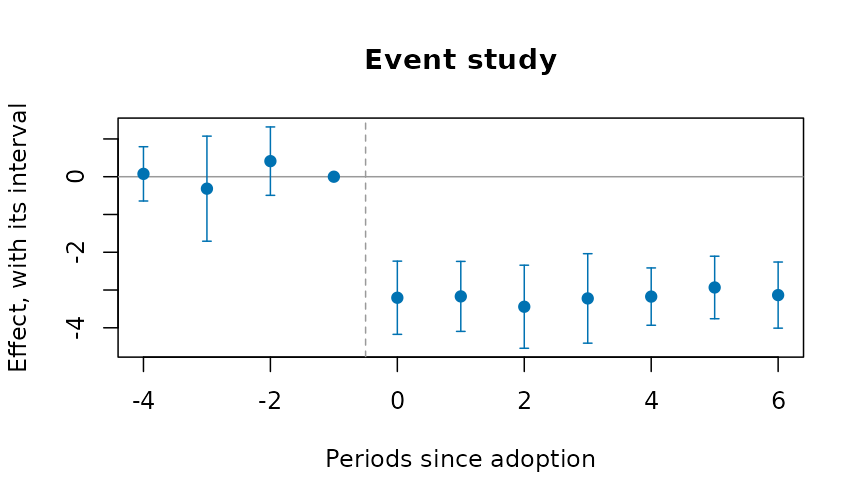
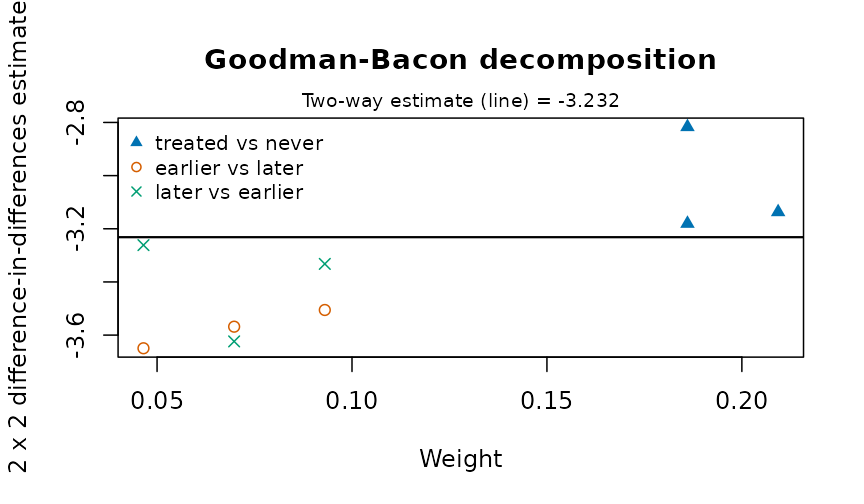
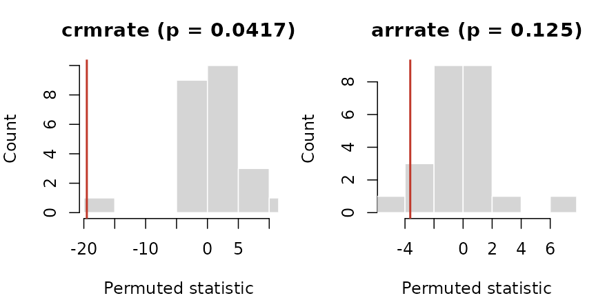
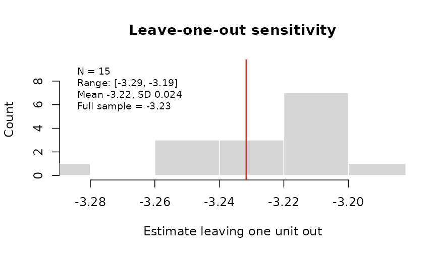

# Evaluating a policy from administrative panels

A reform reaches some places before others: a new criminal procedure
rolled out district by district, a policing program adopted city by
city, a ward boundary redrawn. Agencies publish the outcomes as counts
or rates by place and period. This vignette covers the designs that turn
such a table into an estimate of the reform’s effect, with honest
uncertainty. Each estimator gives the same answer as the reference
implementation (`fixest`, `did`, `bacondecomp`) to rounding error, and
none of them needs a package outside base R.

The examples use
[`polex()`](https://rootcoder007.github.io/rmorie-bricklayer/reference/polex.md):
twenty districts in four regions over 36 months, with a reform that
reaches the regions in three stages (months 13, 19 and 25) and never
reaches the fourth. The numbers are made up, with a known effect: the
reform lowers the crime rate by 3.

``` r

p <- polex()
head(p)
#>   district region month refmonth reformed population   logpop crimes crmrate
#> 1      D01     R1     1       13        0     152152 11.93264     80  39.732
#> 2      D01     R1     2       13        0     152152 11.93264     56  42.708
#> 3      D01     R1     3       13        0     152152 11.93264     68  41.228
#> 4      D01     R1     4       13        0     152152 11.93264     68  43.296
#> 5      D01     R1     5       13        0     152152 11.93264     62  42.036
#> 6      D01     R1     6       13        0     152152 11.93264     59  40.197
#>   arrrate
#> 1  15.394
#> 2  16.387
#> 3  16.043
#> 4  17.148
#> 5  15.443
#> 6  15.568
```

## Difference in differences

[`plndid()`](https://rootcoder007.github.io/rmorie-bricklayer/reference/plndid.md)
fits the two-way fixed-effects regression, with standard errors
clustered by unit (or any coarser grouping), and reports the effect
relative to the comparison units’ mean before the reform:

``` r

plndid(p, "district", "month", "crmrate", "reformed")
#> Difference in differences: 720 observations, 20 clusters
#>     term estimate     se  lower  upper      t  p_value
#>  treated   -3.232 0.1164 -3.475 -2.988 -27.76 7.66e-17
#> Effect relative to the comparison units' pre-period mean (26.52): -12.2%
```

## Before any model

[`cohtrnd()`](https://rootcoder007.github.io/rmorie-bricklayer/reference/cohtrnd.md)
shows each adoption cohort’s outcome around its adoption, scaled to 1
just before it:

``` r

plot(cohtrnd(p, "district", "month", "crmrate", "refmonth", win = c(-10, 10)))
```


## Leads and lags

[`evstudy()`](https://rootcoder007.github.io/rmorie-bricklayer/reference/evstudy.md)
estimates the effect period by period around adoption. The leads
(periods before adoption) should be near zero; the joint test of that is
printed below the table:

``` r

es <- evstudy(p, "district", "month", "crmrate", "refmonth", leads = 4, lags = 6)
es
#> Event study: 720 observations, 20 clusters
#>  evtm estimate     se   lower  upper       t   p_value
#>    -4  0.07546 0.3433 -0.6431  0.794  0.2198 8.284e-01
#>    -3 -0.31658 0.6646 -1.7076  1.074 -0.4763 6.393e-01
#>    -2  0.41249 0.4327 -0.4931  1.318  0.9534 3.524e-01
#>    -1  0.00000 0.0000  0.0000  0.000      NA        NA
#>     0 -3.20456 0.4630 -4.1737 -2.235 -6.9207 1.344e-06
#>     1 -3.16882 0.4427 -4.0954 -2.242 -7.1580 8.390e-07
#>     2 -3.44256 0.5254 -4.5422 -2.343 -6.5522 2.836e-06
#>     3 -3.22263 0.5659 -4.4070 -2.038 -5.6951 1.725e-05
#>     4 -3.17395 0.3626 -3.9328 -2.415 -8.7537 4.291e-08
#>     5 -2.93264 0.3955 -3.7603 -2.105 -7.4158 5.072e-07
#>     6 -3.13434 0.4182 -4.0097 -2.259 -7.4940 4.362e-07
#> Leads jointly zero: F(3, 19) = 1.263, p = 0.3152
plot(es)
```



## Staggered adoption

When districts adopt at different times, the two-way estimate uses
districts already treated as controls for later ones.
[`bacondcmp()`](https://rootcoder007.github.io/rmorie-bricklayer/reference/bacondcmp.md)
shows how much weight those comparisons get:

``` r

b <- bacondcmp(p, "district", "month", "crmrate", "reformed")
tapply(b$weight, b$type, sum)
#> earlier vs later later vs earlier treated vs never 
#>        0.2093023        0.2093023        0.5813953
plot(b)
```



[`stgatt()`](https://rootcoder007.github.io/rmorie-bricklayer/reference/stgatt.md)
avoids them: each cohort is compared only with districts not yet treated
(Callaway and Sant’Anna), or the regression has a coefficient for every
cohort and period (Wooldridge). The bootstrap resamples whole districts:

``` r

s <- stgatt(p, "district", "month", "crmrate", "refmonth", reps = 99, seed = 1)
s$overall
#>    estimate        se     lower     upper
#> 1 -2.825844 0.3400471 -3.492324 -2.159364
plot(s)
```


For a treatment that can switch off as well as on,
[`swtdid()`](https://rootcoder007.github.io/rmorie-bricklayer/reference/swtdid.md)
compares the units that switch with those that do not, in the period
they switch, with a placebo one period earlier:

``` r

swtdid(p, "district", "month", "crmrate", "reformed", reps = 99, seed = 1)
#>      term   estimate        se     lower      upper switchers
#> 1  effect -3.1355000 0.4555572 -4.028376 -2.2426243        15
#> 2 placebo -0.5169222 0.4429911 -1.385169  0.3513245        15
```

## Inference from the assignment

With four regions there are only 24 ways to assign the three stages and
the never-treated region.
[`perminf()`](https://rootcoder007.github.io/rmorie-bricklayer/reference/perminf.md)
tries every one, and gives the share at least as extreme as the real
assignment. With two outcomes it also gives Westfall and Young’s
stepdown p-values, which hold the chance of any false positive at the
nominal level:

``` r

r <- perminf(p, "district", "month", c("crmrate", "arrrate"), "refmonth",
                           cl = "region")
r
#>   outcome   estimate  statistic    p_value     pstpdn assignments exact
#> 1 crmrate -3.2316395 -19.516735 0.04166667 0.04166667          24  TRUE
#> 2 arrrate -0.2136969  -3.638159 0.12500000 0.12500000          24  TRUE
plot(r, type = "histogram")
```



[`loounit()`](https://rootcoder007.github.io/rmorie-bricklayer/reference/loounit.md)
checks that no single district drives the estimate:

``` r

plot(loounit(p, "district", "month", "crmrate", "reformed"))
```



Several outcomes at once, in the style of a Stata event-study figure:

``` r

plotevgrid(list(
  "Crime rate" = es,
  "Arrest rate" = evstudy(p, "district", "month", "arrrate", "refmonth", leads = 4,
                              lags = 6)), style = "stata")
```


## Counts

For counts,
[`plnpois()`](https://rootcoder007.github.io/rmorie-bricklayer/reference/plnpois.md)
gives the effect as a rate ratio, with the population as exposure:

``` r

plnpois(p, "district", "month", "crimes", "reformed", offset = "logpop")
#>      term  estimate         se rateratio     lower     upper      p_value
#> 1 treated -0.092146 0.02220761  0.911972 0.8731289 0.9525431 3.334947e-05
```

## One treated place

[`synctl()`](https://rootcoder007.github.io/rmorie-bricklayer/reference/synctl.md)
builds a weighted average of untreated places that tracks the treated
one before the reform, and runs the same method on each untreated place
as a placebo:

``` r

p13 <- p[is.na(p$refmonth) | p$district == "D13", ]
sc <- synctl(p13, "district", "month", "crmrate", "D13", adopt = 13)
sc
#> Synthetic control for D13, adoption at 13
#> Donor weights: D12 0.408, D04 0.376, D20 0.185, D16 0.031 
#> Pre-period RMSPE 0.7638; mean gap after adoption -3.107; post/pre RMSPE ratio 4.33
#> Placebo-in-space p = 0.167 (5 placebos)
plot(sc)
```


## Measures for justice data

Three measures prepare the outcomes these designs take:

- [`sevidx()`](https://rootcoder007.github.io/rmorie-bricklayer/reference/sevidx.md)
  combines offence rates, weighted by each offence’s severity (for
  example its mean statutory sentence);
- [`piperate()`](https://rootcoder007.github.io/rmorie-bricklayer/reference/piperate.md)
  gives the rate at which one stage of the justice process follows
  another, with the input’s window set before the outcome’s, because
  cases take time;
- [`cmlrisk()`](https://rootcoder007.github.io/rmorie-bricklayer/reference/cmlrisk.md)
  gives the chance of a first arrest (or conviction, or placement) by
  each age, from first events and the population.

For place-based designs,
[`bufasgn()`](https://rootcoder007.github.io/rmorie-bricklayer/reference/bufasgn.md)
marks places near a site as treated, places near a comparison point and
far from every site as the comparison, and excludes the rest.

``` r

d <- data.frame(city = rep(c("A", "B"), each = 3), year = 2024,
                offence = rep(c("homicide", "robbery", "burglary"), 2),
                n = c(5, 120, 300, 2, 90, 410), pop = rep(c(250000, 180000), each = 3))
sevidx(d, "city", "year", "offence", "n",
               w = c(homicide = 25, robbery = 8, burglary = 4), pop = "pop")
#>   unit time unweighted weighted
#> 1    A 2024   170.0000  914.000
#> 2    B 2024   278.8889 1338.889
cmlrisk(16:20, c(900, 1400, 1700, 1600, 1400), rep(1e5, 5))
#>   age     hazard atrisk cumrisk      lower       upper
#> 1  16 0.00900000 100000   0.009 0.00841449 0.009585164
#> 2  17 0.01412714  99100   0.023 0.02207046 0.023928652
#> 3  18 0.01740020  97700   0.040 0.03878469 0.041213777
#> 4  19 0.01666667  96000   0.056 0.05457388 0.057423968
#> 5  20 0.01483051  94400   0.070 0.06841727 0.071580045
```

## Doing better than the original designs

Published applications of these designs often share a few weaknesses,
and each has a remedy here.

**Few clusters.** A reform assigned to a handful of districts gives
cluster-robust tests that reject too often.
[`wcb()`](https://rootcoder007.github.io/rmorie-bricklayer/reference/wcb.md)
gives an honest p-value and interval; with four clusters it says plainly
that nothing can be rejected at 5%:

``` r

wcb(p, "district", "month", "crmrate", "reformed", cl = "region")
#>   estimate         t p_value lower upper clusters draws enumerated
#> 1 -3.23164 -19.51674   0.125  -Inf   Inf        4    16       TRUE
```

**Doubts about parallel trends.**
[`tse()`](https://rootcoder007.github.io/rmorie-bricklayer/reference/tse.md)
asks how large a departure from parallel trends, relative to the largest
seen before adoption, would make the effect vanish:

``` r

tse(es, seed = 1)
#> Sensitivity of the average post-period effect to departures from parallel trends (relative magnitudes)
#>  mbar lowerbnd upbound   lower   upper
#>   0.0   -3.183 -3.1828  -3.938 -2.4111
#>   0.5   -4.641 -1.7247  -6.987  0.1902
#>   1.0   -6.099 -0.2665 -10.199  3.3527
#>   1.5   -7.557  1.1916 -13.461  6.6212
#>   2.0   -9.015  2.6497 -16.729  9.8277
#> Breakdown: the interval first includes 0 at Mbar = 0.4677591
```

**Covariates that differ between groups.**
[`stgatt()`](https://rootcoder007.github.io/rmorie-bricklayer/reference/stgatt.md)
with `covariates` is doubly robust (use covariates fixed before
treatment: one the reform moves, such as arrests, is a bad control).
[`plndml()`](https://rootcoder007.github.io/rmorie-bricklayer/reference/plndml.md)
lets a machine learner fit the confounding with fixed effects, and
[`mtchdid()`](https://rootcoder007.github.io/rmorie-bricklayer/reference/mtchdid.md)
matches units on their pre-reform paths before differencing:

``` r

set.seed(4)
p$x1 <- rnorm(20)[match(p$district, unique(p$district))]
stgatt(p, "district", "month", "crmrate", "refmonth", covs = "x1", reps = 49,
              seed = 1)$overall
#>    estimate       se   lower    upper
#> 1 -2.459345 0.691214 -3.8141 -1.10459
m <- mtchdid(p, "district", "month", "crmrate", "refmonth", ratio = 2)
m$estimate
#> Difference in differences: 720 observations, 20 clusters
#>     term estimate     se  lower  upper      t   p_value
#>  treated   -3.081 0.1208 -3.334 -2.829 -25.51 3.672e-16
#> Effect relative to the comparison units' pre-period mean (26.3): -11.7%
```

**A single treated place, or a few.**
[`syndid()`](https://rootcoder007.github.io/rmorie-bricklayer/reference/syndid.md)
weights both comparison units and pre-periods:

``` r

sd <- syndid(p13, "district", "month", "crmrate", "refmonth", reps = 50, seed = 1)
sd
#> Synthetic difference in differences: -2.886 (placebo s.e. 0.5927; -4.047 to -1.724)
#> Unit weights: D12 0.207, D20 0.203, D04 0.201, D16 0.195, D08 0.195
plot(sd)
```


**Null results without a measure of power.**
[`plnpwr()`](https://rootcoder007.github.io/rmorie-bricklayer/reference/plnpwr.md)
simulates the design on the untreated data and gives the minimum
detectable effect:

``` r

pw <- plnpwr(p[p$month <= 12, ], "district", "month", "crmrate", ntrt = 10,
                  adopt = 7:10, eff = c(0, 0.5, 1, 1.5), reps = 40, seed = 1)
pw
#>  effect power
#>     0.0 0.050
#>     0.5 0.475
#>     1.0 1.000
#>     1.5 1.000
#> Size (rejections with no effect): 0.050 at alpha 0.050
#> Minimum detectable effect at this power: 0.8095
plot(pw)
```


## Indigenous examples

The methods here need a panel: units observed over time, some treated at
a known date. The bundled Indigenous tables are repeated cross-sections
of published estimates, so the before-and-after comparison they support
is the change in a gap, with its interval:

``` r

hi <- indiex("health")
x <- hi[hi$age == "Total, 18 years and over" &
          hi$indicator == "Perceived mental health, very good or excellent", ]
gaps <- do.call(rbind, lapply(split(x, x$period), function(p) {
  cbind(period = p$period[1],
        indgap(p, "group", "estimate", "lower", "upper")[
          , c("group", "difference", "diflo", "difup")])
}))
rownames(gaps) <- NULL
gaps
#>      period         group difference     diflo      difup
#> 1 2015/2018 First Nations      -10.8 -13.23311  -8.366895
#> 2 2015/2018         Métis       -9.6 -12.03311  -7.166895
#> 3 2015/2018         Inuit      -21.5 -27.31378 -15.686223
#> 4 2019/2022 First Nations      -15.7 -18.53593 -12.864070
#> 5 2019/2022         Métis       -8.7 -11.58531  -5.814692
#> 6 2019/2022         Inuit      -13.7 -20.16568  -7.234321
```

Perceived mental health fell for every group between the two cycles;
whether the gaps moved is read from the intervals, not the point
estimates.

## Acknowledgements

These designs are those of the empirical work of Professor Angela Zorro
Medina (University of Toronto) on criminal-procedure reform, political
dynasties, police stops and the cumulative risk of criminal justice
outcomes. The estimators themselves are the standard ones of the
literature cited on each help page.

## References

- Abadie A, Diamond A, Hainmueller J (2010). Synthetic control methods
  for comparative case studies. *Journal of the American Statistical
  Association* 105(490):493-505.
- Acosta C, Mejia D, Zorro Medina A (2023). On the tension between due
  process protection and public safety: the case of an extensive
  procedural reform in Colombia. SSRN 10.2139/ssrn.4585682.
- Callaway B, Sant’Anna PHC (2021). Difference-in-differences with
  multiple time periods. *Journal of Econometrics* 225(2):200-230.
- de Chaisemartin C, D’Haultfoeuille X (2020). Two-way fixed effects
  estimators with heterogeneous treatment effects. *American Economic
  Review* 110(9):2964-2996.
- Goodman-Bacon A (2021). Difference-in-differences with variation in
  treatment timing. *Journal of Econometrics* 225(2):254-277.
- Hepburn P, Kohler-Hausmann I, Zorro Medina A (2019). Cumulative risks
  of multiple criminal justice outcomes in New York City. *Demography*
  56(3):1161-1171.
- Ternullo S, Zorro-Medina A, Vargas R (2024). How political dynasties
  concentrate advantage within cities. *Social Forces* 102(4):1310-1331.
- Westfall PH, Young SS (1993). *Resampling-Based Multiple Testing*.
  Wiley.
- Wooldridge JM (2021). Two-way fixed effects, the two-way Mundlak
  regression, and difference-in-differences estimators. SSRN
  10.2139/ssrn.3906345.
- Zorro Medina A, Hackett D, Green D, Vargas R (2025). Evidence of donor
  bias in Chicago police stops. arXiv:2504.15140.
