# Search and rescue: detection, coverage and the best use of effort

Search theory began with Koopman’s work for the U.S. Navy (1946) and is
how search and rescue services plan a search: how likely a sensor is to
see the object at a given distance, how much ground a search covers, how
likely the object is to be in each area, and where a limited effort does
the most good. Frost’s *The Theory of Search: A Simplified Explanation*
(1996) explains it for search planners in four chapters of figures. This
vignette walks those chapters and draws every one of the book’s 36
figures with
[`srchfig()`](https://rootcoder007.github.io/rmorie-bricklayer/reference/srchfig.md),
which builds each from the package’s functions with the book’s
parameters.
[`srchfig()`](https://rootcoder007.github.io/rmorie-bricklayer/reference/srchfig.md)
with no argument lists them and says how each is drawn: from the model,
as a schematic, or as an approximation where the book’s plate cannot be
recovered exactly.

``` r

table(srchfig()$how)
#> 
#> approximation         model     schematic 
#>             4            28             4
```

The functions behind the figures work on any inputs:
[`ltrlrng()`](https://rootcoder007.github.io/rmorie-bricklayer/reference/ltrlrng.md)
(lateral range curves),
[`swpwdth()`](https://rootcoder007.github.io/rmorie-bricklayer/reference/ltrlrng.md)
(sweep width),
[`srchpod()`](https://rootcoder007.github.io/rmorie-bricklayer/reference/ltrlrng.md)
and
[`pswppod()`](https://rootcoder007.github.io/rmorie-bricklayer/reference/ltrlrng.md)
(probability of detection),
[`srchscs()`](https://rootcoder007.github.io/rmorie-bricklayer/reference/ltrlrng.md)
(probability of success and the update after a search),
[`datumpmap()`](https://rootcoder007.github.io/rmorie-bricklayer/reference/ltrlrng.md)
(where the object may be),
[`opteffort()`](https://rootcoder007.github.io/rmorie-bricklayer/reference/ltrlrng.md),
[`optcrcsrch()`](https://rootcoder007.github.io/rmorie-bricklayer/reference/ltrlrng.md)
and
[`optsqr()`](https://rootcoder007.github.io/rmorie-bricklayer/reference/optsqr.md)
(the best use of effort).

## Chapter 3: datums and probability maps

**Figure 3-1.** A point datum is a circular normal distribution of
possible positions. The probability that the object is within `R`
standard deviations of the datum is `POC = 1 - exp(-R^2 / 2)`.

``` r

srchfig("3-1")
```


**Figures 3-2, 3-3 and 3-5.** The square circumscribed about a circle of
radius `R` holds `(2 Phi(R) - 1)^2` of the distribution: 47% for one
standard deviation, 58% for the total probable error of position
`E = sqrt(2 ln 2) = 1.1774` standard deviations (the radius holding
50%), and 65% for the simplified method’s first search radius of 1.1
`E`.

``` r

srchfig("3-2")
```


``` r

srchfig("3-3")
```

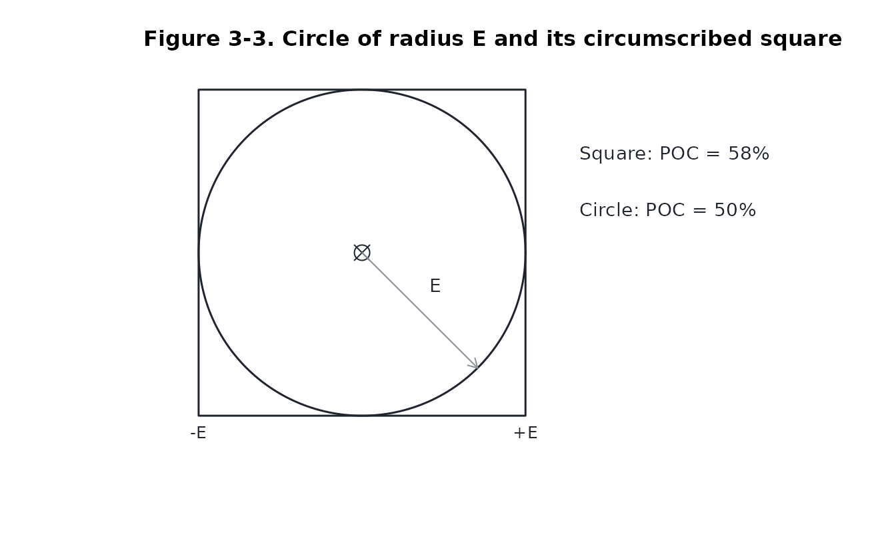

``` r

srchfig("3-5")
```

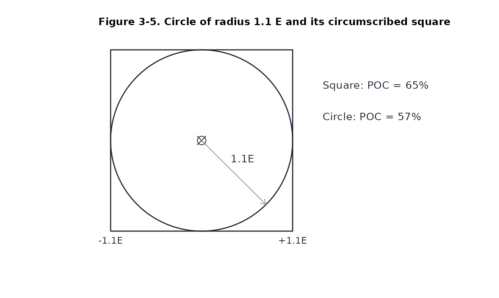

**Figure 3-4.** A probability map lays a grid over the distribution.
With cells `2E` wide the centre holds 57.91%, a side cell 9.08% and a
corner 1.42%.

``` r

srchfig("3-4")
```

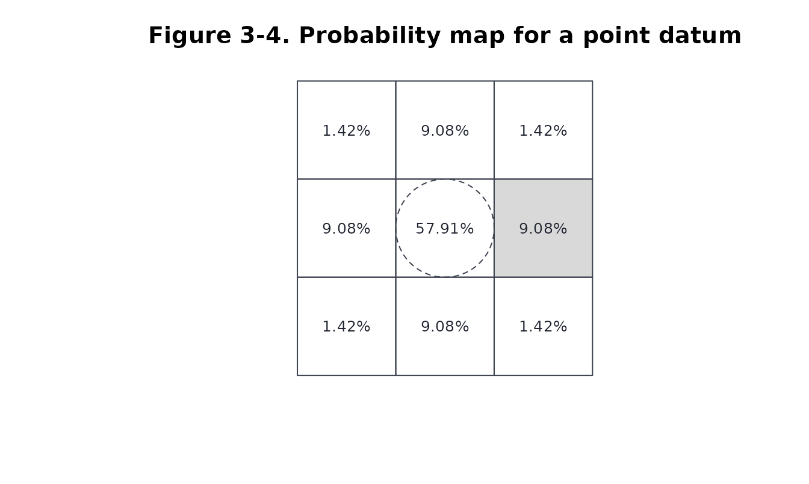

**Figures 3-6 and 3-7.** The simplified method extended a point datum to
a line by drawing circles at the two end points and boxing them in. The
density this implies is drawn as a circular normal spread along the
segment (`datum = "line"`), an approximation of the book’s plate.

``` r

srchfig("3-6")
```


``` r

srchfig("3-7")
```

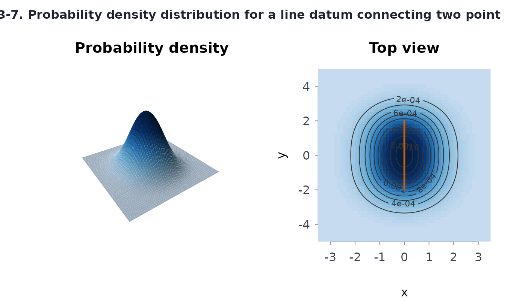

**Figures 3-8 to 3-10.** A simpler line datum is normal across the line
and uniform along it, with nothing beyond its ends
(`datum = "corridor"`). A strip one standard deviation either side holds
68%, a strip of `2E` holds 76.1%, and dividing strips into cells along
the line gives the completed map of figure 3-10.

``` r

srchfig("3-8")
```

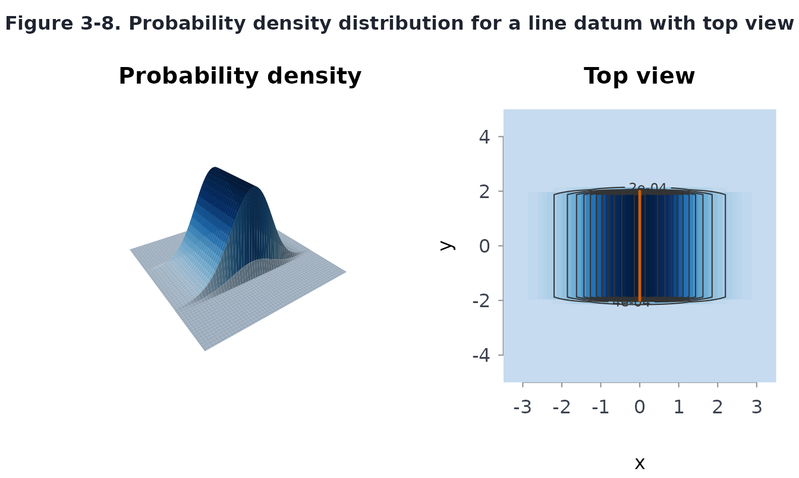

``` r

srchfig("3-9")
```

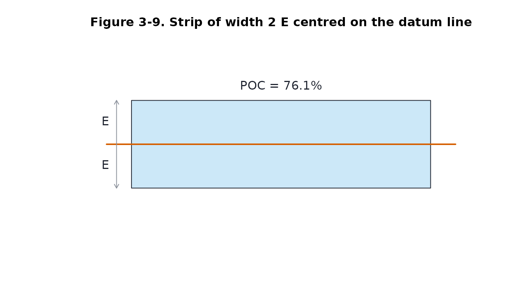

``` r

srchfig("3-10")
```


**Figures 3-11 and 3-12.** An area datum spreads the probability evenly:
each of 20 equal cells holds 5%.

``` r

srchfig("3-11")
```

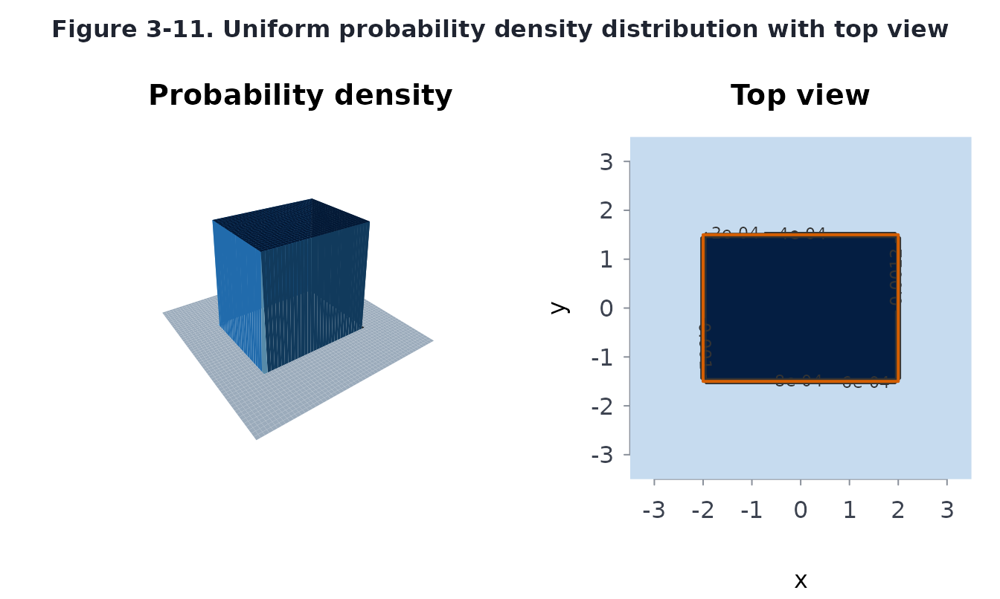

``` r

srchfig("3-12")
```


**Figures 3-13 and 3-14.** A generalized datum takes the planner’s own
cell probabilities (`datum = "general"`, `wts =`). The book’s surface is
illustrative; here it is drawn from the cells of figure 3-14.

``` r

srchfig("3-13")
```

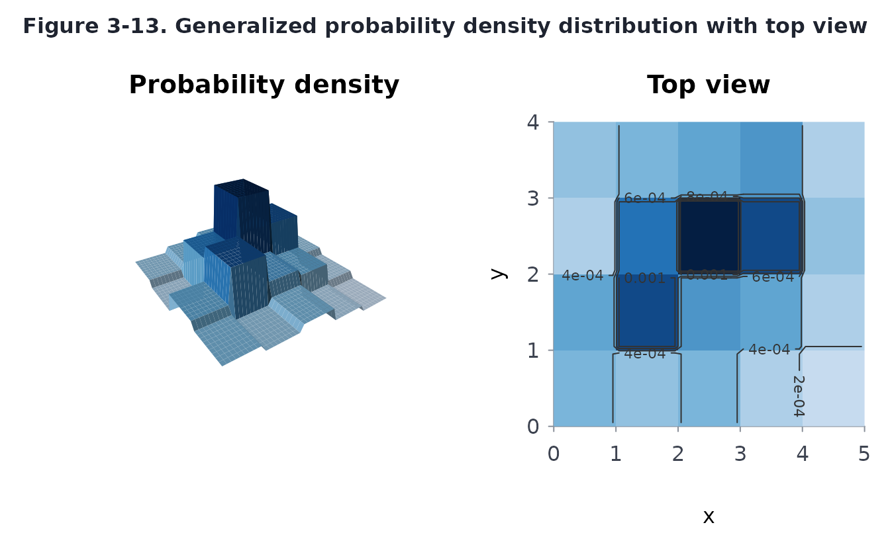

``` r

srchfig("3-14")
```


## Chapter 4: lateral range curves and sweep width

**Figure 4-1.** A lateral range curve `p(x)` is the probability of
detecting an object that passes at distance `x` from the track. The
sweep width is its area, `W = integral of p(x) dx`; the dashed
rectangles have the same area.

``` r

srchfig("4-1")
```

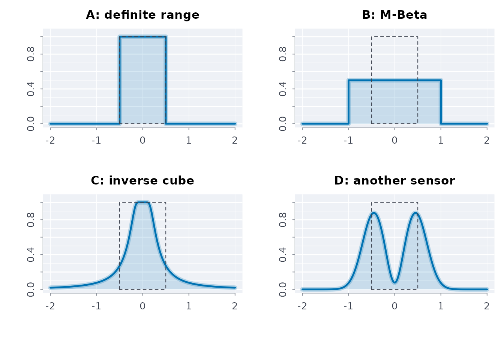

**Figures 4-2 and 4-3.** A definite range sensor sees everything within
`W / 2` of its track and nothing beyond: it sweeps a strip exactly `W`
wide.

``` r

srchfig("4-2")
```

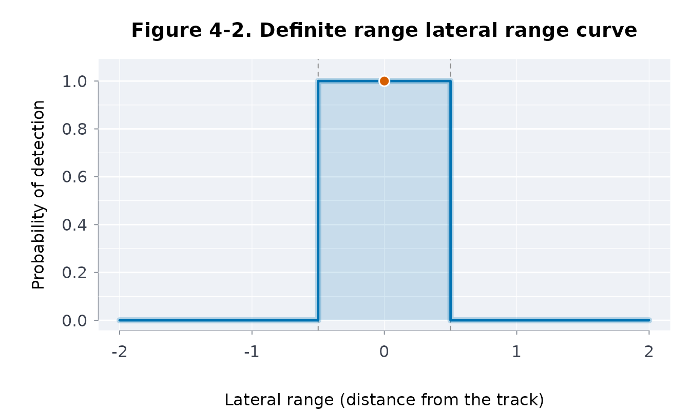

``` r

srchfig("4-3")
```

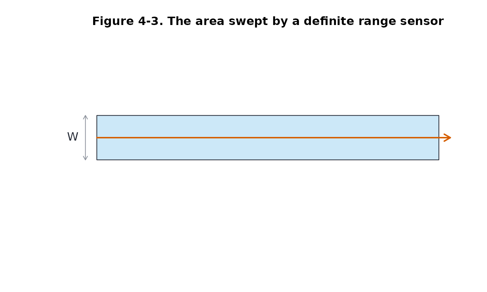

**Figures 4-4 and 4-5.** The M-Beta curve has height `M` over a width of
`W / M`; with `M = 0.5` and `M = 0.25` the sweep width is unchanged.

``` r

srchfig("4-4")
```


``` r

srchfig("4-5")
```

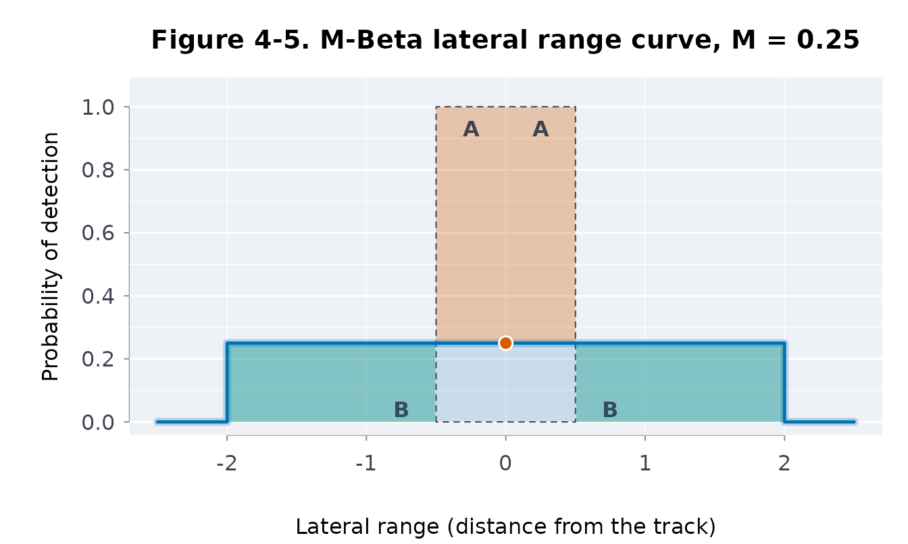

**Figures 4-6 and 4-7.** Koopman’s inverse cube law takes the chance of
a glimpse to be proportional to the solid angle of the wake,
`k h / r^3`, which gives `p(x) = 1 - exp(-W^2 / (4 pi x^2))`. Its sweep
width is `W`: the objects missed inside the sweep width (A) balance
those seen outside it (B).

``` r

srchfig("4-6")
```

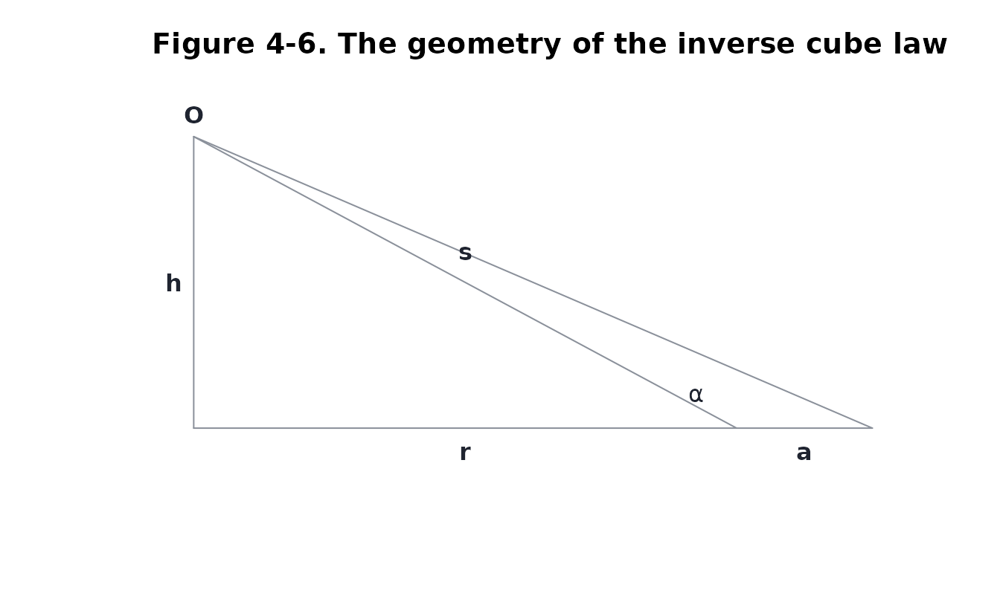

``` r

srchfig("4-7")
```

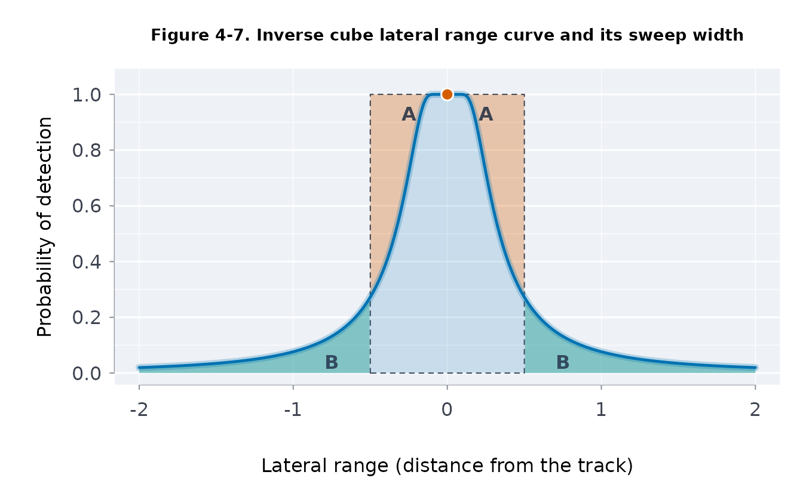

``` r

swpwdth(ltrlrng(seq(-500, 500, by = 0.01), W = 1))
#> [1] 0.9996817
```

## Chapter 5: effort, coverage and probability of detection

**Figure 5-1.** Search effort is sweep width times track length,
`Z = W L`, and coverage is effort over area, `C = Z / A`. A search whose
path is random gives `POD = 1 - exp(-C)`.

``` r

srchfig("5-1")
```


**Figures 5-2 to 5-5.** A parallel sweep at track spacing `S` has
coverage `C = W / S`. With a definite range sensor the POD is
`min(C, 1)`: half the gap is seen at `S = 2W`, all of it at `S = W`.

``` r

srchfig("5-2")
```

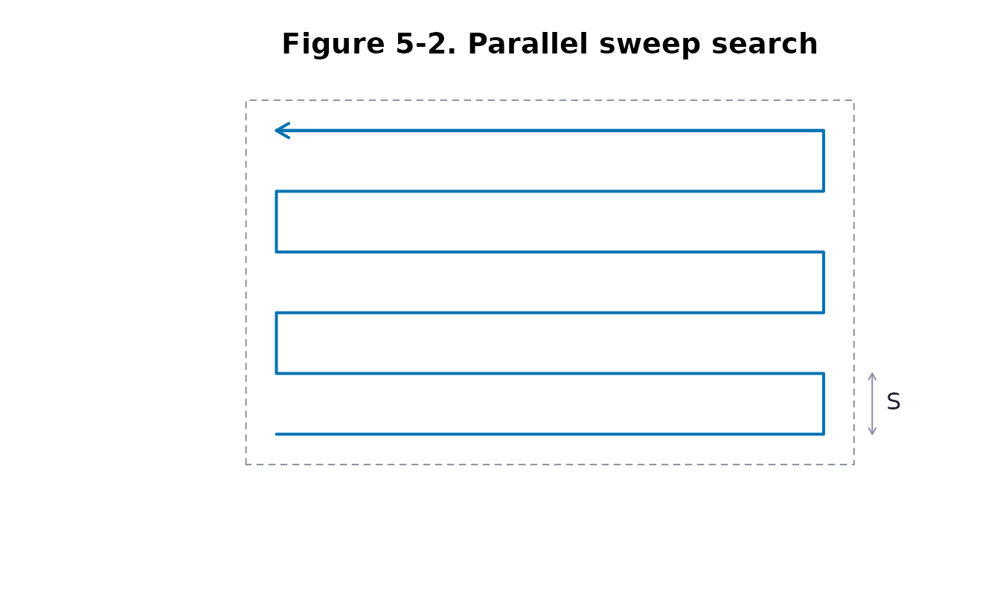

``` r

srchfig("5-3")
```


``` r

srchfig("5-4")
```


``` r

srchfig("5-5")
```

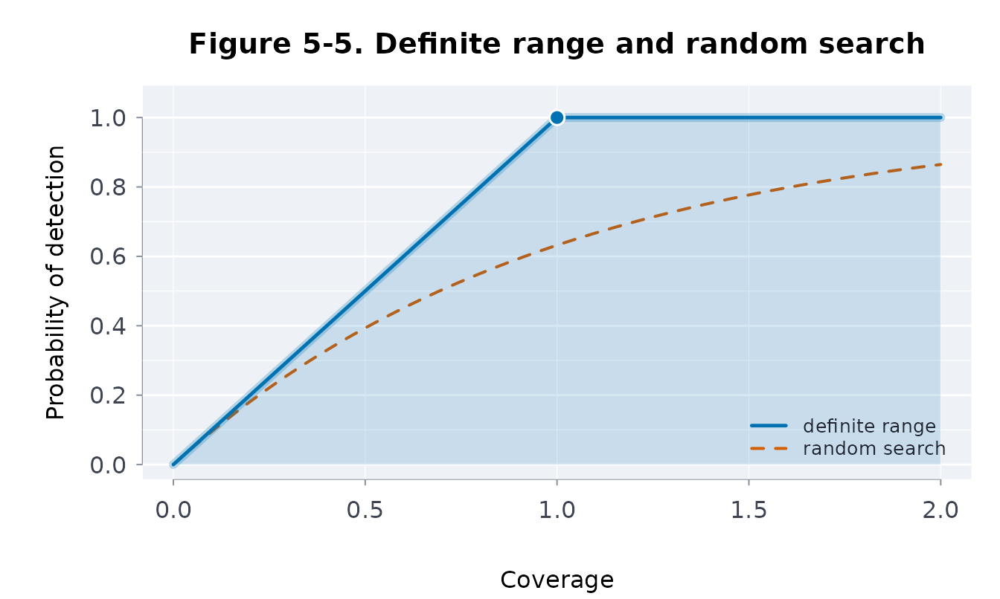

**Figures 5-6 and 5-7.** M-Beta curves overlap once the tracks are
closer than their width: `POD = C` below `C = M` and
`1 - (1 - M)^(C / M)` above it, 0.75 and 0.6836 at coverage 1 for
`M = 0.5` and `M = 0.25`, nearer the random search curve as `M` falls.

``` r

srchfig("5-6")
```


``` r

srchfig("5-7")
```


``` r

srchpod(c(0.5, 1, 2), "mbeta", m = 0.25)
#> ── Probability of detection ────────────────────────────────────── 
#>   M-Beta model, M = 0.25
#> 
#>  coverage      pod
#>       0.5 0.437500
#>       1.0 0.683594
#>       2.0 0.899887
#> ──────────────────────────────────────────────────────────────────
```

**Figure 5-8.** The inverse cube parallel sweep gives
`POD = erf(sqrt(pi) C / 2)`, 0.7899 at coverage 1, between the definite
range and random search curves.
[`pswppod()`](https://rootcoder007.github.io/rmorie-bricklayer/reference/ltrlrng.md)
computes the same sweep directly, for any curve.

``` r

srchfig("5-8")
```


``` r

pswppod(W = 1, S = 1)
#> [1] 0.7899086
```

**Figure 5-9.** Poorer conditions shrink the sweep width, and a
cross-track navigation error of standard deviation `sigma` flattens the
curve: the expected curve is the convolution
`phi(x) = integral of p(x - t) Z(t, sigma) dt`, whose area is still `W`
(`ltrlrng(..., navsd = )`). The plate is blank in the published file; it
is drawn from the text.

``` r

srchfig("5-9")
```

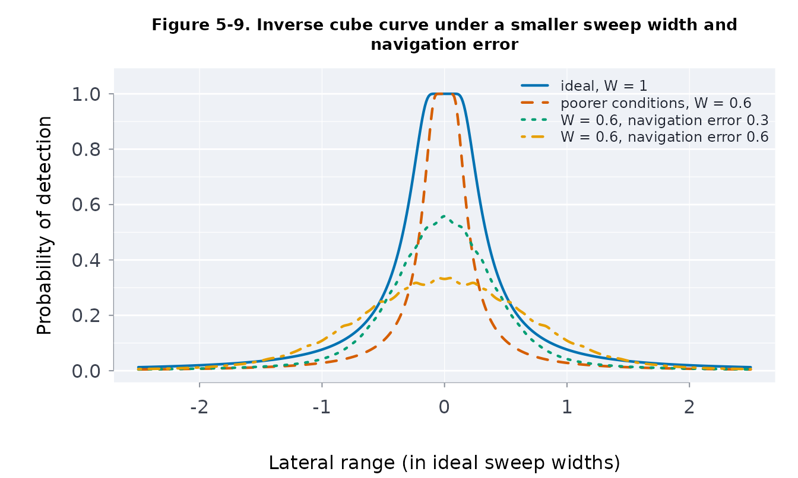

## Chapter 6: optimal search

**Figures 6-1 and 6-2.** With half the probability in a 3 by 3 square
inside a 5 by 5 one and effort for half the area, the trial squares of
the whole area, half of it and a third of it hold 100%, 60.94% and
46.30%; at coverage 1 the middle trial succeeds most often.

``` r

srchfig("6-1")
```

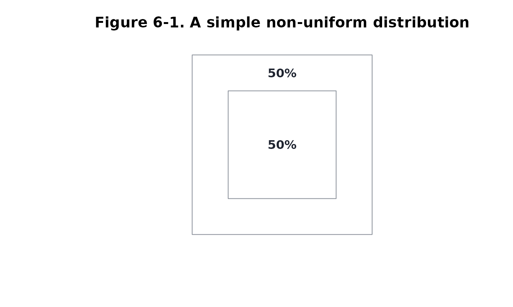

``` r

srchfig("6-2")
```


**Figures 6-3 and 6-4.** For a point datum,
[`optsqr()`](https://rootcoder007.github.io/rmorie-bricklayer/reference/optsqr.md)
finds the square that an effort, spread evenly, should cover: the search
factor is its half side in units of `E`. An effort of `4 E^2` gives a
factor of 1.02, coverage 0.96 and POS 0.4578, as the book’s program
found.

``` r

optsqr(4)
#>   search effort releff cumeff   factor     side       poc  coverage       pod
#> 1      1      4      4      4 1.021043 2.042086 0.5939919 0.9592059 0.7707087
#>         pos    cumpos
#> 1 0.4577947 0.4577947
srchfig("6-3")
```

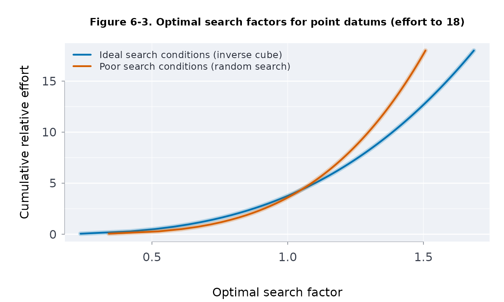

``` r

srchfig("6-4")
```

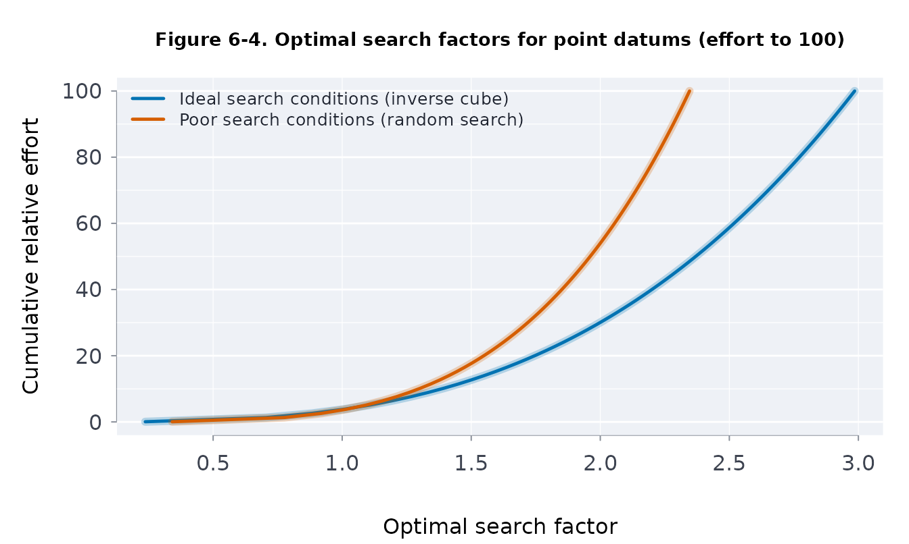

**Figure 6-5.** By the additive principle, a series of searches each
optimal for what the earlier ones left does as well as one optimal
search with all the effort: the cumulative probability of success
depends on the cumulative effort.

``` r

srchfig("6-5")
```

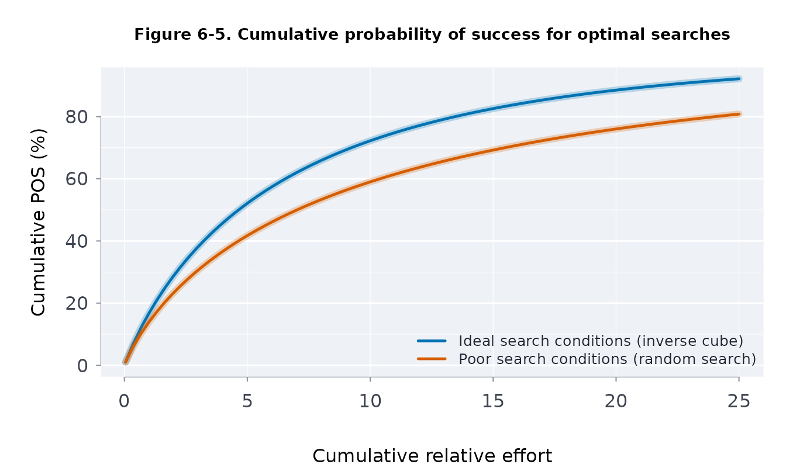

**Figure 6-6.** Searching in a series with random efforts between 0.1
and 50 `E^2`, the optimal factors cluster around the curve, except where
a much smaller effort follows a large one and the best use of it is the
remaining central peak.

``` r

srchfig("6-6")
```

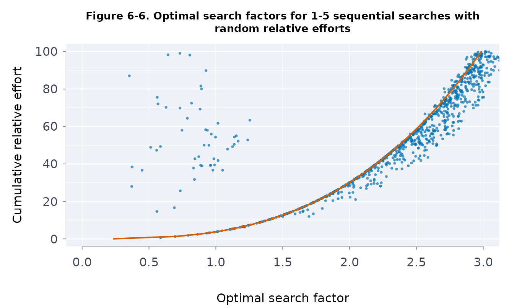

## On a grid of your own

The same functions take any grid and datum.
[`opteffort()`](https://rootcoder007.github.io/rmorie-bricklayer/reference/ltrlrng.md)
spreads a total track length over the cells to make the probability of
success as large as possible (Stone 1975), and
[`srchscs()`](https://rootcoder007.github.io/rmorie-bricklayer/reference/ltrlrng.md)
updates the containment after a search that finds nothing.

``` r

m <- datumpmap(seq(-6, 6, by = 0.5), seq(-6, 6, by = 0.5), sigma = 2)
a <- opteffort(m, W = 1, effort = 30)
a$pos
#> [1] 0.455821
optcrcsrch(sigma = 2, W = 1, effort = 30)$pos
#> [1] 0.4571532
plot(a)
```

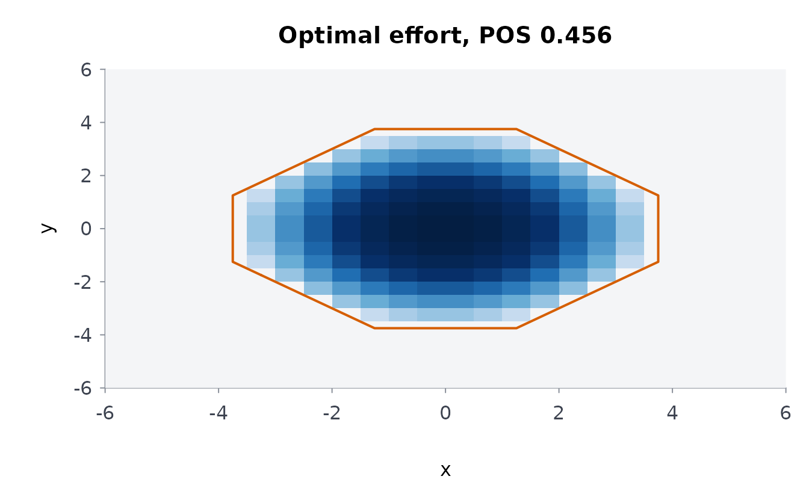

``` r

srchscs(c(0.5, 0.3, 0.2), c(0.8, 0.5, 0))
#> ── Probability of success ──────────────────────────────────────── 
#>   POS 0.55 after 1 search
#> 
#>  area poc cumpod posarea pocupd
#>     1 0.5    0.8    0.40 0.2222
#>     2 0.3    0.5    0.15 0.3333
#>     3 0.2    0.0    0.00 0.4444
#> ──────────────────────────────────────────────────────────────────
```

## References

Frost, J. R. (1996). The Theory of Search: A Simplified Explanation.
Soza and Company and U.S. Coast Guard Office of Search and Rescue.
Chapters 3-6 and their figures.

Koopman, B. O. (1946). Search and Screening. OEG Report 56, Office of
the Chief of Naval Operations.

Koopman, B. O. (1956-1957). The theory of search, parts I-III.
Operations Research 4(3), 324-346; 4(5), 503-531; 5(5), 613-626.

Stone, L. D. (1975). Theory of Optimal Search. Academic Press.
