# Search and rescue: detection, coverage and the best use of effort

Search theory began with Koopman’s work for the U.S. Navy (1946) and is
how search and rescue services plan a search: how likely a sensor is to
see the object at a given distance, how much ground a search covers, how
likely the object is to be in each area, and where a limited effort does
the most good. Frost’s *The Theory of Search: A Simplified Explanation*
(1996) explains it for search planners in four chapters of figures. This
vignette walks those chapters and draws every one of the book’s 36
figures with
[`srchfig()`](https://rootcoder007.github.io/rmorie-bricklayer/reference/srchfig.md),
which builds each from the package’s functions with the book’s
parameters.
[`srchfig()`](https://rootcoder007.github.io/rmorie-bricklayer/reference/srchfig.md)
with no argument lists them and says how each is drawn: from the model,
as a schematic, or as an approximation where the book’s plate cannot be
recovered exactly.

``` r

table(srchfig()$how)
#> 
#> approximation         model     schematic 
#>             3            29             4
```

The functions behind the figures work on any inputs:
[`ltrlrng()`](https://rootcoder007.github.io/rmorie-bricklayer/reference/ltrlrng.md)
(lateral range curves),
[`swpwdth()`](https://rootcoder007.github.io/rmorie-bricklayer/reference/ltrlrng.md)
(sweep width),
[`srchpod()`](https://rootcoder007.github.io/rmorie-bricklayer/reference/ltrlrng.md)
and
[`pswppod()`](https://rootcoder007.github.io/rmorie-bricklayer/reference/ltrlrng.md)
(probability of detection),
[`srchscs()`](https://rootcoder007.github.io/rmorie-bricklayer/reference/ltrlrng.md)
(probability of success and the update after a search),
[`datumpmap()`](https://rootcoder007.github.io/rmorie-bricklayer/reference/ltrlrng.md)
(where the object may be),
[`opteffort()`](https://rootcoder007.github.io/rmorie-bricklayer/reference/ltrlrng.md),
[`optcrcsrch()`](https://rootcoder007.github.io/rmorie-bricklayer/reference/ltrlrng.md)
and
[`optsqr()`](https://rootcoder007.github.io/rmorie-bricklayer/reference/optsqr.md)
(the best use of effort). The book’s figures come first; [Your own
search](#your-own-search) then runs each function on numbers of your
own.

## Datums and probability maps

**Figure 3-1.** A point datum is a circular normal distribution of
possible positions. The probability that the object is within `R`
standard deviations of the datum is `POC = 1 - exp(-R^2 / 2)`.

``` r

srchfig("3-1")
```

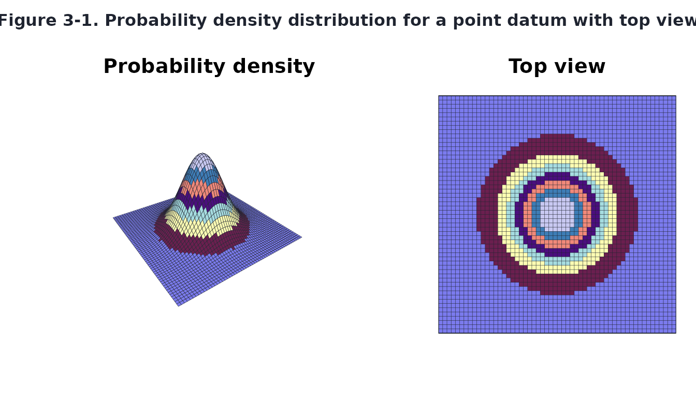

**Figures 3-2, 3-3 and 3-5.** The square circumscribed about a circle of
radius `R` holds `(2 Phi(R) - 1)^2` of the distribution: 47% for one
standard deviation, 58% for the total probable error of position
`E = sqrt(2 ln 2) = 1.1774` standard deviations (the radius holding
50%), and 65% for the simplified method’s first search radius of 1.1
`E`.

``` r

srchfig("3-2")
```

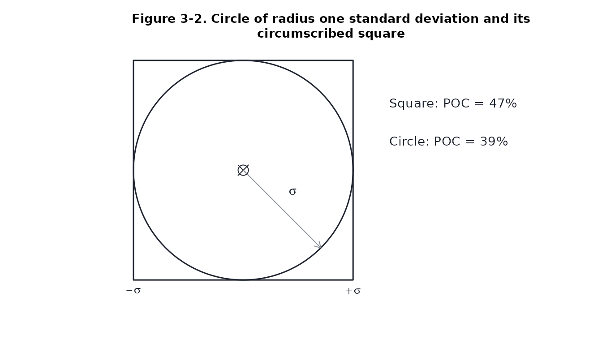

``` r

srchfig("3-3")
```


``` r

srchfig("3-5")
```


**Figure 3-4.** A probability map lays a grid over the distribution.
With cells `2E` wide the centre holds 57.91%, a side cell 9.08% and a
corner 1.42%.

``` r

srchfig("3-4")
```

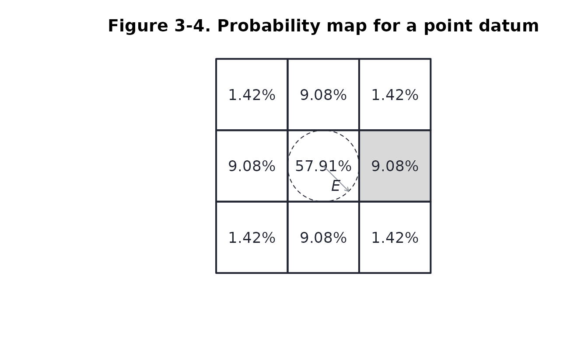

**Figures 3-6 and 3-7.** The simplified method extended a point datum to
a line by drawing circles at the two end points and boxing them in. The
density this implies is drawn as a circular normal spread along the
segment (`datum = "line"`), an approximation of the book’s plate.

``` r

srchfig("3-6")
```

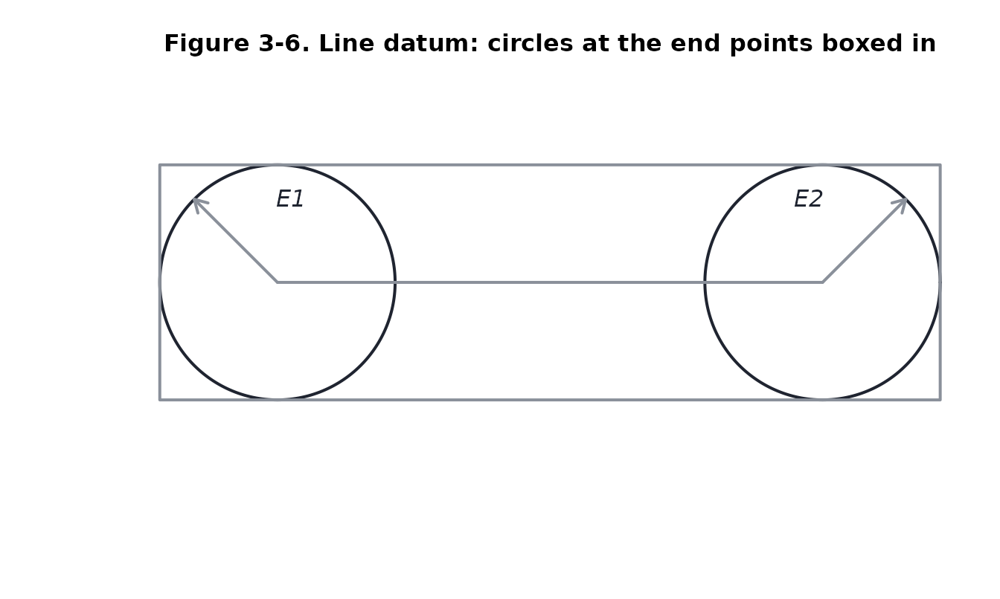

``` r

srchfig("3-7")
```

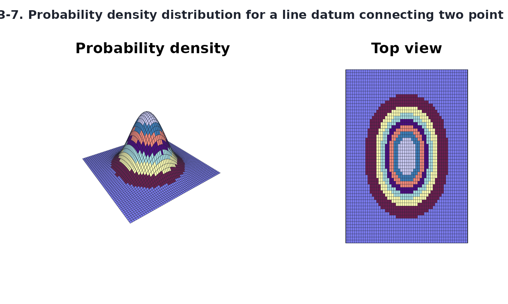

**Figures 3-8 to 3-10.** A simpler line datum is normal across the line
and uniform along it, with nothing beyond its ends
(`datum = "corridor"`). A strip one standard deviation either side holds
68%, a strip of `2E` holds 76.1%, and dividing strips into cells along
the line gives the completed map of figure 3-10.

``` r

srchfig("3-8")
```

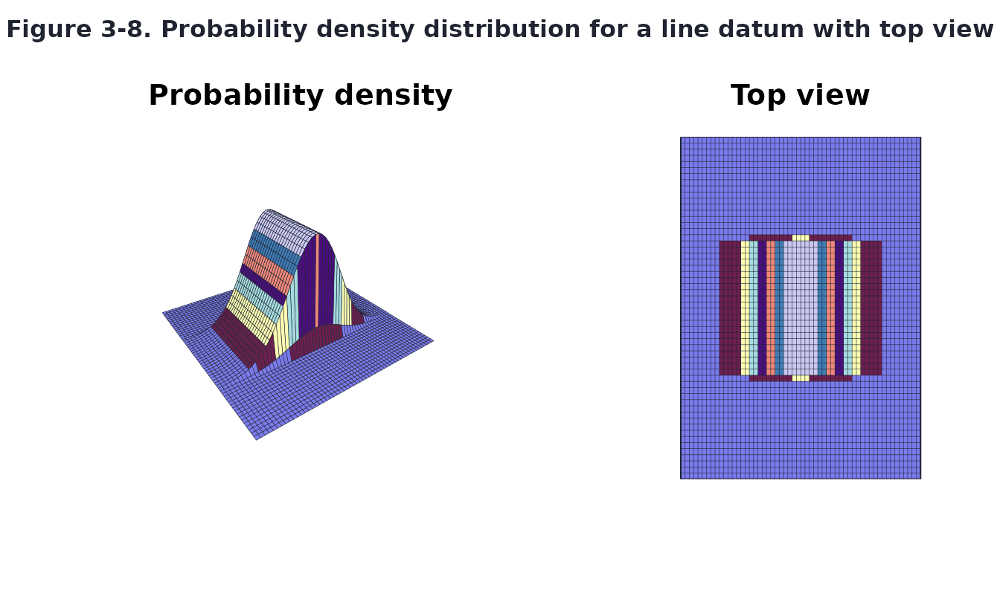

``` r

srchfig("3-9")
```


``` r

srchfig("3-10")
```

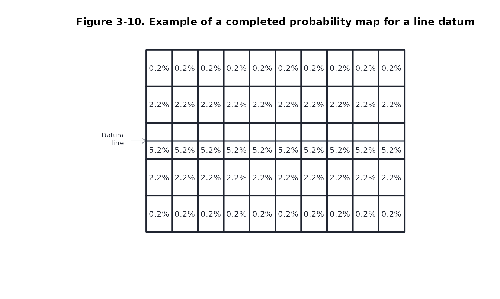

**Figures 3-11 and 3-12.** An area datum spreads the probability evenly:
each of 20 equal cells holds 5%.

``` r

srchfig("3-11")
```


``` r

srchfig("3-12")
```

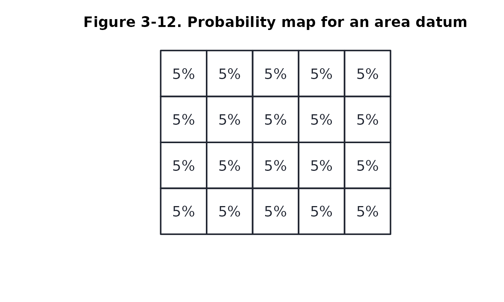

**Figures 3-13 and 3-14.** A generalized datum takes the planner’s own
cell probabilities (`datum = "general"`, `wts =`). The book’s surface is
illustrative; here it is drawn from the cells of figure 3-14.

``` r

srchfig("3-13")
```


``` r

srchfig("3-14")
```

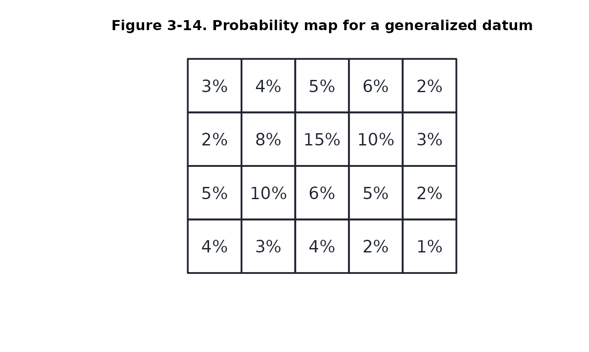

## Lateral range curves and sweep width

**Figure 4-1.** A lateral range curve `p(x)` is the probability of
detecting an object that passes at distance `x` from the track. The
sweep width is its area, `W = integral of p(x) dx`; the dashed
rectangles have the same area.

``` r

srchfig("4-1")
```

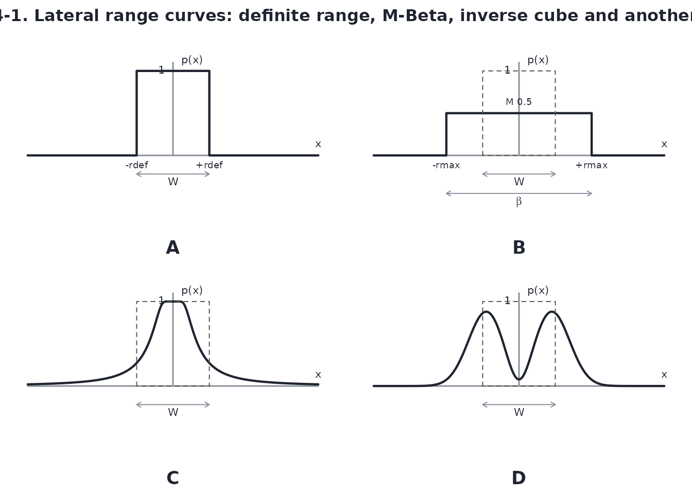

**Figures 4-2 and 4-3.** A definite range sensor sees everything within
`W / 2` of its track and nothing beyond: it sweeps a strip exactly `W`
wide.

``` r

srchfig("4-2")
```


``` r

srchfig("4-3")
```


**Figures 4-4 and 4-5.** The M-Beta curve has height `M` over a width of
`W / M`; with `M = 0.5` and `M = 0.25` the sweep width is unchanged.

``` r

srchfig("4-4")
```

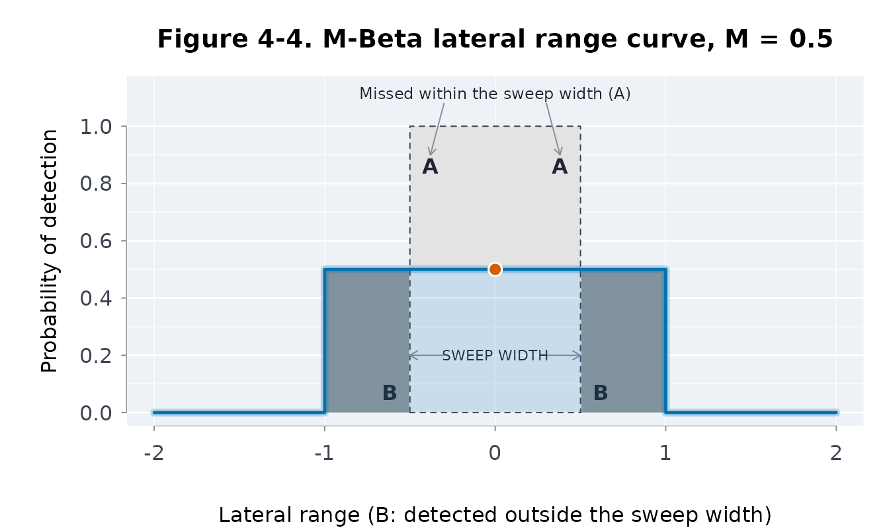

``` r

srchfig("4-5")
```

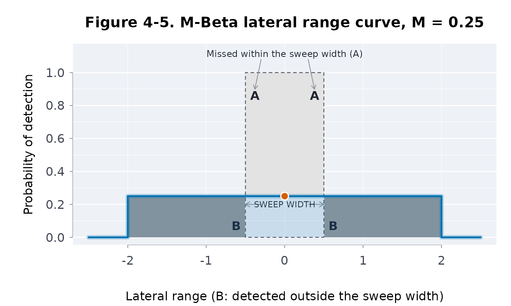

**Figures 4-6 and 4-7.** Koopman’s inverse cube law takes the chance of
a glimpse to be proportional to the solid angle of the wake,
`k h / r^3`, which gives `p(x) = 1 - exp(-W^2 / (4 pi x^2))`. Its sweep
width is `W`: the objects missed inside the sweep width (A) balance
those seen outside it (B).

``` r

srchfig("4-6")
```

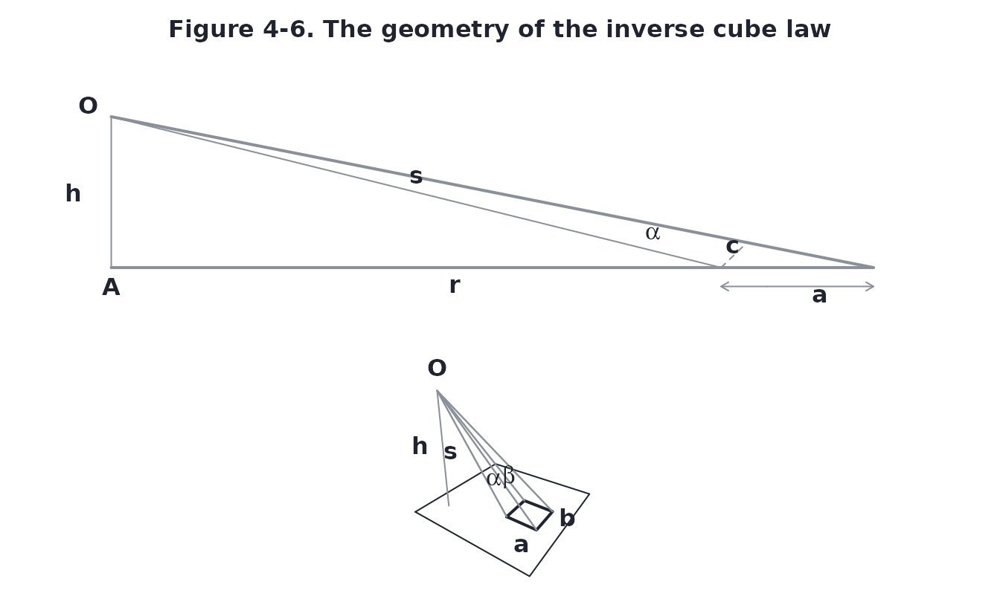

``` r

srchfig("4-7")
```

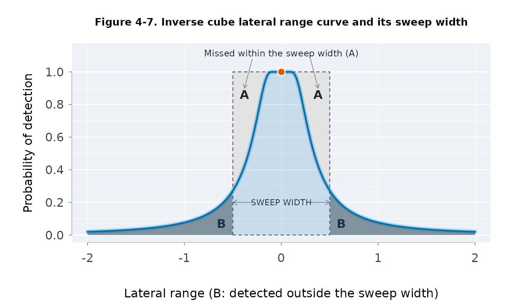

``` r

swpwdth(ltrlrng(seq(-500, 500, by = 0.01), W = 1))
#> [1] 0.9996817
```

## Effort, coverage and probability of detection

**Figure 5-1.** Search effort is sweep width times track length,
`Z = W L`, and coverage is effort over area, `C = Z / A`. A search whose
path is random gives `POD = 1 - exp(-C)`.

``` r

srchfig("5-1")
```

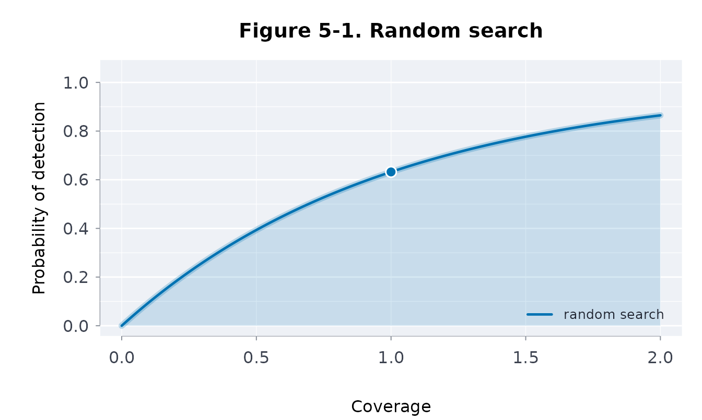

**Figures 5-2 to 5-5.** A parallel sweep at track spacing `S` has
coverage `C = W / S`. With a definite range sensor the POD is
`min(C, 1)`: half the gap is seen at `S = 2W`, all of it at `S = W`.

``` r

srchfig("5-2")
```


``` r

srchfig("5-3")
```

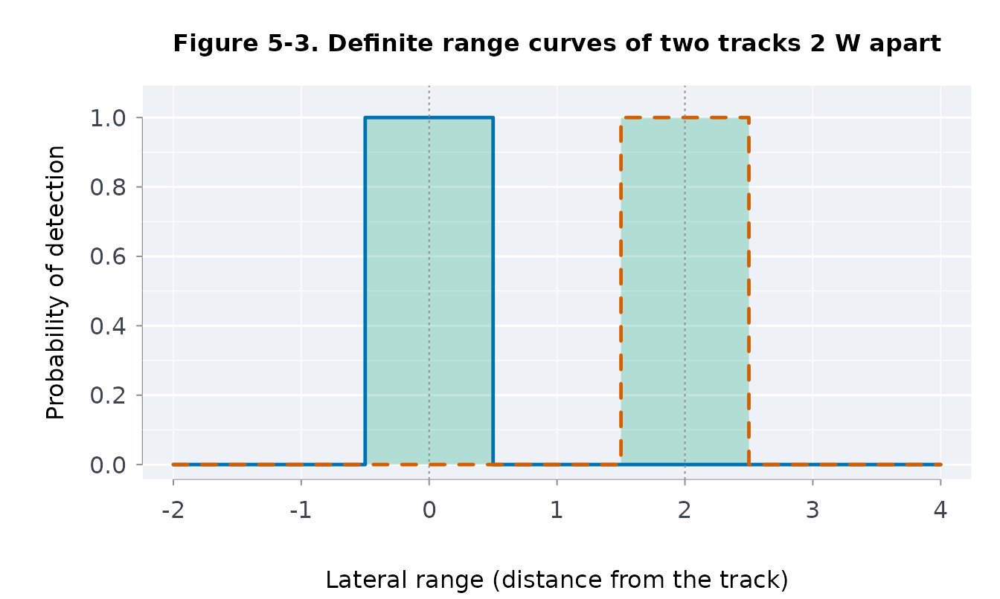

``` r

srchfig("5-4")
```

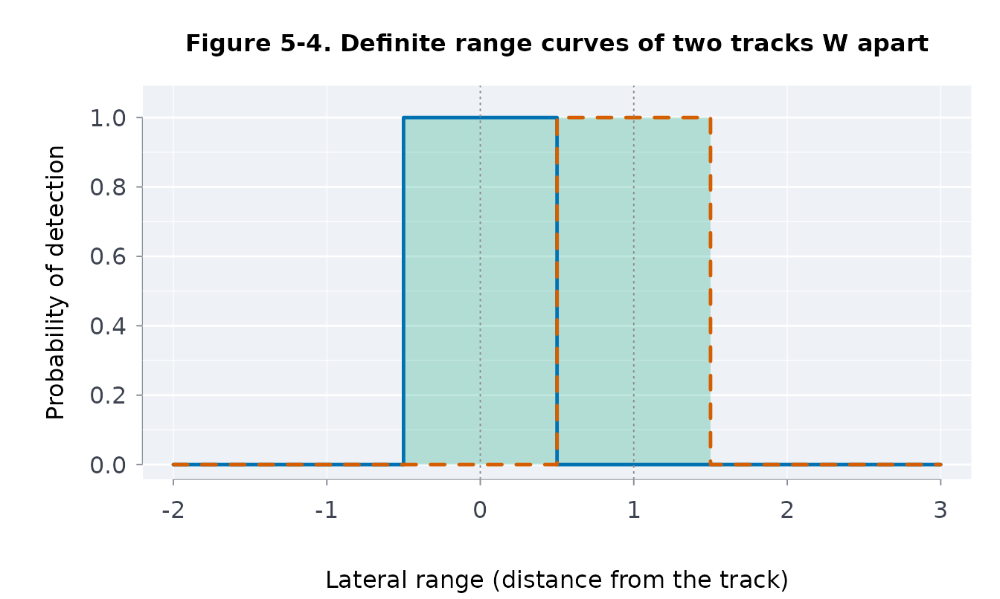

``` r

srchfig("5-5")
```


**Figures 5-6 and 5-7.** M-Beta curves overlap once the tracks are
closer than their width: `POD = C` below `C = M` and
`1 - (1 - M)^(C / M)` above it, 0.75 and 0.6836 at coverage 1 for
`M = 0.5` and `M = 0.25`, nearer the random search curve as `M` falls.

``` r

srchfig("5-6")
```

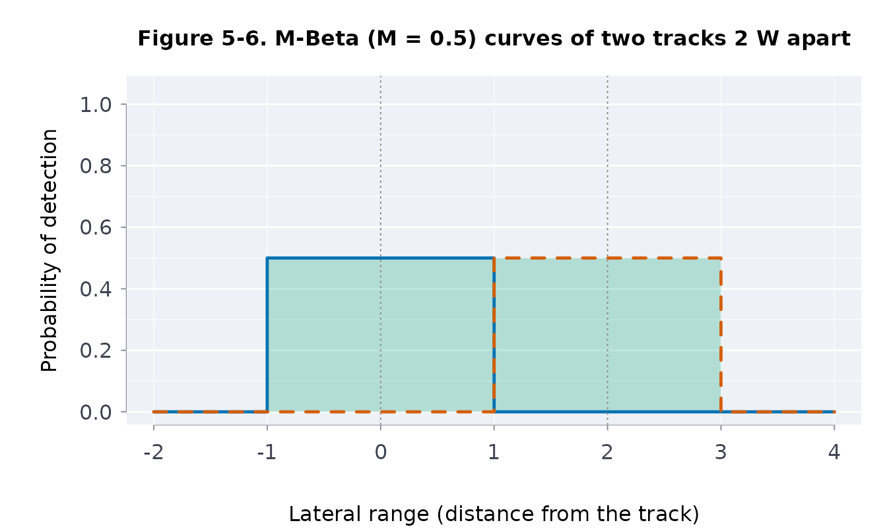

``` r

srchfig("5-7")
```

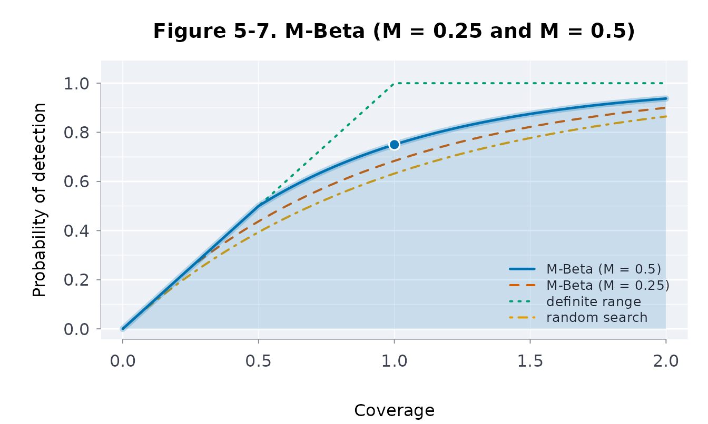

``` r

srchpod(c(0.5, 1, 2), "mbeta", m = 0.25)
#> ── Probability of detection ────────────────────────────────────── 
#>   M-Beta model, M = 0.25
#> 
#>  coverage      pod
#>       0.5 0.437500
#>       1.0 0.683594
#>       2.0 0.899887
#> ──────────────────────────────────────────────────────────────────
```

**Figure 5-8.** The inverse cube parallel sweep gives
`POD = erf(sqrt(pi) C / 2)`, 0.7899 at coverage 1, between the definite
range and random search curves.
[`pswppod()`](https://rootcoder007.github.io/rmorie-bricklayer/reference/ltrlrng.md)
computes the same sweep directly, for any curve.

``` r

srchfig("5-8")
```

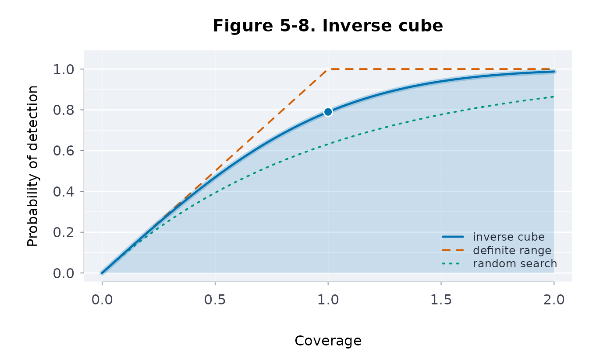

``` r

pswppod(W = 1, S = 1)
#> [1] 0.7899086
```

**Figure 5-9.** Poorer conditions shrink the sweep width, and a
cross-track navigation error of standard deviation `sigma` flattens the
curve: the expected curve is the convolution
`phi(x) = integral of p(x - t) Z(t, sigma) dt`, whose area is still `W`
(`ltrlrng(..., navsd = )`). The plate is blank in the published file; it
is drawn from the text.

``` r

srchfig("5-9")
```

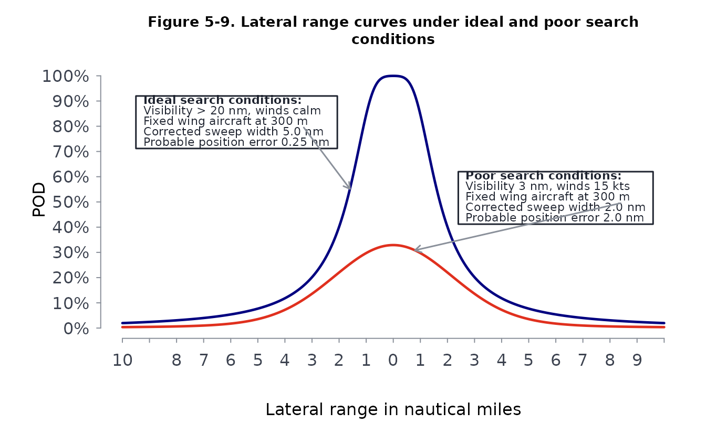

## Optimal search

**Figures 6-1 and 6-2.** With half the probability in a 3 by 3 square
inside a 5 by 5 one and effort for half the area, the trial squares of
the whole area, half of it and a third of it hold 100%, 60.94% and
46.30%; at coverage 1 the middle trial succeeds most often.

``` r

srchfig("6-1")
```


``` r

srchfig("6-2")
```

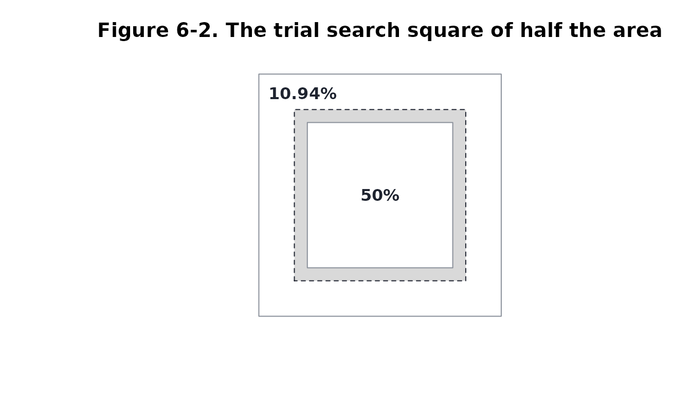

**Figures 6-3 and 6-4.** For a point datum,
[`optsqr()`](https://rootcoder007.github.io/rmorie-bricklayer/reference/optsqr.md)
finds the square that an effort, spread evenly, should cover: the search
factor is its half side in units of `E`. An effort of `4 E^2` gives a
factor of 1.02, coverage 0.96 and POS 0.4578, as the book’s program
found.

``` r

optsqr(4)
#>   search effort releff cumeff   factor     side       poc  coverage       pod
#> 1      1      4      4      4 1.021043 2.042086 0.5939919 0.9592059 0.7707087
#>         pos    cumpos
#> 1 0.4577947 0.4577947
srchfig("6-3")
```

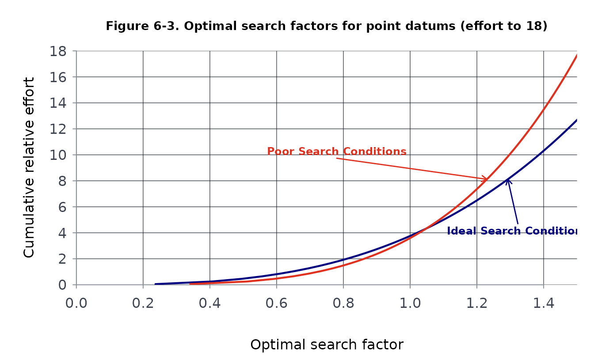

``` r

srchfig("6-4")
```

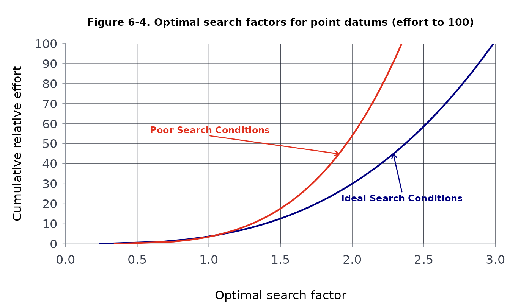

**Figure 6-5.** By the additive principle, a series of searches each
optimal for what the earlier ones left does as well as one optimal
search with all the effort: the cumulative probability of success
depends on the cumulative effort.

``` r

srchfig("6-5")
```

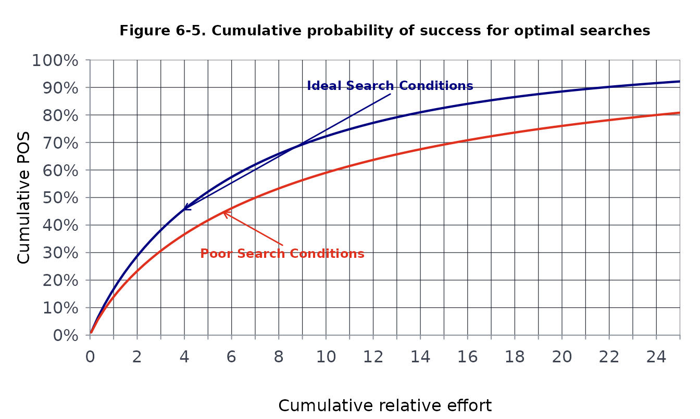

**Figure 6-6.** Searching in a series with random efforts between 0.1
and 50 `E^2`, the optimal factors cluster around the curve, except where
a much smaller effort follows a large one and the best use of it is the
remaining central peak.

``` r

srchfig("6-6")
```


## Your own search

The figures use the book’s numbers; every function takes yours, and each
result has a [`plot()`](https://rdrr.io/r/graphics/plot.default.html)
method.
[`srchfig()`](https://rootcoder007.github.io/rmorie-bricklayer/reference/srchfig.md)
lists, for each of the 36 figures, the one line that draws it from your
own numbers (replace the example inputs; a schematic gives the
computation it pictures):

``` r

# an HTML table with each line in <code>: in a Markdown table a `$` starts a formula and a `|`
# ends the cell, so both are written as entities
tab <- srchfig()[, c("fig", "caption", "yours")]
esc <- function(x) {
  for (r in list(c("&", "&amp;"), c("<", "&lt;"), c(">", "&gt;"), c("$", "&#36;"), c("|", "&#124;"))) {
    x <- gsub(r[1], r[2], x, fixed = TRUE)
  }
  x
}
tab$caption <- esc(tab$caption)
tab$yours <- sprintf("<code>%s</code>", esc(tab$yours))
knitr::kable(tab, format = "html", escape = FALSE, row.names = FALSE,
             col.names = c("Figure", "Caption", "From your own numbers"))
```

| Figure | Caption | From your own numbers |
|:---|:---|:---|
| 3-1 | Probability density distribution for a point datum with top view | `plot(datumpmap(seq(-4, 4, by = 0.25), seq(-4, 4, by = 0.25), center = c(0, 0), sigma = 1.5), view = “both”)` |
| 3-2 | Circle of radius one standard deviation and its circumscribed square | `sum(datumpmap(c(-1.5, 1.5), c(-1.5, 1.5), sigma = 1.5)$poc)` |
| 3-3 | Circle of radius E and its circumscribed square | `sum(datumpmap(c(-1, 1) * 1.177 * 1.5, c(-1, 1) * 1.177 * 1.5, sigma = 1.5)$poc)` |
| 3-4 | Probability map for a point datum | `plot(datumpmap(c(-3, -1, 1, 3) * 1.77, c(-3, -1, 1, 3) * 1.77, sigma = 1.5), view = “cells”)` |
| 3-5 | Circle of radius 1.1 E and its circumscribed square | `sum(datumpmap(c(-1, 1) * 1.295 * 1.5, c(-1, 1) * 1.295 * 1.5, sigma = 1.5)$poc)` |
| 3-6 | Line datum: circles at the end points boxed in | `plot(datumpmap(seq(-4, 4, by = 0.25), seq(-4, 4, by = 0.25), “line”, center = c(0, -2), end = c(0, 2), sigma = 1), view = “both”)` |
| 3-7 | Probability density distribution for a line datum connecting two point datums | `plot(datumpmap(seq(-4, 4, by = 0.25), seq(-4, 4, by = 0.25), “line”, center = c(0, -2), end = c(0, 2), sigma = 1), view = “both”)` |
| 3-8 | Probability density distribution for a line datum with top view | `plot(datumpmap(seq(-4, 4, by = 0.25), seq(-4, 4, by = 0.25), “corridor”, center = c(0, -2), end = c(0, 2), sigma = 1), view = “both”)` |
| 3-9 | Strip of width 2 E centred on the datum line | `plot(datumpmap(c(-5, 5), c(-1.18, 1.18), “corridor”, center = c(-4, 0), end = c(4, 0), sigma = 1), view = “cells”)` |
| 3-10 | Example of a completed probability map for a line datum | `plot(datumpmap(0:10, c(-3, -1.8, -0.6, 0.6, 1.8, 3), “corridor”, center = c(0, 0), end = c(10, 0), sigma = 1), view = “cells”)` |
| 3-11 | Uniform probability density distribution with top view | `plot(datumpmap(seq(-4, 4, by = 0.25), seq(-4, 4, by = 0.25), “area”, center = c(-2, -1.5), end = c(2, 1.5)), view = “both”)` |
| 3-12 | Probability map for an area datum | `plot(datumpmap(0:5, 0:4, “area”, center = c(0, 0), end = c(5, 4)), view = “cells”)` |
| 3-13 | Generalized probability density distribution with top view | `plot(datumpmap(0:5, 0:4, “general”, wts = matrix(c(1:10, 10:1), 4, 5)), view = “both”)` |
| 3-14 | Probability map for a generalized datum | `plot(datumpmap(0:5, 0:4, “general”, wts = matrix(c(1:10, 10:1), 4, 5)), view = “cells”)` |
| 4-1 | Lateral range curves: definite range, M-Beta, inverse cube and another sensor | `plot(ltrlrng(seq(-3, 3, by = 0.05), W = 0.8, model = “mbeta”, m = 0.5))` |
| 4-2 | Definite range lateral range curve | `plot(ltrlrng(seq(-3, 3, by = 0.05), W = 0.8, model = “definite”))` |
| 4-3 | The area swept by a definite range sensor | `plot(ltrlrng(seq(-3, 3, by = 0.05), W = 0.8, model = “definite”), equiv = TRUE)` |
| 4-4 | M-Beta lateral range curve, M = 0.5 | `plot(ltrlrng(seq(-3, 3, by = 0.05), W = 0.8, model = “mbeta”, m = 0.5), equiv = TRUE)` |
| 4-5 | M-Beta lateral range curve, M = 0.25 | `plot(ltrlrng(seq(-3, 3, by = 0.05), W = 0.8, model = “mbeta”, m = 0.25), equiv = TRUE)` |
| 4-6 | The geometry of the inverse cube law | `plot(ltrlrng(seq(-3, 3, by = 0.05), W = 0.8, model = “invcube”))` |
| 4-7 | Inverse cube lateral range curve and its sweep width | `plot(ltrlrng(seq(-3, 3, by = 0.05), W = 0.8, model = “invcube”), equiv = TRUE)` |
| 5-1 | Random search | `plot(srchpod(seq(0, 3, by = 0.1), model = “random”))` |
| 5-2 | Parallel sweep search | `pswppod(W = 0.8, S = 1, model = “invcube”)` |
| 5-3 | Definite range curves of two tracks 2 W apart | `plot(ltrlrng(seq(-3, 3, by = 0.05), W = 0.8, model = “definite”), spacing = 1.6)` |
| 5-4 | Definite range curves of two tracks W apart | `plot(ltrlrng(seq(-3, 3, by = 0.05), W = 0.8, model = “definite”), spacing = 0.8)` |
| 5-5 | Definite range and random search | `plot(srchpod(seq(0, 3, by = 0.1), “definite”), models = c(“definite”, “random”))` |
| 5-6 | M-Beta (M = 0.5) curves of two tracks 2 W apart | `plot(ltrlrng(seq(-3, 3, by = 0.05), W = 0.8, model = “mbeta”, m = 0.5), spacing = 1.6)` |
| 5-7 | M-Beta (M = 0.25 and M = 0.5) | `plot(srchpod(seq(0, 3, by = 0.1), “mbeta”, m = 0.5), models = c(“mbeta”, “definite”, “random”), m = c(0.5, 0.25))` |
| 5-8 | Inverse cube | `plot(srchpod(seq(0, 3, by = 0.1), “invcube”), models = c(“invcube”, “definite”, “random”))` |
| 5-9 | Lateral range curves under ideal and poor search conditions | `plot(ltrlrng(seq(-3, 3, by = 0.05), W = 0.8, model = “invcube”, navsd = 0.3), spacing = 1)` |
| 6-1 | A simple non-uniform distribution | `optsqr(effort = 2)` |
| 6-2 | The trial search square of half the area | `optsqr(effort = 2)$side` |
| 6-3 | Optimal search factors for point datums (effort to 18) | `with(do.call(rbind, lapply(seq(0.5, 18, by = 0.5), optsqr)), plot(factor, cumeff, type = “l”))` |
| 6-4 | Optimal search factors for point datums (effort to 100) | `with(do.call(rbind, lapply(seq(2, 100, by = 2), optsqr)), plot(factor, cumeff, type = “l”))` |
| 6-5 | Cumulative probability of success for optimal searches | `with(do.call(rbind, lapply(seq(0.5, 25, by = 0.5), optsqr)), plot(cumeff, 100 * cumpos, type = “l”))` |
| 6-6 | Optimal search factors for 1-5 sequential searches with random relative efforts | `optsqr(c(1, 0.5, 2, 1.5))` |

The most used of them, step by step. Say a sensor’s sweep width is 0.8
nautical miles and its detection falls off as the inverse cube of the
lateral range. Its lateral range curve, and the picture of what the
sweep width means (the objects missed inside it equal those seen outside
it, Figure 4-7):

``` r

lr <- ltrlrng(seq(-3, 3, by = 0.05), W = 0.8)
plot(lr)
```

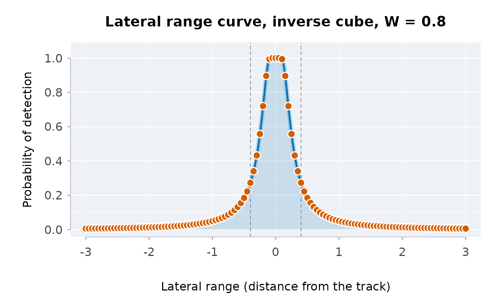

``` r

plot(lr, equiv = TRUE)
```

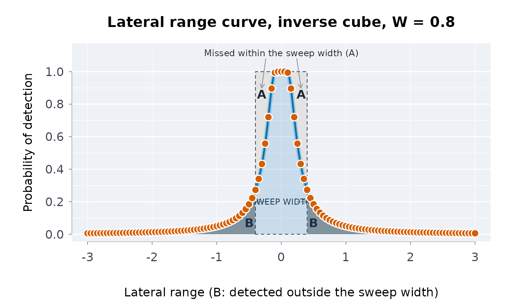

A sweep width can also come from a field trial: the share of objects
detected at each lateral range, measured on both sides of the track.
[`swpwdth()`](https://rootcoder007.github.io/rmorie-bricklayer/reference/ltrlrng.md)
integrates the curve.

``` r

d <- c(-3, -2, -1.5, -1, -0.5, -0.25, 0, 0.25, 0.5, 1, 1.5, 2, 3)
p <- c(0.01, 0.08, 0.2, 0.45, 0.75, 0.9, 0.95, 0.9, 0.75, 0.45, 0.2, 0.08, 0.01)
swpwdth(d, p)
#> [1] 2.03
```

The probability of detection for the coverage a plan gives (coverage is
sweep width times track length over the area), and for parallel sweeps
at a track spacing of 1 with a navigation error of 0.1:

``` r

pd <- srchpod(seq(0, 3, by = 0.1), model = "invcube")
plot(pd)
```

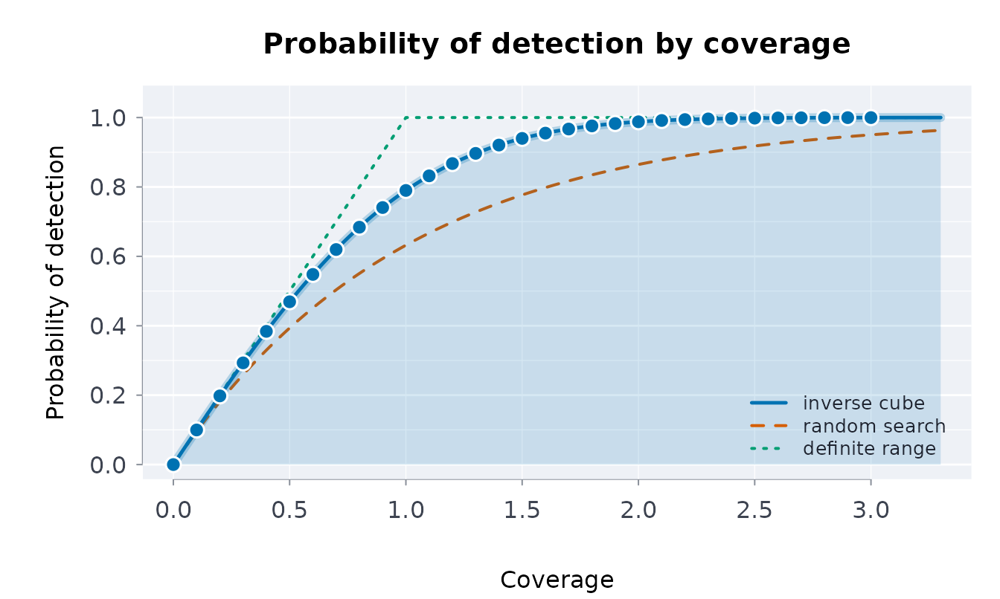

``` r

pswppod(W = 0.8, S = 1, navsd = 0.1)
#> [1] 0.6806056
```

After a search of three areas that found nothing, the chance the object
is in each area is updated by what each search could have detected:

``` r

srchscs(poc = c(0.5, 0.3, 0.2), pod = c(0.8, 0.5, 0))
#> ── Probability of success ──────────────────────────────────────── 
#>   POS 0.55 after 1 search
#> 
#>  area poc cumpod posarea pocupd
#>     1 0.5    0.8    0.40 0.2222
#>     2 0.3    0.5    0.15 0.3333
#>     3 0.2    0.0    0.00 0.4444
#> ──────────────────────────────────────────────────────────────────
```

## Planning a search, start to finish

The same steps plan a real search. A hiker is overdue; the last known
position is 2 km east and 3 km north of the base, and with the time and
terrain since then the position could be off by about 1.5 km (one
standard deviation). Lay a grid over the area, in kilometres, and put
the probability of where the hiker may be on it:

``` r

xe <- seq(-4, 8, by = 0.5)
ye <- seq(-3, 9, by = 0.5)
m <- datumpmap(xe, ye, center = c(2, 3), sigma = 1.5)
plot(m)
```

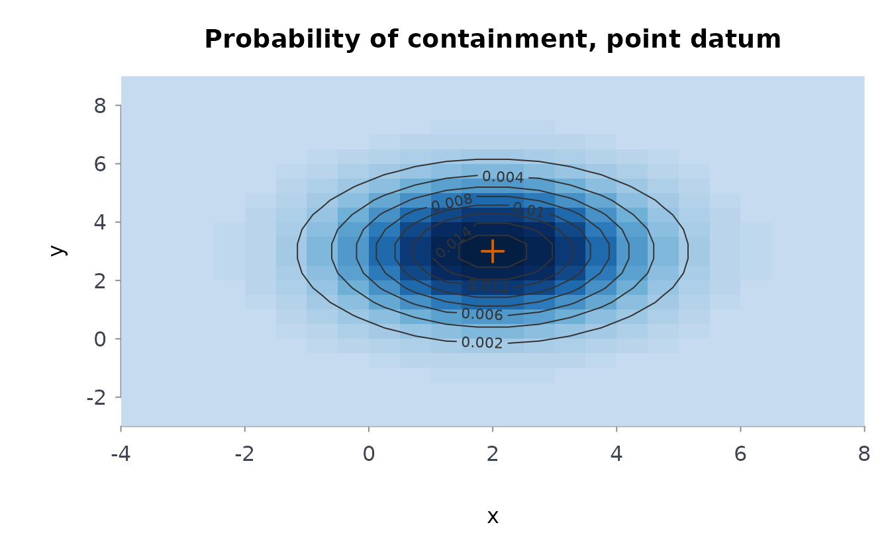

The ground teams’ sweep width is 0.6 km (from a published table for the
terrain and object, or from a trial of your own as above), and they can
walk 40 km of track today.
[`opteffort()`](https://rootcoder007.github.io/rmorie-bricklayer/reference/ltrlrng.md)
spreads those 40 km over the cells to make the chance of finding the
hiker as large as possible:

``` r

day1 <- opteffort(m, W = 0.6, effort = 40)
day1$pos
#> [1] 0.5471492
plot(day1)
```

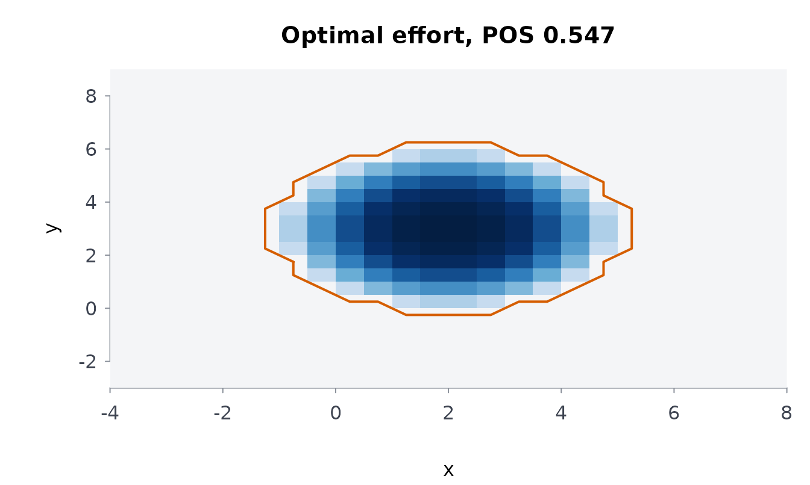

`day1$effort` is the track length to walk in each cell, and `day1$pod`
the chance of detection there. If the day ends without a find, each
cell’s probability is updated by what was searched (cells searched hard
become less likely, the rest more likely), and the next day is planned
on the updated map:

``` r

upd <- srchscs(as.vector(m$poc), as.vector(day1$pod))
poc2 <- matrix(upd$pocupd, nrow = nrow(m$poc))
day2 <- opteffort(poc2, area = rep(0.25, length(poc2)), W = 0.6, effort = 40)
day2$pos
#> [1] 0.4068465
```

## On a grid of your own

The same functions take any grid and datum.
[`opteffort()`](https://rootcoder007.github.io/rmorie-bricklayer/reference/ltrlrng.md)
spreads a total track length over the cells to make the probability of
success as large as possible (Stone 1975), and
[`srchscs()`](https://rootcoder007.github.io/rmorie-bricklayer/reference/ltrlrng.md)
updates the containment after a search that finds nothing.

``` r

m <- datumpmap(seq(-6, 6, by = 0.5), seq(-6, 6, by = 0.5), sigma = 2)
a <- opteffort(m, W = 1, effort = 30)
a$pos
#> [1] 0.455821
optcrcsrch(sigma = 2, W = 1, effort = 30)$pos
#> [1] 0.4571532
plot(a)
```


``` r

srchscs(c(0.5, 0.3, 0.2), c(0.8, 0.5, 0))
#> ── Probability of success ──────────────────────────────────────── 
#>   POS 0.55 after 1 search
#> 
#>  area poc cumpod posarea pocupd
#>     1 0.5    0.8    0.40 0.2222
#>     2 0.3    0.5    0.15 0.3333
#>     3 0.2    0.0    0.00 0.4444
#> ──────────────────────────────────────────────────────────────────
```

## References

Frost, J. R. (1996). The Theory of Search: A Simplified Explanation.
Soza and Company and U.S. Coast Guard Office of Search and Rescue.
Chapters 3-6 and their figures.

Koopman, B. O. (1946). Search and Screening. OEG Report 56, Office of
the Chief of Naval Operations.

Koopman, B. O. (1956-1957). The theory of search, parts I-III.
Operations Research 4(3), 324-346; 4(5), 503-531; 5(5), 613-626.

Stone, L. D. (1975). Theory of Optimal Search. Academic Press.
