# Survey, causal and statistical methods

## Complex survey estimation

A survey respondent stands for many people, and not the same number
each: the final weight says how many. The weights fix the estimate; the
design (how the sample was drawn) fixes its uncertainty, and ignoring it
usually understates the interval.
[`svydes()`](https://rootcoder007.github.io/rmorie-bricklayer/reference/svydes.md)
records the design,
[`svyest()`](https://rootcoder007.github.io/rmorie-bricklayer/reference/svyest.md)
gives means, totals, proportions and ratios with design-based standard
errors, and
[`svycmp()`](https://rootcoder007.github.io/rmorie-bricklayer/reference/svycmp.md)
tests differences between groups.

### Two ways to the variance

Public-use files from Statistics Canada and Health Canada ship
**replicate weights**: hundreds of alternative weight columns, each a
resampled version of the design. The estimate is recomputed under each
and the spread of those estimates is the variance. Other surveys ship
the **strata and primary sampling units** (PSUs), and the variance comes
from Taylor linearization.

``` r

set.seed(1)
n <- 600
d <- data.frame(region = sample(c("north", "south", "east"), n, replace = TRUE),
                age = sample(c("15-24", "25-49", "50+"), n, replace = TRUE),
                used = rbinom(n, 1, 0.3), drinks = rpois(n, 3), w = runif(n, 40, 160))
# a stratified design: variance by linearization
lin <- svydes(d, w = "w", strata = "region")
lin
#> Survey design: 600 respondents, weights summing to 60,110
#> Variance: Taylor linearization, 3 strata, 600 PSUs
# a replicate design: 200 bootstrap weights, made here by resampling within region
reps <- sapply(1:200, function(r) {
  m <- numeric(n)
  for (g in unique(d$region)) {
    i <- which(d$region == g)
    m[i] <- tabulate(sample(length(i), replace = TRUE), length(i)) * length(i) / (length(i) - 1)
  }
  d$w * m
})
repdes <- svydes(d, w = "w", reps = reps, type = "bootstrap")
repdes
#> Survey design: 600 respondents, weights summing to 60,110
#> Variance: 200 replicate weights, bootstrap; scale 0.005, centred on the full-sample estimate
```

### Estimates by domain

A domain (a region, an age group) is estimated inside the whole design:
a respondent outside it counts zero, but stays in the design. That is
what makes the subgroup’s variance right.

``` r

e <- svyest(repdes, d, "used", by = "age", stat = "proportion", lvls = "1")
e
#> Survey proportion of used by age (bootstrap variance, 95% wilson interval)
#>    age level estimate      se  lower  upper     cv   n flag
#>  15-24     1   0.3681 0.03560 0.3018 0.4398  9.671 206   NA
#>  25-49     1   0.2967 0.03063 0.2375 0.3635 10.324 199   NA
#>    50+     1   0.2333 0.03067 0.1790 0.2982 13.147 195   NA
plot(e)
```

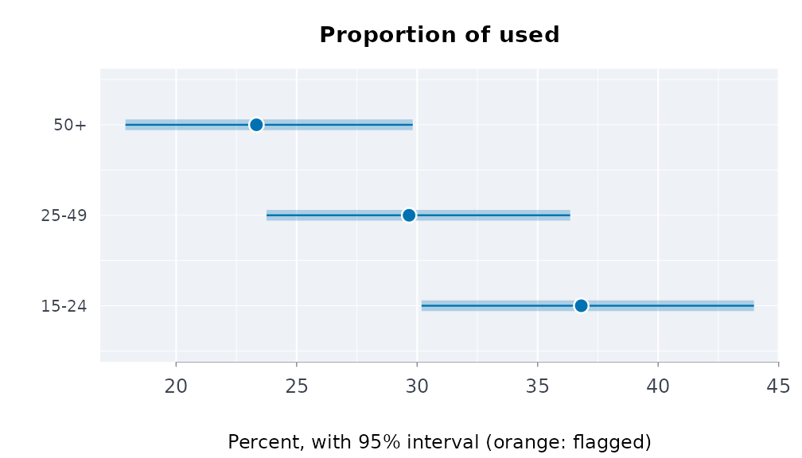

``` r

svyest(lin, d, "drinks", by = "region")
#> Survey mean of drinks by region (linearization variance, 95% wald interval)
#>  region estimate     se lower upper    cv   n flag
#>    east    2.857 0.1245 2.614 3.101 4.356 186   NA
#>   north    2.822 0.1254 2.577 3.068 4.442 220   NA
#>   south    3.046 0.1282 2.794 3.297 4.210 194   NA
```

Proportions get the modified Wilson interval of SAS PROC SURVEYFREQ (the
effective sample size $`n/\mathrm{Deff}`$, adjusted for the design’s
degrees of freedom and never above $`n`$); it stays inside 0 to 100% and
behaves near the ends. Domains with fewer than 30 respondents are
flagged, the rule Health Canada uses to suppress estimates in its data
tool; here nothing is withheld, and the flag travels with the row.

### Comparing groups

Two overlapping intervals do not mean two groups are the same, and two
separate intervals leave out the covariance between the estimates.
[`svycmp()`](https://rootcoder007.github.io/rmorie-bricklayer/reference/svycmp.md)
takes the difference within the design:

``` r

cmp <- svycmp(repdes, d, "used", by = "region", stat = "proportion", lvls = "1",
                      ref = "north")
cmp
#> Survey proportion of used against north (95% interval)
#>  domain level estimate reference difference      se    lower   upper p_value
#>    east     1   0.3074    0.3082  -0.000804 0.04468 -0.08838 0.08677  0.9856
#>   south     1   0.2862    0.3082  -0.021992 0.05139 -0.12272 0.07874  0.6687
plot(cmp)
```

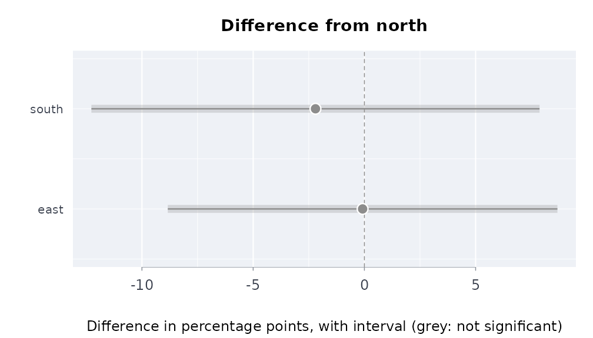

### The Canadian Substance Use Survey, against the published figures

CSUS 2023 ships 1,000 **mean bootstrap** weights, each the average of 12
bootstrap weights, so the bootstrap variance is multiplied by 12 (Health
Canada’s technical notes; the same as Fay’s BRR with
$`\rho = 1 - 1/\sqrt{12}`$). The public-use file and its weights are on
data.rmorie.com (sign in once with `rmbl login`), where
[`dload()`](https://rootcoder007.github.io/rmorie-bricklayer/reference/dmnf.md)
checks each table against the SHA-256 its manifest lists:

``` r

a <- dload("csus_2023/pumf")        # 36,180 respondents
b <- dload("csus_2023/bootstrap")   # PUMF_ID, WGT_PUMF and BWGT1 ... BWGT1000
```

Or, without signing in, from Health Canada’s own copies on the Open
Government Portal (the same files, 612 MB for the weights):

``` r

src <- "https://open.canada.ca/data/dataset/65e2d45e-efc6-4c29-9a9b-db59bc96aa0e/resource"
pumf <- file.path(tempdir(), "csus2023_pumf_final.csv")
bwt <- file.path(tempdir(), "csus2023_pumf_bwt.csv")
bldl(paste0(src, "/c2c1795b-4501-49ba-9dd1-5b8360cc3b2e/download/",
                           "csus2023_pumf_final.csv"), pumf)
bldl(paste0(src, "/7d19d47a-5f42-4447-b735-aa4d677ad5ed/download/",
                           "csus2023_pumf_bwt.csv"), bwt)
a <- utils::read.csv(pumf)
b <- utils::read.csv(bwt)
# With rmorie installed, the same two files come from
# rmorie::morie_load_dataset() with the keys "cu23mf" and "cu23bt".
```

Either way, the design and the lifetime cannabis question are:

``` r

a$can <- ifelse(a$CAN_Q01 < 0, NA, a$CAN_Q01)   # -8: not stated
des <- svydes(a, w = "WGT_PUMF", reps = b, id = "PUMF_ID",
                     type = "meanboot", msize = 12)
svyest(des, a, "can", stat = "proportion", lvls = c("1", "2"))
```

Run on 13 October 2026 (1.6 seconds for the 1,000 replicates), against
Health Infobase’s published table:

| Lifetime cannabis use | Published % | Published 95% CI | Here % | Here 95% CI |
|----|----|----|----|----|
| Yes, just once | 9.907782 | 9.544212 to 10.28363 | 9.907816 | 9.522047 to 10.30743 |
| Yes, more than once | 53.192923 | 52.677340 to 53.70783 | 53.193086 | 52.677503 to 53.70799 |

The percentages agree to the fourth decimal, and so does the second
interval, whose design effect is below one so the interval is the plain
Wilson one at the 36,024 respondents. The first interval is slightly
wider here: Health Canada computed from its master file, and the
public-use weights are not identical to it (the percentages differ in
the fifth significant digit).

### When you only have the published table

Often there is no microdata, only the published table: an estimate and
its 95% limits for each group. The limits carry the design. A standard
error is the limits’ width over $`2z`$, and it includes the design
effect of the survey’s weights and clusters.
[`scests()`](https://rootcoder007.github.io/rmorie-bricklayer/reference/scests.md)
puts each Statistics Canada estimate beside its limits.
[`indgap()`](https://rootcoder007.github.io/rmorie-bricklayer/reference/indgap.md),
[`dstntst()`](https://rootcoder007.github.io/rmorie-bricklayer/reference/dstntst.md)
and
[`ordcmp()`](https://rootcoder007.github.io/rmorie-bricklayer/reference/ordcmp.md)
then compare groups from them.

They treat the groups as independent samples. Disjoint domains of one
survey nearly are, but not exactly, since they share strata and
clusters. The exact comparison needs the bootstrap weights, which
Statistics Canada holds in its Research Data Centres.

Perceived mental health of First Nations, Metis and Inuit adults living
off reserve, 2019/2022 (table 13-10-0924-01):

``` r

h <- indiex("health")
mh <- h[h$period == "2019/2022" & h$age == "Total, 18 years and over" &
          h$indicator == "Perceived mental health, very good or excellent", ]
indgap(mh, "group", "estimate", "lower", "upper", qual = "quality")[
  , c("group", "difference", "diflo", "difup")]
#>           group difference     diflo      difup
#> 1 First Nations      -15.7 -18.53593 -12.864070
#> 2         Métis       -8.7 -11.58531  -5.814692
#> 3         Inuit      -13.7 -20.16568  -7.234321
dstntst(mh[mh$group != "Non-Indigenous", ], "group", "estimate", "lower", "upper")
#> Distinctions test across 3 groups: Q = 11.97 on 2 df, p = 0.00252, I^2 = 83%
#> Pooled (inverse-variance) 49.11; the groups differ: report each one, not the pooled figure
```

### Linearization or replicates, the same answer

On the same data the two routes agree closely when the replicates come
from the same design:

``` r

rbind(linearization = svyest(lin, d, "drinks")[, c("estimate", "se")],
      bootstrap = svyest(repdes, d, "drinks")[, c("estimate", "se")])
#>  estimate      se
#>     2.906 0.07295
#>     2.906 0.07324
```

Every variance formula here is checked in the package tests against the
survey package to machine precision: linearized means, totals, ratios,
proportions and domains with a finite population correction; JK1,
bootstrap and Fay replicate designs; and differences between domains.

## Causal effects with cross-fitted double machine learning

[`plrcf()`](https://rootcoder007.github.io/rmorie-bricklayer/reference/plrcf.md)
estimates the average effect of a treatment on an outcome when the
treated and the untreated differ in measured ways (confounders). It fits
the partially linear model

``` math
 Y = \theta D + g(X) + \varepsilon, \qquad D = m(X) + v, 
```

by the double machine learning recipe of Chernozhukov et al. (2018): the
outcome and the treatment are each predicted from the confounders $`X`$
on folds the row was not part of (cross-fitting), and $`\theta`$ is the
regression of the outcome residuals on the treatment residuals (DML2),
with a sandwich standard error. When the effect is the same for
everyone, $`\theta`$ is the average treatment effect (ATE); otherwise it
is a variance-weighted average of the individual effects.
[`exprspplr()`](https://rootcoder007.github.io/rmorie-bricklayer/reference/exprspplr.md)
bootstraps the same estimator for a continuous exposure (see the
air-pollution vignette). The nuisances $`g`$ and $`m`$ are ordinary
least squares fits, so $`\theta`$ is consistent when they are linear in
the columns given; add squares, interactions or splines as columns where
they are not.

### A known effect, recovered

Confounding biases the simple comparison; the cross-fitted estimate
removes it. Here the true effect of `d` on `y` is 2, and `x1` drives
both:

``` r

set.seed(42)
n <- 2000
sim <- data.frame(x1 = rnorm(n), x2 = rnorm(n))
sim$d <- rbinom(n, 1, plogis(1.5 * sim$x1))
sim$y <- 2 * sim$d + 3 * sim$x1 + sim$x2 + rnorm(n)
mean(sim$y[sim$d == 1]) - mean(sim$y[sim$d == 0])   # biased by x1
#> [1] 5.373073
fit <- plrcf(sim, "y", "d", c("x1", "x2"))
fit$ate
#> [1] 2.039439
fit$ate + c(-1.96, 1.96) * fit$se
#> [1] 1.938179 2.140699
```

### The NSW job-training experiment, and what observational data can recover

LaLonde (1986) took the National Supported Work Demonstration, a
randomised job-training programme of the 1970s, and asked whether the
econometric methods of the day could recover its experimental effect on
1978 earnings when the randomised controls are replaced by a survey
sample (the PSID). Dehejia and Wahba (1999) kept the men with 1974
earnings: 185 treated, 260 randomised controls, and 2,490 PSID-1
comparison men. The three files are on data.rmorie.com (`rmbl login`
once), checked against the SHA-256 the manifest lists:

``` r

tr <- dload("nsw_dw/treated")
ct <- dload("nsw_dw/control")
ps <- dload("nsw_dw/psid_controls")
```

Or, without signing in, from Rajeev Dehejia’s own pages
(whitespace-separated text):

``` r

cols <- c("treat", "age", "educ", "black", "hisp", "married", "nodegree", "re74", "re75", "re78")
nber <- function(f) {
  dest <- file.path(tempdir(), f)
  bldl(paste0("https://users.nber.org/~rdehejia/data/", f), dest)
  stats::setNames(utils::read.table(dest), cols)
}
tr <- nber("nswre74_treated.txt")
ct <- nber("nswre74_control.txt")
ps <- nber("psid_controls.txt")
```

The PSID men are older, more often married and earned about nine times
as much before the programme; the randomised controls look like the
treated:

| Mean                | age   | educ  | black | married | nodegree | re74      | re75      |
|---------------------|-------|-------|-------|---------|----------|-----------|-----------|
| Treated             | 25.82 | 10.35 | 0.84  | 0.19    | 0.71     | 2,095.57  | 1,532.06  |
| Randomised controls | 25.05 | 10.09 | 0.83  | 0.15    | 0.83     | 2,107.03  | 1,266.91  |
| PSID controls       | 34.85 | 12.12 | 0.25  | 0.87    | 0.31     | 19,428.75 | 19,063.34 |

The experimental benchmark, and the same question asked of the
observational sample:

``` r

x <- c("age", "educ", "black", "hisp", "married", "nodegree", "re74", "re75")
exp <- rbind(tr, ct)
obs <- rbind(tr, ps)
mean(tr$re78) - mean(ct$re78)                 # the experiment
mean(tr$re78) - mean(ps$re78)                 # treated against the PSID, unadjusted
plrcf(exp, "re78", "treat", x)
plrcf(obs, "re78", "treat", x)
plrcf(obs, "re78", "treat", x, kfol = 10, seed = 2)
```

Run on 15 October 2026 (1982 US dollars of 1978 earnings):

| Sample and estimator | Effect | Standard error | 95% interval |
|----|----|----|----|
| Experiment, difference in means | 1,794.3 |  |  |
| Experiment, [`plrcf()`](https://rootcoder007.github.io/rmorie-bricklayer/reference/plrcf.md) | 1,695.9 | 680.8 | 361.5 to 3,030.2 |
| Treated vs PSID, difference in means | -15,204.8 |  |  |
| Treated vs PSID, [`plrcf()`](https://rootcoder007.github.io/rmorie-bricklayer/reference/plrcf.md) | 618.3 | 791.1 | -932.3 to 2,168.9 |
| Treated vs PSID, [`plrcf()`](https://rootcoder007.github.io/rmorie-bricklayer/reference/plrcf.md), 10 folds, seed 2 | 748.4 | 777.5 | -775.5 to 2,272.3 |

Adjusting for the eight pre-programme covariates turns a
fifteen-thousand-dollar penalty into a small positive effect whose
interval covers the experimental one, though it sits well below it and
is far less precise. Two things limit it. The nuisances are linear, so
the large earnings gap is adjusted for only as a straight line; and the
overlap is thin: most PSID men earned more before the programme than
almost any treated man, so the comparison rests on the few who look like
them. Dehejia and Wahba show that trimming the comparison group to the
region of common support (on an estimated propensity score) brings the
observational estimate close to the experiment; with
[`plrcf()`](https://rootcoder007.github.io/rmorie-bricklayer/reference/plrcf.md),
restrict `obs` to that region before fitting. The cross-fit split moves
the estimate by about a sixth of a standard error, which is why the seed
and the number of folds are arguments.

### Overlap and balance

Two checks belong with every weighting estimate: whether the two groups
overlap (each person has a real chance of either treatment) and whether
weighting balances the covariates. On simulated data, where the true
effect is 3:

``` r

set.seed(7)
n <- 1500
d <- data.frame(age = runif(n, 18, 70), income = rnorm(n))
d$t <- rbinom(n, 1, plogis(-2 + 0.04 * d$age + 0.5 * d$income))
d$y <- 10 + 3 * d$t + 0.2 * d$age + d$income + rnorm(n)
fit <- aipwcf(d, "y", "t", c("age", "income"), lrn = "ols")
fit
#> Cross-fitted AIPW, ATE: 1500 rows, 684 treated
#>  estimate      se lower upper p_value
#>     3.071 0.05606 2.961 3.181       0
#> Propensities from 0.086 to 0.903; 0 clipped
plot(fit)
```

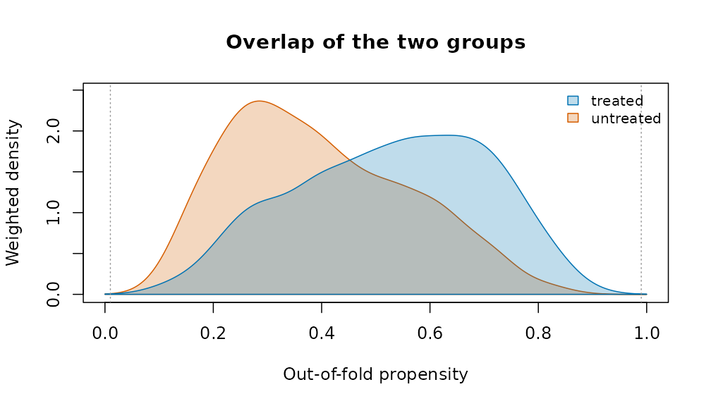

``` r

plot(fit, type = "estimate")
```

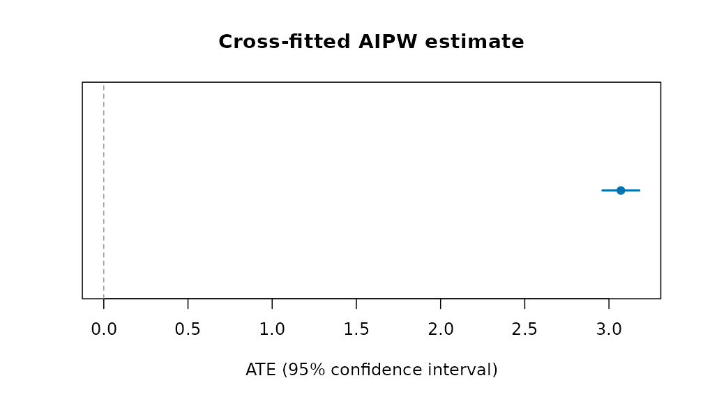

``` r

pr <- attr(fit, "propensity")
e <- pmin(pmax(pr$propensity, 0.01), 0.99)
d$ipw <- ifelse(d$t == 1, 1 / e, 1 / (1 - e))
plot(baltab(d, "t", c("age", "income")),
     after = baltab(d, "t", c("age", "income"), w = "ipw"))
```

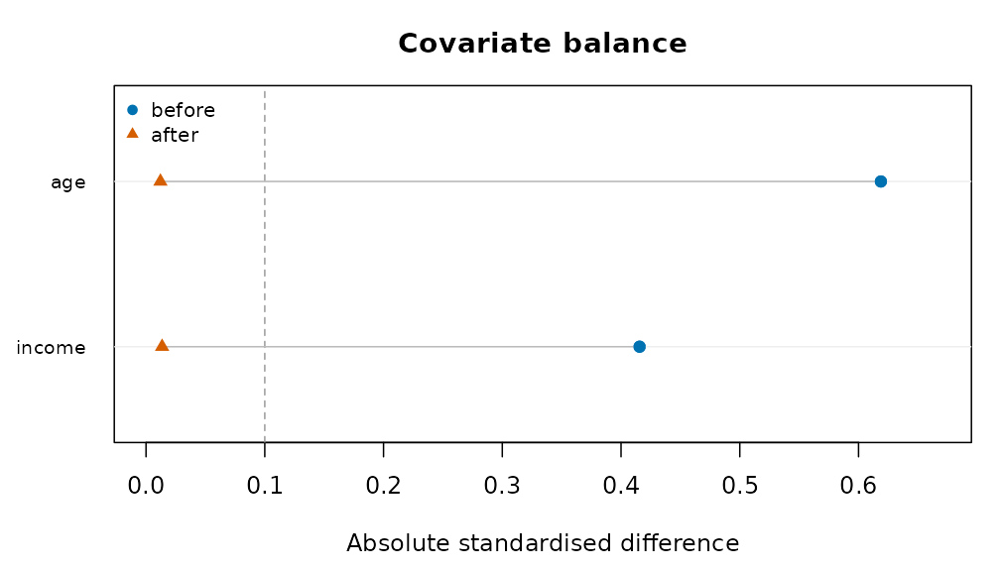

The groups overlap where both curves have mass; after weighting, both
covariates fall below the 0.1 line.

### Indigenous examples

The person-level questions this vignette is about (does a strong sense
of belonging go with better mental health once circumstances are held
equal?) need the survey microdata, which Statistics Canada distributes
as a public use file;
[`aipwcf()`](https://rootcoder007.github.io/rmorie-bricklayer/reference/aipwcf.md)
with `design = svydes(...)` takes its bootstrap weights directly. The
published tables bundled with the package support the group-level
questions; for those see
[`vignette("applied-analyses")`](https://rootcoder007.github.io/rmorie-bricklayer/articles/applied-analyses.md).
A comparison of the published estimates themselves:

``` r

hi <- indiex("health")
x <- hi[hi$period == "2019/2022" & hi$age == "Total, 18 years and over" &
          hi$indicator == "Perceived mental health, very good or excellent", ]
indgap(x, "group", "estimate", "lower", "upper", qual = "quality")[
  , c("group", "estimate", "refest", "difference", "diflo",
      "difup")]
#>           group estimate refest difference     diflo      difup
#> 1 First Nations     45.8   61.5      -15.7 -18.53593 -12.864070
#> 2         Métis     52.8   61.5       -8.7 -11.58531  -5.814692
#> 3         Inuit     47.8   61.5      -13.7 -20.16568  -7.234321
```

### References

Chernozhukov, V., Chetverikov, D., Demirer, M., Duflo, E., Hansen, C.,
Newey, W. and Robins, J. (2018). Double/debiased machine learning for
treatment and structural parameters. *The Econometrics Journal* 21(1),
C1-C68.

Dehejia, R. H. and Wahba, S. (1999). Causal effects in nonexperimental
studies: reevaluating the evaluation of training programs. *Journal of
the American Statistical Association* 94(448), 1053-1062.

LaLonde, R. J. (1986). Evaluating the econometric evaluations of
training programs with experimental data. *American Economic Review*
76(4), 604-620.

## Evaluating a policy from administrative panels

A reform reaches some places before others: a new criminal procedure
rolled out district by district, a policing program adopted city by
city, a ward boundary redrawn. Agencies publish the outcomes as counts
or rates by place and period. This vignette covers the designs that turn
such a table into an estimate of the reform’s effect, with honest
uncertainty. Each estimator gives the same answer as the reference
implementation (`fixest`, `did`, `bacondecomp`) to rounding error, and
none of them needs a package outside base R.

The examples use
[`polex()`](https://rootcoder007.github.io/rmorie-bricklayer/reference/polex.md):
twenty districts in four regions over 36 months, with a reform that
reaches the regions in three stages (months 13, 19 and 25) and never
reaches the fourth. The numbers are made up, with a known effect: the
reform lowers the crime rate by 3.

``` r

p <- polex()
head(p)
#>   district region month refmonth reformed population   logpop crimes crmrate
#> 1      D01     R1     1       13        0     152152 11.93264     80  39.732
#> 2      D01     R1     2       13        0     152152 11.93264     56  42.708
#> 3      D01     R1     3       13        0     152152 11.93264     68  41.228
#> 4      D01     R1     4       13        0     152152 11.93264     68  43.296
#> 5      D01     R1     5       13        0     152152 11.93264     62  42.036
#> 6      D01     R1     6       13        0     152152 11.93264     59  40.197
#>   arrrate
#> 1  15.394
#> 2  16.387
#> 3  16.043
#> 4  17.148
#> 5  15.443
#> 6  15.568
```

### Difference in differences

[`plndid()`](https://rootcoder007.github.io/rmorie-bricklayer/reference/plndid.md)
fits the two-way fixed-effects regression, with standard errors
clustered by unit (or any coarser grouping), and reports the effect
relative to the comparison units’ mean before the reform:

``` r

plndid(p, "district", "month", "crmrate", "reformed")
#> Difference in differences: 720 observations, 20 clusters
#>     term estimate     se  lower  upper      t  p_value
#>  treated   -3.232 0.1164 -3.475 -2.988 -27.76 7.66e-17
#> Effect relative to the comparison units' pre-period mean (26.52): -12.2%
```

### Before any model

[`cohtrnd()`](https://rootcoder007.github.io/rmorie-bricklayer/reference/cohtrnd.md)
shows each adoption cohort’s outcome around its adoption, scaled to 1
just before it:

``` r

plot(cohtrnd(p, "district", "month", "crmrate", "refmonth", win = c(-10, 10)))
```


### Leads and lags

[`evstudy()`](https://rootcoder007.github.io/rmorie-bricklayer/reference/evstudy.md)
estimates the effect period by period around adoption. The leads
(periods before adoption) should be near zero; the joint test of that is
printed below the table:

``` r

es <- evstudy(p, "district", "month", "crmrate", "refmonth", leads = 4, lags = 6)
es
#> Event study: 720 observations, 20 clusters
#>  evtm estimate     se   lower  upper       t   p_value
#>    -4  0.07546 0.3433 -0.6431  0.794  0.2198 8.284e-01
#>    -3 -0.31658 0.6646 -1.7076  1.074 -0.4763 6.393e-01
#>    -2  0.41249 0.4327 -0.4931  1.318  0.9534 3.524e-01
#>    -1  0.00000 0.0000  0.0000  0.000      NA        NA
#>     0 -3.20456 0.4630 -4.1737 -2.235 -6.9207 1.344e-06
#>     1 -3.16882 0.4427 -4.0954 -2.242 -7.1580 8.390e-07
#>     2 -3.44256 0.5254 -4.5422 -2.343 -6.5522 2.836e-06
#>     3 -3.22263 0.5659 -4.4070 -2.038 -5.6951 1.725e-05
#>     4 -3.17395 0.3626 -3.9328 -2.415 -8.7537 4.291e-08
#>     5 -2.93264 0.3955 -3.7603 -2.105 -7.4158 5.072e-07
#>     6 -3.13434 0.4182 -4.0097 -2.259 -7.4940 4.362e-07
#> Leads jointly zero: F(3, 19) = 1.263, p = 0.3152
plot(es)
```


### Staggered adoption

When districts adopt at different times, the two-way estimate uses
districts already treated as controls for later ones.
[`bacondcmp()`](https://rootcoder007.github.io/rmorie-bricklayer/reference/bacondcmp.md)
shows how much weight those comparisons get:

``` r

b <- bacondcmp(p, "district", "month", "crmrate", "reformed")
tapply(b$weight, b$type, sum)
#> earlier vs later later vs earlier treated vs never 
#>        0.2093023        0.2093023        0.5813953
plot(b)
```


[`stgatt()`](https://rootcoder007.github.io/rmorie-bricklayer/reference/stgatt.md)
avoids them: each cohort is compared only with districts not yet treated
(Callaway and Sant’Anna), or the regression has a coefficient for every
cohort and period (Wooldridge). The bootstrap resamples whole districts:

``` r

s <- stgatt(p, "district", "month", "crmrate", "refmonth", reps = 99, seed = 1)
s$overall
#>    estimate        se     lower     upper
#> 1 -2.825844 0.3400471 -3.492324 -2.159364
plot(s)
```


For a treatment that can switch off as well as on,
[`swtdid()`](https://rootcoder007.github.io/rmorie-bricklayer/reference/swtdid.md)
compares the units that switch with those that do not, in the period
they switch, with a placebo one period earlier:

``` r

swtdid(p, "district", "month", "crmrate", "reformed", reps = 99, seed = 1)
#>      term   estimate        se     lower      upper switchers
#> 1  effect -3.1355000 0.4555572 -4.028376 -2.2426243        15
#> 2 placebo -0.5169222 0.4429911 -1.385169  0.3513245        15
```

### Inference from the assignment

With four regions there are only 24 ways to assign the three stages and
the never-treated region.
[`perminf()`](https://rootcoder007.github.io/rmorie-bricklayer/reference/perminf.md)
tries every one, and gives the share at least as extreme as the real
assignment. With two outcomes it also gives Westfall and Young’s
stepdown p-values, which hold the chance of any false positive at the
nominal level:

``` r

r <- perminf(p, "district", "month", c("crmrate", "arrrate"), "refmonth",
                           cl = "region")
r
#>   outcome   estimate  statistic    p_value     pstpdn assignments exact
#> 1 crmrate -3.2316395 -19.516735 0.04166667 0.04166667          24  TRUE
#> 2 arrrate -0.2136969  -3.638159 0.12500000 0.12500000          24  TRUE
plot(r, type = "histogram")
```

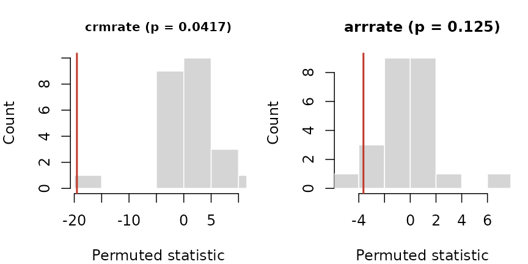

[`loounit()`](https://rootcoder007.github.io/rmorie-bricklayer/reference/loounit.md)
checks that no single district drives the estimate:

``` r

plot(loounit(p, "district", "month", "crmrate", "reformed"))
```


Several outcomes at once, in the style of a Stata event-study figure:

``` r

plotevgrid(list(
  "Crime rate" = es,
  "Arrest rate" = evstudy(p, "district", "month", "arrrate", "refmonth", leads = 4,
                              lags = 6)), style = "stata")
```


### Counts

For counts,
[`plnpois()`](https://rootcoder007.github.io/rmorie-bricklayer/reference/plnpois.md)
gives the effect as a rate ratio, with the population as exposure:

``` r

plnpois(p, "district", "month", "crimes", "reformed", offset = "logpop")
#>      term  estimate         se rateratio     lower     upper      p_value
#> 1 treated -0.092146 0.02220761  0.911972 0.8731289 0.9525431 3.334947e-05
```

### One treated place

[`synctl()`](https://rootcoder007.github.io/rmorie-bricklayer/reference/synctl.md)
builds a weighted average of untreated places that tracks the treated
one before the reform, and runs the same method on each untreated place
as a placebo:

``` r

p13 <- p[is.na(p$refmonth) | p$district == "D13", ]
sc <- synctl(p13, "district", "month", "crmrate", "D13", adopt = 13)
sc
#> Synthetic control for D13, adoption at 13
#> Donor weights: D12 0.408, D04 0.376, D20 0.185, D16 0.031 
#> Pre-period RMSPE 0.7638; mean gap after adoption -3.107; post/pre RMSPE ratio 4.33
#> Placebo-in-space p = 0.167 (5 placebos)
plot(sc)
```


### Measures for justice data

Three measures prepare the outcomes these designs take:

- [`sevidx()`](https://rootcoder007.github.io/rmorie-bricklayer/reference/sevidx.md)
  combines offence rates, weighted by each offence’s severity (for
  example its mean statutory sentence);
- [`piperate()`](https://rootcoder007.github.io/rmorie-bricklayer/reference/piperate.md)
  gives the rate at which one stage of the justice process follows
  another, with the input’s window set before the outcome’s, because
  cases take time;
- [`cmlrisk()`](https://rootcoder007.github.io/rmorie-bricklayer/reference/cmlrisk.md)
  gives the chance of a first arrest (or conviction, or placement) by
  each age, from first events and the population.

For place-based designs,
[`bufasgn()`](https://rootcoder007.github.io/rmorie-bricklayer/reference/bufasgn.md)
marks places near a site as treated, places near a comparison point and
far from every site as the comparison, and excludes the rest.

``` r

d <- data.frame(city = rep(c("A", "B"), each = 3), year = 2024,
                offence = rep(c("homicide", "robbery", "burglary"), 2),
                n = c(5, 120, 300, 2, 90, 410), pop = rep(c(250000, 180000), each = 3))
sevidx(d, "city", "year", "offence", "n",
               w = c(homicide = 25, robbery = 8, burglary = 4), pop = "pop")
#>   unit time unweighted weighted
#> 1    A 2024   170.0000  914.000
#> 2    B 2024   278.8889 1338.889
cmlrisk(16:20, c(900, 1400, 1700, 1600, 1400), rep(1e5, 5))
#>   age     hazard atrisk cumrisk      lower       upper
#> 1  16 0.00900000 100000   0.009 0.00841449 0.009585164
#> 2  17 0.01412714  99100   0.023 0.02207046 0.023928652
#> 3  18 0.01740020  97700   0.040 0.03878469 0.041213777
#> 4  19 0.01666667  96000   0.056 0.05457388 0.057423968
#> 5  20 0.01483051  94400   0.070 0.06841727 0.071580045
```

### Doing better than the original designs

Published applications of these designs often share a few weaknesses,
and each has a remedy here.

**Few clusters.** A reform assigned to a handful of districts gives
cluster-robust tests that reject too often.
[`wcb()`](https://rootcoder007.github.io/rmorie-bricklayer/reference/wcb.md)
gives an honest p-value and interval; with four clusters it says plainly
that nothing can be rejected at 5%:

``` r

wcb(p, "district", "month", "crmrate", "reformed", cl = "region")
#>   estimate         t p_value lower upper clusters draws enumerated
#> 1 -3.23164 -19.51674   0.125  -Inf   Inf        4    16       TRUE
```

**Doubts about parallel trends.**
[`tse()`](https://rootcoder007.github.io/rmorie-bricklayer/reference/tse.md)
asks how large a departure from parallel trends, relative to the largest
seen before adoption, would make the effect vanish:

``` r

tse(es, seed = 1)
#> Sensitivity of the average post-period effect to departures from parallel trends (relative magnitudes)
#>  mbar lowerbnd upbound   lower   upper
#>   0.0   -3.183 -3.1828  -3.938 -2.4111
#>   0.5   -4.641 -1.7247  -6.987  0.1902
#>   1.0   -6.099 -0.2665 -10.199  3.3527
#>   1.5   -7.557  1.1916 -13.461  6.6212
#>   2.0   -9.015  2.6497 -16.729  9.8277
#> Breakdown: the interval first includes 0 at Mbar = 0.4677591
```

**Covariates that differ between groups.**
[`stgatt()`](https://rootcoder007.github.io/rmorie-bricklayer/reference/stgatt.md)
with `covariates` is doubly robust (use covariates fixed before
treatment: one the reform moves, such as arrests, is a bad control).
[`plndml()`](https://rootcoder007.github.io/rmorie-bricklayer/reference/plndml.md)
lets a machine learner fit the confounding with fixed effects, and
[`mtchdid()`](https://rootcoder007.github.io/rmorie-bricklayer/reference/mtchdid.md)
matches units on their pre-reform paths before differencing:

``` r

set.seed(4)
p$x1 <- rnorm(20)[match(p$district, unique(p$district))]
stgatt(p, "district", "month", "crmrate", "refmonth", covs = "x1", reps = 49,
              seed = 1)$overall
#>    estimate       se   lower    upper
#> 1 -2.459345 0.691214 -3.8141 -1.10459
m <- mtchdid(p, "district", "month", "crmrate", "refmonth", ratio = 2)
m$estimate
#> Difference in differences: 720 observations, 20 clusters
#>     term estimate     se  lower  upper      t   p_value
#>  treated   -3.081 0.1208 -3.334 -2.829 -25.51 3.672e-16
#> Effect relative to the comparison units' pre-period mean (26.3): -11.7%
```

**A single treated place, or a few.**
[`syndid()`](https://rootcoder007.github.io/rmorie-bricklayer/reference/syndid.md)
weights both comparison units and pre-periods:

``` r

sd <- syndid(p13, "district", "month", "crmrate", "refmonth", reps = 50, seed = 1)
sd
#> Synthetic difference in differences: -2.886 (placebo s.e. 0.5927; -4.047 to -1.724)
#> Unit weights: D12 0.207, D20 0.203, D04 0.201, D16 0.195, D08 0.195
plot(sd)
```

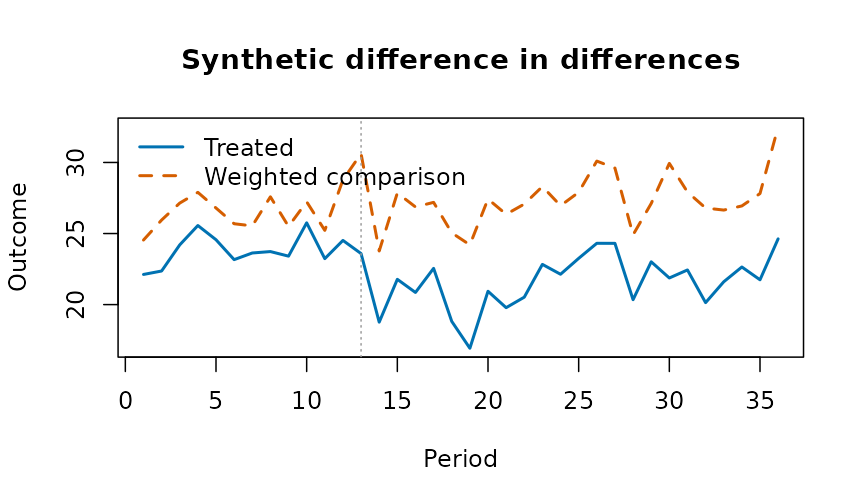

**Null results without a measure of power.**
[`plnpwr()`](https://rootcoder007.github.io/rmorie-bricklayer/reference/plnpwr.md)
simulates the design on the untreated data and gives the minimum
detectable effect:

``` r

pw <- plnpwr(p[p$month <= 12, ], "district", "month", "crmrate", ntrt = 10,
                  adopt = 7:10, eff = c(0, 0.5, 1, 1.5), reps = 40, seed = 1)
pw
#>  effect power
#>     0.0 0.050
#>     0.5 0.475
#>     1.0 1.000
#>     1.5 1.000
#> Size (rejections with no effect): 0.050 at alpha 0.050
#> Minimum detectable effect at this power: 0.8095
plot(pw)
```


### Indigenous examples

The methods here need a panel: units observed over time, some treated at
a known date. The bundled Indigenous tables are repeated cross-sections
of published estimates, so the before-and-after comparison they support
is the change in a gap, with its interval:

``` r

hi <- indiex("health")
x <- hi[hi$age == "Total, 18 years and over" &
          hi$indicator == "Perceived mental health, very good or excellent", ]
gaps <- do.call(rbind, lapply(split(x, x$period), function(p) {
  cbind(period = p$period[1],
        indgap(p, "group", "estimate", "lower", "upper")[
          , c("group", "difference", "diflo", "difup")])
}))
rownames(gaps) <- NULL
gaps
#>      period         group difference     diflo      difup
#> 1 2015/2018 First Nations      -10.8 -13.23311  -8.366895
#> 2 2015/2018         Métis       -9.6 -12.03311  -7.166895
#> 3 2015/2018         Inuit      -21.5 -27.31378 -15.686223
#> 4 2019/2022 First Nations      -15.7 -18.53593 -12.864070
#> 5 2019/2022         Métis       -8.7 -11.58531  -5.814692
#> 6 2019/2022         Inuit      -13.7 -20.16568  -7.234321
```

Perceived mental health fell for every group between the two cycles;
whether the gaps moved is read from the intervals, not the point
estimates.

### Acknowledgements

These designs are those of the empirical work of Professor Angela Zorro
Medina (University of Toronto) on criminal-procedure reform, political
dynasties, police stops and the cumulative risk of criminal justice
outcomes. The estimators themselves are the standard ones of the
literature cited on each help page.

### References

- Abadie A, Diamond A, Hainmueller J (2010). Synthetic control methods
  for comparative case studies. *Journal of the American Statistical
  Association* 105(490):493-505.
- Acosta C, Mejia D, Zorro Medina A (2023). On the tension between due
  process protection and public safety: the case of an extensive
  procedural reform in Colombia. SSRN 10.2139/ssrn.4585682.
- Callaway B, Sant’Anna PHC (2021). Difference-in-differences with
  multiple time periods. *Journal of Econometrics* 225(2):200-230.
- de Chaisemartin C, D’Haultfoeuille X (2020). Two-way fixed effects
  estimators with heterogeneous treatment effects. *American Economic
  Review* 110(9):2964-2996.
- Goodman-Bacon A (2021). Difference-in-differences with variation in
  treatment timing. *Journal of Econometrics* 225(2):254-277.
- Hepburn P, Kohler-Hausmann I, Zorro Medina A (2019). Cumulative risks
  of multiple criminal justice outcomes in New York City. *Demography*
  56(3):1161-1171.
- Ternullo S, Zorro-Medina A, Vargas R (2024). How political dynasties
  concentrate advantage within cities. *Social Forces* 102(4):1310-1331.
- Westfall PH, Young SS (1993). *Resampling-Based Multiple Testing*.
  Wiley.
- Wooldridge JM (2021). Two-way fixed effects, the two-way Mundlak
  regression, and difference-in-differences estimators. SSRN
  10.2139/ssrn.3906345.
- Zorro Medina A, Hackett D, Green D, Vargas R (2025). Evidence of donor
  bias in Chicago police stops. arXiv:2504.15140.

## Falsification controls and power curves: is the statistic real?

A capsule can prove that a statistic was computed from exactly these
bytes. It cannot, by itself, say whether the statistic means anything.
Two complementary checks address that: a **falsification control** asks
whether the statistic survives deliberate attempts to break it, and a
**power curve** asks whether the procedure could have detected an effect
of a given size at all. Both are borrowed from the refutation tests of
causal-inference practice (placebo treatments, random subsets,
permutation) and made to run on any statistic you can write as a
function of the data.

### Falsification controls

[`cpsfals()`](https://rootcoder007.github.io/rmorie-bricklayer/reference/cpsfals.md)
takes the data, a statistic (a function of the data frame) and the name
of the treatment column, and runs the controls that a real association
must pass:

- **permutation**: shuffle the treatment; the statistic should collapse
  toward its null;
- **placebo**: replace the treatment with noise; the statistic should
  collapse;
- **subsets**: recompute on random subsets; the statistic should stay
  stable.

``` r

set.seed(1)
d <- data.frame(x = rnorm(200))
d$y <- 0.8 * d$x + rnorm(200)

real <- cpsfals(d, function(z) cor(z$x, z$y), trt = "x", n = 199, seed = 42)
real$controls[, c("control", "passed")]
#>               control passed
#> 1         permutation   TRUE
#> 2             placebo   TRUE
#> 3 random_common_cause   TRUE
#> 4    subset_stability   TRUE
```

A statistic that ignores the data fails the controls that can see it. A
constant “0.5” passes the subset check (it is perfectly stable) and
fails the permutation check (it does not collapse when the treatment is
destroyed):

``` r

fake <- cpsfals(d, function(z) 0.5, trt = "x", n = 199, seed = 42)
fake$controls[fake$controls$control == "permutation", "passed"]
#> [1] FALSE
```

This is the point of running controls rather than looking at a p-value:
the p-value of a constant is undefined, but its behaviour under
permutation is not.

### Power curves

A null result is only informative if the procedure could have found
something.
[`cpspwr()`](https://rootcoder007.github.io/rmorie-bricklayer/reference/cpspwr.md)
injects an effect of known size into the data, re-runs the statistic
with its permutation test, and reports the detection rate at each size:

``` r

set.seed(1)
d <- data.frame(x = rnorm(120), y = rnorm(120))
inj <- function(z, size) {
  z$y <- z$y + size * z$x
  z
}

pw <- cpspwr(d, function(z) cor(z$x, z$y), inj,
                    sizes = c(0, 0.3, 0.6), trt = "x",
                    n = 99, reps = 5, seed = 42)
pw$curve
#>   size detected reps rate
#> 1  0.0        0    5    0
#> 2  0.3        5    5    1
#> 3  0.6        5    5    1
```

The rate at size 0 estimates the false-positive rate. With few
repetitions it is usually 0, because alpha is small (five draws at 0.05
come up empty about three times in four), so read it as a sanity check
that it is not *large*, not as an estimate of alpha:

``` r

pw$curve[pw$curve$size == 0, "rate"]
#> [1] 0
```

Use more `reps` for a real study; the example keeps them small so the
vignette builds quickly. The curve answers the question a reviewer will
ask of a null finding: “what effect size would you have detected with
this data?”

### Families of statistics: the multiple-testing correction

When several statistics are examined, the smallest p-value among them is
not the finding.
[`falsfam()`](https://rootcoder007.github.io/rmorie-bricklayer/reference/falsfam.md)
applies a multiple-testing correction across a family of falsification
results, so one real association is still reported as real and the noise
is not:

``` r

set.seed(1)
d <- data.frame(x = rnorm(150))
d$y <- 0.6 * d$x + rnorm(150)
d$a <- rnorm(150)
d$b <- rnorm(150)
fam <- list(
  real    = cpsfals(d, function(z) cor(z$x, z$y), trt = "x", n = 199, seed = 1),
  noisea = cpsfals(d, function(z) cor(z$a, z$y), trt = "a", n = 199, seed = 2),
  noiseb = cpsfals(d, function(z) cor(z$b, z$y), trt = "b", n = 199, seed = 3)
)
falsfam(fam)
#> ── Family of 3, corrected by holm at alpha 0.05 ──────────────────
#>   real                   p 0.005      adjusted 0.015      survives
#>   noisea                 p 0.955      adjusted 1          
#>   noiseb                 p 0.995      adjusted 1          
#> ──────────────────────────────────────────────────────────────────
#>   at the permutation floor (more permutations would be needed to say more): real
#> ──────────────────────────────────────────────────────────────────
```

It also accepts bare p-values, which is what stops the smallest of
several from being read as the finding:

``` r

falsfam(c(a = 0.01, b = 0.04, c = 0.2, d = 0.5))$results
#>   name    p adjusted survives
#> 1    a 0.01     0.04     TRUE
#> 2    b 0.04     0.12    FALSE
#> 3    c 0.20     0.40    FALSE
#> 4    d 0.50     0.50    FALSE
```

### Sensitivity to an unmeasured confounder

For an observed risk ratio, the E-value (VanderWeele and Ding 2017) is
the minimum strength of association an unmeasured confounder would need
with both treatment and outcome to explain the result away:

``` r

evlrr(2)                       # needs a confounder associated by 3.41 with both
#> evlpoint 
#> 3.414214
evlrr(0.5)                     # a protective effect is inverted; same answer
#> evlpoint 
#> 3.414214
evlrr(2, lo = 0.9, hi = 4.4)   # an interval that includes the null needs nothing
#> evlpoint evllimit 
#> 3.414214 1.000000
evlrr(3, lo = 2.1, hi = 4.3)   # a strong result with a limit well above the null
#> evlpoint evllimit 
#> 5.449490 3.619868
```

### Where this fits in a capsule

[`cpsrpt()`](https://rootcoder007.github.io/rmorie-bricklayer/reference/cpsrpt.md)
runs the falsification controls alongside the schema, rule and drift
checks when a statistic is supplied, so the capsule records not only
that the number was computed from these bytes but that it survived its
controls. A pre-registered hypothesis
([`prrgdecl()`](https://rootcoder007.github.io/rmorie-bricklayer/reference/prrgdecl.md),
[`prrgchk()`](https://rootcoder007.github.io/rmorie-bricklayer/reference/prrgdecl.md))
pins what was going to be tested before the data were seen, which is the
other half of keeping a finding honest.

### Several gaps, one family of tests

A report on Indigenous health usually tests many indicators at once.
[`falsfam()`](https://rootcoder007.github.io/rmorie-bricklayer/reference/falsfam.md)
adjusts the family; here the differences from non-Indigenous adults in
2019/2022 for First Nations adults, with z statistics from the published
95 percent intervals:

``` r

hi <- indiex("health")
s <- hi[hi$period == "2019/2022" & hi$age == "Total, 18 years and over" &
          hi$quality == "ok", ]
fn <- s[s$group == "First Nations", ]
ni <- s[s$group == "Non-Indigenous", ]
both <- merge(fn, ni, by = "indicator", suffixes = c("fn", "ni"))
se <- function(l, u) (u - l) / (2 * 1.96)
z <- (both$estimatefn - both$estimateni) /
  sqrt(se(both$lowerfn, both$upperfn)^2 + se(both$lowerni, both$upperni)^2)
p <- stats::setNames(2 * stats::pnorm(-abs(z)), both$indicator)
res <- falsfam(p, meth = "holm")
head(res)
#> $results
#>                                                                     name
#> 1                                    Current smoker, daily or occasional
#> 2                                                  Current smoker, daily
#> 3                        Perceived mental health, very good or excellent
#> 4                               Perceived health, very good or excellent
#> 5                                                       Anxiety disorder
#> 6                  Body mass index, adjusted self-reported, adult, obese
#> 7                                                          Mood disorder
#> 8                                  Perceived mental health, fair or poor
#> 9                                         Perceived health, fair or poor
#> 10                                                        Heavy drinking
#> 11                        Life satisfaction, satisfied or very satisfied
#> 12                      At least one underlying chronic health condition
#> 13            Body mass index, adjusted self-reported, adult, overweight
#> 14                                     Has a regular healthcare provider
#> 15                                         Perceived mental health, good
#> 16                                                Perceived health, good
#> 17                                                   Has ever had cancer
#> 18                                                             Arthritis
#> 19 Sense of belonging to local community, somewhat strong or very strong
#> 20   Perceived life stress, most days quite a bit or extremely stressful
#> 21                                                   Effects of a stroke
#> 22                                                              Diabetes
#> 23                                 Two or more chronic health conditions
#> 24                                                   High blood pressure
#> 25                      Never had alcoholic drinks in the past 12 months
#> 26                                                         Heart disease
#>               p     adjusted survives
#> 1  4.799378e-47 1.247838e-45     TRUE
#> 2  6.666055e-33 1.666514e-31     TRUE
#> 3  1.977723e-27 4.746535e-26     TRUE
#> 4  4.701772e-27 1.081408e-25     TRUE
#> 5  8.269913e-26 1.819381e-24     TRUE
#> 6  1.570439e-24 3.297922e-23     TRUE
#> 7  2.217733e-22 4.435465e-21     TRUE
#> 8  8.105074e-22 1.539964e-20     TRUE
#> 9  5.917920e-20 1.065226e-18     TRUE
#> 10 2.383432e-15 4.051834e-14     TRUE
#> 11 4.967275e-13 7.947640e-12     TRUE
#> 12 4.149245e-11 6.223867e-10     TRUE
#> 13 6.976248e-10 9.766747e-09     TRUE
#> 14 4.744043e-05 6.167256e-04     TRUE
#> 15 1.916130e-04 2.299356e-03     TRUE
#> 16 1.986114e-04 2.299356e-03     TRUE
#> 17 7.953428e-04 7.953428e-03     TRUE
#> 18 5.573725e-03 5.016352e-02    FALSE
#> 19 9.255276e-03 7.404220e-02    FALSE
#> 20 1.455855e-02 1.019099e-01    FALSE
#> 21 1.616352e-02 1.019099e-01    FALSE
#> 22 2.409857e-02 1.204929e-01    FALSE
#> 23 3.100005e-02 1.240002e-01    FALSE
#> 24 2.077056e-01 6.231168e-01    FALSE
#> 25 6.863741e-01 1.000000e+00    FALSE
#> 26 1.000000e+00 1.000000e+00    FALSE
#> 
#> $method
#> [1] "holm"
#> 
#> $famsz
#> [1] 26
#> 
#> $alpha
#> [1] 0.05
#> 
#> $atflr
#> character(0)
```

### The tests in a picture

[`plot()`](https://rdrr.io/r/graphics/plot.default.html) draws each
result. For the real statistic, the observed correlation stands far
outside the correlations the permuted tables give. The fake statistic
returns 0.5 whatever the data, so every permuted table also gives 0.5:
the null collapses onto the observed value, and the permutation control
fails, as it should. The last panel is the power of the test across
injected effect sizes.

``` r

plot(real)
```

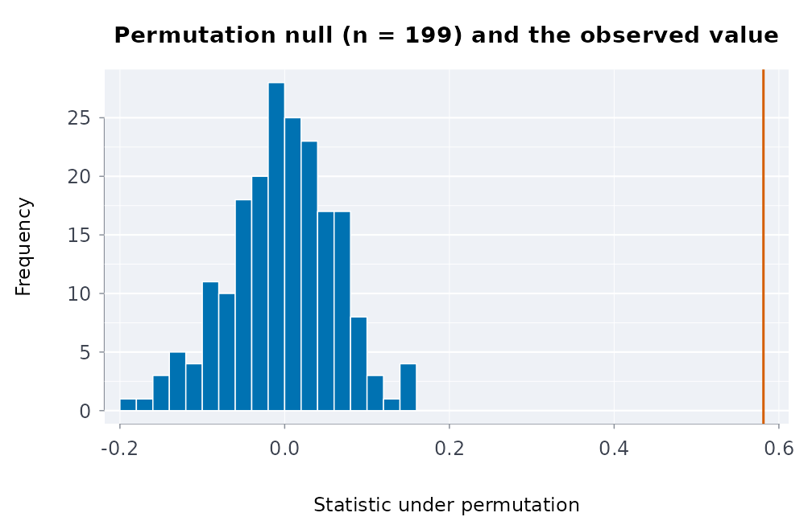

``` r

plot(fake)
```

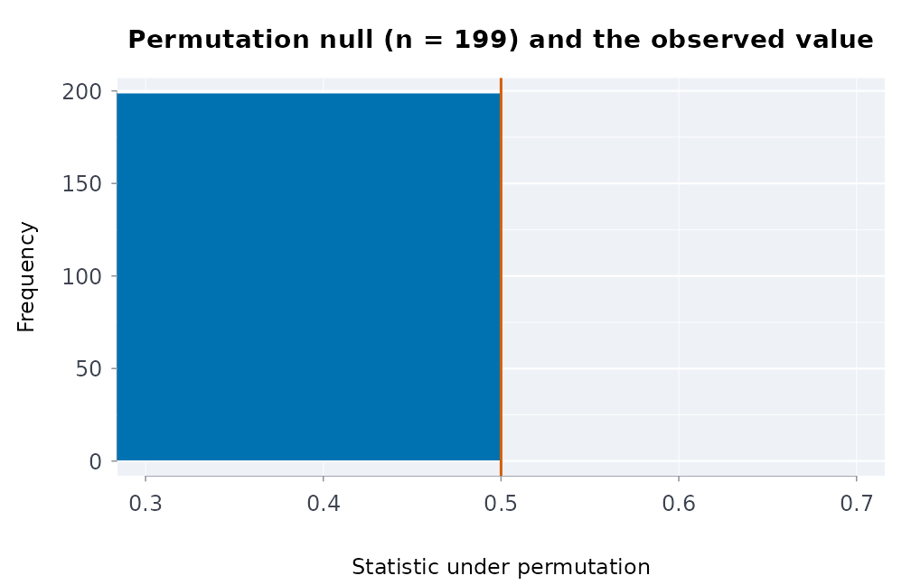

``` r

plot(pw)
```

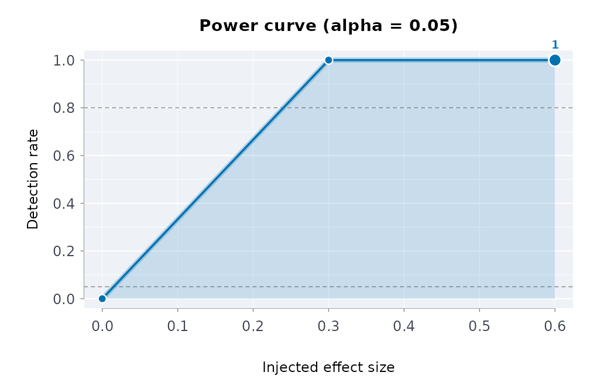

### References

VanderWeele, Ding (2017). Sensitivity analysis in observational
research: introducing the E-value. *Annals of Internal Medicine* 167(4).
Benjamini, Hochberg (1995). Controlling the false discovery rate. *JRSS
B* 57(1).

## Small-area rates: expected counts, shrinkage, funnels and spatial autocorrelation

Published tables often give a count per region, division or facility.
Comparing those counts fairly needs three steps: adjust for the
population each unit serves (and its composition), stabilise the ratios
of small units, and judge each unit against limits that widen as its
expected count shrinks. This vignette walks the four tools that do that.

### Expected counts by indirect standardisation

If the overall rate applied everywhere, how many events would each unit
have? That is the *expected count*. Adjusting for size alone:

``` r

d <- data.frame(
  region = rep(c("North", "South", "East"), each = 2),
  age = rep(c("18 to 24", "25 to 49"), 3),
  n = c(30, 45, 12, 60, 8, 20),
  pop = c(1000, 6000, 900, 9000, 400, 3500)
)
expcnts(d$n, d$pop, d$region)
#>    area observed population expected
#> 1  East       28       3900 32.81250
#> 2 North       75       7000 58.89423
#> 3 South       72       9900 83.29327
```

Adjusting for size **and** age composition is indirect standardisation:
each stratum’s overall rate is applied to the unit’s population in that
stratum, then summed. This is the comparison that says something about
the unit rather than about who lives there:

``` r

expcnts(d$n, d$pop, d$region, strata = d$age)
#>    area observed population expected
#> 1  East       28       3900 32.34430
#> 2 North       75       7000 62.27967
#> 3 South       72       9900 80.37603
```

### Direct standardisation, for populations of different ages

Indirect standardisation asks what each unit would expect at the overall
rates. Direct standardisation asks what rate each population would have
with one standard age structure. It is the comparison to use when the
populations’ ages differ a great deal. First Nations, Metis and Inuit
populations, for example, are younger than the non-Indigenous
population.
[`agestd()`](https://rootcoder007.github.io/rmorie-bricklayer/reference/agestd.md)
gives the rates with the Fay-Feuer gamma interval, which holds for small
counts.
[`rategap()`](https://rootcoder007.github.io/rmorie-bricklayer/reference/rategap.md)
compares two of them. The counts below are made up, to show the
computation:

``` r

r <- agestd(events = c(4, 9, 11, 6, 3, 40, 70, 90, 80, 60),
                     pop = c(9000, 8000, 6000, 4000, 2000, 300000, 320000, 350000, 340000, 300000),
                     std = c(30, 25, 20, 15, 10),
                     grp = rep(c("Inuit", "Non-Indigenous"), each = 5))
r
#>            group events      rate    lower    upper
#> 1          Inuit     33 115.62500 79.23967 165.0186
#> 2 Non-Indigenous    340  20.14102 17.93306  22.5839
rategap(r, "Inuit", "Non-Indigenous")
#>   group      reference    ratio  ratiolo ratioup difference    diflo    difup
#> 1 Inuit Non-Indigenous 5.740772 3.993798 8.25191   95.48398 55.54321 135.4247
```

For survey percentages rather than counts,
[`stdprev()`](https://rootcoder007.github.io/rmorie-bricklayer/reference/stdprev.md)
does the same.

### Standardised ratios with exact intervals

The ratio of observed to expected is the standardised incidence ratio
(SIR).
[`stdinc()`](https://rootcoder007.github.io/rmorie-bricklayer/reference/stdinc.md)
gives the exact Poisson interval, which is what makes a small count
honest:

``` r

stdinc(obs = c(30, 12, 3), expd = c(20, 14, 5),
    area = c("North", "South", "East"))
#>    area observed expected       sir     lower    upper excess deficit
#> 1 North       30       20 1.5000000 1.0120437 2.141343   TRUE   FALSE
#> 2 South       12       14 0.8571429 0.4428982 1.497256  FALSE   FALSE
#> 3  East        3        5 0.6000000 0.1237344 1.753455  FALSE   FALSE
#>   significant
#> 1        TRUE
#> 2       FALSE
#> 3       FALSE
```

An observed count of three carries almost no information, and the
interval says so rather than hiding it:

``` r

stdinc(3, 5)
#>   observed expected sir     lower    upper excess deficit significant
#> 1        3        5 0.6 0.1237344 1.753455  FALSE   FALSE       FALSE
```

### Empirical Bayes shrinkage

A tiny unit’s raw ratio is extreme by chance. Empirical Bayes shrinks
each ratio toward the overall experience in proportion to how little its
own data say: the pooled ratios share a Gamma prior whose parameters are
estimated from all units, and each unit’s posterior mean is a weighted
average of its own ratio and the prior mean, weighted by its expected
count (Clayton and Kaldor 1987).

``` r

ebrates(obs = c(30, 45, 2), expd = c(25, 50, 0.5),
         area = c("North", "South", "Tiny"))
#>    area observed expected sir        eb shrinkage       nu    alpha
#> 1 North       30     25.0 1.2 1.1073869 0.5141392 26.98066 26.45506
#> 2 South       45     50.0 0.9 0.9414767 0.3460211 26.98066 26.45506
#> 3  Tiny        2      0.5 4.0 1.0751472 0.9814506 26.98066 26.45506
```

The tiny area’s raw ratio of 4 is pulled sharply toward 1; the large
areas barely move.

### Funnel plots

A funnel plot draws control limits that narrow as the expected count
grows (Spiegelhalter 2005): a ratio of 2 means nothing at an expected
count of 2 and a great deal at 200. Units outside the limits are the
ones worth a second look; the rest are consistent with the common rate.

``` r

fnllim(c(2, 20, 200))
#>   expected level lower upper
#> 1        2 0.950 0.000 2.500
#> 2       20 0.950 0.600 1.450
#> 3      200 0.950 0.865 1.140
#> 4        2 0.998 0.000 4.000
#> 5       20 0.998 0.400 1.750
#> 6      200 0.998 0.790 1.225
```

``` r

e <- seq(2, 200, length.out = 60)
lim <- fnllim(e)
plot(e, lim$upper_95, type = "l", ylim = c(0, 3), xlab = "expected count",
     ylab = "observed / expected", main = "Funnel limits")
lines(e, lim$lower_95)
lines(e, lim$upper_998, lty = 2)
lines(e, lim$lower_998, lty = 2)
abline(h = 1, col = "grey")
points(c(20, 14, 5), c(30, 12, 3) / c(20, 14, 5), pch = 19, col = 2)
```

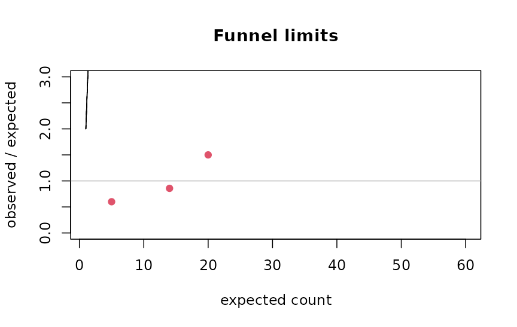

The `levels` argument sets which limits are drawn; 95% and 99.8% (about
two and three standard deviations) are the conventional pair.

### Spatial autocorrelation

Rates of neighbouring areas are rarely independent. Moran’s *I* measures
whether similar values cluster in space, against a permutation null;
`neighbours` is a list giving each area’s adjacent areas:

``` r

nb <- list(2L, c(1L, 3L), c(2L, 4L), c(3L, 5L), c(4L, 6L), 5L)   # six areas in a line

set.seed(1)
morani(c(1, 2, 3, 4, 5, 6), nb, nperm = 999L)[c("I", "p_value")]   # a gradient
#> $I
#> [1] 0.7142857
#> 
#> $p_value
#> [1] 0.011

set.seed(1)
morani(c(1, 6, 1, 6, 1, 6), nb, nperm = 999L)[c("I", "p_value")]   # alternating
#> $I
#> [1] -1
#> 
#> $p_value
#> [1] 0.199
```

The null expectation of *I* is not zero but $`-1/(n-1)`$:

``` r

-1 / (6 - 1)
#> [1] -0.2
```

Positive autocorrelation in the residual ratios means neighbouring units
share something the standardisation did not capture, and a funnel that
treats them as independent is optimistic.

### From a published table to a judgement

1.  [`expcnts()`](https://rootcoder007.github.io/rmorie-bricklayer/reference/expcnts.md)
    with the strata the table publishes.
2.  [`stdinc()`](https://rootcoder007.github.io/rmorie-bricklayer/reference/stdinc.md)
    for the ratios and their exact intervals.
3.  [`ebrates()`](https://rootcoder007.github.io/rmorie-bricklayer/reference/ebrates.md)
    where small units dominate.
4.  [`fnllim()`](https://rootcoder007.github.io/rmorie-bricklayer/reference/fnllim.md)
    to see which units are outside the common experience.
5.  [`morani()`](https://rootcoder007.github.io/rmorie-bricklayer/reference/morani.md)
    on the residuals before trusting independence.

### References

Clayton, Kaldor (1987). Empirical Bayes estimates of age-standardized
relative risks for use in disease mapping. *Biometrics* 43(3).
Spiegelhalter (2005). Funnel plots for comparing institutional
performance. *Statistics in Medicine* 24(8). Moran (1950). Notes on
continuous stochastic phenomena. *Biometrika* 37(1/2).

## Hawkes processes: self-exciting event series

Many administrative event series cluster: one incident raises the chance
of another soon after. A **Hawkes process** (Hawkes 1971) models this
directly. Its conditional intensity, the instantaneous event rate given
the past, is

``` math
\lambda(t) = \mu + \sum_{t_i < t} \phi(t - t_i),
```

a baseline rate $`\mu`$ plus a kernel $`\phi`$ that each past event adds
and that decays with the time since it. The integral of the kernel,
$`n = \int_0^\infty \phi(s)\,ds`$, is the **branching ratio**: the
expected number of events each event directly triggers. When $`n < 1`$
the process is stationary; $`n`$ is the fraction of events that are
“children” of earlier events rather than arrivals from the baseline,
which is often the quantity of substantive interest.

### Simulating a Hawkes process

Ogata’s thinning algorithm simulates the process exactly: propose events
from an upper bound on the intensity and keep each with probability
$`\lambda(t)/\lambda_{\max}`$. Here is an exponential kernel
$`\phi(s) = \alpha \beta e^{-\beta s}`$, whose branching ratio is
$`\alpha`$:

``` r

simhwk <- function(mu, alpha, beta, horizon, seed = 1) {
  set.seed(seed)
  t <- 0
  events <- numeric(0)
  while (t < horizon) {
    lambdamax <- mu + alpha * beta * sum(exp(-beta * (t - events)))
    t <- t + stats::rexp(1, lambdamax)
    if (t >= horizon) break
    lambdat <- mu + alpha * beta * sum(exp(-beta * (t - events)))
    if (stats::runif(1) <= lambdat / lambdamax) events <- c(events, t)
  }
  events
}
times <- simhwk(mu = 1, alpha = 0.5, beta = 2, horizon = 300)
length(times)
#> [1] 559
```

### Fitting

[`chwkfit()`](https://rootcoder007.github.io/rmorie-bricklayer/reference/chwkfit.md)
maximises the exact log-likelihood with an analytic gradient in C
(projected BFGS, with the parameters bounded). `theta` holds the
baseline, the branching ratio and the kernel parameter:

``` r

fit <- chwkfit(times, hor = 300, kernel = "exponential")
fit$theta
#> [1] 0.1027148 0.4073514 2.1590220
fit$braratio
#> [1] 0.4073514
```

The branching ratio is recovered close to the 0.5 the data were
simulated with, and the baseline close to 1. Four kernels are available:
`exponential` (memoryless decay), `weibull` and `gamma` (a delayed
peak), `lomax` (a heavy tail: influence that fades slowly). Compare them
by information criterion:

``` r

sapply(c("exponential", "weibull", "lomax"), function(k) {
  chwkfit(times, 300, kernel = k)$aic
})
#> exponential     weibull       lomax 
#>    352.1139    353.6296    354.1802
```

A **sinusoidal baseline** lets the background rate follow a cycle (a
weekly or seasonal pattern) instead of staying constant:

``` r

chwkfit(times, 300, kernel = "exponential", base = "sinusoidal")$aic
#> [1] 352.3058
```

### Checking the fit: time-rescaling residuals

If the fitted intensity is right, the compensator
$`\Lambda(t_i) = \int_0^{t_i}\lambda(s)\,ds`$ turns the event times into
a unit-rate Poisson process (the time-rescaling theorem; Brown et
al. 2002).
[`chwkres()`](https://rootcoder007.github.io/rmorie-bricklayer/reference/chwkres.md)
returns the rescaled inter-event quantities, which should then be
uniform:

``` r

U <- chwkres(times, 300, "exponential", fit$theta)
stats::ks.test(U, "punif")$p.value
#> [1] 0.8168762
```

``` r

plot(stats::qunif(stats::ppoints(length(U))), sort(U), pch = 20, cex = .6,
     xlab = "uniform quantiles", ylab = "rescaled residuals",
     main = "Time-rescaling check")
abline(0, 1, col = 2)
```

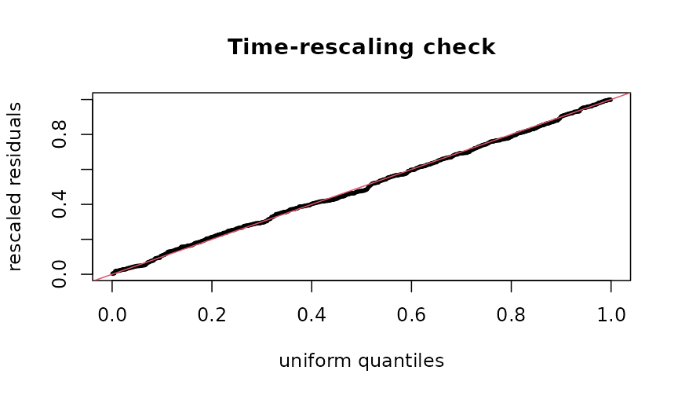

A misspecified kernel shows as a departure from the diagonal; a p-value
well below 0.05 says the model does not explain the clustering it was
fitted to.

### Events recorded to a resolution

Administrative data record dates, not instants. Many events on one day
are *ties*, and a Hawkes likelihood with tied times is ill-defined (the
kernel at lag zero).
[`chwkjit()`](https://rootcoder007.github.io/rmorie-bricklayer/reference/chwkjit.md)
spreads each day’s events uniformly across that day, deterministically
from a seed, so the fit is reproducible and no two events coincide:

``` r

days <- c(0, 0, 0, 1, 3, 3)
chwkjit(days)
#> [1] 0.1599104 0.2786011 0.7415649 1.3441907 3.0380302 3.8682281
anyDuplicated(chwkjit(days))
#> [1] 0
```

Fit on jittered times, and treat the day as the unit of the horizon.

### Evaluating a likelihood directly

[`chwknll()`](https://rootcoder007.github.io/rmorie-bricklayer/reference/chwknll.md)
returns the negative log-likelihood at given parameters, for profile
plots, likelihood-ratio comparisons or a check against another
implementation:

``` r

chwknll(times, 300, "exponential", fit$theta)
#> [1] 173.0569
chwknll(times, 300, "exponential", fit$theta * 1.5)
#> [1] 193.815
```

### Boundaries and identifiability

A heavy-tailed kernel that tends to its exponential limit has a shape
parameter that is not identified; the fit then stops at the parameter
bound and says so (`fit$atbound`), instead of reporting an absurd
estimate. Short series carry little information about the kernel’s
shape: with a few hundred events, compare kernels by AIC but do not read
much into the third decimal of a shape parameter.

### Indigenous examples

Self-exciting models need event times (one row per event), which the
published Indigenous health tables do not contain: they are counts and
percentages. The bundled tables are used for gaps, trends and
standardisation in
[`vignette("applied-analyses")`](https://rootcoder007.github.io/rmorie-bricklayer/articles/applied-analyses.md);
a Hawkes model applies once event-level data are available under a
community’s own data governance.

### References

Hawkes (1971). Spectra of some self-exciting and mutually exciting point
processes. *Biometrika* 58(1). Ogata (1981). On Lewis’ simulation method
for point processes. *IEEE Trans. Inf. Theory*. Brown, Barbieri,
Ventura, Kass, Frank (2002). The time-rescaling theorem and its
application to neural spike train data analysis. *Neural Computation*
14(2).

## Stock and flow: population, admissions and length of stay

A custodial or clinical population can be described two ways: the
**stock** (how many are held on an average day) and the **flow** (how
many pass through in a period). The two are linked by the length of
stay, and a published table that reports one without the others is easy
to misread. These functions implement the standard measures (Lakner’s
formulation, as used in the Canadian corrections statistics) with exact
intervals.

### Average daily population

The stock. Detention days in a period divided by the days in the period:

``` r

# Lakner's worked example: 3,000 inmates served 13,500 detention days in a year
adp(13500)
#> [1] 36.9863

# per-person days over a 30-day period give the same total
adp(c(10, 20, 30), t = 30)
#> [1] 2
```

[`adpcnts()`](https://rootcoder007.github.io/rmorie-bricklayer/reference/adpcnts.md)
estimates person-days from periodic headcounts (a monthly census) when
daily data are not published.

### Average length of stay

Detention days divided by the number of people who completed a stay:

``` r

# Lakner: 2,700 inmates admitted and released served 12,150 detention days
alos(12150, 2700)
#> [1] 4.5
```

### Admissions implied by stock and stay

Little’s law ties the three together: in a stationary system, stock =
flow × stay, so admissions = ADP × days / ALOS. Lakner (p. 20) runs it
the other way: an average daily population of 25 and 1,750 admissions in
a year imply a stay of 5.2 days, and back again:

``` r

alosimplied <- 25 * 365 / 1750
round(alosimplied, 1)
#> [1] 5.2
admits(25, alosimplied)
#> [1] 1750
```

### Stock and flow together

[`stkflow()`](https://rootcoder007.github.io/rmorie-bricklayer/reference/stkflow.md)
takes detention days and people per period, with an exposure (the
population at risk) to turn counts into rates, and reports how the
stock, the flow and the stay moved between periods. The pattern it is
built to surface: **fewer people, held longer**, so the flow falls while
the stock rises.

``` r

stkflow(
  days = c(115674, 126121), people = c(12647, 9608),
  prd = c("2023", "2025"),
  expo = c(15495050, 16256538)
)
#> ── Stock and flow over 2 periods ───────────────────────────────── 
#>  period people   days      alos      adp flowrate  stkrate
#>    2023  12647 115674  9.146359 316.9151 81.61961 2.045267
#>    2025   9608 126121 13.126665 345.5370 59.10237 2.125526
#> 
#>   2023 to 2025: people -24.0%, stay +43.5%, days +9.0%
#>   flow rate -27.6%, stock rate +3.9%  <- opposite signs: quote both
#> ──────────────────────────────────────────────────────────────────
```

A table that reported only admissions would show a decline; one that
reported only the daily count would show growth. Both are true, and the
length of stay is the reason.

### The distribution of stays

The mean stay is pulled far above the median by a few long stays, so the
summary that matters is the whole distribution:

``` r

stays <- c(rep(1, 40), rep(3, 30), rep(10, 20), 60, 90, 120)
staysmry(stays)
#>    n totaldays     mean       sd median iqr max       se    lower    upper
#> 1 93       600 6.451613 16.33183      3   2 120 1.693532 3.088113 9.815113
staysmry(stays)[, c("mean", "median", "max")]
#>       mean median max
#> 1 6.451613      3 120
```

[`staysmry()`](https://rootcoder007.github.io/rmorie-bricklayer/reference/staysmry.md)
gives the mean with its interval, the quantiles and the maximum, so a
report can say “half of stays were three days or less, and the longest
was 120” instead of “the average stay was 9.6 days”, which describes
almost no one.

### Periods and fiscal years

Published series use fiscal years and uneven periods:

``` r

perdays("2024-04-01", "2025-03-31")
#> [1] 365
fylbl(2024)
#> [1] "2023/24"
```

### From a published table

1.  [`adp()`](https://rootcoder007.github.io/rmorie-bricklayer/reference/adp.md)
    for the stock from detention days, or
    [`adpcnts()`](https://rootcoder007.github.io/rmorie-bricklayer/reference/adpcnts.md)
    from headcounts.
2.  [`alos()`](https://rootcoder007.github.io/rmorie-bricklayer/reference/alos.md)
    for the stay;
    [`admits()`](https://rootcoder007.github.io/rmorie-bricklayer/reference/admits.md)
    to check the implied flow against the published one.
3.  [`stkflow()`](https://rootcoder007.github.io/rmorie-bricklayer/reference/stkflow.md)
    across periods, with the population as exposure.
4.  [`staysmry()`](https://rootcoder007.github.io/rmorie-bricklayer/reference/staysmry.md)
    whenever per-person stays are available, and report the median.

### Indigenous examples

Stock and flow measures need counts of people and the days they spend in
custody or care. The census excerpt bundled with the package counts
foster children, a stock on census day:

``` r

cp <- indiex("censuspop")
fc <- cp[cp$GEO_NAME == "Canada" & cp$AGE_GROUP == "0 to 14 years" &
           cp$RESIDENCE == "Total - Residence on or off reserve", ]
kids <- fc[grepl("Total - Children in census families", fc$CHARACTERISTIC_NAME),
           c("FIRST_NATIONS", "NON_IND")]
fost <- fc[grepl("Foster children", fc$CHARACTERISTIC_NAME), c("FIRST_NATIONS", "NON_IND")]
round(100 * unlist(fost) / unlist(kids), 2)
#> FIRST_NATIONS       NON_IND 
#>          4.42          0.23
```

Turning that stock into admissions and lengths of stay needs the flow
data held by child welfare agencies.

### The figures in a picture

The left panel puts the counts on a common footing: children in foster
care per 1,000 children, First Nations and non-Indigenous, from the
census tables above. The right panel shows how the lengths of stay are
spread: most are short, a few are very long, which is why the mean and
the median differ.

``` r

op <- par(mfrow = c(1, 2))
per1000 <- unlist(fost) / unlist(kids) * 1000
barplot(per1000, names.arg = c("First Nations", "non-Indigenous"), col = blpal()[1:2],
        ylab = "per 1,000 children", main = "Children in foster care")
hist(stays, breaks = 30, col = blpal()[2], xlab = "length of stay", main = "Lengths of stay")
```

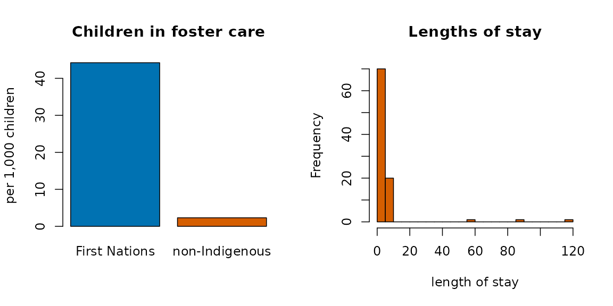

``` r

par(op)
```

### Reference

Lakner, *A Manual of Correctional Statistics* (the ADP and ALOS worked
examples at pp. 15 and 17 are reproduced above).
