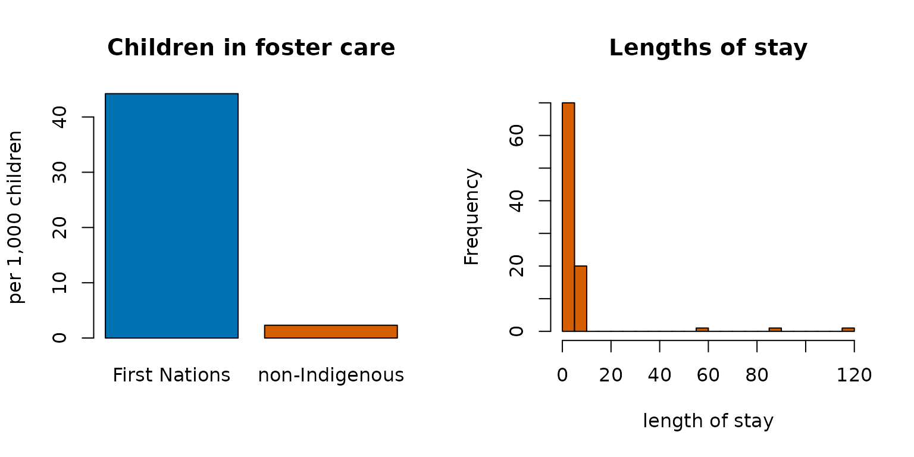

# Stock and flow: population, admissions and length of stay

A custodial or clinical population can be described two ways: the
**stock** (how many are held on an average day) and the **flow** (how
many pass through in a period). The two are linked by the length of
stay, and a published table that reports one without the others is easy
to misread. These functions implement the standard measures (Lakner’s
formulation, as used in the Canadian corrections statistics) with exact
intervals.

## Average daily population

The stock. Detention days in a period divided by the days in the period:

``` r

# Lakner's worked example: 3,000 inmates served 13,500 detention days in a year
adp(13500)
#> ╭── Average daily population ──────────────────────────────────────────────╮
#> │   Average daily population  36.99 people on an average day               │
#> │   Person-days               13,500                                       │
#> │   Period                    365 days                                     │
#> │   Formula                   adp = days / t = 13,500 / 365                │
#> │                                                                          │
#> │   13,500 person-days over 365 days: 36.99 people held on an average day. │
#> │                                                                          │
#> │   Lakner (1976, p.15): a stock -- people held at once, not people who    │
#> │   passed through. Count only the days served inside the period.          │
#> │   adp = n x alos / t links it to alos() and admits(), exactly only in a  │
#> │   steady state.                                                          │
#> ╰──────────────────────────────────────────────────────────────────────────╯

# per-person days over a 30-day period give the same total
adp(c(10, 20, 30), t = 30)
#> ╭── Average daily population ─────────────────────────────────────────────╮
#> │   Average daily population  2 people on an average day                  │
#> │   Person-days               60                                          │
#> │   Period                    30 days                                     │
#> │   Formula                   adp = days / t = 60 / 30                    │
#> │                                                                         │
#> │   60 person-days over 30 days: 2 people held on an average day.         │
#> │                                                                         │
#> │   Lakner (1976, p.15): a stock -- people held at once, not people who   │
#> │   passed through. Count only the days served inside the period.         │
#> │   adp = n x alos / t links it to alos() and admits(), exactly only in a │
#> │   steady state.                                                         │
#> ╰─────────────────────────────────────────────────────────────────────────╯
```

[`adpcnts()`](https://rootcoder007.github.io/rmorie-bricklayer/reference/adpcnts.md)
estimates person-days from periodic headcounts (a monthly census) when
daily data are not published.

## Average length of stay

Detention days divided by the number of people who completed a stay:

``` r

# Lakner: 2,700 inmates admitted and released served 12,150 detention days
alos(12150, 2700)
#> ╭── Average length of stay ─────────────────────────────────────────────────╮
#> │   Average stay  4.5 days per person                                       │
#> │   Person-days   12,150                                                    │
#> │   People        2,700                                                     │
#> │   Formula       alos = days / n = 12,150 / 2,700                          │
#> │                                                                           │
#> │   2,700 people served 12,150 days between them: 4.5 days each on average. │
#> │                                                                           │
#> │   Lakner (1976, p.16-17): n should be the people admitted AND released    │
#> │   in the period. A period shorter than the longest stay cuts unfinished   │
#> │   stays short, so alos is biased downward. staysmry() gives the median.   │
#> ╰───────────────────────────────────────────────────────────────────────────╯
```

## Admissions implied by stock and stay

Little’s law ties the three together: in a stationary system, stock =
flow × stay, so admissions = ADP × days / ALOS. Lakner (p. 20) runs it
the other way: an average daily population of 25 and 1,750 admissions in
a year imply a stay of 5.2 days, and back again:

``` r

alosimplied <- 25 * 365 / 1750
round(alosimplied, 1)
#> [1] 5.2
admits(25, alosimplied)
#> ╭── Admissions implied by stock and stay ─────────────────────────────────────╮
#> │   Admissions                1,750 over the period                           │
#> │   Average daily population  25                                              │
#> │   Average stay              5.214 days                                      │
#> │   Period                    365 days                                        │
#> │   Formula                   admits = adp x t / alos = 25 x 365 / 5.214      │
#> │                                                                             │
#> │   25 held on an average day, staying 5.214 days each, imply 1,750           │
#> │   admissions over 365 days.                                                 │
#> │                                                                             │
#> │   Lakner (1976, p.18-20): adp = admissions x alos / t is exact only in      │
#> │   a steady state; with a population growing or shrinking quickly the        │
#> │   result is an approximation. It is not rounded.                            │
#> ╰─────────────────────────────────────────────────────────────────────────────╯
```

## Stock and flow together

[`stkflow()`](https://rootcoder007.github.io/rmorie-bricklayer/reference/stkflow.md)
takes detention days and people per period, with an exposure (the
population at risk) to turn counts into rates, and reports how the
stock, the flow and the stay moved between periods. The pattern it is
built to surface: **fewer people, held longer**, so the flow falls while
the stock rises.

``` r

stkflow(
  days = c(115674, 126121), people = c(12647, 9608),
  prd = c("2023", "2025"),
  expo = c(15495050, 16256538)
)
#> ╭── Stock and flow over 2 periods ────────────────────────────────────────────╮
#> │   Periods          2023 to 2025                                             │
#> │   Period length    365 days                                                 │
#> │   Changes against  the first period                                         │
#> │   Rates per        100,000 residents                                        │
#> │   Columns          alos = days per person; adp = people held on an average  │
#> │                    day                                                      │
#> │                                                                             │
#> │   period  people     days   alos    adp  flowrate  stkrate                  │
#> │   ------  ------  -------  -----  -----  --------  -------                  │
#> │   2023    12,647  115,674   9.15  316.9     81.62    2.045                  │
#> │   2025     9,608  126,121  13.13  345.5     59.10    2.126                  │
#> │                                                                             │
#> │   2023 to 2025: people -24.0%, stay +43.5%, days +9.0%                      │
#> │   flow rate -27.6%, stock rate +3.9%                                        │
#> │   <- opposite signs: quote both, neither alone tells the story              │
#> │                                                                             │
#> │   Lakner (1976): adp = people x alos / t, exact only in a steady state.     │
#> │   A period shorter than the longest stay cuts unfinished stays short,       │
#> │   so alos is biased downward (p.16-17).                                     │
#> ╰─────────────────────────────────────────────────────────────────────────────╯
```

A table that reported only admissions would show a decline; one that
reported only the daily count would show growth. Both are true, and the
length of stay is the reason.

## The distribution of stays

The mean stay is pulled far above the median by a few long stays, so the
summary that matters is the whole distribution:

``` r

stays <- c(rep(1, 40), rep(3, 30), rep(10, 20), 60, 90, 120)
staysmry(stays)
#> ╭── Length of stay ─────────────────────────────────────────────────────╮
#> │   People               93                                             │
#> │   Days served          600                                            │
#> │   Mean stay            6.452 days                                     │
#> │   Median stay          3 days                                         │
#> │   Interquartile range  2 days                                         │
#> │   Longest stay         120 days                                       │
#> │   Standard deviation   16.33                                          │
#> │   Mean, interval       [3.088, 9.815] 95% t interval                  │
#> │                                                                       │
#> │   The mean stay is 2.2 times the median: a few long stays pull it up, │
#> │   so the median says more about a typical stay.                       │
#> │                                                                       │
#> │   The interval is on the AVERAGE stay, not the spread of stays.       │
#> │   Lakner (1976, p.16-17): a person still held has an unfinished stay, │
#> │   so a window shorter than the longest stay biases the mean downward. │
#> ╰───────────────────────────────────────────────────────────────────────╯
staysmry(stays)[, c("mean", "median", "max")]
#>       mean median max
#> 1 6.451613      3 120
```

[`staysmry()`](https://rootcoder007.github.io/rmorie-bricklayer/reference/staysmry.md)
gives the mean with its interval, the quantiles and the maximum, so a
report can say “half of stays were three days or less, and the longest
was 120” instead of “the average stay was 9.6 days”, which describes
almost no one.

## Periods and fiscal years

Published series use fiscal years and uneven periods:

``` r

perdays("2024-04-01", "2025-03-31")
#> ╭── Period length ──────────────────────────────────────────────────────╮
#> │   Length   365 days                                                   │
#> │   From     2024-04-01                                                 │
#> │   To       2025-03-31                                                 │
#> │   Formula  t = to - from + 1 (both ends counted)                      │
#> │                                                                       │
#> │   From 2024-04-01 to 2025-03-31 is 365 days.                          │
#> │   Pass it as t to adp(), admits(), adpcnts() or stkflow().            │
#> │                                                                       │
#> │   Both ends count: the 1st to the 31st is 31 days of exposure. A leap │
#> │   year comes out at 366 from the dates, without anyone choosing.      │
#> ╰───────────────────────────────────────────────────────────────────────╯
fylbl(2024)
#> [1] "2023/24"
```

## From a published table

1.  [`adp()`](https://rootcoder007.github.io/rmorie-bricklayer/reference/adp.md)
    for the stock from detention days, or
    [`adpcnts()`](https://rootcoder007.github.io/rmorie-bricklayer/reference/adpcnts.md)
    from headcounts.
2.  [`alos()`](https://rootcoder007.github.io/rmorie-bricklayer/reference/alos.md)
    for the stay;
    [`admits()`](https://rootcoder007.github.io/rmorie-bricklayer/reference/admits.md)
    to check the implied flow against the published one.
3.  [`stkflow()`](https://rootcoder007.github.io/rmorie-bricklayer/reference/stkflow.md)
    across periods, with the population as exposure.
4.  [`staysmry()`](https://rootcoder007.github.io/rmorie-bricklayer/reference/staysmry.md)
    whenever per-person stays are available, and report the median.

## Indigenous examples

Stock and flow measures need counts of people and the days they spend in
custody or care. The census excerpt bundled with the package counts
foster children, a stock on census day:

``` r

cp <- indiex("censuspop")
fc <- cp[
  cp$GEO_NAME == "Canada" &
    cp$AGE_GROUP == "0 to 14 years" &
    cp$RESIDENCE == "Total - Residence on or off reserve",
]
kids <- fc[
  grepl(
    "Total - Children in census families",
    fc$CHARACTERISTIC_NAME,
    fixed = TRUE
  ),
  c("FIRST_NATIONS", "NON_IND")
]
fost <- fc[
  grepl("Foster children", fc$CHARACTERISTIC_NAME, fixed = TRUE),
  c("FIRST_NATIONS", "NON_IND")
]
round(100 * unlist(fost) / unlist(kids), 2)
#> FIRST_NATIONS       NON_IND 
#>          4.42          0.23
```

Turning that stock into admissions and lengths of stay needs the flow
data held by child welfare agencies.

## The figures in a picture

The left panel puts the counts on a common footing: children in foster
care per 1,000 children, First Nations and non-Indigenous, from the
census tables above. The right panel shows how the lengths of stay are
spread: most are short, a few are very long, which is why the mean and
the median differ.

``` r

op <- par(mfrow = c(1, 2))
per1000 <- unlist(fost) / unlist(kids) * 1000
barplot(
  per1000,
  names.arg = c("First Nations", "non-Indigenous"),
  col = blpal()[1:2],
  ylab = "per 1,000 children",
  main = "Children in foster care"
)
hist(
  stays,
  breaks = 30,
  col = blpal()[2],
  xlab = "length of stay",
  main = "Lengths of stay"
)
```



``` r

par(op)
```

## Reference

Lakner, *A Manual of Correctional Statistics* (the ADP and ALOS worked
examples at pp. 15 and 17 are reproduced above).
