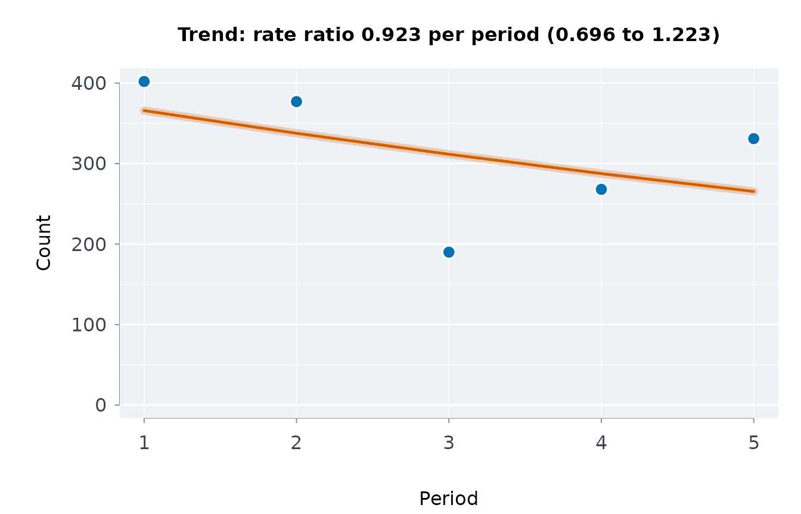
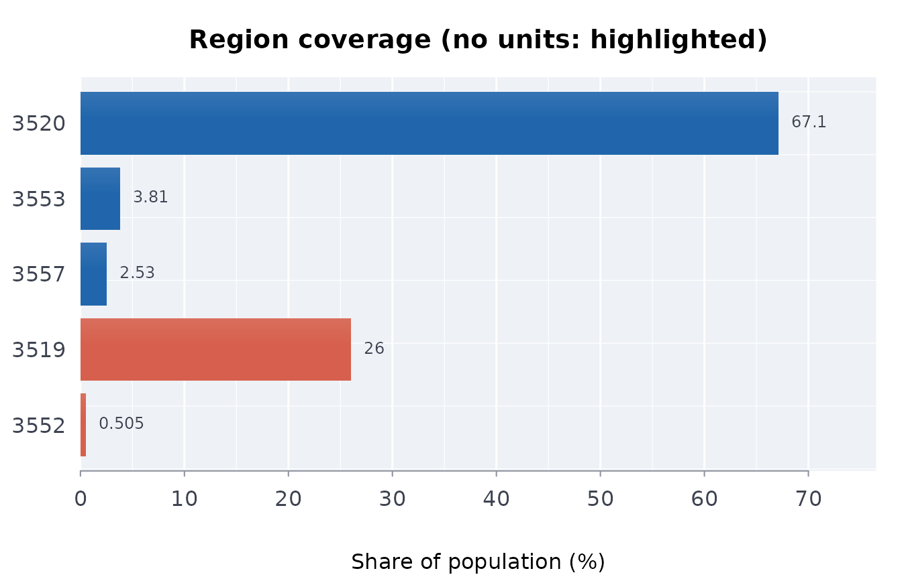

# Statistics for a published administrative table

An open-data extract from a criminal-justice system has a particular
shape: a handful of fiscal years, counts rather than measurements,
categories reported as bands rather than values, and a region code with
no geometry attached. The general-purpose toolkits assume none of that.
This vignette covers the functions that do.

The running example is the shape Ontario’s inmate datasets have – one
row per placement, keyed on the fiscal year’s end year, with banded
counts and a region.

## A Statistics Canada table, as published

A Statistics Canada full-table download puts each estimate, its
confidence limits (or its coefficient of variation), and a quality flag
on separate rows.
[`sctidy()`](https://rootcoder007.github.io/rmorie-bricklayer/reference/sctidy.md)
reads the flags and never keeps a suppressed value.
[`scests()`](https://rootcoder007.github.io/rmorie-bricklayer/reference/scests.md)
puts each estimate beside its limits, whatever form the limits take.
Here, a table with three measures per cell, and limits that name their
measure only in part:

``` r

pyll <- data.frame(
  GEO = rep(c("Inuit Nunangat", "Rest of Canada"), each = 5),
  Characteristics = rep(
    c(
      "Number of potential years of life lost",
      "Crude rate of potential years of life lost",
      "Age-standardized rate of potential years of life lost",
      "Low 95% confidence interval, potential years of life lost",
      "High 95% confidence interval, potential years of life lost"
    ),
    2
  ),
  VALUE = c(5000, 900, 1100, 1000, 1200, 7000, 800, 950, 870, 1030),
  STATUS = "",
  stringsAsFactors = FALSE
)
scests(pyll)[, c("GEO", "measure", "estimate", "lower", "upper")]
#>              GEO                                               measure estimate
#> 1 Inuit Nunangat                Number of potential years of life lost     5000
#> 2 Inuit Nunangat            Crude rate of potential years of life lost      900
#> 3 Inuit Nunangat Age-standardized rate of potential years of life lost     1100
#> 4 Rest of Canada                Number of potential years of life lost     7000
#> 5 Rest of Canada            Crude rate of potential years of life lost      800
#> 6 Rest of Canada Age-standardized rate of potential years of life lost      950
#>   lower upper
#> 1    NA    NA
#> 2    NA    NA
#> 3  1000  1200
#> 4    NA    NA
#> 5    NA    NA
#> 6   870  1030
```

The limits belong to the age-standardised rate: they are the only pair
that contains its estimate in every cell. (The values are made up; the
layout is that of table 13-10-0402.)

## Bands

Published categories are intervals. Anything computed from them rests on
an assumption about where inside each band the mass sits, and on a
second assumption about where the open top band ends.

``` r

bands <- prsbands(c("1", "2 to 5", "6 to 10", "Greater than 10"))
bands
#>             label lower upper openlo openup
#> 1               1     1     1  FALSE  FALSE
#> 2          2 to 5     2     5  FALSE  FALSE
#> 3         6 to 10     6    10  FALSE  FALSE
#> 4 Greater than 10    11    NA  FALSE   TRUE
```

Note what the bounds say. `"Greater than 10"` starts at 11, because the
quantity is a count of placements; `"10 or more"` would start at 10. One
whole placement separates the two readings, and only the label says
which was meant.

The representative value needs a rule, and the open band needs a cap:

``` r

bandvals(bands)
#>             label lower upper openlo openup value assumed
#> 1               1     1     1  FALSE  FALSE   1.0   FALSE
#> 2          2 to 5     2     5  FALSE  FALSE   3.5   FALSE
#> 3         6 to 10     6    10  FALSE  FALSE   8.0   FALSE
#> 4 Greater than 10    11    NA  FALSE   TRUE  16.5    TRUE
```

The last row is marked `assumed`, because a band with no upper bound has
no midpoint. Everything downstream inherits that assumption, so measure
how much it matters:

``` r

counts <- c(1200, 430, 110, 38)
bandsens(bands, counts)
#> ╭── Sensitivity to the open top band's assumed cap ───────────────────────╮
#> │   Open band starts at         11                                        │
#> │   Caps tried                  12                                        │
#> │   Span over the caps          0.2747                                    │
#> │   Share of the typical value  53.7%                                     │
#> │                                                                         │
#> │      cap   value                                                        │
#> │   ------  ------                                                        │
#> │    11.55  0.4255                                                        │
#> │    15.10  0.4346                                                        │
#> │    19.74  0.4461                                                        │
#> │    25.80  0.4604                                                        │
#> │    33.73  0.4780                                                        │
#> │    44.09  0.4993                                                        │
#> │    57.63  0.5245                                                        │
#> │    75.34  0.5538                                                        │
#> │    98.49  0.5868                                                        │
#> │   128.74  0.6229                                                        │
#> │   168.30  0.6611                                                        │
#> │   220.00  0.7002                                                        │
#> │                                                                         │
#> │   span over the caps tried: 0.2747 (53.7% of the typical value). The    │
#> │   statistic moves by more than a tenth of itself across the caps tried, │
#> │   so it is a property of the assumption as much as of the data. Report  │
#> │   the range, not a single figure.                                       │
#> ╰─────────────────────────────────────────────────────────────────────────╯
```

Read the span, not the middle row. A statistic that moves by more than a
tenth of itself across plausible caps is a property of the assumption as
much as of the data, and the honest report is the range.

## Concentration

The recurring question is whether a few individuals account for most of
the total.

``` r

placements <- expbands(bands, counts, openupcap = 25)
ginicoef(placements)
#> ╭── Gini coefficient ─────────────────────────────────────────────────────────╮
#> │   Gini coefficient  0.4586                                                  │
#> │   Units             1,778                                                   │
#> │   Total             4,269                                                   │
#> │   Largest unit      18 (0.4% of the total)                                  │
#> │   Most for n units  0.9994                                                  │
#> │                                                                             │
#> │   A Gini of 0.4586: the total is highly concentrated.                       │
#> │   That is 46% of the way from equal shares (0) to one unit holding all of   │
#> │   it (0.9994 for 1,778 units).                                              │
#> │                                                                             │
#> │   0 when every unit holds the same, 1 - 1/n when one unit holds it all;     │
#> │   doubling every value leaves it unchanged. It says how unequal, not        │
#> │   which units: topshr() and lorenzc() show where the total sits.            │
#> ╰─────────────────────────────────────────────────────────────────────────────╯
topshr(placements, c(0.01, 0.05, 0.1))
#> ╭── Top shares of a total ───────────────────────────────────────────────╮
#> │   Fractions  3                                                         │
#> │                                                                        │
#> │   top  units  share                                                    │
#> │   ---  -----  ------                                                   │
#> │   1%      18  7.59%                                                    │
#> │   5%      89  25.58%                                                   │
#> │   10%    178  39.1%                                                    │
#> │                                                                        │
#> │   The top 1% of units (18 of them) hold 7.59% of the total; with equal │
#> │   shares they would hold 1%.                                           │
#> ╰────────────────────────────────────────────────────────────────────────╯
```

Gini has a ceiling that depends on the number of units: for `n` units
the maximum is `1 - 1/n`, not 1. A Gini of 0.9 means something different
across ten units than across ten thousand.

``` r

c(ten = 1 - 1 / 10, thousand = 1 - 1 / 1000)
#>      ten thousand 
#>    0.900    0.999
```

If the tail looks heavy, fit it rather than asserting it – and read the
goodness-of-fit distance before the exponent:

``` r

fit <- hilltlidx(placements, xmin = 1)
c(alpha = round(fit$alpha, 2), ks = round(fit$ks, 3),
  reliable = fit$reliable)
#>    alpha       ks reliable 
#>    2.100    0.044    1.000
```

A large `ks` means the tail is not a power law, whatever `alpha` came
out as. The estimator maximises the exact discrete likelihood: the
closed-form continuity correction usually quoted is an asymptotic
approximation in the threshold, and at a threshold of one – where counts
start – it is badly biased.

## Trend across a handful of years

Five annual points support a rank test and a resistant slope. They do
not support a model with an autocorrelation structure.

``` r

y <- c(402, 377, 190, 268, 331)
tt <- trndtst(y)
c(tau = tt$tau, p = round(tt$p_value, 4), slope = tt$slope)
#>      tau        p    slope 
#>  -0.4000   0.4833 -21.3750
tt$method
#> [1] "Mann-Kendall, exact over all 120 orderings"
```

The p-value is exact, by enumerating all 120 orderings. For counts, the
trend is better expressed as a multiplicative change per year:

``` r

ct <- cnttrnd(y)
c(rateratio = round(ct$rateratio, 3),
  lower = round(ct$lower, 3), upper = round(ct$upper, 3),
  dispersion = round(ct$dispersion, 2))
#>  rateratio      lower      upper dispersion 
#>      0.923      0.696      1.223     24.390
```

The dispersion is reported because a Poisson interval assumes it is one.
Above 1.5 the interval is widened to the quasi-Poisson one rather than
being left too narrow.

### Did it change when the policy changed?

``` r

sc <- stepchg(c(100, 104, 98, 60, 63, 58), x = 2018:2023)
c(after = sc$breakafter, before = sc$before, aftermean = sc$after,
  p = round(sc$p_value, 4))
#>      after     before  aftermean          p 
#> 2020.00000  100.66667   60.33333    0.10000
```

The p-value comes from the permutation distribution of the **maximum**
over splits, not from the best split’s own test. That distinction is the
difference between a change-point test and a way of finding a break in
noise. It also has a consequence worth stating plainly: six points
cannot produce a p-value below about 0.1, however clean the step,
because only 72 of the 720 orderings separate three low values from
three high ones.

``` r

(1 + 2 * factorial(3)^2) / (1 + factorial(6))
#> [1] 0.1012483
```

## Points, and the regions that contain them

Before a regional count means anything, something has to have decided
which region each facility is in. That decision is a region map: built
once, from coordinates and a boundary file, and then read by everything
downstream.

Which is exactly why recomputing the downstream tables cannot check it.
An error in the region map reproduces perfectly in every table built on
it, because those tables are where it is read. The region map has to be
checked on its own terms.

``` r

cw <- data.frame(
  facility = c("North Jail", "South Jail", "Hill Jail", "Lake Jail"),
  region   = c("3557", "3520", "3553", "3520"),
  stringsAsFactors = FALSE
)
pop <- data.frame(
  region     = c("3557", "3520", "3553", "3552", "3519"),
  population = c(114094, 3025647, 171568, 22746, 1173334),
  stringsAsFactors = FALSE
)
```

[`rgnmapintg()`](https://rootcoder007.github.io/rmorie-bricklayer/reference/rgnmapintg.md)
finds the failures that a comparison against published output cannot,
because they would be present on both sides of it: a facility assigned
two regions, a facility assigned none, a region code that belongs to a
different province.

``` r

rgnmapintg(cw, "facility", "region", regs = pop$region)
#> ╭── Region map integrity ───────────────────────────────────────────────────╮
#> │   Checks   3                                                              │
#> │   Verdict  every check passed                                             │
#> │                                                                           │
#> │   check                                        observed  expected  result │
#> │   -------------------------------------------  --------  --------  ------ │
#> │   units assigned more than one region                 0         0  pass   │
#> │   units assigned no region                            0         0  pass   │
#> │   region codes not in the reference geography         0         0  pass   │
#> │                                                                           │
#> │   A sound map gives each unit exactly one region, and only regions of     │
#> │   the reference geography; each check counts the units that break that,   │
#> │   and 0 passes.                                                           │
#> ╰───────────────────────────────────────────────────────────────────────────╯
```

Every check is written so that zero is the passing value, which is what
makes the frame safe to record directly into a manifest.

``` r

bad <- cw
bad$region[3] <- "2406"          # a code from another province
rgnmapintg(bad, "facility", "region", regs = pop$region)
#> ╭── Region map integrity ───────────────────────────────────────────────────╮
#> │   Checks   3                                                              │
#> │   Verdict  1 of 3 checks failed                                           │
#> │                                                                           │
#> │   check                                        observed  expected  result │
#> │   -------------------------------------------  --------  --------  ------ │
#> │   units assigned more than one region                 0         0  pass   │
#> │   units assigned no region                            0         0  pass   │
#> │   region codes not in the reference geography         1         0  FAIL   │
#> │                                                                           │
#> │   A sound map gives each unit exactly one region, and only regions of     │
#> │   the reference geography; each check counts the units that break that,   │
#> │   and 0 passes.                                                           │
#> ╰───────────────────────────────────────────────────────────────────────────╯
```

### Recomputing is not the same as checking

[`rgnmapcmp()`](https://rootcoder007.github.io/rmorie-bricklayer/reference/rgnmapcmp.md)
matches a recomputed region map against the published one and compares
them cell by cell. Numeric columns go through
[`all.equal()`](https://rdrr.io/r/base/all.equal.html), so a coordinate
that survived a round trip through text is not reported as a change.

``` r

recomputed <- cw
recomputed$region[2] <- "3519"
rgnmapcmp(cw, recomputed, "facility")
#> ╭── Published and rebuilt region maps compared ────────────────────────────╮
#> │   Columns compared  1                                                    │
#> │   Mismatched cells  1                                                    │
#> │   Verdict           the maps disagree                                    │
#> │                                                                          │
#> │   column  cells  mismatched  first                                       │
#> │   ------  -----  ----------  ------------------------------------------- │
#> │   rows        4           0                                              │
#> │   region      4           1  South Jail: published 3520, recomputed 3519 │
#> │                                                                          │
#> │   The rows line counts units present on one side only; each other line   │
#> │   compares one column over the shared units. first writes out the first  │
#> │   disagreement, and 0 mismatched throughout is agreement.                │
#> ╰──────────────────────────────────────────────────────────────────────────╯
```

That is worth having, and it is worth being clear about what it
establishes: the recomputation reproduced the published assignment. Run
the same method against the same boundary file and a *definitional*
error reproduces perfectly too. Both sides move together.

### A second route can disagree

The check that can catch an error in the original method is one that
does not use that method. Derive the region a different way – from a
place name, a postal geography, an administrative lookup – and compare.

A name-based route is the usual second route, and it has understood
weaknesses. Names collide. In Ontario, census division 3552 is named
“Sudbury” and is a thinly populated district; census division 3553 is
named “Greater Sudbury” and is the city inside it. A facility in the
city has a postal address in Sudbury, and a name route sends it to the
district.

``` r

route <- c("North Jail" = "3557", "South Jail" = "3520",
           "Hill Jail" = "3552", "Lake Jail" = "3520")
rgnmapalt(cw, "facility", "region", route,
                       known = "Hill Jail")
#>        unit primary second known
#> 1 Hill Jail    3553   3552  TRUE
```

The known-bad case is listed by NAME rather than allowed for by widening
a tolerance, and the distinction matters. A tolerance of “one
disagreement is acceptable” would swallow a second, different
disagreement silently. Naming it means `sum(!x$known)` stays the number
that must be zero.

``` r

route["South Jail"] <- "3599"    # an assignment nobody documented
d <- rgnmapalt(cw, "facility", "region", route,
                            known = "Hill Jail")
d
#>         unit primary second known
#> 1 South Jail    3520   3599 FALSE
#> 2  Hill Jail    3553   3552  TRUE
sum(!d$known)
#> [1] 1
```

Facilities the route does not cover are skipped rather than counted as
disagreements, so a partial second route is still usable. Record how
many it covered: a route that quietly stops matching anything leaves the
disagreement check passing over an empty set.

``` r

length(route)
#> [1] 4
```

[`rgnmappts()`](https://rootcoder007.github.io/rmorie-bricklayer/reference/rgnmappts.md)
does the geometric recompute, projecting the points onto the boundary
file’s own coordinate system rather than the reverse, since reprojecting
polygons moves their edges. It needs `sf` and a boundary file and
returns `NULL` without either, so a verification script records the
check as unavailable instead of failing over an optional dependency. It
also returns `nreg` rather than silently resolving it: any value but 1
means the point fell outside the geography, or the boundaries overlap.

### The coverage share is not a denominator

With the region map checked, the obvious next step is a rate per region.
[`rgncov()`](https://rootcoder007.github.io/rmorie-bricklayer/reference/rgncov.md)
reports the ingredients and, every time it prints, declines to supply
that rate.

``` r

units <- vapply(pop$region, function(r) sum(cw$region == r), numeric(1))
cov <- rgncov(pop$region, pop$population, units)
cov
#> ╭── 4 units in 3 of 5 regions ─────────────────────────────────────────────╮
#> │   Covered    those regions hold 3,311,309 of 4,507,389 residents (73.5%) │
#> │   Uncovered  2 regions hold none; 1,196,080 residents (26.5%) live there │
#> │                                                                          │
#> │   region  population  units  hasunit  popshr                             │
#> │   ------  ----------  -----  -------  ------                             │
#> │   3520     3,025,647      2  TRUE     67.126                             │
#> │   3553       171,568      1  TRUE      3.806                             │
#> │   3557       114,094      1  TRUE      2.531                             │
#> │   3519     1,173,334      0  FALSE    26.031                             │
#> │   3552        22,746      0  FALSE     0.505                             │
#> │                                                                          │
#> │   The covered share is context, not a denominator: units serve           │
#> │   catchments, so a rate over these regions alone would take its          │
#> │   numerator from the whole territory and is inflated.                    │
#> ╰──────────────────────────────────────────────────────────────────────────╯
```

Two of the five regions hold no facility at all. It is tempting to read
their population as uncovered, and to build a regional rate on the
population of the regions that do hold one. Both readings are wrong, for
the same reason.

A facility serves a catchment: an administrative fact about where people
are sent from, which a coordinate does not state and cannot imply. Some
geographies were never meant to have one facility each. So summing the
populations of facility-holding regions gives a denominator covering
part of the territory while the numerator counts people drawn from all
of it. Every rate built that way is inflated, and inflated unevenly – a
dense region holding one facility and a sparse region holding seven
distort it in opposite directions.

``` r

a <- attr(cov, "coverage")
c(covered = a$covpop, uncovered = a$uncpop,
  share = round(a$covshr, 1))
#>   covered uncovered     share 
#> 3311309.0 1196080.0      73.5
```

Where the numerator and the denominator have to cover the same people,
the defensible figure is the whole-territory one. That is the next
section.

## Regions

A region code is an areal unit, not a coordinate. Three things go wrong
with a table of regional counts: the regions hold different numbers of
people, they hold different *kinds* of people, and a small region’s rate
is mostly noise.

``` r

d <- expand.grid(
  region = c("Central", "Eastern", "Northern", "Toronto", "Western"),
  age = c("18 to 24", "25 to 49", "50+"),
  stringsAsFactors = FALSE
)
d$pop <- rep(c(4000, 3000, 800, 5000, 2500), 3) *
  rep(c(0.3, 0.55, 0.15), each = 5)
set.seed(13)
rate <- c(Central = 0.006, Eastern = 0.011, Northern = 0.010,
          Toronto = 0.016, Western = 0.012)
d$n <- rpois(nrow(d), lambda = d$pop * rate[d$region])
```

Indirect standardisation handles the second problem: the expected count
is what each region would have under the overall rate in every age band,
given its own age composition.

``` r

e <- expcnts(d$n, d$pop, d$region, strata = d$age)
e
#> ╭── Expected counts, indirect standardisation ────────────────────────────╮
#> │   Areas       5                                                         │
#> │   Observed    185                                                       │
#> │   Expected    185                                                       │
#> │   Population  15,300                                                    │
#> │                                                                         │
#> │   area      observed  population  expected                              │
#> │   --------  --------  ----------  --------                              │
#> │   Central         17       4,000     48.37                              │
#> │   Eastern         36       3,000     36.27                              │
#> │   Northern         9         800      9.67                              │
#> │   Toronto         86       5,000     60.46                              │
#> │   Western         37       2,500     30.23                              │
#> │                                                                         │
#> │   expected is the count an area would have at the overall rate of each  │
#> │   stratum, given its own population in it. stdinc() puts an interval on │
#> │   the ratio of observed to expected.                                    │
#> │                                                                         │
#> │   The expected counts sum to the observed ones: the reference rates     │
#> │   come from the same data.                                              │
#> ╰─────────────────────────────────────────────────────────────────────────╯
```

The expected counts total the observed ones. That identity is what makes
them a standardisation rather than a prediction.

``` r

c(observed = sum(e$observed), expected = sum(e$expected))
#> observed expected 
#>      185      185
```

The ratio, with an exact interval – the counts here are small, and a
normal approximation on a count of six is a decoration rather than an
interval:

``` r

stdinc(e$observed, e$expected, e$area)
#> ╭── Standardised incidence ratios ──────────────────────────────────────╮
#> │   Areas          5                                                    │
#> │   Observed       185                                                  │
#> │   Expected       185                                                  │
#> │   Overall ratio  1                                                    │
#> │   Interval       exact Poisson, at the level asked for (default 95%)  │
#> │   Above one      1                                                    │
#> │   Below one      1                                                    │
#> │                                                                       │
#> │   area      observed  expected     sir  interval          finding     │
#> │   --------  --------  --------  ------  ----------------  -------     │
#> │   Central         17     48.37  0.3515  [0.2048, 0.5628]  deficit     │
#> │   Eastern         36     36.27  0.9924  [0.6951, 1.3739]              │
#> │   Northern         9      9.67  0.9304  [0.4254, 1.7662]              │
#> │   Toronto         86     60.46  1.4225  [1.1378, 1.7568]  excess      │
#> │   Western         37     30.23  1.2240  [0.8618, 1.6871]              │
#> │                                                                       │
#> │   A ratio above 1 means more cases than the area's population would   │
#> │   give at the overall rates. An excess or a deficit is an interval    │
#> │   wholly above or below 1 (the significant column is either).         │
#> │                                                                       │
#> │   Each interval is a separate test: with many areas some exclude 1 by │
#> │   chance (scanadj() allows for that).                                 │
#> ╰───────────────────────────────────────────────────────────────────────╯
```

And the third problem. A league table of rates ranks the small regions
to both ends by construction, so borrow strength across regions:

``` r

ebrates(e$observed, e$expected, e$area)
#> ╭── Empirical Bayes rates ────────────────────────────────────────────────╮
#> │   Areas               5                                                 │
#> │   Overall ratio       1                                                 │
#> │   Prior shape (nu)    6.679                                             │
#> │   Prior rate (alpha)  6.679                                             │
#> │   Method              gamma-Poisson, moments (Clayton and Kaldor 1987)  │
#> │                                                                         │
#> │   area      observed  expected     sir      eb  shrinkage               │
#> │   --------  --------  --------  ------  ------  ---------               │
#> │   Central         17     48.37  0.3515  0.4302     0.1213               │
#> │   Eastern         36     36.27  0.9924  0.9936     0.1555               │
#> │   Northern         9      9.67  0.9304  0.9588     0.4085               │
#> │   Toronto         86     60.46  1.4225  1.3805     0.0995               │
#> │   Western         37     30.23  1.2240  1.1835     0.1810               │
#> │                                                                         │
#> │   Each raw ratio (sir) is pulled toward the overall ratio; shrinkage is │
#> │   the share of the pull (0 untouched, 1 replaced), largest for areas    │
#> │   with small expected counts. Use eb for maps and rankings, stdinc()    │
#> │   for each area's own evidence.                                         │
#> ╰─────────────────────────────────────────────────────────────────────────╯
```

`shrinkage` is how far each estimate was pulled toward the overall rate.
It is governed by the expected count, which is to say by how much
information the region carries – not by how extreme its ratio was.

The funnel plot shows the reader the same thing directly: what range a
region’s ratio could take, given its size, if it were no different from
anywhere else.

``` r

fnllim(c(5, 20, 50, 200))
#>   expected level lower upper
#> 1        5 0.950 0.200 2.000
#> 2       20 0.950 0.600 1.450
#> 3       50 0.950 0.740 1.280
#> 4      200 0.950 0.865 1.140
#> 5        5 0.998 0.000 2.600
#> 6       20 0.998 0.400 1.750
#> 7       50 0.998 0.600 1.460
#> 8      200 0.998 0.790 1.225
```

### Autocorrelation, if you have a neighbour list

``` r

nb <- list(c(2L, 4L), c(1L, 3L), c(2L, 5L), c(1L, 5L), c(3L, 4L))
set.seed(1)
mi <- morani(e$observed / e$expected, nb, nperm = 999L)
c(I = round(mi$I, 3), expectation = round(mi$expectation, 3),
  p = mi$p_value)
#>           I expectation           p 
#>      -0.292      -0.250       0.842
```

The neighbour list has to be supplied. An extract keyed on a region
ships no geometry, and a guessed adjacency would make the answer a
property of the guess. Note too that the null expectation is
`-1/(n - 1)`, not zero: with five regions, a small negative `I` is what
independence looks like.

``` r

-1 / (5 - 1)
#> [1] -0.25
```

## Indigenous examples

Statistics Canada tables on Indigenous health come in several layouts;
[`scests()`](https://rootcoder007.github.io/rmorie-bricklayer/reference/scests.md)
reads them all into estimate, lower and upper. The bundled excerpts are
already in that form, and
[`stdprev()`](https://rootcoder007.github.io/rmorie-bricklayer/reference/stdprev.md)
and
[`indgap()`](https://rootcoder007.github.io/rmorie-bricklayer/reference/indgap.md)
take them directly; see
[`vignette("first-nations-metis-inuit-health")`](https://rootcoder007.github.io/rmorie-bricklayer/articles/first-nations-metis-inuit-health.md).
A trend across the three life expectancy periods:

``` r

le <- indiex("lifeexp")
inuit <- le[le$group == "Inuit", ]
inuit[, c("period", "estimate", "lower", "upper")]
#>       period estimate lower upper
#> 2  2006/2011    71.83 70.44 73.23
#> 9  2011/2016    74.18 72.17 76.19
#> 16 2016/2021    71.91 70.80 73.03
trndtst(inuit$estimate, x = 1:3)$p_value
#> [1] 1
```

Three periods cannot show a trend: the exact Mann-Kendall p-value is 1.

## The results in a picture

[`plot()`](https://rdrr.io/r/graphics/plot.default.html) draws the count
trend and the regional coverage computed above.

``` r

plot(ct)
```



``` r

plot(cov)
```


