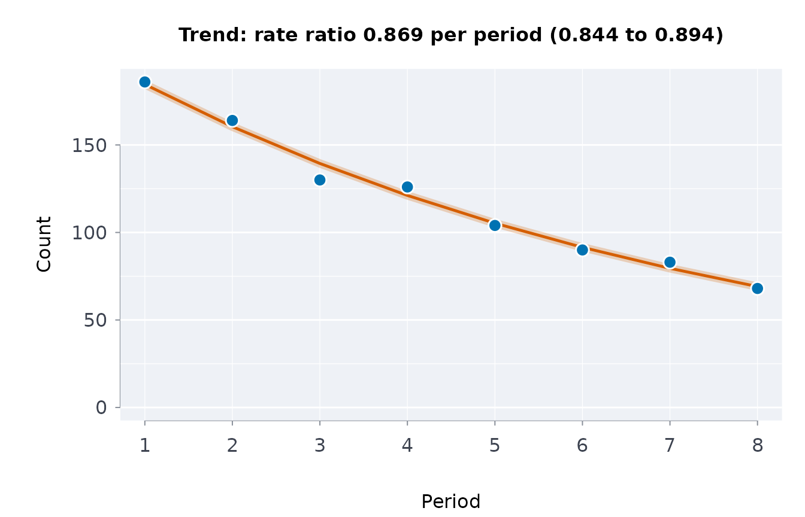

# Trends and change in short count series

A published series is usually short: five to ten annual counts. Three
questions recur. Is there a monotone trend? How fast is the count
changing per period? Did something change at one point? Each has a
method suited to short series, and each is wrong to answer with a
least-squares line on five points.

## A monotone trend: Mann–Kendall and Sen’s slope

The Mann–Kendall test counts, over all pairs of periods, how many later
values exceed earlier ones minus how many fall below. It is
distribution-free and exact for small *n*, so it is informative where a
regression’s standard error would be nearly meaningless. Sen’s slope is
the median of all pairwise slopes, a robust rate of change.

``` r

y <- c(402, 377, 190, 268, 331)        # five years of placements
trndtst(y)
#> $S
#> [1] -4
#> 
#> $tau
#> [1] -0.4
#> 
#> $p_value
#> [1] 0.4833333
#> 
#> $slope
#> [1] -21.375
#> 
#> $intercept
#> [1] 419.75
#> 
#> $slopelo
#> [1] -187
#> 
#> $slopeup
#> [1] 78
#> 
#> $slopecicla
#> [1] TRUE
#> 
#> $n
#> [1] 5
#> 
#> $var_S
#> [1] 16.66667
#> 
#> $alternative
#> [1] "two.sided"
#> 
#> $conflvl
#> [1] 0.95
#> 
#> $method
#> [1] "Mann-Kendall, exact over all 120 orderings"
```

A monotone series is detected even at *n* = 5:

``` r

trndtst(c(1, 2, 3, 4, 5))
#> $S
#> [1] 10
#> 
#> $tau
#> [1] 1
#> 
#> $p_value
#> [1] 0.01666667
#> 
#> $slope
#> [1] 1
#> 
#> $intercept
#> [1] 0
#> 
#> $slopelo
#> [1] 1
#> 
#> $slopeup
#> [1] 1
#> 
#> $slopecicla
#> [1] TRUE
#> 
#> $n
#> [1] 5
#> 
#> $var_S
#> [1] 16.66667
#> 
#> $alternative
#> [1] "two.sided"
#> 
#> $conflvl
#> [1] 0.95
#> 
#> $method
#> [1] "Mann-Kendall, exact over all 120 orderings"
```

One aberrant period does not create a trend:

``` r

trndtst(c(100, 100, 100, 100, 900))$p_value
#> [1] 0.4
```

From a data frame, with a direction when one is hypothesised in advance:

``` r

d <- data.frame(year = 2019:2023, n = y)
trndtst(d, value = "n", prd = "year")$slope
#> [1] -21.375
trndtst(d, value = "n", prd = "year", alt = "decreasing")$p_value
#> [1] 0.2416667
```

## The rate of change: a Poisson trend

For counts, the natural model is a Poisson log-linear trend:
`log E[y] = a + b * t`, so `exp(b)` is the **rate ratio per period**,
the multiplicative change from one period to the next.
[`cnttrnd()`](https://rootcoder007.github.io/rmorie-bricklayer/reference/cnttrnd.md)
fits it with an interval:

``` r

set.seed(3)
y <- stats::rpois(8, lambda = 200 * 0.85^(0:7))   # falling ~15% a year
fit <- cnttrnd(y)
round(fit$rateratio, 3)
#> [1] 0.869
```

With a varying denominator the trend is in the *rate*, via an offset:

``` r

cnttrnd(c(20, 25, 30), offset = c(1000, 1500, 2500))$rateratio
#> [1] 0.7708656
```

Counts here rise while the rate per 1,000 falls, which is the finding.

## A step change

A trend test asks “is it drifting?”; a step-change test asks “did it
jump once?”. The best single split point is found by maximising the
between-segment difference, and its significance is judged by
permutation, which accounts for having searched over every possible
split:

``` r

stepchg(c(100, 104, 98, 60, 63, 58))
#> $breakafter
#> [1] 3
#> 
#> $index
#> [1] 3
#> 
#> $before
#> [1] 100.6667
#> 
#> $after
#> [1] 60.33333
#> 
#> $difference
#> [1] -40.33333
#> 
#> $statistic
#> [1] 2440.167
#> 
#> $p_value
#> [1] 0.1
#> 
#> $nperm
#> [1] 720
#> 
#> $method
#> [1] "exact over all 720 orderings"
```

Pure noise still yields a best split, and it is not significant:

``` r

set.seed(2)
stepchg(stats::rnorm(12))$p_value
#> [1] 0.6223
```

## Two survey periods

Survey tables often give only two periods, each with its confidence
interval. The change between them has an interval of its own.
[`healchg()`](https://rootcoder007.github.io/rmorie-bricklayer/reference/healchg.md)
gives it for every group and indicator at once. It lists wellness
indicators first, reading change as Indigenous scholars of mental health
read it, as a process of healing (Stewart 2008). Perceived mental health
of adults, 2015/2018 and 2019/2022, by Statistics Canada (table
13-10-0924-01):

``` r

h <- indiex("health")
h <- h[h$age == "Total, 18 years and over" &
         h$indicator == "Perceived mental health, very good or excellent", ]
healchg(h, "group", "indicator", "period", "estimate", "lower", "upper",
               from = "2015/2018", to = "2019/2022", qual = "quality")
#>            group                                       indicator side from   to
#> 1  First Nations Perceived mental health, very good or excellent <NA> 59.8 45.8
#> 2          Métis Perceived mental health, very good or excellent <NA> 61.0 52.8
#> 3          Inuit Perceived mental health, very good or excellent <NA> 49.1 47.8
#> 4 Non-Indigenous Perceived mental health, very good or excellent <NA> 70.6 61.5
#>   change      lower      upper usewithcau
#> 1  -14.0 -17.687818 -10.312182      FALSE
#> 2   -8.2 -11.925923  -4.474077      FALSE
#> 3   -1.3  -9.974243   7.374243      FALSE
#> 4   -9.1  -9.702080  -8.497920      FALSE
```

## A pace, projected

Some counts accumulate toward a fixed number: the 94 Calls to Action of
the Truth and Reconciliation Commission, for instance.
[`trcprog()`](https://rootcoder007.github.io/rmorie-bricklayer/reference/trcprog.md)
takes the pace so far as a Poisson rate with its exact interval, and
gives the year all would be complete at that pace. That is a description
of the pace, not a forecast.

``` r

trcprog()
#>   completed remaining years     rate    ratelo   rateup   cmplby cmplbyearly
#> 1        13        81  7.04 1.846591 0.9832319 3.157727 2066.865    2048.651
#>   cmplbylate
#> 1   2105.381
```

## Choosing between them

| Question | Tool | Reports |
|----|----|----|
| Is the series moving in one direction? | [`trndtst()`](https://rootcoder007.github.io/rmorie-bricklayer/reference/trndtst.md) | Mann–Kendall p-value, Sen’s slope with interval |
| By what factor per period? | [`cnttrnd()`](https://rootcoder007.github.io/rmorie-bricklayer/reference/cnttrnd.md) | rate ratio with interval, optional offset |
| Did it change once, and when? | [`stepchg()`](https://rootcoder007.github.io/rmorie-bricklayer/reference/stepchg.md) | split point, segment means, permutation p-value |
| Year over year, with publication rounding | [`yoy()`](https://rootcoder007.github.io/rmorie-bricklayer/reference/yoy.md) (its own vignette) | exact intervals on each change |

All of them work on the five to ten values a published table gives, and
none of them assumes the counts are large.

## The trend in a picture

[`plot()`](https://rdrr.io/r/graphics/plot.default.html) draws the
counts with the fitted trend.

``` r

plot(fit)
```



## References

Mann (1945). Nonparametric tests against trend. *Econometrica* 13(3).
Kendall (1975). *Rank Correlation Methods*. 4th ed. Sen (1968).
Estimates of the regression coefficient based on Kendall’s tau. *JASA*
63(324).
